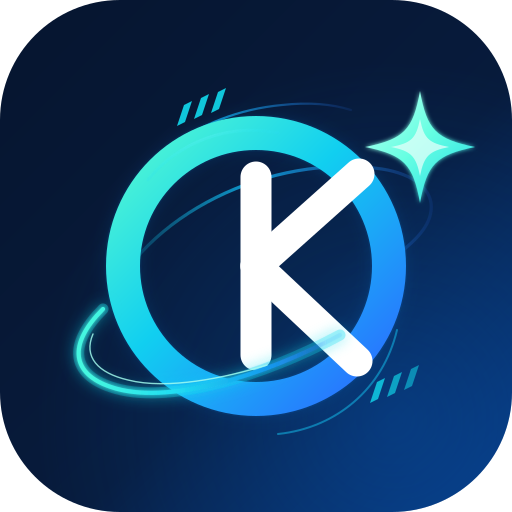

<div align="center">
  

  # OmniKit

  <p>A modular toolkit plugin for SiYuan Note</p>

  <p>
    <a href="https://github.com/Forgo7ten/siyuan-plugin-omnikit/releases"></a>
    <a href="https://b3log.org/siyuan/"></a>
  </p>

  <p>
    <b>English</b> • <a href="README.zh-CN.md">简体中文</a>
  </p>

  <p>
    <a href="#overview">Overview</a> •
    <a href="#features">Features</a> •
    <a href="#usage--settings">Usage & Settings</a> •
    <a href="#safety-mechanisms">Safety</a> •
    <a href="#installation">Installation</a> •
    <a href="#development">Development</a>
  </p>
</div>

---

# Overview

**OmniKit** is a modular toolkit plugin for [SiYuan Note](https://b3log.org/siyuan/) providing automatic hyperlink titles, image compression, and remote image localization. Each module operates independently and can be toggled on or off in the settings panel.

---

# Features

## 1. Titled Link

Asynchronously fetches webpage titles in the background and populates hyperlink anchor text when URLs are pasted in the editor.

- **Automatic Title Fetching**: When an `http://` or `https://` link is pasted into the editor, the plugin fetches the webpage in the background, extracts the `<title>`, and fills in the link anchor text.
- **Preserves Custom Text**: If the pasted content is a Markdown link with an existing title (e.g. `[title](url)`) or the link text has been manually edited, no modification is made.
- **Static File Link Detection**: Links pointing to common non-web files (such as `.pdf`, `.zip`, `.exe`, etc.) extract and decode filenames directly from the URL without making network requests.
- **Context Menu Actions**:
  - Right-click an individual link and choose `[OmniKit] Fetch link title` to manually trigger re-fetching;
  - Right-click a block icon and choose `[OmniKit] Fetch link titles (N)` to process all HTTP/HTTPS hyperlinks in the block.
- **Undo Support**: Title insertion is performed through SiYuan's native editor transaction and can be undone with `Ctrl+Z`.

## 2. Image Compressor & Localization

Converts images into WebP format and downloads remote image URLs into local workspace assets.

- **Automatic Compression for New Images**: Newly pasted or dropped images are compressed into WebP in the background. Can be configured to run globally or restricted to an allowlist of specific documents.
- **Manual Single Image Compression & Preview**:
  - Right-click an image in the editor and choose `[OmniKit] Compress this image` for immediate conversion;
  - Choose `[OmniKit] Compress…` to open a preview dialog where compression quality can be adjusted while comparing visual quality and file sizes, with options to save as an asset only or replace the document reference.
- **Document Batch Compression**: Right-click a document node in the file tree, on the document title bar (`[OmniKit] Compress all images in this document`), or select **Compress all images in this document** from the top-bar menu to process all images in the document.
- **Remote Image Localization**: Detects newly inserted external HTTP/HTTPS images in authorized documents and downloads them into the local `assets/` directory.
- **Records Dock & Reference Revert**:
  - Open the OmniKit Dock in the sidebar to view historical compression mappings and statuses;
  - Jump to and highlight corresponding image blocks in the editor;
  - Revert document references back to original images at any time.

---

# Usage & Settings

1. Click the OmniKit icon in the SiYuan top bar and select **OmniKit settings**;
2. Toggle individual feature modules on or off;
3. Available options:
   - **General**: console debug logging and shared network `User-Agent`;
   - **Image Compressor**: global automatic compression toggle, document allowlist, smart compression toggle (MS-SSIM adaptive search), target similarity, initial quality, and manual maximum edge limit;
   - **Titled Link**: fetch link titles on paste, sync hover title attribute (`data-title`), fallback to hostname on fetch failure, and maximum title length.

---

# Safety Mechanisms

- **Original Assets Preserved**: Converted WebP files are stored as new assets in `assets/`; the plugin does not physically delete original user files;
- **Zero Workspace Clutter**: No temporary log files, queue caches, or `.tmp` dump files are written to the workspace;
- **Pre-write Snapshot Verification**: Target blocks and nodes are verified before updating document references; conflicting concurrent edits abort safely without overwriting content.

---

# Installation

- **Marketplace (Recommended)**: In SiYuan Note, open **Settings -> Marketplace -> Plugins**, search for `OmniKit`, download and enable.
- **Manual Installation**: Download `package.zip` from the [Releases page](https://github.com/Forgo7ten/siyuan-plugin-omnikit/releases), extract into `data/plugins/siyuan-plugin-omnikit/` in your workspace, and restart SiYuan.

---

# Development

### Requirements
- Node.js >= 24.0.0
- pnpm >= 11.4.0
- SiYuan Note >= 3.8.4

### Commands
```bash
# Install dependencies
pnpm install

# Type-check and unit tests
pnpm check
pnpm test

# Build production bundle
pnpm build
```
