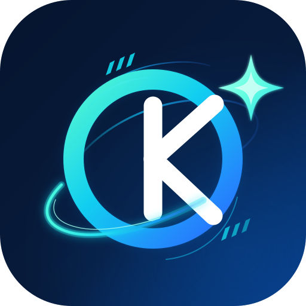

# OmniKit

<p></p>

A modular toolkit for SiYuan. Based on the official [plugin-sample](https://github.com/siyuan-note/plugin-sample) with a Vite + Svelte 5 UI overlay.

- **Plugin ID**: `siyuan-plugin-omnikit`
- **Minimum SiYuan**: 3.8.0; upload hook works on 3.8.4+
- **Global automatic image compression ON**: new image uploads in all documents
- **Global automatic image compression OFF**: new uploads in allowlisted documents only
- **Feature OFF**: no feature-specific menu items, listeners, or new jobs
- **Source i18n**: `src/i18n/en.json`, `src/i18n/zh-CN.json`

## Development

```bash
pnpm install
pnpm check
pnpm test
pnpm build
pnpm package:verify
```

The marketplace icon is generated from `assets/omnikit-plugin.svg` during each build. To install the build into a local SiYuan workspace, run `pnpm run install:workspace -- "/path/to/siyuan/workspace"`.

OmniKit provides a modular feature system and currently includes image compression, with settings and translations bundled in the plugin package.
