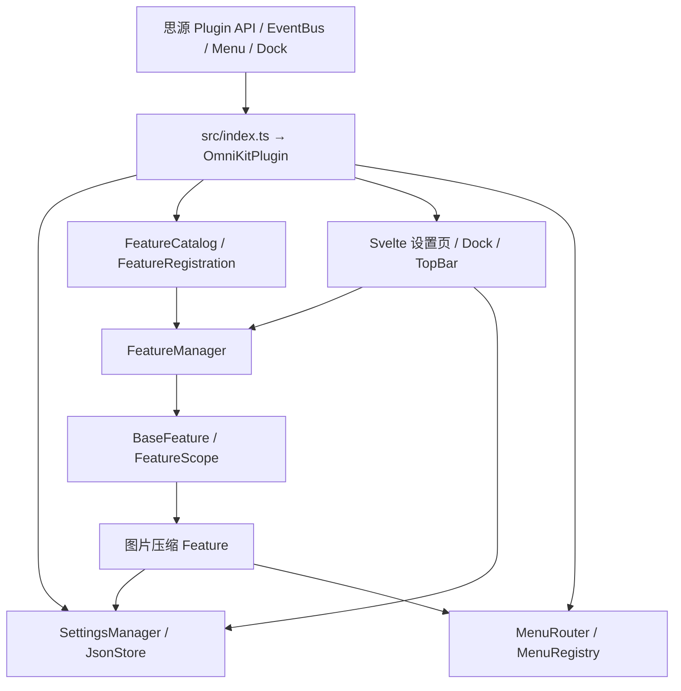

# OmniKit 架构与模块说明

OmniKit 是一个以 TypeScript、Vite 和 Svelte 5 构建的思源插件。`src/index.ts` 是唯一插件入口，导出 `OmniKitPlugin` 供思源加载。Vite 将入口打包为 `index.js`，提取 `index.css`，并把插件清单、README、国际化文件、图标和本地图片压缩 Worker 复制到发布包。

## 运行结构

| 目录 | 当前职责 |
| --- | --- |
| `src/index.ts` | 插件打包入口，导出 `OmniKitPlugin` |
| `src/core` | 插件宿主集成、Feature 注册与生命周期、设置存储、菜单路由、兼容性、平台判断和日志 |
| `src/features` | 各功能的业务实现、专属配置、服务、动作及设置面板；当前包含 `image-compressor` |
| `src/ui` | 通用 Svelte 设置外壳、Dock、TopBar 与 DOM 辅助代码；功能专属设置组件由 Feature 自己提供 |
| `src/i18n` | 英文与简体中文 JSON 翻译源文件，打包到 `dist/i18n` |
| `src/styles` | 插件全局 SCSS，由插件入口依赖链导入 |

## 核心与 Feature 的边界

`OmniKitPlugin` 在 `src/core/OmniKitPlugin.ts` 中连接思源宿主、配置、Feature 管理器、菜单和界面。唯一入口加载各 Feature 的注册描述；Feature 的业务实现不在插件入口内展开。

`FeatureRegistration<T>` 保存稳定元数据、默认启用状态、配置文件名与 codec、创建运行实例的工厂，以及归 Feature 所有的 Svelte 设置组件。`FeatureCatalog` 持有注册后的实例，`FeatureManager` 按 Feature 串行处理启停并暴露运行状态。通用设置界面根据注册描述展示各 Feature，不按具体 Feature ID 写分支。

每个 Feature 从 `BaseFeature` 派生，以 `FeatureScope` 持有运行期副作用。停用时先使 Scope 失效，再撤销该 Feature 的菜单贡献和事件监听并执行清理；失效的旧回调不能启动新业务。Scope 冻结不能跳过 `onDisable`。插件卸载时先冻结所有 Feature，再逐一清理；单个功能的清理失败不应阻止其他功能释放资源。启停操作按 Feature 串行，防止快速切换产生重复监听或并行初始化。

菜单通过 `MenuRouter` 将思源菜单事件路由到 `MenuRegistry`。注册项关联所属 Feature，只有仍在运行的 Feature 才能贡献菜单；回调执行时再次检查运行状态，以防菜单已打开后 Feature 被关闭。Dock 与 TopBar 属于核心入口，即使所有 Feature 停用仍保持可用。设置面板通过 Svelte 5 `mount`/`unmount` 管理组件生命周期，并在关闭时释放订阅和 DOM 资源。

## 配置存储

`SettingsManager` 将通用设置与 Feature 数据分开保存：核心文件 `omnikit-core.json` 仅包含通用选项和各 Feature 的启用状态，每个 Feature 使用自己的 `feature-*.json` 保存业务配置。增加 Feature 时提供自己的默认值、codec 和文件名，不把该 Feature 的字段加入核心 schema。

`JsonStore` 负责解析、验证、订阅和写入。首次缺少配置时使用内存默认值，不因加载或打开设置页而创建文件；相同值更新不写盘，每个文件的更新串行执行。无效或损坏的 JSON 不得被默认值覆盖，恢复写入前需要通过备份流程保护原始内容。外部数据变更通过 `onDataChanged` 重新加载并通知运行时，不把重新加载的数据写回。

核心启用偏好与运行状态不是同一个值：启用失败会显示错误状态，但不擅自改写用户保存的偏好。运行状态切换与保存失败需要补偿，使运行资源与已保存偏好保持一致。

当前配置只支持现行 schema，不迁移旧版 OmniKit 配置，也不主动删除旧配置文件。SiYuan 独立设置窗口能力目前未启用；未来若多个插件实例同时编辑同一 JSON 文件，`onDataChanged` 只负责刷新，不构成跨实例写锁，也不承诺解决并发写冲突。

## 图片压缩规则

当前图片 Feature 位于 `src/features/image-compressor`，设置、白名单、图片处理服务和设置面板均归该 Feature 管理。自动压缩策略如下：

| Feature | 全局自动压缩 | 当前文档在白名单 | 后续合规编辑器上传 |
| --- | --- | --- | --- |
| 关闭 | 任意 | 任意 | 不处理 |
| 开启 | 开启 | 否或是 | 处理 |
| 开启 | 关闭 | 是 | 处理 |
| 开启 | 关闭 | 否 | 不处理 |

自动上传只处理编辑器上传事件。`before-upload-assets` 能力按思源版本和事件形状检测；不支持或无法可靠识别目标时跳过。事件的 `respondWith` 必须在处理器的同步调用栈内注册，异步压缩完成后仍按原文件序列返回；宿主取消或处理失败时返回原始有序文件批次。

白名单以文档 `rootID` 标识，不因改名或移动而改变授权。全局开关和 Feature 总开关不清空白名单；Feature 停用时则停止该功能的监听和任务。文档树菜单只对单个文档提供操作，不对多选或笔记本节点猜测目标。

### 图片 Feature 子模块

| 模块 | 职责与调用边界 |
| --- | --- |
| `ImageCompressorFeature` | 组合 Feature 生命周期：注册菜单、上传监听、任务和设置变更响应；通过 `FeatureScope` 管理运行期资源。 |
| `AutoUploadHandler` / `AutoPolicy` | Handler 校验宿主上传事件并同步调用 `respondWith`，再异步处理有序文件批次；纯策略函数根据 Feature 开关、全局开关、白名单与宿主能力决定是否压缩。 |
| `ImageCompressorService` / `ImageEligibility` | Service 使用本地 Worker 执行压缩；Eligibility 先按路径和 MIME 筛选，再验证文件签名、大小及替换收益。UI 和菜单不直接处理压缩算法。 |
| `PageAllowlist` | 以文档 `rootID` 读写 Feature 配置中的授权名单；菜单入口只提供文档身份，不复制另一份授权状态。 |
| `SingleImageAction` / `DocumentBatchAction` | 单图动作只处理用户指向的图片引用；批量动作遍历当前编辑器内的图片并回报进度和结果，不扫描其他文档。两者调用 Service 获取新图片，并把引用修改委托给块更新层。 |
| `AssetRepository` / `BlockImageRewriter` | Repository 通过思源 API 上传新资源和读取/更新块 DOM；Rewriter 重新读取、校验目标图片引用后至多更新一次，并报告冲突。新资源上传和块引用更新分开处理，Repository 不覆盖或删除原资源。 |
| `TaskRegistry` | 为上传、单图和批量任务创建可取消控制器；Feature 停用或插件卸载时中止仍在运行的任务。 |
| `ImageSettingsPanel.svelte` | 展示并编辑 Feature 配置、全局自动压缩与白名单；通过传入的 `JsonStore` 和组件回调访问数据，不拥有业务执行或 Feature 生命周期。 |

## 笔记数据与资源安全

图片处理失败、压缩结果不值得替换或引用无法精确确认时，保留原图并跳过替换。块更新只改动确认属于目标图片的引用，不进行模糊字符串替换；批量操作限定在当前文档范围，不自动扫描并重写整个工作区，也不自动删除原始资源。去重状态只用于当前任务。

压缩 Worker 由 `browser-image-compression` 依赖提供，并作为本地资源打包，避免运行时依赖外网。支持的图片类型、尺寸和压缩参数由 Feature 配置与处理逻辑共同校验；不适合处理的格式按规则跳过。

当前提供单图压缩和当前文档范围的批量处理入口；批量操作不扩展到整个工作区。WebP、GIF、SVG 和 Excalidraw 等不适合处理的图片按默认策略跳过。块更新前会重新读取并校验目标引用，但思源接口不提供 compare-and-swap（CAS）原子更新；检测到冲突时停止更新，不承诺消除读取与写入之间的并发窗口。

## 新增 Feature

新增功能时在 `src/features/<feature-name>` 内实现业务类、类型化配置及 codec、默认值、注册描述和专属设置组件；将注册项加入 `src/core/OmniKitPlugin.ts` 的注册列表，并在 `src/i18n/en.json` 和 `src/i18n/zh-CN.json` 添加对应翻译。`src/index.ts` 只负责导出插件入口，不是 Feature 注册表。用测试覆盖用户可观察行为和生命周期边界。只有新增的能力确实跨多个 Feature 通用时才扩展 Core；单一 Feature 的业务设置和菜单行为由它自己管理。
