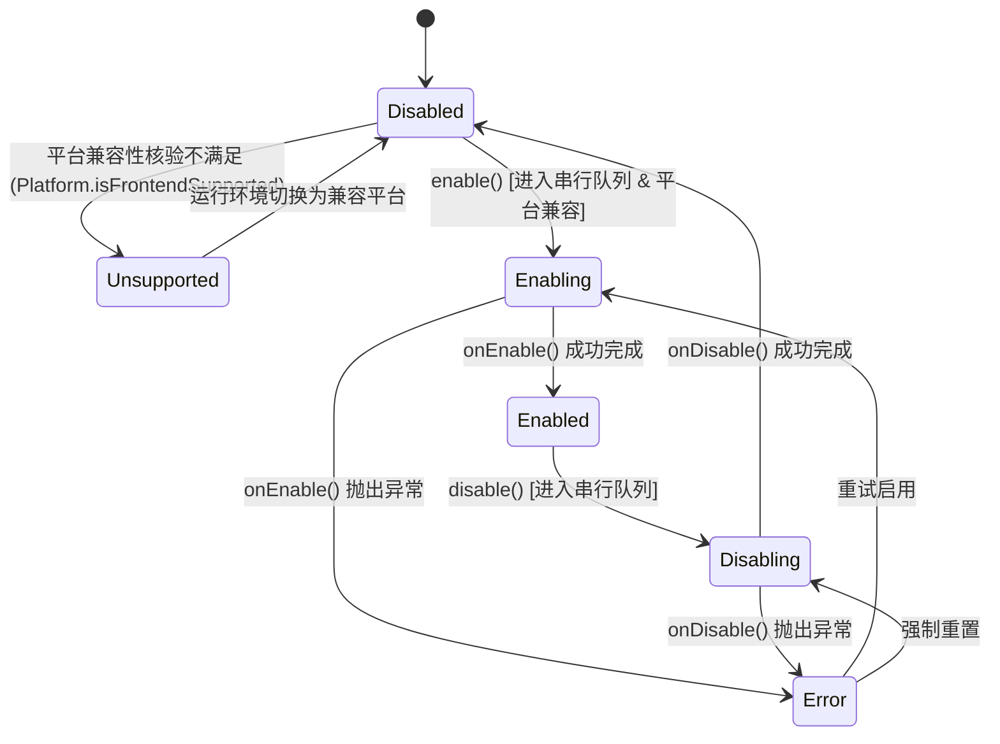
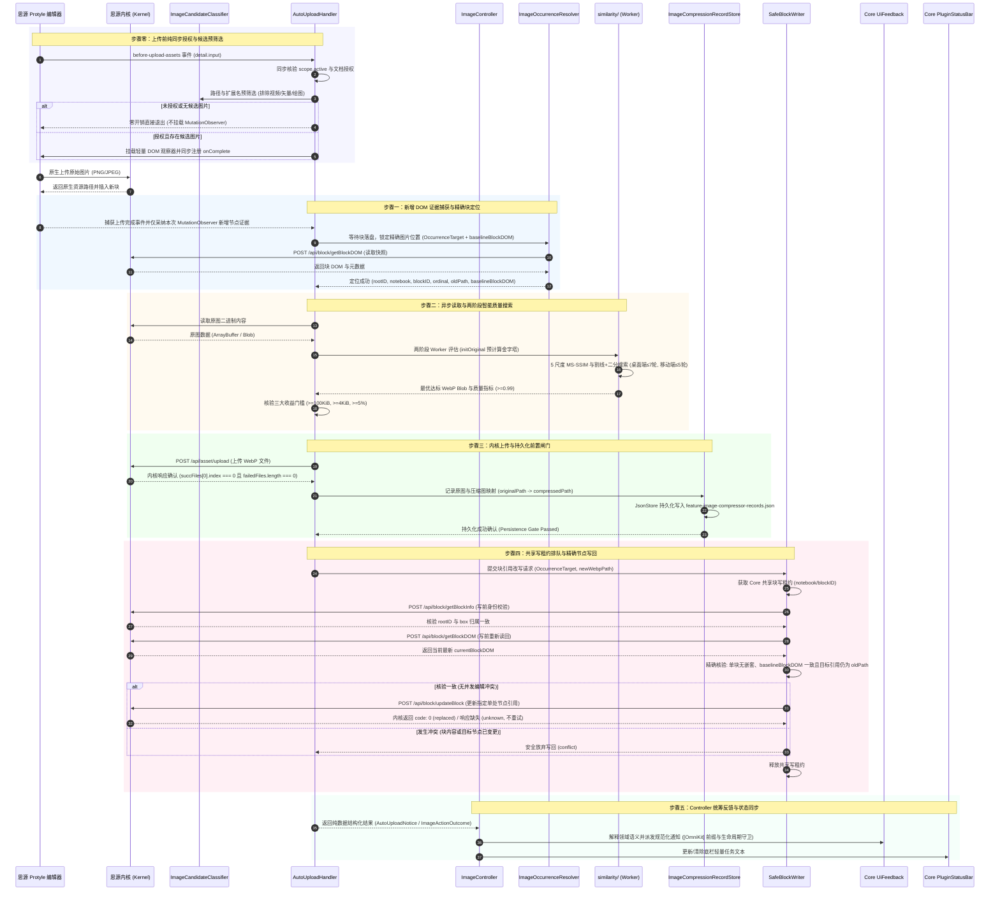
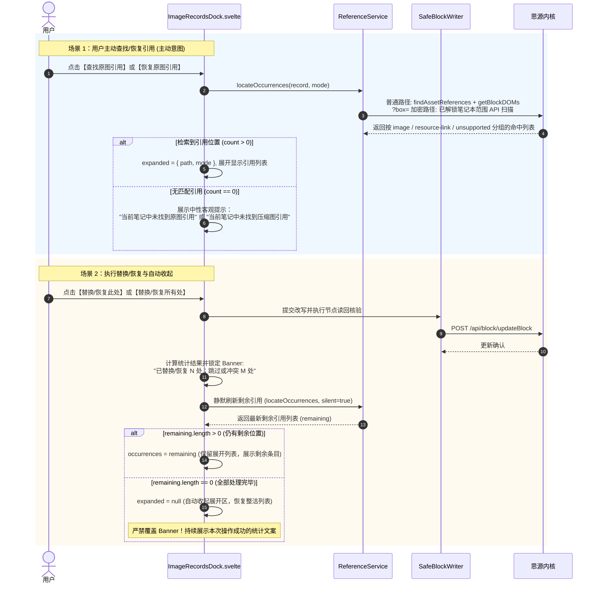
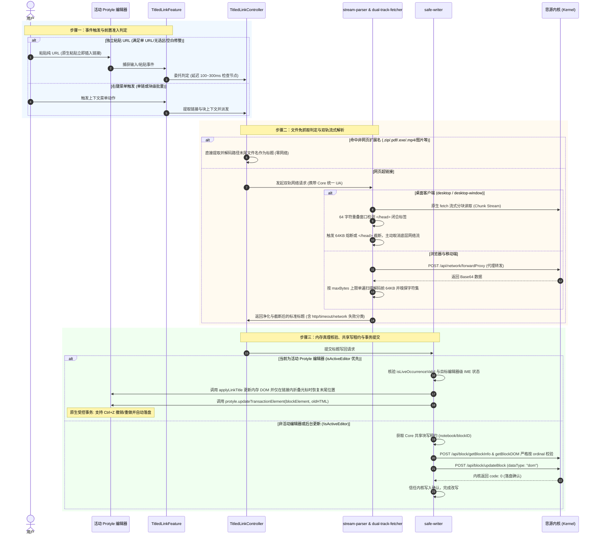
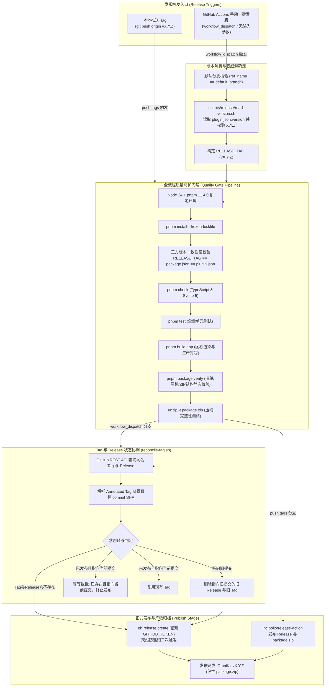

# OmniKit · 系统架构与技术实现设计文档 (ARCHITECTURE)

> **版本**：v1.0（正式发布稿）  
> **状态**：正式发布（Approved）  
> **设计基准**：严格遵循 [AGENTS.md](../AGENTS.md)、[CORE-PRD.md](CORE-PRD.md)、[image-compressor](features/image-compressor/PRD.md) 及 [titled-link](features/titled-link/PRD.md)（各特性严格维护独立的 `PRD.md` 与 `DESIGN.md`）  
> **源码基线**：`Forgo7ten/siyuan-plugin-omnikit` (`feat-image-compressor`)

---

## 1. 架构概览与技术栈

OmniKit 是基于现代前端与思源笔记插件生态构建的高效、高可靠多合一工具箱扩展平台。

### 1.1 技术栈选型
- **编程语言**：TypeScript 5.x（启用 `strict: true`、严格类型检查与安全泛型约束）
- **构建工具**：Vite 5.x（多输出配置：主入口打包为 `index.js`、样式整合为 `index.css`、资源静态复制）
- **UI 组件框架**：Svelte 5（基于 Runes 响应式体系，通过 `mount` 与 `unmount` 精确控制生命周期）
- **样式体系**：SCSS（模块化样式组织，继承思源原生 CSS 变量自适应浅色/深色主题）
- **宿主环境**：思源笔记核心（Protyle 编辑器引擎、REST Kernel API、EventBus、Protyle Upload 流程）

### 1.2 核心设计哲学
1. **微内核与单向依赖**：Core 平台层不感知具体 Feature 的内部实现，所有功能通过元数据驱动注入；
2. **多实例与环境防护**：针对思源独立设置窗口（`body--settings`）进行无副作用纯渲染隔离；
3. **确定性存储体系**：单文件 Promise 串行队列、内存缓存指纹跳写、思源原生 `/api/file/getFile` 与 `saveData` 持久化及配置/数据物理隔离；
4. **防御性块级改写**：写前基于 `OccurrenceTarget` 进行精确节点读回核验、采用进程内写租约（Write Lease）与持久化前置闸门；
5. **可重现与确定性工程体系**：统一工程脚本体系、全自动化质量门禁与多入口幂等发版闭环。

---

## 2. 系统分层架构

OmniKit 划分为清晰的“宿主适配层”、“Core 平台基础设施层”与“Feature 业务特性层”三层架构：

```mermaid
flowchart TD
    subgraph Host["宿主环境 (SiYuan Note)"]
        H_API["Kernel REST API (/api/...)"]
        H_Event["EventBus / Protyle Lifecycle"]
        H_UI["Host Dock / Context Menu / TopBar"]
    end

    subgraph Core["OmniKit Core 平台层 (src/core/ & src/ui/)"]
        PluginEntry["OmniKitPlugin (插件主入口)"]
        Catalog["FeatureCatalog (元数据仓库 & frontends 契约)"]
        Manager["FeatureManager (平台兼容设防与串行状态机)"]
        Scope["FeatureScope (AbortSignal & 资源作用域)"]
        
        subgraph CoreInfra["基础设施与驱动"]
            KernelClient["KernelClient (安全 API 调用门面)"]
            BlockWriteLease["BlockWriteLease (跨 Feature 共享块写租约)"]
            CoreHelpers["describeError / TaskId / ProtectedSelectors"]
            ProtyleAdapter["ProtyleAdapter (宿主数据标准提取器)"]
            SettingsMgr["SettingsManager (多文件配置协调器)"]
            JsonStore["JsonStore (单文件串行队列/指纹跳写/容灾)"]
            Logger["Logger (动态等级日志)"]
            Platform["Platform (环境探测 & IsTargetSupported 判定)"]
        end
        
        subgraph CoreUI["统一宿主 UI 容器"]
            UnifiedDock["UnifiedDock (单槽位 Tab 容器)"]
            SettingsShell["SettingsRoot.svelte (iPad 双栏联动面板)"]
            MenuRouter["MenuRouter & MenuRegistry (通用上下文转换与 Matcher 路由)"]
            FeedbackService["UiFeedback (统一交互/前缀/防抖/静默)"]
            StatusBar["PluginStatusBar (单例底栏状态栏)"]
        end
    end

    subgraph Features["Feature 业务特性层 (src/features/)"]
        subgraph ImgCompressor["image-compressor (图片压缩特性)"]
            FeatImage["ImageCompressorFeature"]
            ImgController["ImageController (业务编排门面)"]
            Classifier["ImageCandidateClassifier (统一准入/视频/Excalidraw)"]
            AutoUpload["AutoUploadHandler (上传完成异步捕获)"]
            RemoteWatcher["RemoteImageWatcher (外链安全本地化)"]
            SafeWriter["SafeBlockWriter (写租约与 Occurrence 节点改写)"]
            WorkerCodec["BicEncoder (WebP 编解码引擎)"]
            SimilarityDomain["similarity/ (5尺度MS-SSIM/自适应搜索/内联Worker)"]
            RecordStore["ImageCompressionRecordStore (Dock 业务数据持久化)"]
            DockView["ImageRecordsDock.svelte (Tab 视图组件)"]
            SettingsView["ImageSettingsPanel.svelte (设置卡片组件)"]
        end

        subgraph TitledLink["titled-link (自动标题链接特性)"]
            FeatTitledLink["TitledLinkFeature"]
            TitledLinkController["TitledLinkController (业务编排门面)"]
            DualFetcher["dual-track-fetcher (桌面 fetch / 代理 forwardProxy)"]
            StreamParser["stream-parser (</head>/64KB 流式截断 & 编码嗅探)"]
            SafeWriterTL["safe-writer (写前核验与事务提交)"]
            TitleCache["TitleCache (短期内存 LRU 缓存)"]
            TitledLinkSettingsView["TitledLinkSettingsPanel.svelte (设置组件)"]
        end
        
        subgraph FutureFeatures["未来扩展特性..."]
            FeatX["Feature X (独立业务逻辑与数据)"]
        end
    end

    %% 依赖与交互调用链
    Host <--> PluginEntry
    PluginEntry --> Catalog
    PluginEntry --> Manager
    PluginEntry --> SettingsMgr
    PluginEntry --> UnifiedDock
    PluginEntry --> MenuRouter
    PluginEntry --> StatusBar

    Manager --> Scope
    Manager --> FeatImage
    Manager --> FeatTitledLink
    Manager --> FeatX

    FeatImage --> ImgController
    ImgController --> Classifier
    ImgController --> AutoUpload
    ImgController --> RemoteWatcher
    ImgController --> SafeWriter
    ImgController --> WorkerCodec
    ImgController --> SimilarityDomain
    ImgController --> RecordStore
    ImgController --> FeedbackService
    ImgController --> StatusBar

    FeatTitledLink --> TitledLinkController
    TitledLinkController --> DualFetcher
    TitledLinkController --> StreamParser
    TitledLinkController --> SafeWriterTL
    TitledLinkController --> TitleCache
    DualFetcher --> KernelClient
    SafeWriterTL --> KernelClient
    SafeWriterTL --> BlockWriteLease
    
    SafeWriter --> KernelClient
    SafeWriter --> BlockWriteLease
    AutoUpload --> KernelClient
    RemoteWatcher --> KernelClient
    KernelClient --> H_API

    RecordStore --> JsonStore
    SettingsMgr --> JsonStore
    JsonStore --> H_API

    UnifiedDock -.-> DockView
    SettingsShell -.-> SettingsView
    SettingsShell -.-> TitledLinkSettingsView
    MenuRouter --> H_UI
```



---

## 3. Core 平台核心设计与类职责

### 3.1 `OmniKitPlugin` (宿主集成与多窗口守卫)
- **文件位置**：`src/core/OmniKitPlugin.ts`
- **主要职责**：
  - 继承思源官方 `Plugin`，作为思源加载的唯一物理入口；
  - **多窗口隔离识别**：通过 `document.body.classList.contains("body--settings")` 识别独立设置窗口。在设置窗口中仅挂载 Svelte 设置界面与 Store（`onload()` 阶段仅预热实例与存储，不自动弹窗；设置对话框统一由 `openSetting()` 打开），配置开启且受支持的特性状态反映为 `runtime.configured`，不启动后台监听、MenuRouter 或 Dock；
  - **生命周期与外部数据同步**：监听宿主 `onload`、`onunload`、`onLayoutReady` 以及跨窗口配置广播 `onDataChanged`。收到 `onDataChanged` 时等待 `ready` 就绪后，在主窗口按顺序执行：先遍历已注册 Feature 调用可选 `reloadData(this)`（如 `imageCompressor` 仅对已初始化的记录存储执行增量重载），再调用 `SettingsManager.reloadAfterExternalChange()` 协调启停与参数变更，最后刷新 Dock 视图；在 `body--settings` 窗口则同步外部配置变更；
  - **顶栏与下拉菜单装配**：统筹注册 Core Dock 单槽位、TopBar 图标与设置对话框；构建顶栏下拉菜单时严格按分层组织：顶部 Core 平台项（「OmniKit 设置」） + 调用思源原生 `menu.addSeparator({ id: "separator_settings" })` 物理分隔线 + 各 Feature 业务选项（Dock 栏已有常驻入口，顶栏不设立重复且无控的打开 Dock 选项）。

### 3.2 `FeatureCatalog` 与 `FeatureManager` (生命周期与状态机)
- **文件位置**：`src/core/framework/FeatureCatalog.ts`、`src/core/framework/FeatureManager.ts`
- **主要职责**：
  - `FeatureCatalog` 集中持有所有 Feature 的声明式元数据（`FeatureRegistration<T>`），包含 `id`、`defaultEnabled`、支持端声明 `frontends` 以及可选的跨端/外部数据同步钩子 `reloadData?: (plugin: Plugin) => Promise<void>`，对外暴露只读索引与存储文件命名合法性校验；
  - `FeatureManager` 维护每个 Feature 的严格串行化启停队列（Promise Queue），提供跨端安全的生命周期调度；当宿主广播 `onDataChanged` 或发生外部数据文件写同步时，Core 统筹调用已激活 Feature 的 `reloadData` 钩子，由 Feature 自身刷新内存中缓存的业务记录或视图索引；
  - **六状态机模型 (`FeaturePhase`)**：
    - `disabled`：未激活停用状态；
    - `unsupported`：宿主前端平台不兼容状态；
    - `enabling`：正在分配 Scope 与执行异步初始化；
    - `enabled`：已成功激活并正常运行；
    - `disabling`：正在广播中止信号与安全注销资源；
    - `error`：启停或执行遭遇未捕获异常；



  - **平台兼容性设防与云同步偏好保护 (Platform Compatibility Guard)**：
    1. **启动与热重载设防**：在 `initialize()` 与 `reconcileFromLoadedSettings()` 阶段，`FeatureManager` 调用 `Platform.isFrontendSupported(feature.frontends)` 核验当前运行环境。若环境不支持，立即跳过生命周期激活（不调用 `feature.activate()` 与 `onEnable()`，不分配 `FeatureScope`，不占用任何常驻定时器、DOM 节点或事件总线），将运行时状态置为 `"unsupported"`；
    2. **`setEnabled` 安全拦截机制**：当外界或 API 尝试显式调用 `setEnabled(id, true)` 或 `enable(id)` 时，若当前平台不支持该功能，`FeatureManager` 直接拒绝状态变更（返回 `false`），且**绝对不调用 `settings.setFeatureEnabled(id, true)`**；
    3. **跨端同步状态保全**：严格保护底层 `omnikit-core.json` 中用户的期望启用偏好。在多端云同步架构中，轻量端（如移动端）因平台受限进入 `unsupported` 状态绝不反向冲刷用户的开启偏好，确保在主力设备（如桌面端）上始终维持预期的开启状态；
  - 当 Feature 启动失败时，置状态为 `error` 并记录异常，保持用户在 `omnikit-core.json` 中配置的期望偏好不变。

### 3.3 `BaseFeature` 与 `FeatureScope` (资源作用域与中止信号)
- **文件位置**：`src/core/framework/BaseFeature.ts`、`src/core/framework/FeatureScope.ts`
- **主要职责**：
  - 每个业务功能继承 `BaseFeature`，激活时由 `BaseFeature.activate()` 创建当前激活专属的 `FeatureScope`，并将 `feedback` 通过 `feedback.forScope(scope)` 绑定至上下文；停用时 `deactivate()` 清除错误状态并执行 `onDisable()` 完成清理；
  - `FeatureScope` 原生封装 `AbortController`：
    - `scope.own(disposer)`：注册所有运行期副作用（Protyle 事件监听器、DOM 钩子、定时器）；统一由 `FeatureScope` 集中托管与自动注销；
    - `scope.signal`：向下传递的只读 `AbortSignal`；
    - `scope.guard(fn)`：包装异步回调，若 Scope 已销毁则直接短路，防止失效的幽灵回调执行；
  - **任务取消边界与静默退出设计**：
    - 平台不设通用取消按钮、取消菜单或公开取消 API；文档标签页切换或编辑器关闭不中止已启动的后台异步任务（任务沿用启动时捕获的 `rootID` 与 `notebook`，写前通过内核 API 核验实时状态）；
    - Feature 自有进度 Dialog 的用户关闭行为（含按 Esc）遵循对应特性 PRD 语义，控制器因完成、空结果或前置失败程序化关闭弹窗仅销毁 UI，不记为用户取消；
    - 当 Feature 停用、插件卸载、宿主退出或特性允许的进度弹窗用户关闭触发 `signal.abort` 时，异步任务安全中止未开始步骤并静默退出，保留已确认产物与记录，不执行逆向回滚，重启不续跑；
    - 底层写回层对发出写请求前的中止返回 `"aborted"` 或抛出 `AbortError`，对已发出 `/api/block/updateBlock` 后响应超时、断连或中止的结果归类为 `"unknown"`（严禁自动重试），严禁与真实基线不匹配导致的 `"conflict"` 混为一谈；
  - 当 Feature 停用或插件卸载时，`scope.dispose()` **首先广播 `abort` 信号**通知所有在途任务安全终止，再按后进先出（LIFO）顺序释放所有监听器。

### 3.4 `SettingsManager` 与 `JsonStore` (确定性存储体系)
- **文件位置**：`src/core/store/SettingsManager.ts`、`src/core/store/JsonStore.ts`
- **核心机制**：
  - **精简存储模型与每文件独占 Promise 队列**：基于单文件 Promise 串行队列调度所有读写操作，配合 `/api/file/getFile` 读取与 `Plugin.saveData` 持久化，杜绝写竞争；
  - **内容指纹防抖**：内存维护序列化指纹（`fingerprint`），相同数据重复保存自动跳过实际磁盘 I/O；
  - **读写双路径 30 秒超时保护与不重试契约**：对 `/api/file/getFile` 读路径与 `saveConfirmed` 调用 `plugin.saveData` 的写路径均实施 30 秒超时保护；写入超时后直接抛出错误且不执行重试，防止宿主异步 API 永久挂起冻结单文件串行队列；
  - **安全读取、缺失边界与只读状态契约**：调用思源内核 `/api/file/getFile` 读取配置文件，且读取失败时严禁降级回退宿主 `Plugin.loadData()` 的空缓存：
    - **唯一缺失判定**：仅当 `/api/file/getFile` 返回 HTTP `202` 且思源返回体 `code === 404` 时，确认为文件不存在，返回 `defaults()` 并允许初始化；
    - **HTTP 200 空串与损坏只读保护**：当 HTTP `200` 返回空串、全空白内容或存在 JSON 语法损坏时，进入 `needsRecovery` 只读保护状态并保留真实 `rawToBackup`（含空串）；仅对非空损坏物理字节生成 `.backup` 容灾备份并提示用户显式恢复，严禁使用默认值覆盖；
    - **网络/超时/非缺失 HTTP 错保护**：遭遇网络错误、30 秒超时、HTTP 403/404/500 或其他非 `202 + code: 404` 错误时，直接进入 `needsRecovery` 只读保护模式（暴露 `readOnlyReason` 并保留上一次内存有效数据），严禁回退 `loadData()` 空缓存或使用默认值覆盖持久化文件；
  - **跨窗口写入语义**：`omnikit-core.json` 在多窗口并发修改场景下采用 last-writer-wins 持久化语义，并结合 `onDataChanged` 同步最新落盘配置；
  - **并发加载与容错重载**：`SettingsManager.load()` 采用 `Promise.allSettled` 并发加载全部存储并记录所有读取失败，仅将失败 Store 保持为只读保护状态，不中断插件初始化，确保恢复入口可达；`reloadAfterExternalChange()` 采用 `Promise.allSettled` 并发重载各 Store，确保单个 Store 异常不阻塞其余 Store 与宿主 `onDataChanged`，并按固定顺序返回变更列表。

### 3.5 `KernelClient` 与 Core 共享基础设施
- **`KernelClient` (`src/core/host/KernelClient.ts`)**：
  - 封装对思源内核 `/api/...` 的网络交互，支持调用方传入 `AbortSignal` 与自定义超时；超时定时器不仅拒绝当前 Promise，同时显式调用底层 `fetch` 的 `AbortController.abort()` 释放网络套接字连接；
  - 自动归一化处理思源错误码（`code !== 0`），统一包装为结构化 `KernelRequestError`，避免对非幂等修改请求静默重试；
- **共享块写租约 (`BlockWriteLease`)**：
  - 由 Core 统一提供按 `notebook/blockID` 隔离的进程内串行写租约队列，供 `imageCompressor` 与 `titled-link` 共用，防止跨 Feature 同块并发写入交织；
  - 支持排队期间响应 `AbortSignal` 立即退出并在进入临界区时二次校验中止；明确思源 `/api/block/updateBlock` 无内核原子 CAS，写前仍须执行块身份与完整 DOM 快照核验；
- **统一结构化错误描述 (`describeError`)**：
  - 提取 `Error.message` 或思源 `{ code, msg }` 错误响应对象（格式化输出 `msg` 与错误码），防止界面或日志出现 `[object Object]`；
- **公共受保护 DOM 容器选择器常量**：
  - 由 Core 统一导出受保护容器选择器常量（如 `[data-type="NodeBlockQueryEmbed"]`、`.protyle-wysiwyg__embed`、`pre`、`code`、`script`、`style`、`[data-type="NodeCodeBlock"]`），供各 Feature 统一复用；
- **`Platform` 单一权威来源与五端清单**：
  - 插件 `plugin.json` 的 `frontends` 覆盖全部五端（`desktop`、`desktop-window`、`mobile`、`browser-desktop`、`browser-mobile`），宿主清单元数据闸门优先；Core `Platform` 作为插件内前端探测与 `isFrontendSupported` 判定的唯一权威来源。

### 3.6 统一 UI 扩展系统
- **统一 Dock 容器** (`src/ui/dock/`)：
  - 仅占用思源侧边栏 **1 个图标位置**；
  - 内部实现 Svelte 5 驱动的 Tab 路由管理器：当多个 Feature 启用 Dock 视图时展示 Tab 头；仅单个 Feature 启用时独占主视图；全停用时呈现空状态指引；
  - **视图渲染缓存与状态保全**：`registerDock` 维护持久化容器节点（标题、`tabsHost`、`viewHost`、底部按钮）及 `mountedID` / `mountedComponent` / `lastTabsSignature` 缓存；当相同视图保持激活时复用已有 Svelte 实例并仅原地更新标题、Tab 列表与按钮文案，仅在全部停用或切换 Tab/组件时同步执行 `unmount`；
  - **视图与 Dock 组件生命周期 Abort 机制**：Dock 视图组件持有专用的 `AbortController`；当组件卸载、Dock 折叠或 Tab 切换销毁时，立即广播中断信号，取消在途的后台引用检索与状态核验；
  - **平台兼容性排除**：Dock 动态视图提取函数（`views()`）严格筛选 `this.manager?.isRunning(id)` 的 Feature。处于 `unsupported` 状态的功能不被视作运行中，自动排除在 Dock Tab 之外，不产生多余标签页与空 DOM 挂载；
  - **Dock 顶部视觉与防遮挡规范 (Brand Hero Card)**：
    - 在 Dock 视图顶部常驻渲染约 52px~56px 高度的品牌展示区，包含 OmniKit 图标、粗体大标题（如「OmniKit / 图片记录」）与轻量模式徽章，背景采用思源原生主题微渐变浅背景（`var(--b3-theme-primary)` 8% 透明度）；
    - **几何防遮挡下移 (50px+)**：使下方操作栏（刷新记录、搜索筛选等按钮）整体平滑下移 50px 以上，彻底避开思源桌面端（Windows）及网页端右上角 32px 浮动 Snackbar 消息层（`#message` / `.b3-snackbars`）与 Tooltip 浮层的绝对遮挡，保障交互区域无遮挡点击；
    - **静默刷新防覆盖铁律 (Anti-Overwriting Guard)**：Dock 在改写操作后执行的后续静默刷新（`post_action`）若遇异常或返回空结果，绝对禁止冲刷或覆盖本次操作产生的成功统计文案；当待处理项降为 0 时必须干净收起抽屉并保留成功统计，杜绝悬挂假性“未找到引用”；
  - 依托 Svelte 5 `mount` / `unmount` 精准控制各 Feature 视图的装载与卸载。
- **局域网 HTTP 环境与无 WebCrypto 兼容规范**：
  - 在局域网非 HTTPS（`window.isSecureContext === false`）环境下，剪贴板 API 与 `crypto.randomUUID()` / `crypto.subtle` 受限；
  - 统一交互层在调用 `navigator.clipboard.writeText` 失败或未受支持时，安全回退为弹出包含可复制文本框的模态提示，确保全网络环境可用；Core 提供进程内时间戳与单调自增序列构成的运行时任务 ID 生成器，不依赖 `crypto.randomUUID()`。
- **统一设置面板 (`SettingsRoot.svelte`)** (`src/ui/settings/`)：
  - 采用 iPad 风格双栏联动布局（左侧导航分组 + 右侧单页平滑滚动卡片）；
  - **`User-Agent` 草稿脏状态保护与重置边界**：`general.userAgent` 输入框维护 `uaDirty` 标志，外部同步通知不覆盖正在编辑或已脏草稿；各 Feature 设置卡片重置按钮文案为**“设为默认值（未保存）”**（`settings.resetDraft`），仅重置当前未保存草稿而不直接写入持久化文件；并发保存冲突判定使用稳定错误类型或错误码，不依赖本地化文案子串匹配；
  - **平台兼容性设防架构 (方案 A：卡片保持展示，总开关置灰禁用，专属设置可预先调整)**：
    - 针对 `runtime.status === "unsupported"` 的 Feature，设置卡片在右侧正常排布渲染，左侧导航正常提供平滑定位，维持全端 UI 结构与视觉一致性；
    - **总开关置灰禁用（Disabled Guard）**：卡片头部总开关设置 `disabled` 属性置灰禁用，不可点击切换，彻底阻止非法生命周期触发；
    - **状态 Badge 与平台说明**：卡片顶部 Badge 渲染 `runtime.unsupported`（「当前平台暂不支持」），并展示友好的支持平台列表说明（如“仅支持：桌面端、桌面窗口”）；
    - **专属设置项允许预调**：卡片主体内的专属设置组件（`settingsView`）保持挂载并允许交互调整，满足跨端云同步场景下提前配置参数的诉求；修改保存仅局限于其专属配置文件 `feature-{id}-settings.json`，绝对不触碰 `omnikit-core.json`；
- **统一菜单路由器 (`MenuRouter` / `MenuRegistry`)** (`src/core/feedback/MenuRouter.ts` / `src/core/feedback/MenuRegistry.ts`)：
  - **通用上下文转换与业务解耦架构**：
    - `MenuRouter` 作为通用的宿主事件到上下文转换层，集中监听思源 EventBus 上下文菜单事件（`click-blockicon`、`open-menu-doctree`、`open-menu-link` 等）；
    - **通用上下文提取**：`MenuRouter` 仅负责从原生 detail 中提取标准通用上下文（例如 `selectedDocumentIDs: string[]`、`selectedDocumentCount: number`、`protyle?: IProtyle`、`targetElement?: HTMLElement` 等）；在 `open-menu-doctree` 中精确过滤笔记本节点（`detail.type === "notebook" || detail.type === "notebooks"`、`item.path === "/"` 与 `nodeType === "navigation-closed"`），保留 `boxDocEnabled` 文档节点，Core 平台层不含特定业务条件分支；
    - **Feature 自主注册 Matcher**：具体的业务匹配规则与菜单项由各 Feature 在自身模块内自主注册的 Matcher 判定。Matcher 接收标准通用上下文，自主决定是否激活菜单项、动态生成文案与绑定点击动作；
  - 严格校验菜单所属 Feature 的运行态（`phase === "enabled"`）；
  - **平台兼容性排除**：处于 `unsupported` 状态的功能未被激活且无 `FeatureScope`，不向 `MenuRegistry` 注入任何菜单动作项；`isFeatureRunning` 核验天然拦截，外部宿主上下文菜单与顶栏快捷菜单自动跳过渲染，无冗余开销；
  - **顶栏菜单与分隔线规范**：
    - OmniKit 顶栏下拉菜单顶部为 Core 平台项：包含「OmniKit 设置」（Dock 栏已有常驻图标，顶栏不设立重复的 Dock 菜单项）；
    - Core 平台项与下方各 Feature 贡献的选项之间，**必须使用视觉分隔线 (`separator`) 进行物理隔离**；
    - **思源原生 SDK 契约对齐**：必须在「OmniKit 设置」之后显式调用思源原生 SDK 契约 `menu.addSeparator({ id: "separator_settings" })`，生成思源原生标准的 `<button data-id="separator_settings" class="b3-menu__separator"></button>` 分隔线（与思源官方 `openTopBarMenu.ts` 实现完全对齐），物理隔离 Core 平台设置与下方各 Feature 业务选项；
  - **前缀分流权威收口规范 (Context-Aware Prefix via MenuRegistry)**：
    - 由 `MenuRegistry` 作为菜单项注册与派发的唯一权威分流收口，禁止 Feature 层硬编码前缀；
    - 顶栏自有菜单 (`location === "topbar"`)：不包含 `[OmniKit]` 前缀，保持界面简洁；
    - 外部宿主上下文菜单 (`location === "doc-tree" | "doc-title" | "image" | "link" | "blockicon"`)：由 `MenuRegistry` 自动保留并统一补齐 `[OmniKit] ` 前缀，确保明确的插件归属标识；
  - 若触发时对应功能处于停用状态，调用轻量通知 `showMessage` 提示功能未启用，不弹出模态对话框。

### 3.7 `UiFeedback` (统一通知与交互反馈门面)
- **文件位置**：`src/core/feedback/UiFeedback.ts`
- **主要职责**：
  - 注入 `FeatureContext.feedback`，为所有 Feature 提供平台统筹的用户交互与反馈服务；
  - **前缀自动补齐**：统一对外弹窗追加 `[OmniKit] ` 前缀，Feature 调用时仅传入纯语义内容；
  - **生命周期守卫**：检测 `scope.active`，当对应 Feature 处于停用状态或插件正在卸载时，静默丢弃未决的弹窗，杜绝幽灵通知；
  - **`AbortError` / 取消信号自动吞咽**：捕获任务因 Feature 停用、插件卸载、宿主退出或 Feature 专属进度弹窗用户主动关闭而触发 `signal.abort` 产生的中止信号与 `AbortError`，自动拦截并静默处理，严禁向用户弹报错气泡；
  - **防抖抑制**：在 300ms 时间窗口内抑制相同文本的高频重复弹出；
  - **通用能力**：提供标准的 `notify(message, type, options)` 及 `copyable(text: string, notice?: string)`（通过 `forScope(scope)` 绑定上下文作用域，不提供额外参数嗅探重载）。

### 3.8 `PluginStatusBar` (宿主底栏状态栏管理)
- **文件位置**：`src/core/feedback/PluginStatusBar.ts`
- **主要职责**：
  - 注入 `FeatureContext.statusBar`，作为主工作区底部轻量单行任务进度的单例入口；
  - **生命周期挂载**：在主窗口 `onLayoutReady()` 中由 Core 统一调用思源官方原生 `plugin.addStatusBar({ element, position: "left" })` 挂载；插件注销 `onunload()` 时调用 `dispose()` 清理；
  - **通用样式规范**：容器类名固定为通用的 `.omnikit-status-bar`，严禁硬编码 feature 名称；单行布局（`max-width: 260px; overflow: hidden; white-space: nowrap; text-overflow: ellipsis; font-size: 12px;`）；
  - **多任务字典调度**：内部维护 `tasks: Map<string, string>`，支持 `update(taskID, text)` 与 `clear(taskID)`；无活跃任务时自动添加 `.fn__none` 完全隐藏；
  - **跨端兼容短路**：在移动端原生 App（`addStatusBar` 返回 `undefined`）与独立设置窗口中自动短路（`mounted = false`），不进行无意义的 DOM 操作。

### 3.9 `ProtyleAdapter` (宿主数据标准提取器)
- **文件位置**：`src/core/host/ProtyleAdapter.ts`
- **主要职责**：
  - 统一抹平思源不同事件触发源的数据结构差异，提供确定性的 Protyle 上下文提取；
  - **标准属性提取**：从思源标准事件对象及编辑器实例提取核心上下文（如 `detail.protyle.block.rootID`、`detail.protyle.element` 与 `getInstance()`），以确定性数据结构为准，保持适配层精简、可靠；
  - **无副作用与只读守卫**：纯函数式上下文提取与类型守卫，不产生任何 DOM 侵入或状态副作用。

---

## 4. 存储架构与持久化规范

```
SiYuan 工作区目录：data/storage/petal/siyuan-plugin-omnikit/
├── omnikit-core.json                      <-- Core 平台配置
├── feature-image-compressor-settings.json <-- Feature A 用户设置 (受重置管控)
├── feature-image-compressor-records.json  <-- Feature A 业务数据 (不受设置重置影响)
└── feature-titled-link-settings.json      <-- Feature B 用户设置 (受重置管控)
```

### 4.1 文件划分与生命周期

| 存储分类 | 文件路径规则 | 包含内容 | 重置操作影响边界 |
|---|---|---|---|
| **Core 平台配置** | `omnikit-core.json` | `schemaVersion: 1`<br/>`general: { debugLog, userAgent }`<br/>`featureStates: { [id]: { enabled } }` | 跨窗口写入采用 last-writer-wins 语义；**全局重置时重置**（恢复 debugLog 为 false，userAgent 为空串） |
| **Feature 设置** | `feature-{id}-settings.json` | 用户在各 Feature 设置页手动调整的业务参数（质量、白名单、截断长度等偏好） | 界面重置仅更新未保存草稿；**单功能重置**及**全局重置**时恢复默认值 |
| **Feature 业务数据** | `feature-{id}-{dataname}.json` | Feature 核心业务数据（如原图/WebP映射） | **不受设置重置影响**，仅按对应 Feature PRD 规则由用户显式移除或按权威物理缺失证据清理单条失效配对 |

### 4.2 设置重置隔离机制
1. **重置隔离规范**：界面草稿重置操作仅调整内存表单草稿；`SettingsManager.resetFeature(id)` 与 `resetAll()` 仅针对 `omnikit-core.json` 与各 `feature-*-settings.json` 调用 `store.update(...)` 恢复默认值。底层存储注册表中数据文件（`feature-*-{dataname}.json`）使用独立的存储句柄（如 `ImageCompressionRecordStore`），设置重置逻辑不持有业务数据文件的写入权限。
2. **业务数据管理边界**：业务记录的常规管理遵循各自 Feature PRD 的安全契约（如 Unified Dock 中的单条“移除记录”或基于权威缺失证据的条件清理），不随配置重置隐式清空。

---

## 5. 图片压缩功能技术实现设计

### 5.1 上传后异步全流程时序



### 5.2 子模块职责与设计契约

#### 1. 架构分工与去重规范 (Feature-Controller-Action Separation)

为了消除多层重复判断、避免职责混乱引发假性报错或多重提示，系统确立严格的单向职责划分与所有权模型：

```
┌────────────────────────────────────────────────────────────────────────┐
│ Feature 层 (ImageCompressorFeature.ts)                                  │
│ - 负责思源宿主事件与菜单监听注册 (Protyle 事件 / 文档右键 / 图片右键)    │
│ - 负责提取宿主上下文 (Protyle 实例、blockID、rootID 等) 并派发给 Controller │
│ - 所有副作用与监听句柄统一由 FeatureScope (scope.own) 集中托管与注销   │
└───────────────────────────────────┬────────────────────────────────────┘
                                    │ 派发事件上下文
                                    ▼
┌────────────────────────────────────────────────────────────────────────┐
│ Controller 门面层 (ImageController.ts)                                 │
│ - 唯一业务编排门面，负责前置准入判定 (全局自动开关 / 白名单校验)        │
│ - 负责生命周期与状态调度 (TaskPanel 进度模态框装配与销毁、Abort 信号传递)│
│ - 唯一负责领域结果解释：将 Action 返回的结构化纯数据解释为语义文案与通知 │
│ - 对接 Core UiFeedback 派发结果提示，对接 Core PluginStatusBar 刷新状态 │
│ - 区分用户主动关闭进度弹窗与程序化 close()，编辑器切换/关闭不断任务     │
└───────────────────────────────────┬────────────────────────────────────┘
                                    │ 调度纯领域执行 (无 UI 副作用)
                                    ▼
┌────────────────────────────────────────────────────────────────────────┐
│ Action 纯领域层 (SingleImageAction / DocumentBatchAction / ...)         │
│ - 纯领域逻辑执行者，专注扫描、节点定位、编码评估与块安全改写           │
│ - 严禁在 Action 内部直接调用 showMessage 发送全局通知气泡 (防重复弹窗)   │
│ - 遇异常、冲突或取消时返回纯数据结构化结果，由 Controller 统筹呈现     │
└───────────────────────────────────┬────────────────────────────────────┘
                                    │ 调用独立算法与编解码模块
                                    ▼
┌────────────────────────────────────────────────────────────────────────┐
│ 独立算法域 (similarity/ & ImageCodec)                                  │
│ - 纯函数 MS-SSIM 计算、自适应搜索、内联 Worker 线程 Session 管理        │
│ - 零宿主 API / DOM 依赖，支持独立单元测试与算力平台分流                │
└────────────────────────────────────────────────────────────────────────┘
```

#### 2. 子模块技术职责表

| 子模块文件 | 核心类 / 单元 | 职责与技术边界 |
|---|---|---|
| `ImageCompressorFeature.ts` | `ImageCompressorFeature` | Feature 入口（ID: `imageCompressor`）；注册菜单、事件监听；使用 `/api/block/getBlockInfo` + `isDocumentRootIdentity` 区分无效 ID 与 API 错误（标题查询全部失败时回退 `rootID`）；提取 Protyle 与 blockID 上下文委托 `ImageController`；所有监听句柄由 `FeatureScope` 集中托管与注销 |
| `ImageController.ts` | `ImageController` | 业务编排唯一门面；负责全局开关与白名单准入校验；调度 Action（含文档树单选 `compress-document`）与 `ImageTaskUI` / `ImageTaskPanel` 进度模态框（`closingByController` 区分程序关闭与用户主动关闭，不监听 `switch-protyle` / `destroy-protyle` 中止任务）；接入 Core `UiFeedback` 发送统一通知，接入 Core `PluginStatusBar` 维护底栏轻量任务文本；区分 `cancelled`、`total === 0 && scanComplete`（`image.batch.noImages`）与 `!scanComplete`（`image.batch.scanFailed`） |
| `ImageCandidateClassifier.ts` | `classifyImageCandidate` | 纯路径与扩展名前置准入分类器；统一过滤常见视频扩展名、动态图（GIF/APNG）、矢量图（SVG）与 Excalidraw 及绘图专用目录（正则 `/(?:^|[\\/])drawings?[\\/]/i`，精确保护 `drawing/` 与 `drawings/` 目录，放行 `drawings_v2.png` 等普通文件名）；静态 WebP 在 `auto` 与 `document` 跳过、在 `manual-dialog` 与 `manual-quick` 放行 |
| `AutoUploadHandler.ts` | `AutoUploadHandler` | 监听 Protyle 编辑器上传事件；`shouldCompress: (rootID: string) => boolean` 纯同步鉴权与候选筛选，未授权或无候选时零开销退出；`before-upload-assets` 置于 `try/catch` 隔离中；`onComplete` 仅采纳本次 `MutationObserver` 观测到的新增 DOM 节点证据（无全编辑器回退扫描，隔离既有 `` 属性修改），等待块落盘定位后返回 `AutoUploadNotice` |
| `RemoteImageWatcher.ts` | `RemoteImageWatcher` | 监听新插入 HTTP/HTTPS 外链图片；未授权文档中不发起 `blockDOM` 请求与 DOM 解析；引用 Core 公共受保护 DOM 选择器过滤变更，首轮 `sweep()` 无新增候选时至多 1 次延迟确认补扫；外链读取参照宿主原生重定向语义跟随合法跳转（无 3 跳拦截及私网/DNS 拦截，30 秒总超时，32 MiB 上限，无凭据/Cookie，保留 SSRF 边界说明），桌面端 `services/desktop.ts` 复用 Core `general.userAgent`，浏览器与移动端由 `services/download.ts` 调用 `fetch` |
| `ImageOccurrenceResolver.ts` & `policy/source.ts` | `AssetAddress` / `ImageOccurrenceResolver` | `AssetAddress` 分离 `raw`、`kernelPath`、`key`（大小写敏感 + `box`）、`fetchURL` 与 `box`，保留 `?width=`/`#fragment` 与 `?box=` 并保护 `%25` 字面路径；在块 DOM 中建立 `OccurrenceTarget`（`rootID` + `notebook` + `blockID` + `kind` + `attribute` + `imageOrdinal` + `oldPath` + `baselineBlockDOM`） |
| `src/features/image-compressor/similarity/` | 智能压缩独立子模块 | 划分独立的相似度算法域：包含 `AdaptiveImageCompressor`（`smartEnabled === false` 委托固定质量，`true` 执行 MS-SSIM 搜索；与分类器/编码器一致放行 `manual-dialog` / `manual-quick` 静态 WebP）、`computeMSSSIM`、`adaptiveQualitySearch`、`SimilarityWorkerSession`、`getSimilarityPolicy` 与内联 Worker；动图前置 `inspectImage` 预检全模式生效 |
| `services/image.ts` | `BicEncoder` | 封装 WebP 编码生成引擎；在 `manual-dialog` / `manual-quick` 放行静态 WebP；执行保尺寸校验、EXIF 方向校正、整数网格对齐、`inspectImage` 容器头解析与 `verifyBitmap`（支持紧缩尺寸 `maxEdge = 64` 像素级可解码核验，避免输出大图全分辨率解码）校验；保留 `metadata.preserveExif: false` 不支持校验 |
| `ImageProcessingServices.ts` | `ImageProcessingServices` | 聚合读取、本地化、编码、上传与写回步骤的编排服务层；采用内核 `/api/asset/upload` 返回路径（含 `?box=`）与持久化前置闸门；历史 JSON 迁移前执行只读 dry-run 核验，有歧义时保留原记录 |
| `ImageCompressionRecordStore.ts` | `ImageCompressionRecordStore` | 专职管理 `feature-image-compressor-records.json`（`upsert` 与 `markOperation` 按最新 `updatedAt` 置顶，`MAX_RECORDS = 10_000` 容错上限）；提供 `compareAndRemove` 在 `JsonStore.update` 串行队列内二次比对当前配对后安全移除单条确认缺失记录 |
| `SafeBlockWriter.ts` | `SafeBlockWriter` | 接入 Core 共享块写租约（`notebook/blockID`）；写前调用 `/api/block/getBlockInfo` 与 `/api/block/getBlockDOM` 核验块归属、完整 `baselineBlockDOM` 与目标节点（读取失败向上传播为读取错误，不包装为冲突）；返回四态 `CommitResult`（`replaced` / `conflict` / `aborted` / `unknown`），写请求已发但响应缺失归 `unknown` 且不重试 |
| `ImageRecordsDock.svelte` & `services/references.ts` | Dock 视图与引用服务 | 嵌入 Core 统一 Dock；实现 `AssetAvailability` 三态核验（`statAsset` `code === 0` 为 `present`，含混 `code === 1` 映射为 `unknown`，仅权威可信缺失证据为 `missing-confirmed` 并触发单条 `compareAndRemove`）；引用查找覆盖 `image` / `resource-link` / `unsupported`（AV/数据库只读展示），单处改写配对窄 patch 函数；`?box=` 加密路径走已解锁笔记本范围 API 扫描（不剥离 `?box=` 调全局接口）；`post_action` 静默刷新异常不覆盖成功统计 |
| `SingleImageAction.ts` | `SingleImageAction` | 纯领域单图处理，使用 Core 受保护 DOM 容器选择器常量；远程图片确认保存时先执行单处本地化（`replace = true`，不调用文档级 `/api/format/netImg2LocalAssets`），再经块读取 API 重建包含本地原图的新快照后才执行 WebP 上传、持久化与条件替换；`replace: false` 对本地 `assets/` 图片零文档写回，对远程图片保持本地原图引用；弹窗隐藏 EXIF 控件 |
| `DocumentBatchAction.ts` | `DocumentBatchAction` | 纯领域文档批量处理；`activeDocuments.add(rootID)` 后全部初始化纳入 `try/finally` 防锁泄漏；调用 1 次 `/api/block/getBlockDOM({ id: rootID, notebook })` 并按最内层 `[data-node-id]` 切片；执行 `preparing` → `applying` 两阶段汇报；`CompressionBatchSummary` 独立统计 `unknown` 计数（不含无产出死分支） |
| `ImageSettingsPanel.svelte` | Svelte 5 组件 | 设置卡片组件，通过非响应式 `pathLookupsStarted`、卸载 `AbortController` 与有限并发解析白名单层级路径；支持固定/智能模式切换与目标相似度配置；隐藏 EXIF 控件 |

#### 3. 智能压缩质量计算模块解耦与性能契约

智能压缩通过客观图像质量指标（MS-SSIM）自适应探索最佳编码质量，设计遵循以下解耦与性能契约：

1. **子模块独立解耦**：
   - 算法域完全收敛在 `src/features/image-compressor/similarity/` 独立目录；
   - 包含算法纯函数（`ms-ssim.ts`）、自适应搜索逻辑（`adaptive-quality-search.ts`）、Worker 会话驱动（`SimilarityWorkerSession.ts`）与内联 Worker 脚本（`similarity.worker.ts`）；
   - 该模块不直接依赖思源内核 REST API、Protyle 编辑器 DOM 或文件存储体系，可独立进行纯数学与像素级单元测试。
2. **全平台标准 5 尺度 MS-SSIM 评估体系**：
   - 全平台统一采用标准的 **5 尺度 MS-SSIM** 评估体系，不降低尺度数量以保证质量指标的客观一致性与跨端准确性；
   - 尺度标准权重分配：`[0.0448, 0.2856, 0.3001, 0.2363, 0.1333]`；
   - 卷积核配置：$11 \times 11$ 局部高斯平滑窗口，标准差 $\sigma = 1.5$；
   - 通道加权与合成：RGB 三通道分别计算局部亮度（Luminance）、对比度（Contrast）与结构项（Structure），依据标准亮度加权系数合并；
   - **Alpha 通道与预乘优化 (Alpha-Premultiply)**：对含透明通道图片执行 Alpha 预乘，像素色值严格按公式 $\text{RGB} \times (\alpha / 255)$ 缩放计算，将全透明像素（$\alpha = 0$）的 RGB 色值归零，消除透明背景下因杂色数据导致的假性结构差异；同时当存在半透明像素时将 Alpha 相似度独立加权合并。
3. **平台算力分流与搜索预算**：
   - 通过调用思源官方 `getFrontend()` 区分平台算力预算：
     - **桌面端（`desktop` / `desktop-window` / `browser-desktop`）**：单张图片最多允许 7 轮编码与评估搜索；
     - **移动端（`mobile` / `browser-mobile`）**：单张图片最多允许 5 轮编码与评估搜索；
   - **像素尺度归一化**：原图与候选图比较时，基准边长统一限制在不超过 512px（长边等比缩放至 512px，宽高比差异 $\le 0.005$），在保证高频纹理评估准确度的同时严格控制计算耗时。
4. **自包含内联 Worker 与两阶段通信协议**：
   - **Vite 内联打包机制**：Worker 脚本通过 Vite 原生 `import SimilarityWorker from "./similarity.worker.ts?worker&inline"` 打包为内联自包含 Blob Worker，彻底消除 CommonJS 打包产物与 `window.eval` 运行环境下的跨端路径解析与权限异常；
   - **两阶段通信协议**：
     - **阶段一：原图预计算 (`initOriginal`)**：在单张图片质量搜索开始前，`AdaptiveImageCompressor` 先行调用 `inspectImage` 检测动图（APNG / 动画 WebP 直接返回 `{ kind: "skipped", reason: "animation-protected" }`）并将预解析的 `originalInfo` 透传至 `BicEncoder.encode`（每轮仍完整执行输出 WebP 的 `inspectImage(output)` 与 `verifyBitmap` 校验）；随后主线程向 Worker 传递原图 Blob，Worker 仅执行一次原图解码、Alpha 预乘、5 尺度降采样高斯金字塔构建，并常驻缓存原图各层的均值与方差统计量；
     - **阶段二：候选图轻量评估 (`evaluate`)**：后续质量探索轮次中，主线程仅向 Worker 传递当前轮次的候选 WebP Blob。Worker 仅对候选图进行单向解码与金字塔生成，直接与缓存的原图金字塔与统计量执行 MS-SSIM 卷积计算；单次搜索复用同一 Worker 实例，完成或中止时立即销毁释放。
5. **带区间保护的割线法 + 二分法混合搜索**：
   - 基于初始质量点探测；
   - 未达标时以最大质量为合格端点，已达标时以最小质量为不合格端点建立确定性收敛区间；
   - 当割线预测点位于安全边界内部（距端点留有 10% 裕度）时采用割线加速收敛；当预测越界、斜率分母过小或检测到区间收敛停滞保护条件时，安全回退为二分折半法；
   - 质量探索范围严格限制在 $[0.10, 1.00]$，质量区间收敛容差为 0.01；探索过程实时展示当前探索进度与指标，国际化文案由语言包动态解析。
6. **早停收敛与收益门槛铁律**：
   - **达标早停条件**：仅在“已达到目标相似度（默认 $\ge 0.99$）且候选 WebP 体积满足收益门槛（原图 $\ge 100\text{ KiB}$，比原图节省 $\ge 4\text{ KiB}$ 且节省比例 $\ge 5\%$）”时，允许提前安全终止搜索；
   - **不可达判定红线**：若最高质量仍无法达到目标相似度，算法坚决判定为 `unreachable` 并返回未达标状态。系统绝对禁止将未达标的图片当作合格产物进行自动替换，保持原图引用不变。
7. **图片尺寸精确对齐与 EXIF 预处理 (EXIF Pre-decoding & Pixel Alignment)**：
   - 在尺寸缩放与评估前，先读取解析原图 EXIF 旋转标记（Orientation 1~8），计算真实的有效呈现宽高；
   - 缩放目标尺寸计算采用 `Math.floor` 向下取整，与底层 Canvas 位图整数网格保持严格一致，杜绝 1 像素舍入偏差导致的尺寸校验误判。
8. **智能压缩前置过滤与轻量绕过 (Pre-check Skip Gate)**：
   - 在拉起 Worker 线程前执行前置门槛评估（原图体积是否达 100KiB、图片格式是否支持等）；
   - 若未达压缩门槛，直接返回结构化的 `{ status: "skipped", reason: "below_threshold" }` 正常结果，不创建 Worker 线程，不产生额外计算开销与业务异常。

#### 4. 批量处理性能与体验契约

1. **已知字节数复用与上传落盘确认 (Zero Redundant I/O & Upload Contract)**：
   - 准备阶段（`prepareImage`）完成原图读取与 WebP 编码后，`OccurrenceCompressionResult` 明确返回已知元数据：`originalBytes`、`compressedBytes`、`quality`、`similarity`；
   - `DocumentBatchAction` 在处理完成后，直接基于返回结果累计统计信息，不进行二次读盘 I/O；
   - 资产落盘确认以思源内核 `/api/asset/upload` 响应契约（`response.code === 0`，`succFiles[0].index === 0`，`failedFiles.length === 0` 以及返回的资产路径有效性）作为唯一确认凭证。
2. **有界并发调度 (Bounded Concurrency)**：
   - 依据平台前端类型实施严格的并发控制：桌面端最大并发度为 2，移动端最大并发度为 1；
   - **阶段隔离并发原则**：并发仅应用于耗时的资源准备阶段（原图读取、智能质量搜索、WebP 上传与 Dock 记录持久化）；
   - **写回串行保障**：笔记引用的最终替换必须严格按确定顺序逐项提交给 `SafeBlockWriter`，继续受 Core 共享块写租约与写前节点读回比对保护，杜绝多任务并发改写破坏块结构。
3. **批量当前进度与底栏轻量反馈**：
   - `DocumentBatchAction` 在每处理完成一个引用位置后，通过 `onProgress` 回调广播当前进度（`completed` / `total`）以及当前处理的文件名 `currentFile`；
   - `ImageController` 将 `currentFile` 传入 `ImageTaskState`，驱动居中的 `ImageTaskPanel` 模态框实时展示当前正在处理的图片文件名与完成数；
   - 同时，Controller 联动调用 Core `PluginStatusBar`，在支持的桌面客户端主窗口呈现单行轻量文本（如 `图片压缩 5/18 · photo.png`）；
   - 移动端自动短路不操作状态栏；
   - 当任务正常完成、由用户主动关闭进度弹窗（含 Esc）、或因 Feature 停用/插件卸载/宿主退出中止时，Controller 统筹销毁模态框并彻底清除状态栏任务，不残留失效进度；文档切换或编辑器关闭不影响后台任务继续运行，程序化关闭完成/失败面板不触发取消。
4. **文档批量扫描与并发去重契约 (Single-DOM Scan & Concurrency Deduplication)**：
   - **单次 `getBlockDOM(rootID)` + 内存切片与统一安全写回**：`DocumentBatchAction` 先调用 `/api/block/getBlockInfo` 校验 `rootID` 身份与所属笔记本，随后调用 **1 次 `/api/block/getBlockDOM({ id: rootID, notebook })`**（严格校验 `response.data?.id === rootID` 且 `dom` 非空后置 `scanComplete = true`）；通过 `scanDocumentImages`（排除受保护容器选择器）扫描后，利用 `image.closest("[data-node-id]")` 定位最内层归属块并按 `blockEl.outerHTML` 切片存入 `blockDOMs`（若最内层块仍含嵌套 `[data-node-id]` 容器则安全跳过而不误计入 `failed`）；单图、文档批处理、自动上传与远端监听的引用写回均通过 `SafeBlockWriter`（或 `ReferenceService` 透传）在 Core 共享块写租约下完成写前块身份与 DOM 比对后写入；
   - 批处理控制器维护 `activeDocuments: Set<string>` 注册集合，并将 `add(rootID)` 后的初始化全流程纳入 `try/finally` 防止异常锁死；
   - 任务进度状态机明确区分两个执行阶段：准备与上传阶段（`phase: "preparing"`，展示 `uploaded` 进度）与节点替换阶段（`phase: "applying"`，展示 `completed / total` 进度），并独立统计 `unknown` 计数（不将中止或 `unknown` 计入 `failed`）；
   - 当 `result.cancelled` 时静默关闭面板；当 `result.total === 0 && result.scanComplete` 时由控制器置 `closingByController = true` 关闭模态框并提示 `image.batch.noImages`；当 `!result.scanComplete` 时关闭面板并提示 `image.batch.scanFailed`（均不误报为用户取消）。

### 5.3 核心技术安全机制

#### 1. 跨 Feature 共享块写租约 (`BlockWriteLease`) 与四态写回契约
思源内核块更新 API（`/api/block/updateBlock`）不提供原子乐观锁或事务版本号（Revision/CAS）机制。为避免同插件内跨 Feature 或同 Feature 并发任务同时改写同一块导致覆盖，Core 在内存中维护按 `notebook/blockID` 隔离的统一写租约队列，供 `imageCompressor` 与 `titled-link` 共用：
- **排队中止感知**：等待租约期间感知 `signal?.aborted` 并立即退出，进入临界区后执行读写前再次复核中止状态；
- **四态写回边界 (`CommitResult`: `replaced` / `conflict` / `aborted` / `unknown`)**：
  - `getBlockInfo` / `getBlockDOM` 读取失败向上传播为明确读取错误，严禁包装为 `"conflict"`；
  - 写请求发出前检测到 `signal?.aborted` 返回 `"aborted"`（或抛出 `AbortError`），严禁混淆为 `"conflict"`；
  - 仅在真实块归属、`baselineBlockDOM` 快照或目标节点属性不匹配时返回 `"conflict"`；
  - `/api/block/updateBlock` 请求已发出后遭遇超时、断连或中止，归类为 `"unknown"`，严禁自动重试，并保留已确认资产及记录状态为 `"incomplete"`。

#### 2. Occurrence 精确匹配与放弃原则
在获得 Core 共享写租约后，改写流程遵循以下严谨步骤：
1. 调用 `/api/block/getBlockInfo`（`readIdentity`）校验 `data.rootID === target.rootID && data.box === target.notebook`，随后调用 `/api/block/getBlockDOM`（`readDOM`）获取内核当前落盘的真实 DOM；
2. 解析 DOM，校验为单块且不含嵌套 `[data-node-id]`，核验 `liveDOM === target.baselineBlockDOM` 并按类型定位目标节点（`img[data-src|src]`、`span[data-type~=a][data-href]` 或 `a[href]`）；
3. **基于 `AssetAddress` 与 `OccurrenceTarget` 的精确节点核验**：
   - **大小写敏感与加密资产路径规范**：`AssetAddress` 保持物理身份大小写敏感与 `?box=` 笔记本边界，不盲目对字面路径解码 `%25` 或合并 `NFC.toLowerCase()`；写前校验仍与当前 DOM 原文 `target.oldPath`（即 `AssetAddress.raw`）严格比对；
   - 严格核验三要素：块归属未变（`rootID` 与 `box`）、整块基线与序号节点存在、目标节点属性原文仍精确等于 `target.oldPath`；
4. 若核验通过，仅通过对应的图片或普通链接窄 patch 函数改写该目标属性并提交 `/api/block/updateBlock`；内核返回 `code: 0` 即意味着事务落盘，完成写入确认；
5. 若后台处理期间目标块或节点被修改、删除或移动，核验失败时安全返回 `"conflict"` 并放弃写回（保留已上传与持久化记录）。

#### 3. 单图右键压缩最小副作用与远程本地化边界
- 编辑器图片右键触发的单图压缩动作（快捷压缩或弹窗微调），作用域严格限定为“仅改写当前选中的单处引用”，不触碰同块或同文档其他位置；
- 在单图微调对话框的 `replace: false` 模式下：
  - 若源图片为已有本地 `assets/` 资源，仅生成 WebP 资产并写入持久化业务记录供用户复制路径，严格执行零文档写回（`updateBlock` 调用次数为 0）；
  - 若源图片为远程 URL，预览阶段保持只读，确认保存时先完成该单处远程原图上传与精确块本地化（将远程 URL 替换为本地原图），随后上传 WebP 并持久化 Dock 记录，保持当前引用为本地原图（`replace: true` 时在本地化成功后经块读取 API 重建新快照，再独立提交 WebP 替换）；
- 对话框在前端内存中持有原图 Blob 缓存，用户切换压缩参数时复用已下载原图，不重复向外部发起网络下载。

#### 4. 持久化前置闸门 (Persistence-First Gate)
在 `ImageProcessingServices` 的 `persistEncodedImage` 中，上传与写回之间设置前置闸门：
```typescript
// 1. 归一化 originalPath 并确认内核上传 WebP 成功 (code === 0 且 succFiles[0].index === 0 且 failedFiles.length === 0)
const uploadedPath = await services.assets.upload(encodedFile, rootID, signal);

// 2. 闸门：先持久化 Dock 记录至磁盘（设 MAX_RECORDS = 10_000 轻量容错上限，保留既有全部映射记录）
try {
  await services.recordsReady;
  await services.records.upsert(originalPath, uploadedPath);
} catch (error) {
  // 闸门阻断：任何磁盘/网络/序列化持久化失败，均向用户暴露可复制的新资源路径并抛出 RecordPersistenceError 阻断自动引用替换
  services.ui.copyablePath(uploadedPath);
  throw new RecordPersistenceError(uploadedPath, error);
}

// 3. 闸门放行：仅在持久化写入确认后，才允许通过 SafeBlockWriter.commitOneImage（或 ReferenceService.commitOccurrence 透传）提交引用替换
await services.references.commitOccurrence(target, uploadedPath, signal);
```

#### 5. 白名单完整路径展示技术方案 (Full Hierarchical Path Resolution)
- **内核接口调用**：白名单展示调用思源内核原生 `/api/filetree/getFullHPathByID` 接口，失败时回退 `/api/filetree/getHPathByID`；
- **展示层级**：解析并展示包含笔记本全名的完整层级路径（格式：`笔记本名/父文档/文档名`），作为列表条目的加粗主标题；
- **缓存与防级联解析**：维护非响应式 `pathLookupsStarted: Set<string>` 集合与卸载 `AbortController`，按有限并发分批解析，同一文档在单次面板生命周期内不重复向内核发起请求；
- **副标题排查**：副标题展示文档精确 `rootID`，满足高级排查与一致性验证；
- **容灾回退**：若内核返回为空或文档被删除，主标题回退展示 `rootID`。

#### 6. Dock 双向引用管理与状态机制 (Bidirectional Reference Management & Lifecycle)
- **三态资产存在性核验与触发时机**：
  - 新建或刚压缩生成的记录，初始状态标记为 `present`（存在）；
  - 当 Dock 打开/激活、用户点击“手动刷新”以及压缩写入记录时，系统执行后台异步核验，通过思源内核 `/api/asset/statAsset`（保留 `?box=`）探测原图与**最新**压缩图的物理存在性（不设后台定时巡检或独立状态缓存）；
  - `AssetAvailability` 严格区分 `"present"`（`code === 0`，含按需同步逻辑文件 `downloaded: false`）、`"missing-confirmed"`（仅来自可证明物理缺失的权威内核契约）与 `"unknown"`（网络/超时/权限/未解锁及当前思源 `/api/asset/statAsset` 返回含混 `code === 1` 错误码的情形）；
- **状态 Badge 原生主题变量呈现与深浅模式自适应 (Theme-Aware Badges)**：
  - 原图与压缩图状态 Badge（`present`、`missing-confirmed`、`checking`、`unknown`）样式严格采用思源原生主题 CSS 变量（`var(--b3-theme-primary)` / `var(--b3-theme-error)` / `var(--b3-theme-secondary)` / `var(--b3-theme-on-surface)`）与半透明派生背景（使用 `color-mix(in srgb, var(...) 15%, transparent)` 或标准透明度）；
  - 严禁硬编码 Hex 颜色或非自适应 RGBA 颜色，确保在深色模式与浅色模式下均具备对比度与可读性；
- **记录持久化、置顶排序与失效配对条件移除**：
  - 业务记录（`feature-image-compressor-records.json`）按最新 `updatedAt` 倒序置顶（`upsert` 与 `markOperation` 均维护最新记录置于首位，不建独立持久化排序缓存），新增条目设 `MAX_RECORDS = 10_000` 轻量容错上限（满载保留既有全量记录并拒绝新增，走常规持久化失败闸门；读取与原地更新不阻断）；
  - 仅当某条记录的原图或最新压缩图明确返回 `"missing-confirmed"` 时，调用 `compareAndRemove(originalPath, compressedPath)` 在 `JsonStore.update` 串行队列内二次核对当前配对后自动移除该单条业务记录；对于含混 `statAsset` `code === 1` 及其他异常均标为 `"unknown"` 并完整保留记录，严禁自动删除物理文件或跨记录级联删除；
- **组件生命周期 Abort 机制**：
  - Dock 视图组件实例化专属的 `AbortController`；当组件卸载、Dock 折叠或 Tab 切换销毁时，立即触发中断信号，安全取消正在执行的后台引用检索与状态核验；
- **对称的双向引用管理与普通资源链接查找改写**：
  - **【查找原图引用】 / 【恢复原图引用】**：同时覆盖图片（`img[data-src|src]`）与普通资源链接（`span[data-type~=a][data-href]`、`a[href]`），按 `image`、`resource-link`、`unsupported` 分组展示并支持跳转定位；选定单处或批量改写时通过 `SafeBlockWriter` 配对图片/链接两种窄 patch 函数精确改写目标属性（不调用全局 `relinkAsset`）；属性视图/数据库等无法映射为单块可编辑节点的引用仅作只读展示；
  - **`?box=` 加密笔记本范围扫描**：不剥离 `?box=` 调用 `/api/asset/findAssetReferences`；在已解锁且获授权的目标笔记本范围内通过思源文档/块读取 API 扫描匹配节点（只读 SQL 仅作为可见已索引普通文档的可选候选预筛选），笔记本锁定或无权限时返回 `unavailable`/`unknown`；
  - **状态更新**：替换后仅当定位完整、剩余引用为 0 且无冲突时调用 `store.markOperation` 写入 `"replaced"`（恢复则写入 `"saved-only"`），否则写入 `"incomplete"`；恢复操作不删除压缩图附件；
- **路径直接复制交互**：点击原图或压缩图路径文本直接复制至剪贴板，弹出轻量 Toast 提示“已复制路径”；局域网 HTTP 部署且不支持原生剪贴板时，安全回退展示带可复制文本框的模态提示。
- **场景区分与反馈状态机 (Decoupled Lookup & Feedback State Machine)**：
  系统严格隔离“主动查找意图”与“执行写回后的静默刷新”：
  1. **用户主动展开查询（用户意图：查找引用）**：
     - 用户点击“查找原图引用”或“恢复原图引用”，触发定位；
     - 若结果集为空（`occurrences.length === 0`），Dock 顶部 Banner 按模式渲染中性提示：查找原图为空提示“当前笔记中未找到原图引用”；恢复原图为空提示“当前笔记中未找到压缩图引用”；
     - 若当前无满足条件的引用，提示明确的中性语境文案（如“当前笔记中未找到压缩图引用”），禁止展示混淆性的报错文案；
  2. **执行替换/恢复后的静默刷新与防覆盖机制 (Post-Operation Silent Refresh & Anti-Overwriting Guard)**：
     - 用户点击“替换此处”、“恢复此处”、“替换所有处”或“恢复所有处”执行改写；
     - 写回完成后，首先生成操作统计文案（如 `已替换 ${replaced} 处为压缩图；跳过或冲突 ${conflicts} 处` 或 `已恢复 ${restored} 处为原图；跳过或冲突 ${conflicts} 处`），并写入顶部 Banner 与全局轻量提示（`showMessage`）；
     - 随后调用的重新定位属于后续静默刷新，**仅当 `source === "user_click"` 时展示查找失败文案，严禁使用静默刷新的空结果或异常冲刷覆盖已展示的成功统计文案**；
  3. **全部处理完成后的自动收起机制 (Auto-Collapse on Completion)**：
     - 若静默刷新返回剩余列表长度为 0（即全部引用均已处理完毕），系统自动重置展开状态（`expanded = null`，`occurrences = []`），抽屉自动折叠收起，界面恢复整洁的记录卡片列表；
     - 收起的同时，顶部 Banner 与轻量通知持续驻留展示本次操作的成功统计结果，形成明确无歧义的闭环反馈。



#### 7. 零工作区临时文件 (Zero Workspace Temporary Files)
- 任务执行状态、队列排队与临时缓存全部保存在宿主进程内存中；
- 不向思源工作区 `data/` 或 `assets/` 写入形如 `.log`、`.journal`、`.tmp`、`.queue` 等临时文件；
- 容灾依托思源内核原生文档历史版本（Doc History）和工作区备份机制，避免污染工作区与云端同步目录。

---

## 6. 自动标题链接功能技术实现设计

### 6.1 异步处理与原生受控事务写回全流程时序



### 6.2 模块职责与大网页流式保护

| 模块文件 | 核心职责 | 技术契约与边界 |
|---|---|---|
| `TitledLinkFeature.ts` | Feature 入口 | 集中注册上下文菜单（`open-menu-link` 过滤 `isHttpUrl` / `click-blockicon` 块级批量）、`paste` 与 `destroy-protyle` 监听；在目标编辑器上以捕获阶段管理输入法状态（`attachCompositionTracking`）；由 `FeatureScope` 集中托管与注销 |
| `TitledLinkController.ts` | 业务编排门面 | 负责前置准入校验、剪贴板修整、延迟防抖、非网页文件免抓取、手动批量块级 `in-flight` 去重门闩、`runBatch` 启动并发前同步完成全部快照与 Token 占位、受控并发调度（上限 3）与用户交互反馈收口 |
| `dual-track-fetcher.ts` | 双轨网络驱动 | 桌面客户端原生 `fetch` 直连分块读取；浏览器与移动端通过 `/api/network/forwardProxy` 代理转发，并在 `decodeBase64` 中绑定 `maxBytes` 上限执行单遍 $O(\text{maxChars})$ 扫描与校验；复用 Core `general.userAgent`；精确输出 `http` / `timeout` / `network` / `aborted` 失败分类 |
| `stream-parser.ts` | 流式解析与保护 | 单实例 `LATIN1_DECODER` 增量分块解码、尾部 64 字符重叠窗口检测 `</head\s*>` 闭合标签与 64KB 硬熔断（不提前在 `</title>` 截断）；GBK/Big5/Shift-JIS/UTF-8 字符集嗅探与解码；`window.Lute.UnEscapeHTMLStr` 实体还原；标题归一化与截断 |
| `safe-writer.ts` | 原生受控事务写回 | 分离 `isActiveEditor` 与 `isLiveOccurrenceValid`；`applyLinkTitle` 保护链接内折叠光标；活动编辑器调用 `updateTransactionElement`（不回退 `updateBlock`）；非活动更新通过 Core 共享块写租约严格按 `ordinal` 校验后调用 `/api/block/updateBlock`；块级批量同块聚合写回 |
| `title-cache.ts` | 短期内存缓存 | 100 条 / 5 分钟 TTL 内存 LRU 结构；Generation Ticket 代际保护；不缓存 `fallback: true` 降级域名；零磁盘持久化 |

#### 1. 大网页截断与流式保护机制 (`stream-parser.ts` & `dual-track-fetcher.ts`)
为限制超大网页的内存与网络开销并正确解析多语言字符集，系统实施两级流式截断防护：
1. **桌面客户端流式分块截断与网络流取消**：
   - 桌面客户端（`desktop` / `desktop-window`）直接发起 `window.fetch` 流式请求，以 Chunk Stream 模式读取前置数据；
   - `stream-parser.ts` 使用单实例 `LATIN1_DECODER`，在流式循环中仅增量解码新增 `chunk`，并利用含尾部 **64 字符**的重叠窗口检测 `</head\s*>` 闭合标签（不因 `</title>` 提前停止，覆盖标签跨分片与空白符场景，保留 `<title></title>` 后的 `og:title` / `twitter:title` 候选），结束时仅执行 1 次 `concatenate` 合并；
   - 匹配 `</head>` 闭合标签或达到 **64KB** 上限时，立即调用 `ReadableStreamDefaultReader.cancel()` 主动取消底层网络流，控制主线程内存占用；
2. **浏览器与移动端 64KB 二进制截取**：
   - 浏览器端与移动端通过思源内核 `/api/network/forwardProxy` 获取网络响应 Base64 字节流；
   - `decodeBase64` 将字符解码上限绑定至 `maxBytes`（`maxChars = Math.ceil((maxBytes + 1) / 3) * 4`，默认 `65_536` 字节对应 `87_384` 字符），通过单遍 $O(\text{maxChars})$ 扫描跳过 ASCII 空白字符、校验 `[A-Za-z0-9+/=]` 与尾部填充态后再调用 `globalThis.atob(cleaned)` 解码，丢弃后续正文数据；
3. **多字符集自动嗅探与解码**：
   - 优先依据响应头 `Content-Type: charset=...` 识别编码；
   - 未声明响应头时在前置 8KB 中嗅探 `<meta charset="...">` 或 `<meta http-equiv="Content-Type" content="...; charset=...">`；
   - 支持 GBK、GB2312、Big5、Shift-JIS、EUC-JP、UTF-8 等常见编码，调用浏览器原生 `TextDecoder(encoding)` 规范化转码；
   - 解码后调用思源官方内置 `window.Lute.UnEscapeHTMLStr` 接口还原 HTML 实体与 Unicode 实体。

### 6.3 内存 DOM 实时真理与原生受控事务写回 (`safe-writer.ts`)

在思源 Protyle 编辑器中，编辑操作以内存 DOM 为核心。系统针对活动编辑器与后台更新确立明确的写回策略：
1. **活动编辑器与节点有效性分离 (`isActiveEditor` vs `isLiveOccurrenceValid`)**：
   - `isActiveEditor(target)` 兼容 `Protyle` 包装层级与测试 Mock，校验 `updateTransactionElement`、`destroyed !== true`、`host.element` 在树且含 `.protyle` 类、`host.wysiwyg?.element` 在树及 `host.block?.rootID === target.rootID`；
   - `isLiveOccurrenceValid(target)` 校验 `blockElement.isConnected`、`linkElement.isConnected`、节点归属及 `data-href` / `textContent` / `data-title` 一致性；当 `isActiveEditor` 为真而节点已被删除或修改时，直接返回 `"conflict"`，不回退调用 `/api/block/updateBlock`；
   - **局部 DOM 更新与光标保护**：核验通过后，调用 `applyLinkTitle(link, title, replaceTitle)` 更新 `linkElement.textContent`（开启 `replaceTitle` 时同步更新 `data-title` 属性），保持 `data-href` 不变；仅当当前 `Selection` 为折叠光标且严格位于 `link` 内部时，在更新后将折叠选区恢复至文本节点末尾，不抢夺外部焦点；
   - **提交受控事务**：调用思源官方编辑器事务接口：
     ```typescript
     protyle.updateTransactionElement(target.blockElement, oldBlockOuterHTML);
     ```
   - **原生撤销与历史版本**：该事务调用使思源编辑器将本次标题修改纳入原生撤销栈，支持用户使用 `Ctrl+Z` 撤销与 `Ctrl+Y` 重做，并由思源编辑器自动同步触发块落盘与 Doc History 记录，避免输入期间因异步落盘延迟导致的假性冲突；
2. **非活动编辑器或后台更新**：
   - 当 `!isActiveEditor(target)` 时（例如用户已关闭页签或切换文档），系统在 Core 共享块写租约内调用 `/api/block/getBlockInfo` 与 `/api/block/getBlockDOM` 并严格按 `links[target.ordinal]` 精确校验（不执行模糊回退），随后调用思源内核 REST API `/api/block/updateBlock`（`dataType: "dom"`），单条与批量写回统一委托 `commitLinkTitles` 执行；
   - 根据思源 Go 内核契约，内核返回 `code: 0` 即意味着落盘并广播了 WebSocket 事务，系统信任该返回值完成写回确认；
3. **块级批量并发快照、在途去重与目标编辑器 IME 保护**：
   - `TitledLinkController.runBatch` 对同一块实施在途批量门闩去重，并在启动并发池（上限 `3`）前，同步一次性完成全部目标链接的 `captureLinkTarget` 快照与 `tokens.set(link, token)` 占位，防止并发排队期间打字引发假冲突或 `token` 竞争；
   - `attachCompositionTracking` 在目标 Protyle 编辑器实例以捕获阶段追踪 IME 状态，确保分屏场景下其他编辑器的 IME 组合不阻塞目标编辑器写回；
   - 同块内所有链接拉取完成后，在单次 `updateTransactionElement` 事务中将该块内所有已完成的链接一并提交，消除撤销历史碎片。

### 6.4 短期内存 LRU 缓存与任务代际保护

1. **短期内存 LRU 结构**：
   - 采用纯内存短期 LRU 缓存，最大容量 100 条，TTL 存活时限为 5 分钟；
   - 自动模式下优先查询缓存，命中且未过期时直接复用；手动单链提取模式绕过缓存读取发起真实联网请求；批量提取不读写 `TitleCache`（仅通过 `pending` 共享并发在途请求去重）；
   - 当网络失败降级为网站域名（`fallback: true`）时，自动与手动模式均不写入 `TitleCache`，避免降级域名阻碍后续重试获取真实标题；
2. **任务代际保护 (Generation Ticket)**：
   - 每个缓存条目与任务持有自增代际版本号；手动操作或新任务启动时代际增加，迟到的历史异步请求在完成时比对代际，若已过时则安全丢弃，防止陈旧数据覆盖最新标题；
3. **零工作区污染**：
   - 缓存仅驻留于宿主内存，不向思源工作区 `data/` 目录写入任何缓存或排队文件，功能停用或插件注销时随作用域安全释放。

---

## 7. 新 Feature 扩展开发指南

当团队或 Agent 需要向 OmniKit 增加新的业务特性时，必须严格执行以下开发步骤与契约清单：

### 7.1 开发步骤指南
1. **需求与技术实现严格解耦先行**：在 `docs/features/<feature-name>/` 目录下分别建立 `PRD.md`（纯产品需求文档：功能描述、用户交互、业务规则与验收用例，遇到 BUG 或代码重构时不随意改动产品规范）与 `DESIGN.md`（技术实现设计文档：架构分层、模块协作、算法数据流与底层 API 契约，遇到 BUG 或代码实现调整时独立更新技术设计），完成评审与 Spec-Freeze；
2. **建立特性目录**：在 `src/features/<feature-name>/` 下创建特性包，包括：
   - `settings.ts`：定义配置 TypeScript 类型与默认值；
   - `registration.ts`：定义 `FeatureRegistration<T>` 元数据，声明支持端列表 `frontends`（可选，5+1 取值集合，省略或空数组时默认为全端支持），指定配置文件为 `feature-{id}-settings.json`；
   - `<FeatureName>Feature.ts`：派生自 `BaseFeature`，重写 `onEnable()` 与 `onDisable()`；
   - `<FeatureName>SettingsPanel.svelte`：Svelte 5 实现的专属设置组件；
   - 可选：若有 Dock 需求，提供 Svelte 5 Dock 视图组件。
3. **Core 元数据挂载**：在 `src/core/OmniKitPlugin.ts` 的 `registrations` 数组中添加该 Feature 的注册项；
4. **国际化补充**：在 `src/i18n/zh-CN.json` 和 `src/i18n/en.json` 添加对应的特性标题、描述及业务文案；
5. **保持 Core Schema 独立**：新特性的专属配置项保存在特性独立配置文件中，不写入 `omnikit-core.json`。

### 7.2 Feature 扩展技术契约自查清单 (Feature Checklist)
- [ ] Feature 是否纯粹面向 `BaseFeature` 和 `FeatureContext` 编程？
- [ ] 是否不存在任何跨 Feature 的直接代码引用（`import`）？
- [ ] 是否按需声明了平台兼容性列表 `frontends`（5+1 取值集合，缺失或空数组时默认为全端支持）？在不受支持的环境下是否平稳保持在 `unsupported` 状态，不挂载任何资源与菜单，且不破坏跨端云同步中的启用偏好？
- [ ] 设置文件命名是否严格为 `feature-${id}-settings.json`？
- [ ] 业务数据文件命名是否严格为 `feature-${id}-{dataname}.json`？
- [ ] 业务数据记录是否严格遵循仅在权威可信缺失证据（`"missing-confirmed"`）时移除单条配对条目，严禁在含混 `statAsset` 错误或 `"unknown"` 状态下自动删除记录？
- [ ] 长时间异步任务是否传递并感知了 `context.scope.signal`？
- [ ] 菜单动作是否由 `MenuRegistry` 权威收口分流（顶栏自有菜单无前缀，外部宿主上下文菜单自动补齐 `[OmniKit] ` 前缀，禁止 Feature 层硬编码）？
- [ ] 顶栏下拉菜单中 Core 平台项（「OmniKit 设置」）与下方 Feature 选项之间是否使用了 `menu.addSeparator({ id: "separator_settings" })` 原生分隔线？
- [ ] 设置面板左侧导航分组标题是否规范使用国际化键 `nav.features`，杜绝任何硬编码或三元表达式？
- [ ] Dock 顶部是否具备 52px~56px 品牌 Hero 卡片区，操作区下移 50px 以上避开思源右上角 32px 浮动 Snackbar？
- [ ] Dock 状态 Badge 是否严格采用思源原生主题 CSS 变量（无硬编码 Hex 颜色），保证深浅模式对比度？
- [ ] 新图插入在未授权文档中是否彻底静默退出（不弹气泡、不挂载无意义 MutationObserver、不向内核发起 blockDOM 请求）？
- [ ] 文档切换或编辑器关闭是否保持后台任务继续运行，仅在 Feature 停用/卸载/宿主退出或 Feature 专属进度弹窗用户主动关闭时判定为正常中止并静默退出？
- [ ] 块写回层是否接入 Core 共享块写租约，且严格区分 `replaced` / `conflict` / `aborted` / `unknown`，严禁将中止或读取失败混淆为 `conflict`、严禁对 `unknown` 自动重试？
- [ ] 批量处理 0 张图片或扫描失败时是否由控制器程序化关闭 `ImageTaskPanel` 模态框而不误报为用户取消？
- [ ] Dock 静默刷新是否遵循防覆盖铁律，未冲刷覆盖操作成功统计？
- [ ] 是否遵循 Feature（上下文分发）、Controller（参数校验与统一用户提示）、Action（纯领域执行）的单向职责划分？
- [ ] 是否避免向思源工作区写入任何临时调试或排队文件？
- [ ] 是否未调用任何主动删除原图或压缩图资产的 API？
- [ ] 块改写是否基于 `OccurrenceTarget`（含 `baselineBlockDOM`、序号与节点属性原文）精确核验而非整块盲改？
- [ ] 单图操作作用域是否严格限定为选中的单处引用？

---

## 8. 工程化脚本体系与构建工具链

OmniKit 的工程化工具链统一人性化收敛在 `scripts/` 目录体系中，各脚本遵循单一职责原则（Single Responsibility Principle）与高可靠防御性设计，支撑从本地开发、静态校验到发布归档的全生命周期。

### 8.1 统一脚本目录架构与分工

项目工程脚本收敛于如下规范化目录拓扑，工程根目录下不设立零散或非标准的辅助工具目录：

```text
scripts/
├── build/
│   └── render-icons.mjs       # 多端与市场高精图标渲染
├── dev/
│   └── install-workspace.mjs  # 开发态向思源工作区安全安装与原子备份恢复
├── release/
│   ├── read-version.sh        # CI 手动发版从 plugin.json 提取版本并校验 X.Y.Z 语义化
│   ├── reconcile-tag.sh       # 处理已有同名 Tag 与 GitHub Release 的状态协调
│   ├── update-version.mjs     # plugin.json 与 package.json 双文件原子同步版本升级工具
│   ├── verify-package.mjs     # 产物包清单、版本强一致与入口静态校验
│   └── release.mjs            # 本地发版准备与校验工作流入口（对应 pnpm release）
└── clean.mjs                  # 产物清理工具（对应 pnpm clean）
```

#### 脚本职责与执行契约

| 脚本路径 | 对应 NPM 指令 | 运行环境与触发时机 | 核心技术职责 |
|---|---|---|---|
| `scripts/build/render-icons.mjs` | `pnpm render:icons` | 本地构建与 CI 构建 (`dev`, `build:app`) 前置 | 基于 `@resvg/resvg-js` 从 `assets/omnikit-plugin.svg` 渲染 $160 \times 160$ 像素 PNG 图标至 `.generated/icon.png`，核验文件体积 $\le 64\text{ KiB}$ |
| `scripts/dev/install-workspace.mjs` | `pnpm install:workspace` | 本地开发调试（需传入工作区路径参数） | 向指定思源工作区 `data/plugins/siyuan-plugin-omnikit` 安全安装插件产物，执行路径逃逸防御、目标清单完整性核验、临时暂存部署与原子备份回滚 |
| `scripts/release/read-version.sh` | CI 内部调用 | GitHub Actions 手动发布（`workflow_dispatch`）前置 | 校验触发分支为默认分支（`main`），使用 `jq` 从 `plugin.json` 提取版本号，严格核验 SemVer `X.Y.Z` 规范，输出 `release_tag=v${version}` 至 `$GITHUB_OUTPUT` |
| `scripts/release/reconcile-tag.sh` | CI 内部调用 | GitHub Actions 手动发布产物构建与检验通过后 | 基于 GitHub REST API 查询目标 Tag 与 Release 状态，递归解析 Annotated Tag，依据状态矩阵执行 Tag 复用、幂等终止或旧提交覆盖清理 |
| `scripts/release/update-version.mjs` | `pnpm version:update <X.Y.Z>` | 本地版本升级维护 | 校验输入版本号符合 `X.Y.Z`，原子化同步读写更新 `plugin.json` 与 `package.json` 中的 `version` 字段，确保两份清单完全一致并符合 JSON 格式 |
| `scripts/release/verify-package.mjs` | `pnpm package:verify` | 本地测试与 CI 门禁构建后 | 静态校验 `dist/` 物理产物清单完整性、集市图标规范、文档引用有效性、双清单版本一致性、`minAppVersion` 字段以及原生解析 `package.zip` Central Directory 校验条目与排除项（严禁包含 `kernel.js` 和 `node_modules/`） |
| `scripts/release/release.mjs` | `pnpm release` | 本地发版准备流水线 | 本地自动化发版入口，闭环执行版本递增确认、类型检查（`pnpm check`）、全量单元测试（`pnpm test`）、生产构建（`pnpm build:app`）、包验证（`pnpm package:verify`）与解包测试，并在完成后输出标准 Git 提交与 Tag 推送指引 |
| `scripts/clean.mjs` | `pnpm clean` | 本地维护与构建重置 | 跨平台递归清理 `dist/`、`.generated/`、`package.zip` 等所有本地构建生成的临时目录与打包产物，使工作区恢复纯净基线 |

#### NPM 脚本映射契约

在 `package.json` 中，工程命令与底层脚本保持一一对应的确定性契约绑定：

- `pnpm dev`：执行 `pnpm render:icons` 后启动 Vite 监听构建（开发模式）；
- `pnpm check`：执行 `tsc --noEmit -p tsconfig.omnikit.json` 与 `svelte-check --tsconfig ./tsconfig.omnikit.json`；
- `pnpm test`：通过 Node.js 原生 Test Runner（`--experimental-transform-types`）执行 `tests/**/*.test.mjs` 全量单元测试；
- `pnpm build`：串行执行 `pnpm check && pnpm test && pnpm build:app` 完整构建流水线；
- `pnpm build:app`：执行 `pnpm render:icons` 后调用生产级 Vite 构建输出 `dist/` 与 `package.zip`；
- `pnpm render:icons`：调用 `node scripts/build/render-icons.mjs`；
- `pnpm install:workspace`：调用 `pnpm build && node scripts/dev/install-workspace.mjs`；
- `pnpm package:verify`：调用 `node scripts/release/verify-package.mjs`；
- `pnpm release`：调用 `node scripts/release/release.mjs`；
- `pnpm clean`：调用 `node scripts/clean.mjs`。

### 8.2 核心构建与工具链实现契约

#### 1. 多端与市场高精图标渲染规范 (`scripts/build/render-icons.mjs`)
- **渲染引擎与入参**：基于 `@resvg/resvg-js` 高性能 Rust 原生 SVG 渲染引擎，输入源文件为 `assets/omnikit-plugin.svg`；
- **输出隔离**：渲染结果输出至 `.generated/icon.png` 与 `.generated/preview.png` 临时构建目录，仓库根目录下不留存或追踪静态 `icon.png` / `preview.png`；
- **渲染配置**：
  - `icon.png`（`fitTo: { mode: "width", value: 160 }`）：生成符合思源笔记集市标准规范的 $160 \times 160$ 像素 PNG 图标；
  - `preview.png`（`fitTo: { mode: "width", value: 512 }`）：基于同一 `assets/omnikit-plugin.svg` 渲染生成 $512 \times 512$ 像素集市预览图（视觉与插件图标严格一致）；
  - `font: { loadSystemFonts: false }`：禁用系统字体探测，确保在不同 OS 构建环境（Linux CI、macOS、Windows）下的渲染结果具备二进制级别的幂等稳定性；
- **双重断言门禁**：
  - 几何尺寸核验：`icon.png` 宽高精确等于 $160 \times 160$ 像素、`preview.png` 宽高精确等于 $512 \times 512$ 像素，否则直接抛出异常；
  - 体积门禁：`icon.png` 严格 $\le 64\text{ KiB}$、`preview.png` 严格 $\le 256\text{ KiB}$，杜绝超大资源阻塞思源集市加载；
- **打包集成**：由 Vite 构建配置通过 `vite-plugin-static-copy` 将 `.generated/icon.png` 与 `.generated/preview.png` 复制归档为 `dist/icon.png` 与 `dist/preview.png`。

#### 2. 开发态工作区安全安装与原子备份回滚 (`scripts/dev/install-workspace.mjs`)
- **真实物理路径与防逃逸核验**：
  - 调用 `requireRealDirectory` 严格验证用户传入的思源工作区路径为物理真实目录；
  - 严禁目标路径为软链接（`isSymbolicLink()` 立即拒绝）；
  - 递归核验内部关键子目录：`conf/`、`data/`、`data/.siyuan/` 与 `data/plugins/` 必须真实存在；
  - 解析工作区规范化路径（`realpath`），严格检查相对路径，杜绝向上逃逸出工作区根目录；
- **目标插件目录所有权防御**：
  - 若目标目录 `data/plugins/siyuan-plugin-omnikit` 已存在，必须读取其内部的 `plugin.json`（仅 `ENOENT` 视作清单缺失，JSON 解析错误或权限错误直接显式报错退出）；
  - 严格校验其 `name` 属性必须精确等于 `"siyuan-plugin-omnikit"`；若不匹配，坚决拒绝覆盖并报错退出，防止因路径误配损坏其他第三方插件；
- **待部署构建产物完整性前置核验**：
  - 在执行任何写入前，校验 `dist/` 下必须完整包含：`plugin.json`、`index.js`、`index.css`、`icon.png`、`preview.png`、`README.md`、`README.zh-CN.md`、`browser-image-compression.js`、`assets/`、`i18n/`；
- **两阶段暂存部署与原子备份恢复**：
  1. 生成包含高精度时间戳与 UUID 的专属暂存目录 `.${pluginName}.install-${Date.now()}-${uuid}`；
  2. 将产物文件及资源目录完整写入暂存目录；
  3. 若目标目录已存在旧版本，将其重命名为 `${pluginName}.backup-${Date.now()}-${uuid}` 完整保留作为容灾备份；
  4. 将暂存目录原子重命名为正式插件目录名 `${pluginName}`；
  5. **异常容灾保障**：若重命名或文件写入中途遭遇任何异常，捕获错误后立即清理暂存目录，并将备份目录重命名恢复为正式插件目录，确保思源工作区绝不处于半安装、损坏或空目录状态。

#### 3. 双清单版本原子同步规范 (`scripts/release/update-version.mjs`)
- **语义化版本严格核验**：使用正则表达式 `^[0-9]+\.[0-9]+\.[0-9]+$` 校验目标版本号，必须为标准的三段式 `X.Y.Z` 格式，拒绝带有非规范前缀或预发布后缀的输入；
- **原子同步写入**：
  - 同步读取 `plugin.json` 与 `package.json`；
  - 同步更新两份清单中的 `version` 属性；
  - 以标准 2 空格缩进格式化序列化并追加末尾换行符写入磁盘；
  - 写后读回重新解析校验 JSON 语法完整性，确保两份清单始终保持完全一致。

#### 4. 产物包结构静态核验规范 (`scripts/release/verify-package.mjs`)
- **双清单版本强一致校验**：`package.json.version === dist/plugin.json.version`；
- **思源内核最低版本约束**：`dist/plugin.json.minAppVersion === "3.8.4"`；
- **物理产物存在性与非空校验**：
  - 核验必须文件：`dist/index.js`、`dist/index.css`、`dist/plugin.json`、`dist/README.md`、`dist/README.zh-CN.md`、`dist/i18n/en.json`、`dist/i18n/zh-CN.json`、`dist/browser-image-compression.js`、`dist/icon.png`、`dist/preview.png`、`dist/assets/omnikit-menu.svg`、`dist/assets/omnikit-plugin.svg` 及 `package.zip` 全部存在且大小 $> 0$；
  - 仓库根目录防御：断言根目录下严禁散落未管理的 `icon.png` 与 `preview.png`；
- **PNG 标头与集市规格深度核验**：
  - 读取 `dist/icon.png` 与 `dist/preview.png` 二进制数据，比对前 8 字节 PNG 魔数标头 `[0x89, 0x50, 0x4E, 0x47, 0x0D, 0x0A, 0x1A, 0x0A]`；
  - 读取 IHDR 块第 16~23 字节，核验 `dist/icon.png` 宽高为 $160 \times 160$ 像素（$\le 64\text{ KiB}$）、`dist/preview.png` 宽高为 $512 \times 512$ 像素（$\le 256\text{ KiB}$）；
  - 核验 `dist/plugin.json` 明确声明 `"icon": "icon.png"` 与 `"preview": "preview.png"`；
- **文档静态资源链接完整性**：校验 `README.md` 与 `README.zh-CN.md` 正文中明确引用 `assets/omnikit-plugin.svg`；
- **国际化语法解析校验**：校验 `dist/i18n/en.json` 与 `dist/i18n/zh-CN.json` 能够被合法解析为标准 JSON 对象；
- **零依赖原生 ZIP Central Directory 静态审查**：
  - 避免引入外部依赖，直接从 `package.zip` 尾部定位 End of Central Directory (EOCD) 标头 `0x06054b50`；
  - 解析 Central Directory 偏移与条目总数，逐条遍历 Central Directory Header `0x02014b50` 提取所有分发文件条目路径；
  - 必须包含所有必要分发文件条目：`index.js`、`index.css`、`plugin.json`、`i18n/en.json`、`i18n/zh-CN.json`、`browser-image-compression.js`、`icon.png`、`preview.png`、`assets/omnikit-menu.svg`、`assets/omnikit-plugin.svg`；
  - **安全排除红线**：断言 ZIP 包内**绝对严禁包含 `kernel.js`**，**绝对严禁包含 `node_modules/` 下的任何文件**。

#### 5. 本地发版闭环工作流 (`scripts/release/release.mjs`) 与产物清理 (`scripts/clean.mjs`)
- **发版闭环工作流 (`release.mjs`)**：
  - 协调本地完整的发版准备工作；
  - 串行执行全套质量流水线：版本一致性检查、`pnpm check`（类型与 Svelte 检查）、`pnpm test`（全量单元测试）、`pnpm build:app`（生产打包）、`pnpm package:verify`（包静态校验）与 `unzip -t package.zip`（压缩包解压测试）；
  - 全量门禁通过后，向控制台输出标准的 Git 提交与 Tag 推送指引，实现本地发版准备的确定性闭环；
- **产物清理工具 (`clean.mjs`)**：
  - 跨平台安全清理 `dist/`、`.generated/`、`package.zip` 以及测试与构建临时文件，使工作区恢复干净基线。

---

## 9. CI/CD 与多入口自动化发版架构规范

OmniKit 构建并维护高可靠、自动化的 CI/CD 体系，通过 `.github/workflows/ci.yml` 守护日常代码提交质量，通过 `.github/workflows/release.yml` 实现多入口、幂等且具备防递归安全机制的自动化发版。

### 9.1 双触发模型与发布架构拓扑

发版工作流同时支持“本地推送 Tag”与“GitHub Actions 界面手动一键发版”双入口，两套入口共享完全一致的构建与质量门禁流水线：



### 9.2 单一版本权威源与默认分支保护

- **单一版本权威源**：
  - 思源笔记生态将 `plugin.json` 作为识别插件元数据与版本的唯一官方契约；
  - 手动一键发版时，工作流不设立任何外部手动输入参数框，统一由 `scripts/release/read-version.sh` 从 `plugin.json` 中的 `version` 提取；
  - 自动生成的发布标签固定为 `v${plugin.json.version}`；
- **默认分支保护原则**：
  - `read-version.sh` 严格校验 `SELECTED_REF === DEFAULT_BRANCH`（通常为 `main`）；
  - 严禁从临时特性分支、开发分支手动触发正式发布流水线，确保发布的代码必然归属于主干分支；
- **语义化版本约束**：
  - 提取的版本号必须严格匹配 `^[0-9]+\.[0-9]+\.[0-9]+$` 格式；
  - 若包含非标准后缀或格式不合规，脚本立即报错并终止流水线。

### 9.3 全流程质量防护门禁 (Quality Gate Pipeline)

无论通过何种入口触发，所有发版任务必须依次通过以下 8 道刚性质量防护门禁，任一步骤失败立即阻断发布：

1. **确定性运行时与包管理器装配**：
   - 锁定 Node.js 运行时版本：Node 24（启用 pnpm 缓存）；
   - 锁定 pnpm 包管理器版本：pnpm 11.4.0；
2. **锁文件冻结安装**：
   - 执行 `pnpm install --frozen-lockfile`，确保依赖树与 `pnpm-lock.yaml` 绝对一致，杜绝依赖漂移；
3. **三方版本一致性强校验**：
   - 校验当前发布目标 Tag 与两份清单中的版本号完全一致：
     ```bash
     RELEASE_TAG="${steps.version.outputs.release_tag || github.ref_name}"
     test "${RELEASE_TAG#v}" = "$(node -p "require('./package.json').version")"
     test "${RELEASE_TAG#v}" = "$(node -p "require('./plugin.json').version")"
     ```
4. **静态类型与模板检查**：
   - 执行 `pnpm check`（包含 TypeScript 严格类型检查 `check:types` 与 Svelte 5 模板类型检查 `check:svelte`）；
5. **全量自动化测试**：
   - 执行 `pnpm test`，运行 Core 平台框架、存储系统、生命周期及所有 Feature 的全量单元测试与契约测试；
6. **生产环境完整构建**：
   - 执行 `pnpm build:app`，包含图标渲染与 Vite 生产打包，输出 `dist/` 目录与 `package.zip` 归档包；
7. **产物包清单与静态结构校验**：
   - 执行 `pnpm package:verify`，全面校验文件清单、双版本一致性、集市图标规范以及 `package.zip` 内置 Central Directory 条目完整性与黑名单（无 `kernel.js`、无 `node_modules/`）；
8. **压缩包完整性解包测试**：
   - 执行 `unzip -t package.zip`，底层校验 ZIP 压缩包的 CRC32 与物理完整性。

### 9.4 Tag 与 Release 状态协调矩阵 (`reconcile-tag.sh`)

在手动发版流程中，`reconcile-tag.sh` **严格位于产物构建与所有质量门禁全部通过之后**执行，确保构建失败时绝不提前对远端 Tag 或 Release 产生破坏性副作用。

脚本通过 GitHub REST API 递归解析 Annotated Tag 至 commit SHA，并依据状态矩阵执行协调处理：

| Git Tag 状态 | GitHub Release 状态 | 处理动作与策略 | 核心设计意图 |
|---|---|---|---|
| 不存在 | 不存在 | 放行后续流程，创建新 Tag 与 Release | 正常首次发版全新版本 |
| 指向当前提交 (`GITHUB_SHA`) | 不存在 | 复用现有 Tag，放行后续创建 Release | Tag 已在本地打好但尚未创建 Release |
| 指向当前提交 (`GITHUB_SHA`) | 已存在 | 终止发布，报错提示已发布 | **幂等设防**：杜绝重复触发导致已发布产物被意外覆盖 |
| 指向历史旧提交 | 已存在 | 调用 `gh release delete "${RELEASE_TAG}" --cleanup-tag --yes` 删除旧 Release 与旧 Tag，重新指向当前提交 | 修正发版提交，确保产物与 Tag 严格绑定当前构建 commit |
| 指向历史旧提交 | 不存在 | 调用 GitHub API `DELETE repos/.../git/refs/tags/${RELEASE_TAG}` 删除旧 Tag，重新指向当前提交 | 清除指向过时提交的孤立 Tag |
| 不存在 | 已存在 | 终止发布，报错提示状态异常 | 异常状态设防拦截 |

### 9.5 防递归死循环机制与并发安全防护

#### 1. `GITHUB_TOKEN` 防递归天然安全原理
- 在手动发版阶段，工作流通过 GitHub CLI 执行发布操作：
  ```bash
  gh release create "${RELEASE_TAG}" package.zip \
    --target "${GITHUB_SHA}" \
    --title "OmniKit ${RELEASE_TAG}" \
    --generate-notes
  ```
- 环境变量注入平台默认安全 Token：`GH_TOKEN: ${{ github.token }}`；
- **防递归原理**：依据 GitHub Actions 核心平台安全契约，**由工作流内置 `GITHUB_TOKEN` 授权产生的 Git 事件（包括通过 API 创建 Tag、创建 Release 或 Push 操作），天然不会触发仓库中配置的后续工作流**；
- 因此，工作流在手动模式下自动创建的 `v*` Tag，绝对不会二次触发 `push.tags` 分支，从根本上隔绝了递归发版死循环；
- 避免引入高权限的 Personal Access Token（PAT）或 Deploy Keys，遵循最小特权原则保障仓库权限隔离与自闭环安全。

#### 2. 发布任务并发互斥控制
- 在 `release.yml` 工作流顶部配置并发组策略：
  ```yaml
  concurrency:
    group: release
    cancel-in-progress: false
  ```
- 确保全局同一时间只能执行单个发版任务，后续触发的任务在队列中等待前序任务执行完成，严禁并发执行导致 Release 覆盖或 Git Tag 竞态损坏。

---

## 10. 自动化依赖安全与监控规范

OmniKit 通过配置 `.github/dependabot.yml` 建立生产级依赖安全与自动化维护体系，保障依赖时效性与构建环境的严格稳定性。

### 10.1 双生态监控架构

Dependabot 实施双生态覆盖体系，统一采用月度监控周期，在依赖安全与开发者审查开销之间取得最佳平衡：

```yaml
version: 2
updates:
  # 1. npm 生态：前端与构建依赖监控
  - package-ecosystem: "npm"
    directory: "/"
    schedule:
      interval: "monthly"
    versioning-strategy: lockfile-only
    groups:
      dev-dependencies:
        patterns:
          - "*"
    labels:
      - "dependencies"
      - "automated-pr"

  # 2. github-actions 生态：CI/CD 外部动作监控
  - package-ecosystem: "github-actions"
    directory: "/"
    schedule:
      interval: "monthly"
    groups:
      actions:
        patterns:
          - "*"
    labels:
      - "dependencies"
      - "automated-pr"
```

### 10.2 `lockfile-only` 依赖锁定保护策略

- **策略约束**：针对 `npm` 生态严格配置 `versioning-strategy: lockfile-only`；
- **保护核心**：Dependabot 仅被允许更新 `pnpm-lock.yaml` 文件中的子依赖解析版本，**绝对禁止自动修改 `package.json` 中声明的主版本号与 SemVer 范围**；
- **稳定性保障**：保全项目显式声明的依赖契约，杜绝依赖版本隐式自动上浮引发构建不一致或破坏生产稳定性。

### 10.3 Actions 核心大版本防御与自动化分组

- **核心 Actions 大版本防御**：
  - 严格锁定受信官方维护的 GitHub Actions：`actions/checkout@v4`、`actions/setup-node@v4`、`pnpm/action-setup@v4` 与 `ncipollo/release-action@v1`；
  - 仅在经过安全审查与本地回归验证后，方可升级 Actions 大版本；
- **自动化依赖分组 (PR Grouping)**：
  - 配置 `groups` 机制，将零散的依赖更新聚合为单一 PR：
    - `dev-dependencies`：将开发工具链相关的更新（如 TypeScript、Vite、Svelte、Sass、Node 类型库等）汇聚为单一 PR；
    - `actions`：将所有 GitHub Actions 依赖更新汇聚为单一 PR；
  - 自动追加 `dependencies` 与 `automated-pr` 标签，大幅提升团队审查与自动化合并效率。

---

## 11. 系统全链路自查与发版验收清单

在执行代码提交、特性上线或正式发版前，开发人员与 AI Agent 必须逐项对照以下清单执行全量核查：

### 11.1 Feature 业务与平台契约核验
- [ ] 是否已逐项完成第 7.2 节《Feature 扩展技术契约自查清单》全部检查项（含解耦、平台兼容性、存储命名、记录条件清理与状态边界、菜单前缀、Dock 规范、安全中止与精确节点写回）？

### 11.2 工程脚本与工具链核验
- [ ] 所有工程脚本是否收敛于 `scripts/` 目录体系，根目录下无非标准的 `tools/` 目录？
- [ ] `scripts/build/render-icons.mjs` 是否正确生成 $160 \times 160$ 像素且 $\le 64\text{ KiB}$ 的图标至 `.generated/icon.png`？
- [ ] `scripts/dev/install-workspace.mjs` 是否实施了软链接拒绝、路径逃逸防御、目标身份校验与原子备份回滚？
- [ ] `scripts/release/read-version.sh` 是否验证默认分支、正确读取 `plugin.json.version` 并严格校验 `X.Y.Z` 语义化格式？
- [ ] `scripts/release/reconcile-tag.sh` 是否在门禁通过后执行，并根据状态矩阵正确处理 Tag 复用、幂等终止与旧提交覆盖？
- [ ] `scripts/release/update-version.mjs` 是否原子化同步更新 `plugin.json` 与 `package.json` 的版本号？
- [ ] `scripts/release/verify-package.mjs` 是否严格核验物理清单、PNG 标头、文档引用、版本一致性与 ZIP Central Directory 条目（严禁包含 `kernel.js` 和 `node_modules/`）？
- [ ] `scripts/clean.mjs` 是否正常清理 `dist/`、`.generated/` 与 `package.zip`？

### 11.3 CI/CD 与发版工作流核验
- [ ] `.github/workflows/release.yml` 是否同时支持 `push.tags: ["v*"]` 与 `workflow_dispatch` 双入口？
- [ ] 手动发版是否免参数输入，单一以 `plugin.json.version` 为发版权威源？
- [ ] 发版流水线是否完整对齐 8 道质量门禁（依赖冻结安装、版本一致性、`pnpm check`、`pnpm test`、`pnpm build:app`、`pnpm package:verify`、`unzip -t`）？
- [ ] 手动发版是否采用默认 `GITHUB_TOKEN`，天然阻断 `push.tags` 递归死循环？
- [ ] 工作流是否声明了 `concurrency: { group: "release", cancel-in-progress: false }` 避免并发冲突？

### 11.4 依赖安全与规范核验
- [ ] `.github/dependabot.yml` 是否覆盖 `npm` 与 `github-actions` 双生态月度监控？
- [ ] `npm` 监控策略是否严格配置为 `lockfile-only`，保全 `package.json` 声明范围？
- [ ] Actions 依赖是否锁定官方核心大版本，并配置分组 PR？
- [ ] 仓库内部文档与代码中是否存在本机绝对路径、用户家目录路径或凭据泄漏（严格遵守准则 5.6）？
- [ ] 所有文档描述是否保持客观终态陈述，无任何中间态与过渡性措辞（严格遵守准则 1.3）？
