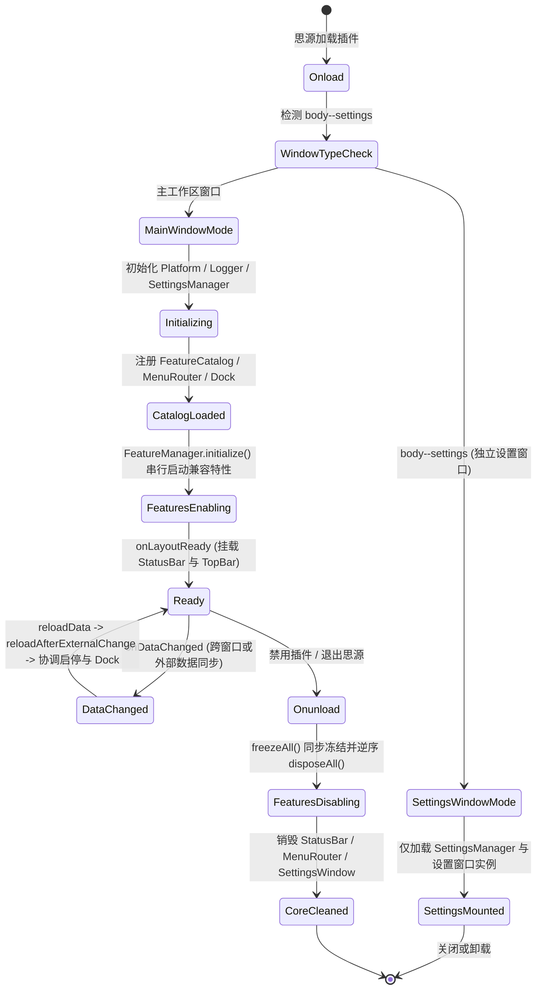
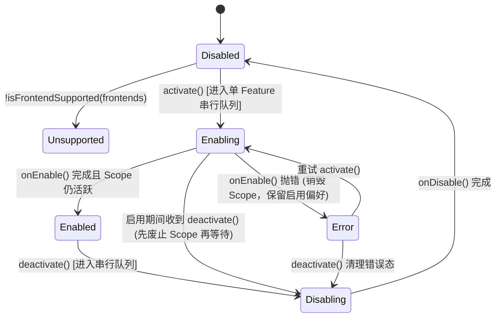

# OmniKit · 系统架构与微内核设计文档 (ARCHITECTURE)

> **版本**：v1.0（正式发布稿）  
> **状态**：正式发布（Approved）  
> **定位**：定义 OmniKit 全局微内核架构、分层边界、Core 平台模块契约、三层存储体系与新 Feature 扩展接入规范  
> **关联文档**：[AGENTS.md](../AGENTS.md) · [CORE-PRD.md](CORE-PRD.md) · [ENGINEERING.md](ENGINEERING.md) · 各特性 `docs/features/<name>/PRD.md` 与 `DESIGN.md`

---

## 1. 架构概览与技术栈

OmniKit 是基于前端技术和思源笔记插件接口构建的模块化插件平台。

### 1.1 技术栈选型
- **编程语言**：TypeScript 6.x（启用 `strict: true`、严格类型检查与安全泛型约束）
- **构建工具**：Vite 8.x（主入口打包为 `index.js`、样式整合为 `index.css`、资源静态复制；构建与发版细节见 [ENGINEERING.md](ENGINEERING.md)）
- **UI 组件框架**：Svelte 5（基于 Runes 响应式体系，通过 `mount` 与 `unmount` 精确控制生命周期）
- **样式体系**：SCSS（模块化样式组织，继承思源原生 CSS 变量自适应浅色/深色主题）
- **宿主环境**：思源笔记核心（Protyle 编辑器引擎、REST Kernel API、EventBus、Protyle Upload 流程）

### 1.2 核心规则
1. **微内核与单向依赖**：Core 平台层不依赖任何 Feature 的内部实现，也不包含针对具体 Feature ID 的硬编码分支；各功能通过声明式 `FeatureRegistration<T>` 元数据注册接入；
2. **多窗口隔离**：思源独立设置窗口（`body--settings`）只挂载配置存储与设置界面，不启动 Feature 运行时、Dock、菜单路由或后台监听器；
3. **配置与数据物理隔离**：每个 JSON 文件拥有独立的 Promise 串行读写队列；严格通过 `/api/file/getFile` 读取并通过 `plugin.saveData` 保存；平台配置、功能设置与功能业务数据分文件独立管理；
4. **共享块写入租约与写前核验**：跨 Feature 共享按 `notebook/blockID` 排队的进程内写入租约（`BlockWriteLease`），写入前必须经思源内核读接口核验最新内容，冲突即放弃，写请求结果未知时不自动重试；
5. **单一事实来源文档体系**：平台架构归本文档，构建与发版工具链归 [ENGINEERING.md](ENGINEERING.md)，各业务特性的内部模块拆分、时序与算法唯一归属 `docs/features/<name>/DESIGN.md`。

---

## 2. 系统分层架构

```mermaid
flowchart TD
    subgraph Host["宿主环境 (SiYuan Note)"]
        H_API["Kernel REST API (/api/...)"]
        H_Event["EventBus / Protyle Lifecycle"]
        H_UI["Host Dock / Context Menu / TopBar / StatusBar"]
    end

    subgraph Core["OmniKit Core 平台层 (src/core/ & src/ui/)"]
        PluginEntry["OmniKitPlugin (唯一宿主入口与多窗口协调)"]
        Catalog["FeatureCatalog (BaseFeature 运行实例集合)"]
        Manager["FeatureManager (平台支持检查与串行生命周期状态机)"]
        Scope["FeatureScope (AbortSignal & 资源托管作用域)"]
        
        subgraph CoreInfra["共享宿主基础设施 (src/core/host/ & store/)"]
            KernelClient["KernelClient & kernelOutcome (REST 调用与传输分类)"]
            BlockWriteLease["BlockWriteLease (按 notebook/blockID 共享块写锁)"]
            ProtyleAdapter["ProtyleAdapter (编辑器上下文提取与信号组合)"]
            CoreHelpers["describeError / createRuntimeId / PROTECTED_CONTAINER_SELECTOR"]
            SettingsMgr["SettingsManager (多文件配置协调器)"]
            JsonStore["JsonStore (单文件串行队列/30s超时/指纹跳写/只读保护)"]
            Logger["Logger (控制台分级日志)"]
            Platform["Platform (前端类型探测 & isFrontendSupported)"]
        end
        
        subgraph CoreUI["统一宿主 UI 容器与反馈 (src/ui/ & src/core/feedback/)"]
            UnifiedDock["registerDock (单槽位多 Tab 容器)"]
            SettingsShell["SettingsRoot.svelte, mountSettings & 子卡片组件 (双栏设置面板)"]
            DraftProtocol["DraftParticipant (全界面统一草稿协议)"]
            TopBarEntry["registerTopBar (统一顶栏图标与下拉菜单)"]
            MenuRouter["MenuRouter & MenuRegistry (上下文提取与前缀/复选框适配)"]
            FeedbackService["UiFeedback (通知前缀/防抖/生命周期与中止拦截)"]
            StatusBar["PluginStatusBar (桌面端单例底栏状态栏)"]
        end
    end

    subgraph Features["Feature 业务特性层 (src/features/<name>/)"]
        FeatContract["FeatureRegistration<T> & BaseFeature 统一接入契约"]
        FeatImg["image-compressor (详见 features/image-compressor/DESIGN.md)"]
        FeatTL["titled-link (详见 features/titled-link/DESIGN.md)"]
        FeatDiff["document-diff (详见 features/document-diff/DESIGN.md)"]
        FeatNext["其他扩展 Feature (独立业务逻辑与存储)"]
    end

    Host <--> PluginEntry
    PluginEntry --> Catalog
    PluginEntry --> Manager
    PluginEntry --> SettingsMgr
    PluginEntry --> UnifiedDock
    PluginEntry --> SettingsShell
    PluginEntry --> TopBarEntry
    PluginEntry --> MenuRouter
    PluginEntry --> StatusBar

    Manager --> Catalog
    Manager --> Scope
    Manager --> FeatContract
    FeatContract --> FeatImg
    FeatContract --> FeatTL
    FeatContract --> FeatDiff
    FeatContract --> FeatNext

    FeatContract --> CoreInfra
    FeatContract --> CoreUI
    SettingsShell --> DraftProtocol
    SettingsMgr --> JsonStore
    JsonStore --> H_API
    KernelClient --> H_API
    UnifiedDock --> H_UI
    TopBarEntry --> H_UI
    MenuRouter --> H_Event
    MenuRouter --> H_UI
    StatusBar --> H_UI
```

OmniKit 划分为“宿主环境层”、“Core 平台层（`src/core/` & `src/ui/`）”与“Feature 业务特性层（`src/features/<name>/`）”三层架构：



---

## 3. Core 平台核心设计与模块契约

### 3.1 `OmniKitPlugin`（宿主接入与多窗口隔离）
- **文件位置**：`src/core/OmniKitPlugin.ts`
- **宿主生命周期流转**：



- **主要职责**：
  - 继承思源官方 `Plugin`，维护顶层 `registrations` 列表；
  - **独立设置窗口隔离 (`body--settings`)**：通过 `document.body.classList.contains("body--settings")` 识别独立设置窗口。在设置窗口中仅初始化 `SettingsManager` 与 `createSettingsWindow`（`onload()` 阶段不自动弹窗，由 `openSetting()` 等待 `ready` 后打开）；不实例化 `FeatureManager`（`manager === undefined`），受当前平台支持且配置为启用的特性其 `runtimePhase` 派生为 `"configured"`（显示「已配置启用（运行状态请看主窗口）」），不挂载 Dock、`MenuRouter`、`PluginStatusBar` 或任何 Feature 运行时；
  - **主窗口启动与卸载**：在主工作区窗口中初始化 `Platform`（注入 `getFrontend`）、`Logger`、`SettingsManager`，并行加载 `omnikit-core.json` 与各 Feature 配置；实例化并向 `FeatureCatalog` 注册各 Feature，创建 `UiFeedback`、`MenuRegistry`、`PluginStatusBar`、`FeatureManager`、设置窗口、`MenuRouter` 与 `registerDock`（返回 `{ refresh, dispose }`），再调用 `manager.initialize()` 依次激活已启用且平台支持的功能；`onLayoutReady()` 等待 `ready` 后挂载 `PluginStatusBar` 与 `registerTopBar`；`onunload()` 标记 `unloading = true`，销毁状态栏与订阅，先调用 `manager.freezeAll()` 同步废止所有 `FeatureScope`，再销毁 `MenuRouter`、关闭设置弹窗并调用 `manager.disposeAll()` 按逆序执行各 Feature 的 `deactivate()`，最后在 `finally` 中调用 `dock.dispose()` 清理侧边栏组件实例；
  - **外部数据同步 (`onDataChanged`)**：先等待 `ready` 完成且全程不回写文件。主窗口依次执行：① 遍历 `registrations` 调用可选 `reloadData(this)` 重载已初始化的业务数据存储；② 调用 `settingsManager.reloadAfterExternalChange()` 重读配置；③ 若 `"core"` 发生变更则调用 `manager.reconcileFromLoadedSettings()` 协调启停，对发生变更的 Feature 调用 `manager.notifySettingsChanged(id)`；④ 调用 `dock.refresh()` 刷新侧边栏视图。独立设置窗口仅执行 `settingsManager.reloadAfterExternalChange()` 驱动界面更新与冲突提示。

### 3.2 `FeatureCatalog`、`FeatureRegistration` 与 `FeatureManager`
- **文件位置**：`src/core/framework/FeatureCatalog.ts`、`src/core/framework/FeatureRegistration.ts`、`src/core/framework/FeatureManager.ts`
- **声明式注册契约 (`FeatureRegistration<T>`)**：

```typescript
export type SiyuanFrontend =
  | "desktop"
  | "desktop-window"
  | "mobile"
  | "browser-desktop"
  | "browser-mobile"
  | "all";

export interface FeatureRegistration<T> {
  readonly id: string;
  readonly titleKey: string;
  readonly descriptionKey: string;
  readonly defaultEnabled: boolean;
  readonly file: `feature-${string}-settings.json`;
  readonly codec: StoreCodec<T>;
  create(plugin: Plugin, settings: SettingsManager): BaseFeature;
  readonly settingsView: Component<{
    store: JsonStore<T>;
    runtimePhase: FeaturePhase | "configured";
    t: (key: string, values?: Record<string, string | number>) => string;
    registerDraft?: RegisterDraftParticipant;
    globalSaving?: boolean;
  }>;
  readonly dockView?: Component<{
    context: FeatureContext;
    t: (key: string, values?: Record<string, string | number>) => string;
  }>;
  readonly frontends?: readonly SiyuanFrontend[];
  readonly reloadData?: (plugin: Plugin) => Promise<void>;
}
```

- **存储文件名派生与校验辅助函数 (`FeatureRegistration.ts`)**：
  - `featureConfigFile(id)`：校验 `id` 格式并将其从驼峰/kebab-case 归一化为 `feature-${slug}-settings.json`；
  - `featureDataFile(id, dataName)` / `isFeatureDataFile(id, dataName, file)`：生成并校验业务数据文件名 `feature-${slug}-${dataName}.json`（禁止 `dataName === "settings"`）；
  - `defineFeature(registration)` / `validateFeatureFiles(ids)`：在定义与注册阶段强制校验 `registration.file === featureConfigFile(registration.id)` 且无 ID 或文件名碰撞。
- **六状态机 (`FeaturePhase`) 与串行生命周期管理 (`FeatureManager`)**：
  - 状态取值：`"disabled" | "enabling" | "enabled" | "disabling" | "error" | "unsupported"`；



  - **单 Feature 串行队列 (`enqueue`) 与状态回滚**：每个 Feature 拥有独立的 Promise 队列；`setEnabled(id, desired, persist)` 先变更运行态再持久化 `omnikit-core.json`，若激活后持久化失败则自动回滚调用 `deactivate()`，若停用后持久化失败则尝试重新 `activate()` 恢复原运行态；启动或激活失败时将异常记入 `startupErrors` 并置为 `"error"`，不篡改用户在 `omnikit-core.json` 中的期望偏好；
  - **平台兼容性设防与只读偏好保护**：
    1. 在 `initialize()` 与 `reconcileFromLoadedSettings()` 中，若 `!isFrontendSupported(feature.meta.frontends)`，直接跳过激活（`BaseFeature.status` 动态返回 `"unsupported"`），不分配 `FeatureScope`，也不修改 `omnikit-core.json` 中跨端同步的启用偏好；
    2. `setEnabled(id, ...)` 遇到不支持当前平台的功能时直接返回 `false` 并拒绝写入配置；
    3. 当 `omnikit-core.json` 或该功能的 `feature-*-settings.json` 处于 `needsRecovery` 只读保护状态（`!settings.isPreferenceReliable(id)`）时，跳过启动与自动协调，保留当前运行状态与原文件不被覆盖。

### 3.3 `BaseFeature`、`FeatureScope` 与 `FeatureContext`
- **文件位置**：`src/core/framework/BaseFeature.ts`、`src/core/framework/FeatureScope.ts`、`src/core/framework/FeatureContext.ts`
- **受控上下文 (`FeatureContext`)**：

```typescript
export interface FeatureContext {
  plugin: Plugin;
  settings: SettingsManager;
  menus: MenuRegistry;
  logger: Logger;
  feedback: UiFeedback;
  statusBar?: PluginStatusBar;
  scope?: FeatureScope;
}
```

- **资源托管与取消边界**：
  - `BaseFeature.activate(context)` 为当次激活创建专属 `FeatureScope` 并通过 `context.feedback.forScope(scope)` 绑定通知作用域；
  - `FeatureScope` 封装 `AbortController` 与 `disposers` 列表：
    - `scope.own(disposer)`：登记运行期副作用（EventBus 监听、DOM 监听、定时器、菜单贡献），若登记时 Scope 已失活则立即执行清理；
    - `scope.signal`：只读 `AbortSignal`，向下传递给异步任务；
    - `scope.guard(handler)`：包装回调函数，Scope 失活后自动短路返回 `undefined`；
    - `scope.dispose()`：将 `alive` 置为 `false`，**先广播 `controller.abort("Feature disabled")`**，再按后进先出（LIFO）逆序执行全部 `disposers`；
  - **任务取消与非回滚规则**：平台不设通用取消入口；文档页签切换或编辑器关闭不中断已启动的后台任务（写前通过内核读接口核验块状态）；仅在 Feature 停用、插件卸载、宿主退出或特性允许的进度弹窗被用户主动关闭时触发 `abort` 信号，停止未开始步骤、静默吞掉 `AbortError` 并保留已确认的附件与记录，不执行逆向回滚。

### 3.4 `SettingsManager` 与 `JsonStore`（持久化与只读恢复保护）
- **文件位置**：`src/core/store/SettingsManager.ts`、`src/core/store/JsonStore.ts`、`src/core/store/SettingsConflictError.ts`
- **核心机制**：
  - **文件名白名单与单文件串行队列**：`JsonStore` 构造时强制校验文件名匹配 `/^(omnikit-core|feature-[a-z0-9-]+)\.json$/`；所有 `load()`、`reload()`、`update()`、`recoverWithBackup()` 均在同一文件的 `tail` Promise 队列中串行执行；
  - **序列化指纹跳写**：内存维护 JSON 序列化指纹（`fingerprint`），`update(mutator)` 在队列内克隆最新快照执行修改并通过 `codec.parse(draft)` 校验，若序列化结果与当前指纹一致则直接返回 `false` 跳过磁盘写入；`reload()` 在指纹变化或 `readOnlyReason` 变化时返回 `true`；
  - **读写双路径 30 秒超时与不重试**：`/api/file/getFile` 读取（含响应体 `response.text()` 读取流）与 `plugin.saveData` 写入均受 `30_000 ms` 超时保护；超时或写入失败直接抛错且不自动重试，防止挂起阻塞队列；
  - **严格单通道读取与缺失/损坏判定 (`readIntoMemory`)**：
    - 仅通过 POST `/api/file/getFile` 读取 `/data/storage/petal/${pluginName}/${file}`（支持测试注入 `fetchFn`），不使用 `plugin.loadData()`；
    - **唯一缺失判定**：仅当 HTTP 状态码为 `202` 且响应 JSON `code === 404` 时判定为文件未创建，采用内存 `codec.defaults()` 且不立即写盘；
    - **损坏与异常只读保护 (`needsRecovery`)**：当 HTTP `200` 返回空串/纯空白、JSON 语法解析失败、`codec.parse` 结构校验失败，或遭遇网络错误、超时、非 `202+404` 的 HTTP 错误时，调用 `enterReadOnly(reason, backup)` 进入只读保护模式（拒绝后续 `update()` 写入）；
    - **备份与恢复 (`recoverWithBackup`)**：仅当 `rawToBackup !== undefined`（即读取到了物理损坏内容而非网络/读取传输失败）时允许恢复；若损坏内容为非空白字符串或对象，先保存为 `${file}.backup-${Date.now()}.json`（纯空白文件不生成空备份），再将默认配置写回原文件并解除只读状态；
  - **并发容错加载与默认 `User-Agent` 补全**：`SettingsManager.load()` 使用 `Promise.allSettled` 并发加载全部 Store，单个文件损坏仅使该 Store 进入只读保护，不阻断插件启动与设置恢复界面挂载；加载后若 `omnikit-core.json` 可写且 `general.userAgent.trim() === ""`，自动回填 `DEFAULT_USER_AGENT` 并落盘（`getUserAgent()` 同时保留 `.trim() || DEFAULT_USER_AGENT` 回退）。

### 3.5 `KernelClient` 与宿主适配基础设施 (`src/core/host/`)
- **`KernelClient` & `kernelOutcome` (`KernelClient.ts`、`kernelOutcome.ts`)**：
  - 封装思源 `fetchSyncPost`，支持传入 `AbortSignal` 与自定义超时（默认 `30_000 ms`）；超时或外部取消时显式触发内部 `AbortController.abort()` 终止底层请求；
  - `KernelResponse<T>` 包含 `{ code, data, msg, limit?, truncated? }`；
  - `KernelRequestError.outcome`（可通过 `getKernelOutcome(error)` 沿 `cause` 链提取）严格区分为三态：
    - `"not-sent"`：请求发出前 `signal.aborted` 已为真；
    - `"rejected"`：收到内核响应且 `typeof result.code === "number" && result.code !== 0`（保留 `code`）；
    - `"unknown"`：空响应、非对象响应、网络断连、超时或请求发出后在等待响应阶段被中止；修改类请求遇到 `"unknown"` 严禁自动重试。
- **跨特性共享块写入租约 (`BlockWriteLease.ts`)**：
  - `withBlockWriteLease(notebook, blockID, signal, operation)` 以 `${notebook}/${blockID}` 为键在插件进程内串行排队；
  - 排队等待期间及获得租约进入临界区前均检查 `signal?.aborted`（已中止则立即抛出 `AbortError`）；因思源 `/api/block/updateBlock` 无原子 CAS，临界区内仍须通过内核读接口核验块归属与实时 DOM。
- **`ProtyleAdapter` (`ProtyleAdapter.ts`)**：
  - 提供无副作用纯函数提取器与编辑器适配器：`resolveEditorRootID`、`resolveNotebookID`、`resolveProtyleElement`、`resolveWysiwygElement`、`resolveProtyleRunner`（兼容直接实例、`IProtyle` 包装与 `getInstance()`）、`isProtyleReadOnly`（检测编辑器 `disabled`、`wysiwyg` 只读标记与块级 `contenteditable="false"`）、`flushProtyleTransactions`、`listEditorsSafe`（安全包装 `getAllEditor`）与 `combineSignals`（基于原生 `AbortSignal.any` 组合多中止信号）。
- **公共辅助模块 (`dom.ts`、`id.ts`、`describeError.ts`、`Platform.ts`、`Logger.ts`)**：
  - `dom.ts`：导出 `PROTECTED_CONTAINER_SELECTOR`（`[data-type="NodeCodeBlock"], [data-type="NodeBlockQueryEmbed"], [data-type="NodeAttributeView"], [data-type="NodeMathBlock"], [data-type="NodeHTMLBlock"], .protyle-wysiwyg__embed, .av, .render-node, pre, code`）与 `isInsideProtectedContainer(node)`；
  - `id.ts`：导出 `createRuntimeId(prefix)`，使用时间戳与进程内单调计数器生成唯一 ID，兼容非 HTTPS（`window.isSecureContext === false`）无 `crypto.randomUUID()` 的局域网环境；
  - `describeError.ts`：将 `Error`、思源 `{ msg, code }` 响应或字符串格式化为可读文本，消除 `[object Object]`；
  - `Platform.ts`：通过注入的 `getFrontend()` 探测前端环境（回退 DOM `#sidebar` 与 UA 推断），导出与思源内核 `IsTargetSupported` 逻辑一致的 `isFrontendSupported(declared, current)` 及 `isMobileFrontend()`；
  - `Logger.ts`：全局共享 `Logger.shared`，输出格式 `[OmniKit][{level}] {message}`；`info` / `warn` / `error` 始终输出至控制台，仅 `debug` 受 `general.debugLog` 动态控制，不向工作区写入文件。

### 3.6 统一 UI 容器与反馈服务 (`src/ui/` & `src/core/feedback/`)
- **统一侧边栏容器 (`src/ui/dock/registerDock.ts`)**：
  - 仅注册 1 个思源侧边栏槽位（`type: "omnikit-dock"`，`position: "RightBottom"`），返回 `{ refresh, dispose }` 句柄；
  - `views()` 动态筛选 `manager.isRunning(id)` 且通过 `filterSupportedDockViews` 的特性视图；`dockViewState` 控制多视图显示 Tab 栏、单视图隐藏 Tab 栏独占、零视图显示 `dock.empty` 空状态指引与底部「打开设置」按钮；
  - 缓存当前挂载的 `mountedID`、`mountedComponent` 与 `lastTabsSignature`，同一视图保持激活时复用 Svelte 5 实例，切换或停用时调用 `unmount`；宿主 Dock `update()` 触发时派发 `window` `"omnikit-dock-tab-activated"` 事件通知活动视图刷新；`dispose()` 在插件卸载时幂等卸载已挂载视图，并在移动端调用 `plugin.removeDock` 清理宿主侧栏注册项。
- **统一设置面板与草稿协议 (`src/ui/settings/SettingsRoot.svelte`、`SettingsSidebar.svelte`、`GeneralSettingsCard.svelte`、`FeatureSettingsCard.svelte`、`SettingsSaveBar.svelte`、`mountSettings.ts`、`DraftParticipant.ts`)**：
  - `createSettingsWindow` 使用思源 `Dialog`（`860px × 600px`）挂载 `SettingsRoot.svelte`；`close()` 在调用 `dialog.destroy()` 前先清空实例引用，防止思源异步 `destroyCallback` 误清理新实例；
  - 采用双栏联动布局（`SettingsSidebar.svelte` 渲染左侧「通用设置」`general.title` 与「功能模块」`nav.features` 导航，右侧 `.omnikit-settings-scroller` 单页平滑滚动 `GeneralSettingsCard.svelte` 与各 `FeatureSettingsCard.svelte` 卡片，含滚动触底末尾卡片高亮判定）；
  - **全界面草稿协议 (`DraftParticipant`)**：通用设置、各功能启用开关与各 Feature 专属设置面板（通过 `registerDraft` 注册 `{ id, isDirty, validate, save, resetToDefaults, isReadOnly, hasConflict }`）统一编辑内存草稿，仅在底部保留唯一全局浮动操作栏 `SettingsSaveBar.svelte`（「恢复默认值」与「保存设置」）；
  - **只读隔离、恢复协调、冲突检测与保存序**：全局「恢复默认值」仅重置未处于 `needsRecovery` 且当前平台支持的可写草稿，不写盘；点击「保存设置」按“校验全部脏草稿 → 依次保存各变更 Feature Store → 保存 Core Store → `manager.reconcileFromLoadedSettings()` → `manager.notifySettingsChanged(id)`”顺序执行；核心或功能配置从 `needsRecovery` 执行备份恢复解除只读后自动调用 `manager.reconcileFromLoadedSettings()` 协调运行态；当外部同步与未保存草稿冲突（或抛出 `SettingsConflictError`）时显示冲突横幅并提供「放弃草稿并载入」；`User-Agent` 输入框通过 `data-omnikit-field="user-agent"` 焦点检测与脏状态保护防止编辑中被外部同步覆盖；
  - **不支持平台卡片呈现**：`unsupported` 特性的设置卡片保持渲染，总开关置灰禁用并展示 `runtime.unsupported` 与支持平台说明，但卡片内专属设置组件仍允许预调并保存至该特性独立的 `feature-*-settings.json`。
- **统一顶栏入口 (`src/ui/topbar/registerTopBar.ts`)**：
  - 注册唯一顶栏图标（`id: "omnikit-core"`）；左键单击与右键菜单第一项固定为「OmniKit 设置」，随后插入 `separator_settings` 分隔线并调用 `menus.render("topbar", ...)` 渲染已启用 Feature 的顶栏动作（左键菜单在渲染项数为 `0` 时自动移除尾部悬空分隔线）；从 `getActiveEditor()` 提取当前文档 `rootID` 与 `protyle`（桌面布局端焦点位于侧边栏面板时从 `getAllModels().editor` 选取最近活动的可见主文档页签）；桌面端按图标（或 `#barMore` / `#barPlugins`）坐标锚定弹出，移动端调用 `menu.fullscreen()`。
- **统一菜单路由与注册表 (`src/core/feedback/MenuRouter.ts`、`MenuRegistry.ts`)**：
  - `MenuRouter` 监听 `click-editortitleicon`（`doc-title`）、`open-menu-doctree`（`doc-tree`）、`open-menu-image`（`image`）、`open-menu-link`（`link`）、`click-blockicon`（`blockicon`）5 类宿主事件，提取标准化 `HostMenuContext`（在 `doc-tree` 中通过 `extractDocTreeDocumentIDs` 过滤笔记本节点，仅保留文档节点）；
  - `MenuRegistry` 按 `location/owner/id` 管理各 Feature 在 `FeatureScope` 内注册的 `provider` 与可选 `matcher`；渲染与点击时双重核验 `scope.active && isFeatureRunning(owner)`（菜单展开期间若功能被停用，点击时触发 `menu.featureInactive` 轻量提示）；
  - **上下文感知前缀与声明式复选框**：`location === "topbar"` 自动剥离 `[OmniKit] ` 前缀，其余 5 类外部宿主上下文菜单自动补齐 `[OmniKit] ` 前缀；当 `OmniMenuItem.checked !== undefined` 时，`MenuRegistry` 自动生成宿主 `bind` 回调注入 `role="menuitemcheckbox"`、`aria-checked`、`.omnikit-checkbox-menu-item` 与 `span.omnikit-menu-checkbox`。
- **`UiFeedback` 与 `PluginStatusBar` (`src/core/feedback/UiFeedback.ts`、`PluginStatusBar.ts`)**：
  - `UiFeedback`：自动补齐 `[OmniKit] ` 通知前缀，实施 300ms 相同文案防抖，检查 `scope.active` 拦截已停用功能的迟到通知（含 `copyable` 异步剪贴板写入后复核），并通过 `isAbortError(error)` 静默忽略取消异常；
  - `PluginStatusBar`：仅在非移动端且非 `body--settings` 的主窗口挂载 `.omnikit-status-bar`，调用 `plugin.addStatusBar` 后核验 `result === this.element && this.element.isConnected === true`；通过 `tasks: Map<string, string>` 按最近更新顺序展示最新活跃任务单行文本，无任务时添加 `.fn__none` 隐藏。

---

## 4. 存储架构与持久化规范

```text
SiYuan 工作区目录：data/storage/petal/siyuan-plugin-omnikit/
├── omnikit-core.json                      <-- Core 平台配置
├── feature-image-compressor-settings.json <-- Feature 用户设置 (ID: imageCompressor，按 kebab-case 派生)
├── feature-image-compressor-records.json  <-- Feature 业务数据 (不受设置重置影响)
├── feature-titled-link-settings.json      <-- Feature 用户设置 (ID: titled-link)
└── feature-document-diff-settings.json    <-- Feature 用户设置 (ID: document-diff)
```

| 存储分类 | 文件命名规则 | 包含内容 | 重置操作影响边界 |
|---|---|---|---|
| **Core 平台配置** | `omnikit-core.json` | `schemaVersion: 1`<br/>`general: { debugLog, userAgent }`<br/>`featureStates: { [id]: { enabled } }` | 跨窗口写入采用 last-writer-wins 语义；受全局恢复默认值管控 |
| **Feature 设置** | `feature-{slug}-settings.json`（由 `featureConfigFile(id)` 派生） | 各 Feature 设置面板管理的用户参数 | 受单功能重置与全局恢复默认值管控 |
| **Feature 业务数据** | `feature-{slug}-{dataname}.json`（由 `featureDataFile(id, dataName)` 派生） | Feature 运行期产生的业务记录（由特性独立 Store 管理，`SettingsManager` 不持有其写权限） | **不受设置重置影响**；按对应特性 PRD 与 `DESIGN.md` 规则管理与清理 |

---

## 5. 新 Feature 扩展开发指南

各已接入特性的详细技术设计见各自独立文档：
- **图片压缩 (`imageCompressor`)**：[PRD](features/image-compressor/PRD.md) · [DESIGN](features/image-compressor/DESIGN.md)
- **自动标题链接 (`titled-link`)**：[PRD](features/titled-link/PRD.md) · [DESIGN](features/titled-link/DESIGN.md)
- **差异文档比较 (`document-diff`)**：[PRD](features/document-diff/PRD.md) · [DESIGN](features/document-diff/DESIGN.md)

### 5.1 标准接入步骤
1. **文档先行**：在 `docs/features/<feature-name>/` 下分别建立 `PRD.md`（产品需求与验收边界，须经用户确认）与 `DESIGN.md`（模块拆分、接口时序、数据结构与容错细节），并在 [CORE-PRD.md](CORE-PRD.md) 第 7 节补充索引；
2. **创建特性包**：在 `src/features/<feature-name>/` 下创建特性实现（禁止跨 Feature 相互 `import`）：
   - 配置与校验器：定义配置类型与 `StoreCodec<T>`；
   - `<FeatureName>Feature.ts`：继承 `BaseFeature`，在 `onEnable(context, scope)` 中通过 `scope.own(...)` 或 `context.menus.contribute(scope, ...)` 注册事件与菜单；
   - 设置与可选 Dock 组件：实现接入 `DraftParticipant` 协议的 Svelte 5 `settingsView` 及可选 `dockView`；
   - `registration.ts`：调用 `defineFeature<T>({ ... })` 声明元数据（按需配置 `frontends` 与 `reloadData`）；
3. **注册挂载与国际化**：在 `src/core/OmniKitPlugin.ts` 的 `registrations` 数组中追加该注册项（无需修改 `CoreSettings` schema 或 `SettingsRoot.svelte`），并在 `src/i18n/zh-CN.json` 与 `src/i18n/en.json` 中同步补充对齐的国际化键。

### 5.2 SQL 辅助查询规范
- 需要跨文档检索或减少多次 HTTP 请求往返时，可调用思源 `/api/query/sql` 执行**只读**辅助查询（传入 `{ stmt, mode: "readonly" }` 并感知响应的 `limit` / `truncated`）；
- SQLite 索引存在异步延迟且不包含未解锁/加密笔记本内容，因此通过 SQL 定位候选块后，执行任何修改前仍须在 `withBlockWriteLease` 锁内通过内核实时块读取接口（`/api/block/getBlockInfo`、`/api/block/getBlockDOM`）核验最新状态。

### 5.3 Feature 扩展通用自查清单
- [ ] 是否严格面向 `BaseFeature` 与 `FeatureContext` 编程，且不存在任何跨 Feature 的代码 `import` 或 Core 层针对 Feature ID 的硬编码分支？
- [ ] 是否通过 `defineFeature` 声明了 `featureConfigFile(id)`，业务数据文件是否符合 `featureDataFile(id, dataName)` 命名且与设置重置隔离？
- [ ] 是否正确声明了 `frontends`（5+1 取值集合），在不支持的平台上保持 `unsupported`、不执行初始化与注册，且不篡改跨端同步的启用偏好？
- [ ] 所有事件监听、DOM 观察器、定时器与菜单项是否均绑定至 `FeatureScope`（`scope.own`），异步任务是否感知 `scope.signal` 并由 `UiFeedback` 静默处理 `AbortError`？
- [ ] 菜单项是否全部通过 `MenuRegistry.contribute` 注册（不在 Feature 内硬编码 `[OmniKit]` 前缀，复选框菜单使用声明式 `checked` 属性）？
- [ ] 设置面板是否实现 `DraftParticipant` 协议接入全局浮动保存栏（卡片内不自建独立保存/重置按钮），且中英文语言包键名与占位符完全一致？
- [ ] 涉及块内容修改时，是否跳过 `PROTECTED_CONTAINER_SELECTOR` 受保护容器、接入 `withBlockWriteLease` 同块写锁、写前通过内核读接口核验基线（冲突即放弃），且对 `KernelRequestError` 的 `"unknown"` 结果严禁自动重试？
- [ ] 是否严格遵守宿主安全底线：不直接读写 `.sy` 或 SQLite 文件、不向工作区写入临时日志或 `.tmp` 缓存文件、不调用主动物理删除用户附件的 API？
