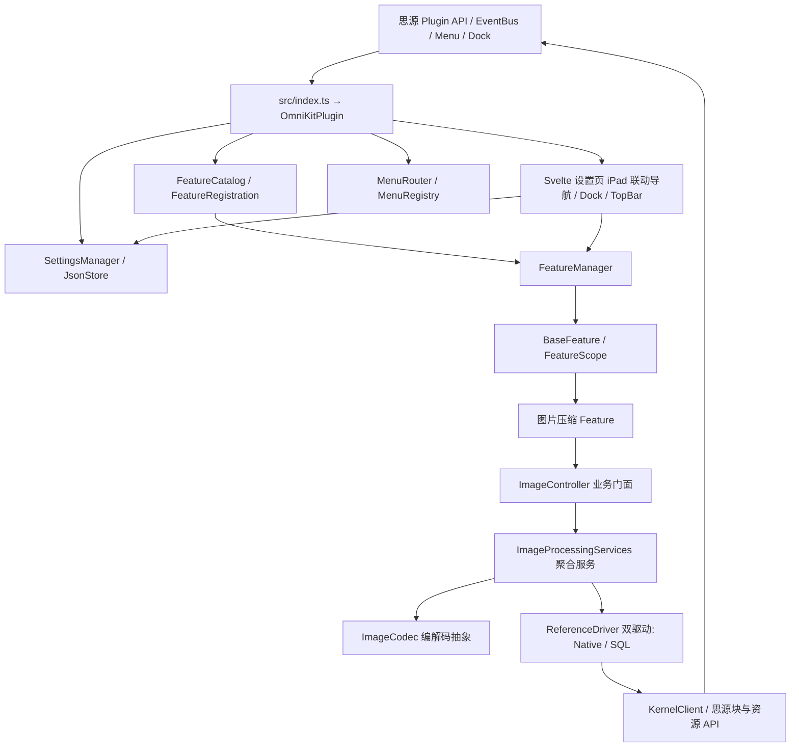

# OmniKit 架构与模块说明

OmniKit 是一个以 TypeScript、Vite 和 Svelte 5 构建的思源插件。`src/index.ts` 是唯一插件入口，导出 `OmniKitPlugin` 供思源加载。Vite 将入口打包为 `index.js`，提取 `index.css`，并把插件清单、README、国际化文件、图标和本地图片压缩 Worker 复制到发布包。

## 运行结构

| 目录 | 当前职责 |
| --- | --- |
| `src/index.ts` | 插件打包入口，导出 `OmniKitPlugin` |
| `src/core` | 插件宿主集成、Feature 注册与生命周期、设置存储、菜单路由、兼容性、平台判断和日志 |
| `src/features` | 各功能的业务实现、专属配置、服务、动作及设置面板；当前包含 `image-compressor` |
| `src/ui` | 通用 Svelte 设置外壳（iPad 风格双向联动单页滚动）、Dock、TopBar 与 DOM 辅助代码；功能专属设置组件由 Feature 自己提供 |
| `src/i18n` | 英文与简体中文 JSON 翻译源文件，打包到 `dist/i18n` |
| `src/styles` | 插件全局 SCSS，由插件入口依赖链导入 |

## 核心与 Feature 的边界

`OmniKitPlugin` 在 `src/core/OmniKitPlugin.ts` 中连接思源宿主、配置、Feature 管理器、菜单和界面。唯一入口加载各 Feature 的注册描述；Feature 的业务实现不在插件入口内展开。

`FeatureRegistration<T>` 保存稳定元数据、默认启用状态、配置文件名与 codec、创建运行实例的工厂，以及归 Feature 所有的 Svelte 设置组件。`FeatureCatalog` 持有注册后的实例，`FeatureManager` 按 Feature 串行处理启停、记录启动错误，并通过订阅接口向设置页暴露运行状态。通用设置界面根据注册描述展示各 Feature，不按具体 Feature ID 写分支。

每个 Feature 从 `BaseFeature` 派生，以 `FeatureScope` 持有运行期副作用。停用时先使 Scope 失效，再撤销该 Feature 的菜单贡献和事件监听并执行清理；失效的旧回调不能启动新业务。Scope 冻结不能跳过 `onDisable`。插件卸载时先冻结所有 Feature，再逐一清理；单个功能的清理失败不应阻止其他功能释放资源。启停操作按 Feature 串行，防止快速切换产生重复监听或并行初始化。

菜单通过 `MenuRouter` 将思源菜单事件路由到 `MenuRegistry`。注册项关联所属 Feature，只有仍在运行的 Feature 才能贡献菜单；回调执行时再次检查运行状态，以防菜单已打开后 Feature 被关闭。Dock 与 TopBar 属于核心入口，即使所有 Feature 停用仍保持可用。思源原生 `openSetting()` 和插件菜单进入同一 Svelte 设置对话框；设置面板通过 Svelte 5 `mount`/`unmount` 管理组件生命周期，并在关闭时释放订阅和 DOM 资源。核心日志开关保存后立即更新 logger。

## 配置存储

`SettingsManager` 将通用设置与 Feature 数据分开保存：核心文件 `omnikit-core.json` 仅包含通用选项和各 Feature 的启用状态，每个 Feature 使用自己的 `feature-*.json` 保存业务配置。`featureConfigFile(id)` 根据 Feature ID 生成规范化文件名，并检查规范化后的冲突；注册项显式保存生成结果。增加 Feature 时提供自己的默认值和 codec，不把该 Feature 的字段加入核心 schema。

`JsonStore` 负责解析、验证、订阅和写入。首次缺少配置时使用内存默认值，不因加载或打开设置页而创建文件；相同值更新不写盘，每个文件的更新串行执行。无效或损坏的 JSON 不得被默认值覆盖；显式恢复先备份原始内容，主文件保存确认后才更新内存状态。写入超时会标记结果不确定，阻止继续写入。外部数据变更通过 `onDataChanged` 重新加载并通知运行时，不把重新加载的数据写回。

核心启用偏好与运行状态不是同一个值：启用失败会显示错误状态，但不擅自改写用户保存的偏好。运行状态切换与保存失败需要补偿，使运行资源与已保存偏好保持一致。

当前图片配置使用 schema v1 的分组结构：`auto`、`compression`、`sources`、`retention`、`references`。codec 只接受完整的现行结构，不迁移旧格式；它校验数值、扩展名、远程来源及文档名单，添加名单时还会向内核确认文档根块。设置页编辑草稿并显式保存，外部数据变更会提示重新载入。SiYuan 独立设置窗口能力目前未启用；未来若多个插件实例同时编辑同一 JSON 文件，`onDataChanged` 只负责刷新，不构成跨实例写锁。

## 图片压缩规则

当前图片 Feature 位于 `src/features/image-compressor`，设置、白名单、图片处理服务和设置面板均归该 Feature 管理。自动压缩策略如下：

| Feature | 全局自动压缩 | 当前文档在白名单 | 后续合规编辑器上传 |
| --- | --- | --- | --- |
| 关闭 | 任意 | 任意 | 不处理 |
| 开启 | 开启 | 否或是 | 处理 |
| 开启 | 关闭 | 是 | 处理 |
| 开启 | 关闭 | 否 | 不处理 |

自动上传只处理编辑器上传事件。`before-upload-assets` 能力按思源版本和事件形状检测；不支持或无法可靠识别目标时跳过。桌面端本地路径拖入会先把整批路径转成 `File`，任何一项读取失败就交回原始批次。事件的 `respondWith` 必须在处理器的同步调用栈内注册，异步压缩完成后仍按原文件序列返回；宿主取消或处理失败时返回原始有序文件批次。有 `onComplete` 时按对应请求的最终上传结果提示；旧宿主只提示图片已准备好，不把压缩完成等同于上传成功。

已授权 HTTP(S) 来源的新插入外链图片由编辑器观察器处理：它先记录现有引用作为基线，只关注后续新增引用，并在思源同步期间暂停。观察器必须确认图片引用已经持久化，才能下载、压缩、上传和更新引用。

白名单以文档 `rootID` 标识，不因改名或移动而改变授权。全局开关和 Feature 总开关不清空白名单；Feature 停用时则停止该功能的监听和任务。文档树菜单只对单个文档提供操作，不对多选或笔记本节点猜测目标。

### 图片 Feature 子模块

| 模块 | 职责与调用边界 |
| --- | --- |
| `ImageCompressorFeature` | 作为 Feature 容器，挂载生命周期、贡献菜单与注册外链观察器；通过 `FeatureScope` 管理运行期资源。 |
| `ImageController` | 统一的业务编排门面；连接菜单交互、参数解析、安全前置检查、进度跟踪与任务生命周期。 |
| `SingleImageAction` / `DocumentBatchAction` / `AutoUploadHandler` | 具体动作执行逻辑，分别处理选中图片、完整文档 DOM 和上传前有序批次。 |
| `RemoteImageWatcher` / `AutoPolicy` | 观察新增外链图片并判断自动授权；上传策略根据 Feature 开关、全局开关、文档名单与宿主能力决定是否压缩。 |
| `source` / `download` / `desktop` | 规范化工作区资源、HTTP(S) 外链与桌面文件路径；按来源权限、超时和字节上限安全读取图片。 |
| `image` (`ImageCodec` / `BicEncoder`) | 校验图片容器与编码收益，通过 `ImageCodec` 标准接口解耦引擎，由本地 Worker 编码生成 WebP。 |
| `assets` / `ImageProcessingServices` | 上传并校验资源，原图归档；单图原件清理由独立终结器守护。绝不向工作区写入临时任务日志垃圾。 |
| `references` (`ReferenceDriver` / `Native` / `SQL`) | 抽象双驱动模型：新版宿主通过原生查引用与重链接 API，旧版宿主通过 SQL Keyset 结合 DOM Patch 乐观写；写租约（`withWriteLease`）保证进程内串行写入。 |
| `scanDocumentImages` / `dom` / `asset-identity` | 扫描内核完整 DOM，确定图片所属块；预检引用并对工作区物理资源消歧。 |
| `CompressionResult` / `TaskRegistry` / `ImageTaskUI` | 汇总资源与引用结果、取消批量任务、通过内存状态向 UI 发布流式进度。 |
| `PageAllowlist` / `ImageSettingsPanel.svelte` | 以文档 `rootID` 保存授权名单；设置面板编辑 Feature 配置草稿，不拥有业务执行或生命周期。 |

## 笔记数据与资源安全

图片处理失败、压缩结果不值得替换或引用无法精确确认时，保留原图并跳过替换。单图和整篇任务按来源归并，先上传新资源，再预检所有相关引用；跨文档更新前向用户显示范围并确认。

**任务日志零垃圾原则**：插件严禁向思源工作区（如 `data/storage`）写入持久化 job 事务日志文件，彻底避免污染用户的云端同步和全量备份。数据容灾完全依托思源原生强大的块历史版本（Block History）、文档历史与工作区快照，不在插件层堆叠脆弱的私有恢复逻辑。

原生重链接 API 覆盖宿主可识别的资源引用；SQL 兼容路径只扫描已索引普通文档，并在更新块前重读、更新后复核。两种路径均不对块内容做模糊字符串替换。上传后的资源或引用写入结果不确定时，报告部分或未知状态，不重试不确定的写入。

压缩 Worker 由 `browser-image-compression` 依赖提供，并作为本地资源打包，避免运行时依赖外网。支持的图片类型、尺寸和压缩参数由 Feature 配置与处理逻辑共同校验；不适合处理的格式按规则跳过。

当前提供单图、整篇、上传前自动压缩和新插入外链图片自动处理。默认扩展名黑名单为 `gif,svg,webp`，用户可编辑；GIF、SVG 和 Excalidraw 仍受固定保护。整篇任务始终保留原资源；仅手动单图在设置允许、宿主版本和原生引用复核均满足条件时，才尝试调用思源单资源清理 API。批量结果分别报告引用体积减少和磁盘回收；原资源未删除时磁盘回收为零。思源接口不提供 compare-and-swap（CAS）原子更新，冲突检测不能消除读取与写入之间的并发窗口。

## 新增 Feature

新增功能时在 `src/features/<feature-name>` 内实现业务类、类型化配置及 codec、默认值、注册描述和专属设置组件；将注册项加入 `src/core/OmniKitPlugin.ts` 的注册列表，并在 `src/i18n/en.json` 和 `src/i18n/zh-CN.json` 添加对应翻译。`src/index.ts` 只负责导出插件入口，不是 Feature 注册表。用测试覆盖用户可观察行为和生命周期边界。只有新增的能力确实跨多个 Feature 通用时才扩展 Core；单一 Feature 的业务设置和菜单行为由它自己管理。
