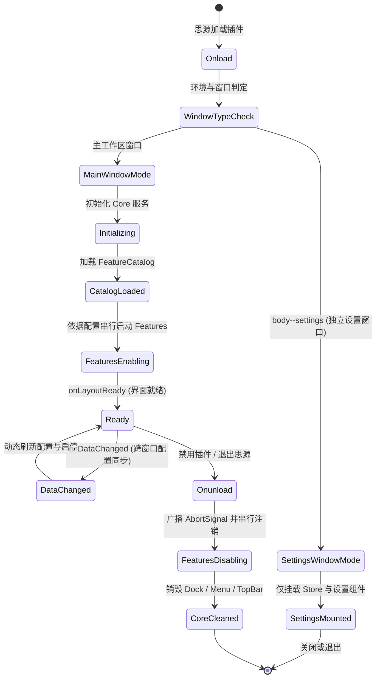
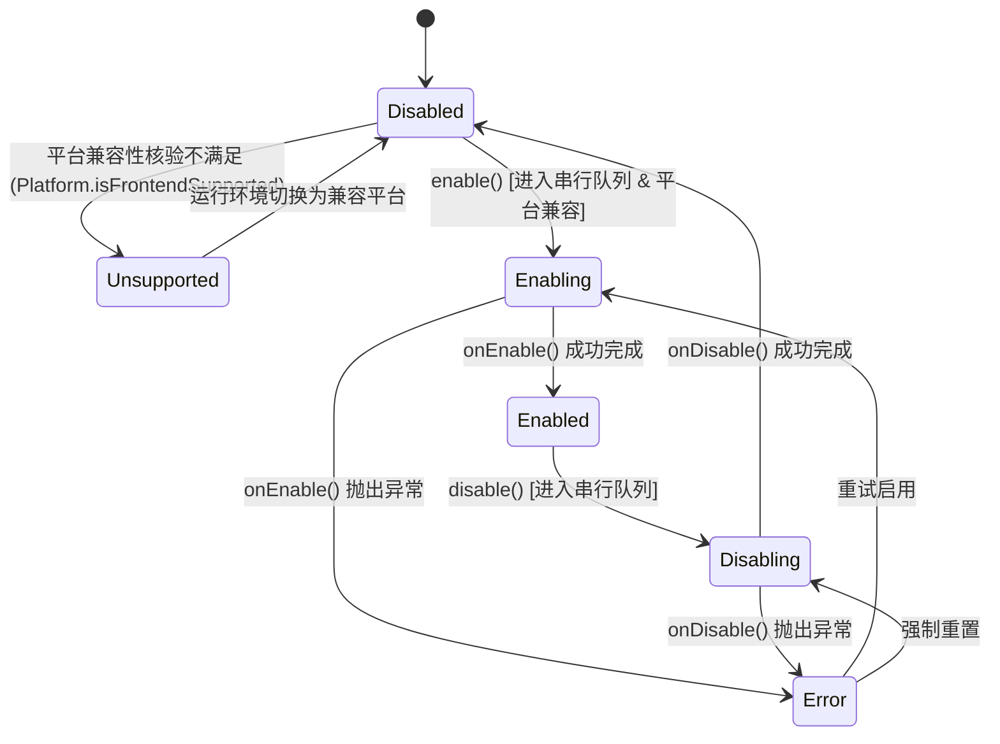
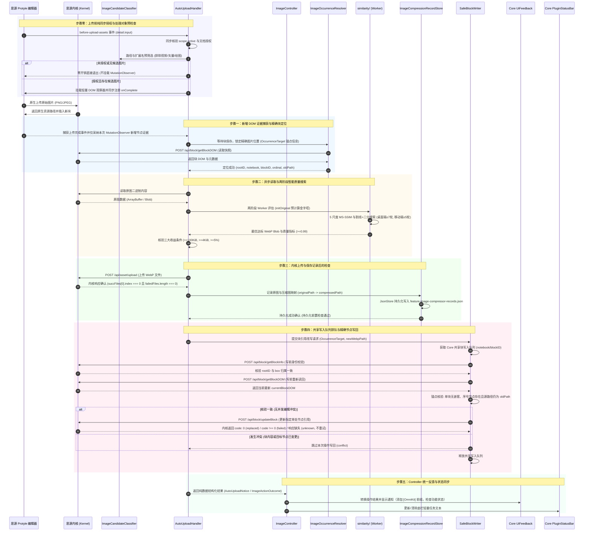
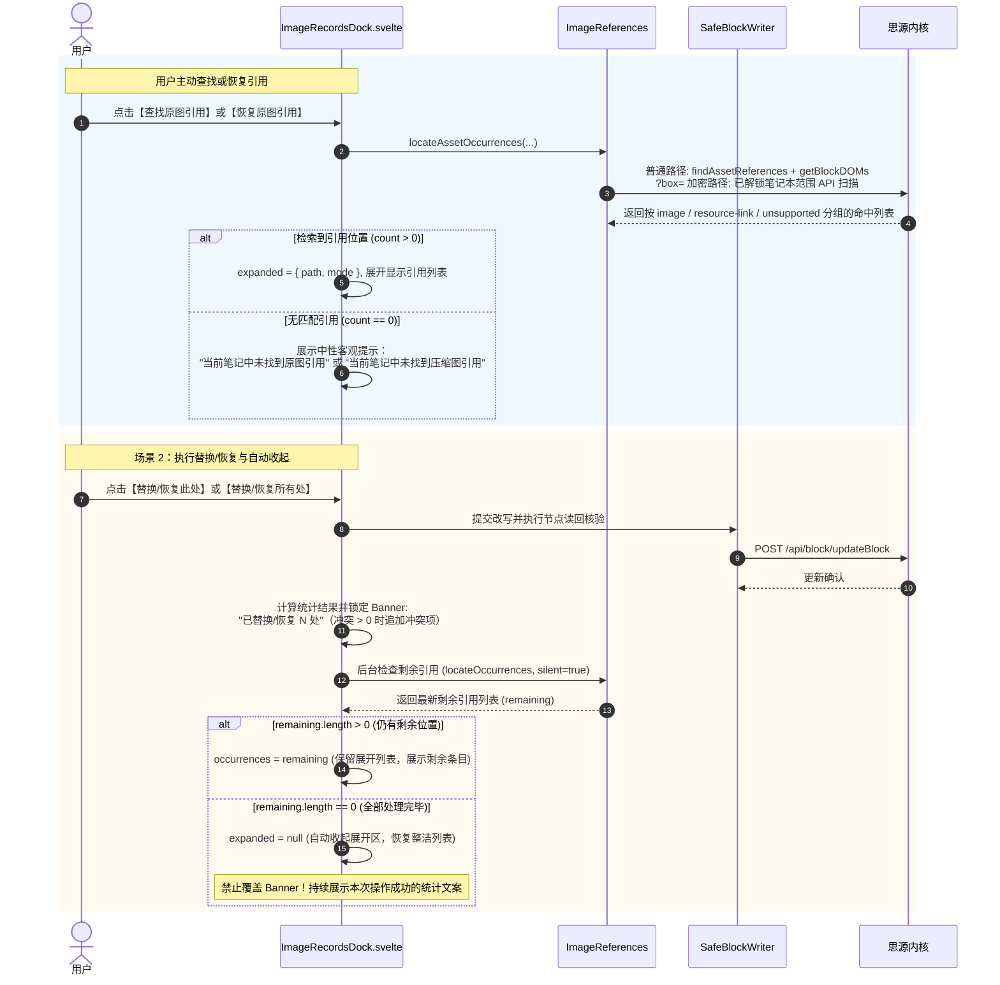
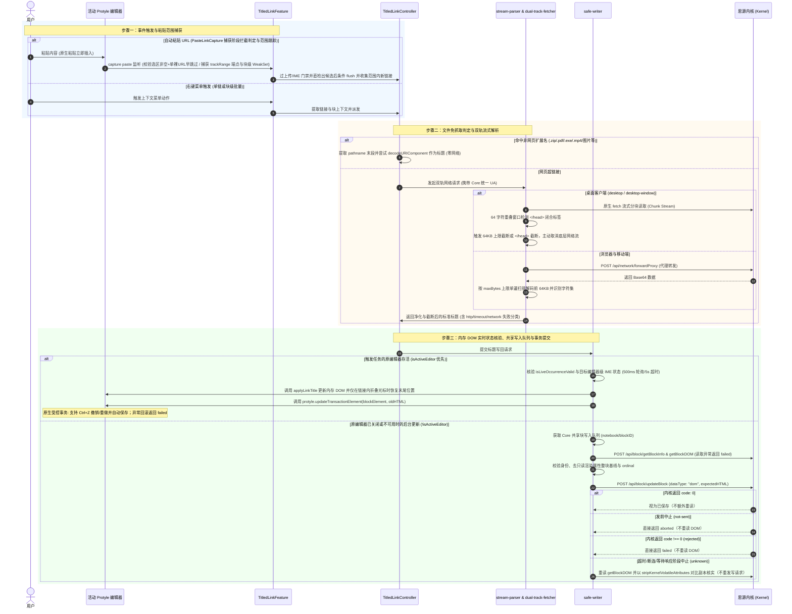
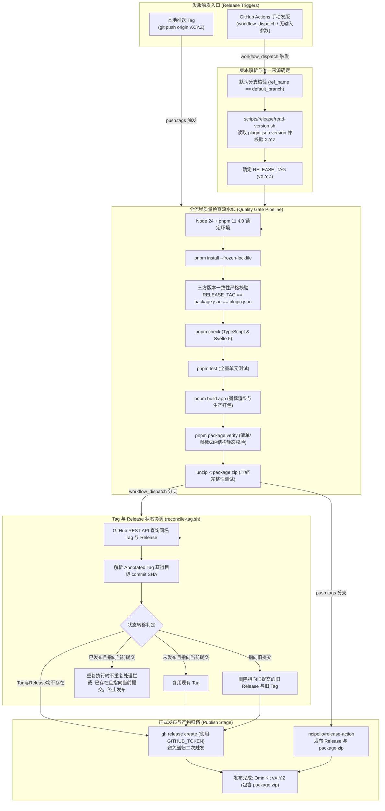

# OmniKit · 系统架构与技术实现设计文档 (ARCHITECTURE)

> **版本**：v1.0（正式发布稿）  
> **状态**：正式发布（Approved）  
> **设计基准**：严格遵循 [AGENTS.md](../AGENTS.md)、[CORE-PRD.md](CORE-PRD.md)、[image-compressor](features/image-compressor/PRD.md) 及 [titled-link](features/titled-link/PRD.md)（各特性严格维护独立的 `PRD.md` 与 `DESIGN.md`）

---

## 1. 架构概览与技术栈

OmniKit 是基于前端技术和思源笔记插件接口构建的多功能插件平台。

### 1.1 技术栈选型
- **编程语言**：TypeScript 6.x（启用 `strict: true`、严格类型检查与安全泛型约束）
- **构建工具**：Vite 8.x（多输出配置：主入口打包为 `index.js`、样式整合为 `index.css`、资源静态复制）
- **UI 组件框架**：Svelte 5（基于 Runes 响应式体系，通过 `mount` 与 `unmount` 精确控制生命周期）
- **样式体系**：SCSS（模块化样式组织，继承思源原生 CSS 变量自适应浅色/深色主题）
- **宿主环境**：思源笔记核心（Protyle 编辑器引擎、REST Kernel API、EventBus、Protyle Upload 流程）

### 1.2 核心规则
1. **微内核与单向依赖**：Core 平台层不依赖 Feature 的内部实现，各功能通过元数据注册；
2. **多窗口隔离**：思源独立设置窗口（`body--settings`）只渲染设置界面，不启动工作区功能；
3. **配置与数据分开保存**：每个文件的读写按顺序执行；严格通过 `/api/file/getFile` 读取，并通过 `saveData` 保存；设置文件与业务数据文件分开管理；
4. **写回前检查**：根据 `OccurrenceTarget` 检查目标内容，使用进程内队列协调并发写入，并在替换图片引用前保存对应记录；
5. **构建和发布检查**：使用统一脚本执行检查，发布流程可安全重复执行。

---

## 2. 系统分层架构

OmniKit 划分为清晰的“宿主适配层”、“Core 平台基础设施层”与“Feature 业务特性层”三层架构：

```mermaid
flowchart TD
    subgraph Host["宿主环境 (SiYuan Note)"]
        H_API["Kernel REST API (/api/...)"]
        H_Event["EventBus / Protyle Lifecycle"]
        H_UI["Host Dock / Context Menu / TopBar"]
    end

    subgraph Core["OmniKit Core 平台层 (src/core/ & src/ui/)"]
        PluginEntry["OmniKitPlugin (插件主入口)"]
        Catalog["FeatureCatalog (BaseFeature 运行实例集合)"]
            Manager["FeatureManager (平台支持检查与串行状态机)"]
        Scope["FeatureScope (AbortSignal & 资源作用域)"]
        
        subgraph CoreInfra["基础设施与驱动"]
            KernelClient["KernelClient (安全 API 调用封装)"]
            BlockWriteLease["BlockWriteLease (跨 Feature 共享块写入锁，按块排队)"]
            CoreHelpers["describeError / TaskId / ProtectedSelectors"]
            ProtyleAdapter["ProtyleAdapter (宿主数据标准提取器)"]
            SettingsMgr["SettingsManager (多文件配置协调器)"]
            JsonStore["JsonStore (单文件串行队列/指纹跳写/异常恢复)"]
            Logger["Logger (控制台分级日志)"]
            Platform["Platform (环境探测 & IsTargetSupported 判定)"]
        end
        
        subgraph CoreUI["统一宿主 UI 容器"]
            UnifiedDock["UnifiedDock (单槽位 Tab 容器)"]
            SettingsShell["SettingsRoot.svelte (iPad 双栏联动面板 & 全局浮动保存栏)"]
            DraftProtocol["DraftParticipant.ts (全界面统一草稿协议)"]
            MenuRouter["MenuRouter & MenuRegistry (上下文路由与 Checkbox/前缀适配)"]
            FeedbackService["UiFeedback (通知前缀/防抖/中止捕获)"]
            StatusBar["PluginStatusBar (单例底栏状态栏)"]
        end
    end

    subgraph Features["Feature 业务特性层 (src/features/)"]
        subgraph ImgCompressor["image-compressor (图片压缩特性)"]
            FeatImage["ImageCompressorFeature"]
            ImgController["ImageController (业务控制器)"]
            Classifier["ImageCandidateClassifier (统一处理条件/视频/Excalidraw)"]
            AutoUpload["AutoUploadHandler (上传完成异步捕获)"]
            RemoteWatcher["RemoteImageWatcher (外链安全本地化)"]
            SafeWriter["SafeBlockWriter (使用 BlockWriteLease 检查并改写 Occurrence 节点)"]
            WorkerCodec["BicEncoder (WebP 编解码引擎)"]
            SimilarityDomain["similarity/ (5尺度MS-SSIM/自适应搜索/内联Worker)"]
            RecordStore["ImageCompressionRecordStore (Dock 业务数据持久化)"]
            AllowlistPaths["allowlistPaths.ts (白名单只读 SQL 批量路径)"]
            DockView["ImageRecordsDock.svelte (Tab 视图组件)"]
            SettingsView["ImageSettingsBridge / ImageSettingsPanel (设置卡片组件)"]
        end

        subgraph TitledLink["titled-link (自动标题链接特性)"]
            FeatTitledLink["TitledLinkFeature"]
            PasteCapture["PasteLinkCapture.ts (capture paste / trackRange / MutationObserver)"]
            TitledLinkController["TitledLinkController (业务控制器)"]
            BatchSummary["batchSummary.ts (7 桶守恒批量统计)"]
            DualFetcher["dual-track-fetcher (桌面 fetch / 代理 forwardProxy)"]
            StreamParser["stream-parser (</head>/64KB 流式截断 & 编码识别)"]
            SafeWriterTL["safe-writer (写前核验、受控事务与重读校验)"]
            TitleCache["TitleCache (短期内存 LRU 缓存)"]
            TitledLinkSettingsView["TitledLinkSettingsPanel.svelte (设置组件)"]
        end
        
        subgraph FutureFeatures["未来扩展特性..."]
            FeatX["Feature X (独立业务逻辑与数据)"]
        end
    end

    %% 依赖与交互调用链
    Host <--> PluginEntry
    PluginEntry --> Catalog
    PluginEntry --> Manager
    PluginEntry --> SettingsMgr
    PluginEntry --> UnifiedDock
    PluginEntry --> MenuRouter
    PluginEntry --> StatusBar

    Manager --> Scope
    Manager --> FeatImage
    Manager --> FeatTitledLink
    Manager --> FeatX

    FeatImage --> ImgController
    ImgController --> Classifier
    ImgController --> AutoUpload
    ImgController --> RemoteWatcher
    ImgController --> SafeWriter
    ImgController --> WorkerCodec
    ImgController --> SimilarityDomain
    ImgController --> RecordStore
    ImgController --> FeedbackService
    ImgController --> StatusBar

    FeatTitledLink --> TitledLinkController
    TitledLinkController --> DualFetcher
    TitledLinkController --> StreamParser
    TitledLinkController --> SafeWriterTL
    TitledLinkController --> TitleCache
    DualFetcher --> KernelClient
    SafeWriterTL --> KernelClient
    SafeWriterTL --> BlockWriteLease
    
    SafeWriter --> KernelClient
    SafeWriter --> BlockWriteLease
    AutoUpload --> KernelClient
    RemoteWatcher --> KernelClient
    KernelClient --> H_API

    RecordStore --> JsonStore
    SettingsMgr --> JsonStore
    JsonStore --> H_API

    UnifiedDock -.-> DockView
    SettingsShell -.-> SettingsView
    SettingsShell -.-> TitledLinkSettingsView
    MenuRouter --> H_UI
```



---

## 3. Core 平台核心设计与类职责

### 3.1 `OmniKitPlugin`（宿主接入与多窗口处理）
- **文件位置**：`src/core/OmniKitPlugin.ts`
- **宿主生命周期流转**：



- **主要职责**：
  - 继承思源官方 `Plugin`，作为思源加载的唯一物理入口；
  - **多窗口隔离识别**：通过 `document.body.classList.contains("body--settings")` 识别独立设置窗口。在设置窗口中仅挂载 `SettingsManager`、Svelte 5 设置界面与 `JsonStore`（`onload()` 阶段仅预先创建设置窗口实例并加载配置存储，不自动弹窗；设置对话框统一由 `openSetting()` 响应显式入口打开）；独立设置窗口不实例化 `FeatureManager`（`manager === undefined`），受当前平台支持且开启配置为启用的特性其 `runtimePhase` 派生为 `"configured"`（对应国际化键 `runtime.configured`：“已配置启用（运行状态请看主窗口）”），不渲染停用提示条，也不初始化 Dock、`MenuRouter` 或后台监听器；
  - **主窗口启动、界面就绪与卸载**：在主工作区窗口中初始化 `Platform`、`Logger`、`SettingsManager` 并加载 `omnikit-core.json` 与各 Feature 配置；注册功能模块后按配置与 `Platform.isFrontendSupported` 依次启动已启用且平台支持的功能（不支持的功能置为 `unsupported` 不启动），随后注册 Dock 与 `MenuRouter`；`onLayoutReady()` 阶段挂载底栏状态栏 `PluginStatusBar`（注入 `FeatureContext.statusBar`）并调用 `registerTopBar(...)` 注册顶栏入口，Feature 的冷启动与热启用统一走 `BaseFeature.onEnable()` 与 `plugin.eventBus` 监听（不设独立的 `onLayoutReady` 功能钩子）；`onunload()` 阶段标记 `unloading = true`，停止接收与调度新任务，销毁 `PluginStatusBar`，按相反顺序停用运行中的 Feature，并销毁 Unified Dock、`MenuRouter` 路由监听与全局事件总线；
  - **外部数据同步 (`onDataChanged`)**：收到跨窗口或外部同步触发的 `onDataChanged` 时先等待 `ready` 就绪，且重载期间不回写文件。在主窗口按顺序执行：先遍历已注册 Feature 调用可选 `reloadData(this)`（如 `imageCompressor` 仅对已初始化的 `ImageCompressionRecordStore` 重载 `feature-image-compressor-records.json`），再调用 `SettingsManager.reloadAfterExternalChange()` 协调启停与参数变更（不支持的平台继续保持 `unsupported`），最后刷新 Dock 视图；在 `body--settings` 窗口仅调用 `SettingsManager.reloadAfterExternalChange()` 同步外部配置变更并驱动并发修改提示；
  - **顶栏与下拉菜单装配**：统一注册 Core Dock 单槽位、TopBar 图标与设置对话框；构建顶栏下拉菜单时严格按分层组织：顶部 Core 平台项（「OmniKit 设置」） + 调用思源原生 `menu.addSeparator({ id: "separator_settings" })` 分隔线 + 各 Feature 业务选项（Dock 栏已有常驻入口，顶栏不设立重复的打开 Dock 选项）。

### 3.2 `FeatureCatalog` 与 `FeatureManager` (生命周期与状态机)
- **文件位置**：`src/core/framework/FeatureCatalog.ts`、`src/core/framework/FeatureManager.ts`、`src/core/framework/FeatureRegistration.ts`
- **Feature 元数据定义 (`FeatureRegistration<T>`)**：每个 Feature 在 `src/features/<feature-name>/registration.ts` 中声明标准元数据，Core 不硬编码具体 Feature 的配置字段：

```typescript
/**
 * 思源笔记支持的前端平台运行环境规范（5+1 取值集合）
 * - "desktop": 桌面客户端主窗口 (Electron)
 * - "desktop-window": 桌面端独立拆分窗口
 * - "mobile": 移动端原生 App (Android / iOS)
 * - "browser-desktop": 桌面端浏览器访问
 * - "browser-mobile": 移动端浏览器访问
 * - "all": 全端通用支持（通配符）
 */
export type SiyuanFrontend =
  | "desktop"
  | "desktop-window"
  | "mobile"
  | "browser-desktop"
  | "browser-mobile"
  | "all";

export interface FeatureRegistration<T> {
  /** 唯一功能标识符（小驼峰或 kebab-case，如 "imageCompressor"、"titled-link"） */
  readonly id: string;
  /** 国际化标题对应的 key（如 "feature.imageCompressor.title"） */
  readonly titleKey: string;
  /** 国际化简要描述对应的 key */
  readonly descriptionKey: string;
  /** 功能首次安装或无持久化配置时的默认开关状态（由 Feature 自行声明） */
  readonly defaultEnabled: boolean;
  /**
   * 功能支持的前端平台环境白名单列表（可选）
   * 采用 5+1 取值集合：desktop, desktop-window, mobile, browser-desktop, browser-mobile, all
   * 省略或为空数组时默认为全端通用支持 (即 ["all"])
   */
  readonly frontends?: readonly SiyuanFrontend[];
  /**
   * Feature 用户配置文件名，严格遵循命名规范：
   * 格式固定为 `feature-${slug}-settings.json`（由 featureConfigFile(id) 将 id 转为 kebab-case 派生）
   */
  readonly file: `feature-${string}-settings.json`;
  /** 配置编解码与校验器，定义 defaults() 和 parse(raw) */
  readonly codec: StoreCodec<T>;
  /**
   * 可选：跨端/外部数据同步钩子
   * 当收到思源内核 onDataChanged 广播时，Core 负责在配置协调前调用该钩子，由 Feature 自行重载业务数据
   */
  readonly reloadData?: (plugin: Plugin) => Promise<void>;
  /** Feature 运行时实例工厂函数 */
  create(plugin: Plugin, settings: SettingsManager): BaseFeature;
  /** Feature 归属的 Svelte 5 设置面板组件，在统一设置页中动态挂载 */
  readonly settingsView: Component<{
    store: JsonStore<T>;
    runtimePhase: FeaturePhase | "configured";
    t: (key: string, values?: Record<string, string | number>) => string;
    registerDraft?: (participant: DraftParticipant) => () => void;
  }>;
  /** 可选：若该 Feature 提供 Dock 视图，则提供 Svelte 5 Dock 组件 */
  readonly dockView?: Component<{
    context: FeatureContext;
    t: (key: string, values?: Record<string, string | number>) => string;
  }>;
}
```

- **主要职责**：
  - `FeatureCatalog` 仅管理已注册的 `BaseFeature` 运行实例（`register` / `get` / `all`）；声明式元数据（`FeatureRegistration<T>`）与配置文件名校验（`featureConfigFile` / `validateFeatureFiles`）分别由 `FeatureRegistration` 与 `SettingsManager` 持有与执行；
  - `FeatureManager` 维护每个 Feature 的严格串行化启停队列（Promise Queue），提供跨端安全的生命周期调度；当宿主广播 `onDataChanged` 或发生外部数据文件写同步时，由插件入口（`OmniKitPlugin.onDataChanged`）遍历全部已注册 Feature 调用可选 `reloadData` 钩子（按需重载已初始化的数据存储），再由 `SettingsManager` 与 `FeatureManager` 协调配置与启停；
  - **六状态机模型 (`FeaturePhase`)**：
    - `disabled`：未激活停用状态；
    - `unsupported`：宿主前端平台不兼容状态；
    - `enabling`：正在分配 Scope 与执行异步初始化；
    - `enabled`：已成功激活并正常运行；
    - `disabling`：正在广播中止信号与安全注销资源；
    - `error`：启停或执行遭遇未捕获异常；



  - **平台支持检查与云同步偏好保护 (Platform Compatibility Guard)**：
    1. **启动与配置更新时检查**：在 `initialize()` 与 `reconcileFromLoadedSettings()` 阶段，`FeatureManager` 调用 `Platform.isFrontendSupported(feature.frontends)` 核验当前运行环境。若环境不支持，立即跳过生命周期激活（不调用 `feature.activate()` 与 `onEnable()`，不分配 `FeatureScope`，不占用任何常驻定时器、DOM 节点或事件总线），将运行时状态置为 `"unsupported"`；
    2. **`setEnabled` 安全拦截机制**：当外界或 API 尝试显式调用 `setEnabled(id, true)` 或 `enable(id)` 时，若当前平台不支持该功能，`FeatureManager` 直接拒绝状态变更（返回 `false`），且**不调用 `settings.setFeatureEnabled(id, true)`**；
    3. **保留跨端启用设置**：轻量端（如移动端）不支持某个功能时，只将其运行状态标记为 `unsupported`，不修改 `omnikit-core.json` 中的启用设置。因此，在受支持的设备（如桌面端）上仍会按该设置启动；
  - 当 Feature 启动失败时，置状态为 `error` 并记录异常，保持用户在 `omnikit-core.json` 中配置的期望偏好不变。

### 3.3 `BaseFeature`、`FeatureScope` 与 `FeatureContext` (资源作用域与中止信号)
- **文件位置**：`src/core/framework/BaseFeature.ts`、`src/core/framework/FeatureScope.ts`、`src/core/framework/FeatureContext.ts`
- **受控上下文定义 (`FeatureContext`)**：

```typescript
/**
 * Core 平台向 Feature 运行时注入的受控上下文规范
 */
export interface FeatureContext {
  /** 思源插件宿主实例 */
  readonly plugin: Plugin;
  /** 平台多文件配置管理器 */
  readonly settings: SettingsManager;
  /** 平台菜单注册表 */
  readonly menus: MenuRegistry;
  /** 控制台日志记录器 */
  readonly logger: Logger;
  /** Core 统一提供的用户交互与通知反馈入口（Feature 启用时绑定对应 FeatureScope） */
  readonly feedback: UiFeedback;
  /** 可选：Core 统一提供的底栏状态栏单例（桌面端提供，移动端或设置窗口为 undefined） */
  readonly statusBar?: PluginStatusBar;
  /** 当前 Feature 的生命周期作用域与 AbortSignal 广播器 */
  readonly scope?: FeatureScope;
}
```

- **主要职责**：
  - 每个业务功能继承 `BaseFeature`，激活时由 `BaseFeature.activate()` 创建当前激活专属的 `FeatureScope`，并将 `feedback` 通过 `feedback.forScope(scope)` 绑定至上下文；停用时 `deactivate()` 清除错误状态并执行 `onDisable()` 完成清理；
  - `FeatureScope` 原生封装 `AbortController`：
    - `scope.own(disposer)`：注册所有运行期副作用（Protyle 事件监听器、DOM 钩子、定时器）；统一由 `FeatureScope` 集中托管与自动注销；
    - `scope.signal`：向下传递的只读 `AbortSignal`；
    - `scope.guard(fn)`：包装异步回调；Scope 已销毁时跳过执行回调；
  - **任务取消边界与不显示提示并结束设计**：
    - 平台不设通用取消按钮、取消菜单或公开取消 API；文档标签页切换或编辑器关闭不中止已启动的后台异步任务（任务沿用启动时捕获的 `rootID` 与 `notebook`，写前通过内核 API 核验实时状态）；
    - Feature 自有进度 Dialog 的用户关闭行为（含按 Esc）遵循对应特性 PRD 语义，控制器因完成、空结果或开始前失败程序化关闭弹窗仅销毁 UI，不记为用户取消；
    - 当 Feature 停用、插件卸载、宿主退出或特性允许的进度弹窗用户关闭触发 `signal.abort` 时，异步任务安全中止未开始步骤并不显示提示并结束，保留已确认产物与记录，不执行逆向回滚，重启不续跑；
    - 底层写回层对发出写请求前的中止返回 `"aborted"` 或抛出 `AbortError`，对已发出 `/api/block/updateBlock` 后响应超时、断连或中止的结果归类为 `"unknown"`（禁止自动重试），禁止与真实基线不匹配导致的 `"conflict"` 混为一谈；
  - 当 Feature 停用或插件卸载时，`scope.dispose()` **首先广播 `abort` 信号**通知所有进行中的任务安全终止，再按后进先出（LIFO）顺序释放所有监听器。

### 3.4 `SettingsManager` 与 `JsonStore`（文件读写与恢复）
- **文件位置**：`src/core/store/SettingsManager.ts`、`src/core/store/JsonStore.ts`
- **核心机制**：
  - **精简存储模型与每文件独占 Promise 队列**：基于单文件 Promise 串行队列调度所有读写操作，严格通过 `/api/file/getFile` 读取（支持在构造参数中注入可选 `fetchFn?: typeof fetch` 供单元测试使用，如 `SettingsManager` 与 `ImageCompressionRecordStore` 透传 `fetchFn`）与 `Plugin.saveData` 持久化，避免写竞争；
  - **内容指纹防抖**：内存维护序列化指纹（`fingerprint`），相同数据重复保存自动跳过实际磁盘 I/O；`reload()` 方法在内容指纹变动或只读保护状态变动时均返回 `true`，确保外部状态协调准确响应；
  - **读写双路径 30 秒超时保护与不重试规则**：对 `/api/file/getFile` 读路径与 `saveConfirmed` 调用 `plugin.saveData` 的写路径均实施 30 秒超时保护；写入超时后直接抛出错误且不执行重试，防止宿主异步 API 永久挂起而阻塞单文件串行队列；
  - **严格单通道读取、缺失边界与只读状态规则**：`JsonStore` 严格仅通过思源内核 `/api/file/getFile` 读取 `/data/storage/petal/${pluginName}/${file}`（无 `Plugin.loadData()` 读取路径）：
    - **唯一缺失判定**：仅当 `/api/file/getFile` 返回 HTTP `202` 且思源返回体 `code === 404` 时，确认为未创建或新安装文件，使用 `defaults()` 并允许后续初始化保存；
    - **HTTP 200 空串与损坏只读保护**：当 HTTP `200` 返回空串、全空白内容或存在 JSON 语法损坏时，进入 `needsRecovery` 只读保护状态；仅对非空损坏物理内容生成 `.backup` 备份文件，纯空白内容不生成空备份文件，并提示用户显式恢复，避免默认值覆盖；
    - **网络/超时/非缺失 HTTP 错保护**：遭遇网络错误、30 秒超时、HTTP 403/404/500 或其他非 `202 + code: 404` 响应时，直接进入 `needsRecovery` 只读保护模式（内部通过 `readOnlyReason` 记录原因，对外暴露 `needsRecovery` 与 `error` 属性并保留上一次内存有效数据），保持原持久化文件不被空缓存或默认值覆盖；
  - **跨窗口写入语义**：`omnikit-core.json` 在多窗口并发修改场景下采用 last-writer-wins 持久化语义，并结合 `onDataChanged` 同步最新保存配置；
  - **并发加载、空 UA 自动补全与容错重载**：`SettingsManager.load()` 采用 `Promise.allSettled` 并发加载全部存储并记录所有读取失败，仅将失败 Store 保持为只读保护状态，不中断插件初始化，确保恢复入口可达；加载完成后若 `omnikit-core.json` 处于可读状态且 `general.userAgent.trim() === ""`，自动赋值为 `DEFAULT_USER_AGENT` 并写回配置文件（写回失败仅输出警告，不阻塞启动）；`reloadAfterExternalChange()` 采用 `Promise.allSettled` 并发重载各 Store 且不写回磁盘，确保单个 Store 异常不阻塞其余 Store 与宿主 `onDataChanged`，并按固定顺序返回变更列表。

### 3.5 `KernelClient` 与 Core 共享基础设施
- **`KernelClient` (`src/core/host/KernelClient.ts`)**：
  - 封装对思源原生 REST API（`fetchPost` / `fetchSyncPost`）的 `/api/...` 网络交互，支持调用方传入 `AbortSignal` 与默认 30 秒超时；超时定时器不仅拒绝当前 Promise，同时显式调用底层 `fetch` 的 `AbortController.abort()` 释放网络套接字连接；
  - `KernelResponse<T>` 与 `node_modules/siyuan/types/api/index.d.ts` 对齐，包含顶层可选字段 `limit?: number` 与 `truncated?: boolean`；
  - `KernelRequestError["outcome"]` 严格区分为 `"not-sent" | "rejected" | "unknown"`：发送前检测到 `signal.aborted` 抛出 `"not-sent"`；收到响应对象且 `typeof result.code === "number" && result.code !== 0` 时抛出 `"rejected"`（保留 `code`）；仅空响应、无效响应、网络异常、超时或发后中止抛出 `"unknown"`；修改类请求失败时不自动重试，避免重复提交；
- **共享块写入租约 (`BlockWriteLease`)**：
  - Core 按 `notebook/blockID` 在进程内排队，并在轮到任务时授予该块的写入权；`imageCompressor` 与 `titled-link` 共用此机制；
  - 排队期间收到 `AbortSignal` 时立即退出；获得写入权后再次检查中止状态。思源 `/api/block/updateBlock` 不支持原子 CAS，因此写入前仍须核验块身份与完整 DOM 快照；
- **统一结构化错误描述 (`describeError`)**：
  - 提取 `Error.message` 或思源 `{ code, msg }` 错误响应对象（格式化输出 `msg` 与错误码），防止界面或日志出现 `[object Object]`；
- **公共受保护 DOM 容器选择器常量 (`src/core/host/dom.ts`)**：
  - 由 Core 统一导出 `PROTECTED_CONTAINER_SELECTOR` 常量（`[data-type="NodeCodeBlock"], [data-type="NodeBlockQueryEmbed"], .protyle-wysiwyg__embed, pre, code`），供各 Feature 统一复用；
- **`Platform` 运行环境判断与五端兼容性算法**：
  - 插件 `plugin.json` 的 `frontends` 列出五个平台（`desktop`、`desktop-window`、`mobile`、`browser-desktop`、`browser-mobile`）。宿主先检查清单，Core `Platform` 通过 `getFrontend()` 探测当前前端类型并辅助识别操作系统平台（Windows / macOS / Linux / Android / iOS）；
  - 核心判定算法 `isFrontendSupported(frontends?: readonly SiyuanFrontend[], current?: SiyuanFrontend): boolean` 与思源内核 Go 实现（`kernel/bazaar/plugin.go` 中 `IsTargetSupported`）对齐：当 `frontends` 缺失或为 `[]` 时返回 `true`（等价于 `["all"]`）；包含 `"all"` 或匹配当前 `current` 时返回 `true`；否则返回 `false`；
  - `SettingsRoot` 通过 `platform.*` 语言包键名与插值参数 `t(key, { platforms })` 格式化兼容性提示。

### 3.6 统一 UI 扩展系统
- **统一 Dock 容器** (`src/ui/dock/`)：
  - 仅占用思源侧边栏 **1 个图标位置**；
  - 内部实现 Svelte 5 驱动的 Tab 路由管理器：当多个 Feature 启用 Dock 视图时展示 Tab 头；仅单个 Feature 启用时独占主视图；全停用时呈现空状态指引；
  - **视图和组件缓存**：`registerDock` 保存容器节点（标题、`tabsHost`、`viewHost`、底部按钮）及 `mountedID` / `mountedComponent` / `lastTabsSignature`；同一视图保持打开时复用 Svelte 实例，只更新标题、Tab 列表和按钮文案；全部停用或切换 Tab/组件时调用 `unmount`；
  - **视图与 Dock 组件生命周期 Abort 机制**：Dock 视图组件持有专用的 `AbortController`；当组件卸载、Dock 折叠或 Tab 切换销毁时，立即广播中断信号，取消进行中的后台引用检索与状态核验；
  - **平台兼容性排除**：Dock 动态视图提取函数（`views()`）严格筛选 `this.manager?.isRunning(id)` 的 Feature。处于 `unsupported` 状态的功能不被视作运行中，自动排除在 Dock Tab 之外，不产生多余标签页与空 DOM 挂载；
  - **容器与视图界面职责边界**：
    - Core 统一 Dock 容器（`registerDock`）只提供通用容器框架（标题 `omnikit-heading`、Tab 栏 `omnikit-dock-tabs`、视图挂载区 `omnikit-dock-view`、空状态提示 `omnikit-dock-empty`）与底部的「打开设置」按钮（`dock.openSettings`）；
    - 顶部约 52px~56px 高度的品牌 Hero 卡片（`image-records__hero`，包含图标、标题与副标题，使下方「刷新记录」等操作区下移 50px 以上，避开思源桌面端与网页端右上角 32px 浮动 Snackbar `#message` / `.b3-snackbars` 与 Tooltip 浮层遮挡）与「刷新记录」按钮属于图片记录视图（`ImageRecordsDock.svelte`）自身界面；
    - **后台刷新不覆盖操作结果**：图片记录视图在改写操作后执行 `post_action` 检查。如果检查出错或没有返回结果，不覆盖刚显示的成功统计；待处理项为 0 时收起抽屉并保留统计结果；
  - 依托 Svelte 5 `mount` / `unmount` 精准控制各 Feature 视图的装载与卸载。
- **局域网 HTTP 环境与无 WebCrypto 兼容规范**：
  - 在局域网非 HTTPS（`window.isSecureContext === false`）环境下，宿主浏览器不暴露 `crypto.randomUUID()` 与 `crypto.subtle`；
  - Core 通过进程内单调计数器与时间戳生成运行时任务 ID（不依赖 `crypto.randomUUID()`）；当 `navigator.clipboard.writeText` 不可用或写入被拒绝时，交互层（如 `ImageTaskUI` / `ImageRecordsDock`）展示带全选只读文本框的弹窗供用户手动复制。
- **统一设置面板 (`SettingsRoot.svelte` & `src/ui/settings/DraftParticipant.ts`)** (`src/ui/settings/`):
  - 采用 iPad 风格双栏联动布局（左侧导航分组「通用设置」`general.title` 与「功能模块」`nav.features`，文案统一通过 `t(...)` 读取；右侧 `.omnikit-settings-scroller` 单页平滑滚动卡片，保留 `.scroll-bottom-spacer { height: 15rem }` 确保桌面端最后一张卡片可完整滚顶对齐）；
  - **全界面统一草稿协议 (`DraftParticipant`) 与唯一全局浮动保存栏**：
    - `src/ui/settings/DraftParticipant.ts` 定义统一草稿参与者协议，`FeatureRegistration.settingsView` 声明可选草稿注册 prop（`registerDraft`，由 `ImageSettingsBridge.svelte` 等桥接组件透传至子面板）；
    - 通用设置（`general.debugLog`、`general.userAgent`）、当前平台支持的功能总开关（`featureStates[id].enabled`）与各功能专属参数统一采用界面草稿编辑（对 Svelte 5 `$state` 使用 `$state.snapshot(...)` 克隆，参与者列表使用 `$state.raw`），各功能卡片内部无独立保存或重置按钮；
    - 整个设置窗口仅在 `.omnikit-settings-scroller` 底部保留唯一全局浮动操作栏（底边 `bottom: 0`，`env(safe-area-inset-bottom, 0px)` 置于自身 `padding-bottom`，兼容 `@media (max-width: 680px)` 窄屏安全区），提供**“恢复默认值”**（`settings.resetDraft`）与**“保存设置”**（`settings.save`）按钮，动态展示“已保存 / 有未保存更改 / 正在保存”（`globalSaving`）状态；
    - **只读恢复隔离与草稿重置规则**：点击全局**“恢复默认值”**仅将未处于 `needsRecovery` 只读保护状态的可编辑草稿（包含通用设置、未只读且当前平台支持的功能开关草稿与未只读的功能参数草稿）恢复为默认值而不写盘；只读 Feature 的开关与参数草稿维持只读保护跳过重置；对 `coreBaseline.featureStates` 未显式持有的条目保持未设置状态，避免首次安装产生虚假 `coreDirty`；
    - **校验、分文件保存与协调顺序**：使用 `settings.core.snapshot()` 与 `settings.core.update(mutator)` 维护与写入 Core 草稿；点击全局保存按“全部草稿校验（含 `User-Agent` 校验失败专用 i18n 错误键） → 保存变更 Feature → 保存 Core → `manager.reconcileFromLoadedSettings()` → `manager.notifySettingsChanged()`”顺序执行（子面板与 Core 均执行基线比对与 `SettingsConflictError` 冲突判定，冲突时置 `conflict = true` / `coreConflict` 并在 `.notice.notice--error` 横幅提供“放弃草稿并载入” `settings.discardReload` 与 `discardCoreDraftAndReload()`；多文件分步保存的非原子边界与只读跳过以注释明确说明并通过 `Logger` 输出 `debug` 级日志）；
    - 损坏恢复区域的按钮文案统一为**“备份并恢复设置”**（`recovery.settingsButton`）；
  - **`User-Agent` 草稿绑定与冲突判定**：`User-Agent` 输入框直接绑定 `coreDraft.general.userAgent`（初始化、恢复默认值，以及读取到可读 `omnikit-core.json` 中 `userAgent.trim() === ""` 时自动赋值并落盘，均使用 `DEFAULT_USER_AGENT`；保存时执行 `.trim()` 并在为空时自动回填预置 `DEFAULT_USER_AGENT`；`SettingsManager.getUserAgent()` 保留 `.trim() || DEFAULT_USER_AGENT` 双重兜底），保留 `data-omnikit-field="user-agent"` 焦点检测与草稿脏状态保护，外部同步通知不覆盖正在编辑或存在未保存草稿的输入内容；并发保存冲突判定使用稳定错误类型（`SettingsConflictError` / `isSettingsConflictError`），不依赖本地化文案子串匹配；
  - **白名单层级路径解析去重**：设置面板通过 `services/allowlistPaths.ts` 与非响应式登记集合 `pathLookupsStarted: Set<string>` 协同解析白名单文档路径，从白名单删除条目时同步清理 `resolvedHPaths` 缓存与 `pathLookupsStarted`，组件卸载时通过 `AbortController` 中止未完成查询，确保单次面板挂载周期内同一文档至多发起一轮路径查询；
  - **平台支持检查架构 (卡片保持展示，总开关置灰禁用，专属设置可预先调整)**：
    - 针对 `runtime.status === "unsupported"` 的 Feature，设置卡片在右侧正常排布渲染，左侧导航正常提供平滑定位，维持全端 UI 结构与视觉一致性；
    - **总开关置灰禁用（Disabled Guard）**：卡片头部总开关设置 `disabled` 属性置灰禁用，不可点击切换，阻止非法生命周期触发；
    - **状态 Badge 与平台说明**：卡片顶部 Badge 渲染 `runtime.unsupported`（「不支持当前平台」），并展示 `feature.unsupportedFrontend`（「当前设备运行环境不支持此功能（支持平台：...）」）；
    - **专属设置项允许预调**：卡片主体内的专属设置组件（`settingsView`）保持挂载并允许交互调整，满足跨端云同步场景下提前配置参数的诉求；修改保存仅局限于其专属配置文件 `feature-{id}-settings.json`，不触碰 `omnikit-core.json`；
- **统一 TopBar 入口 (`registerTopBar`)** (`src/ui/topbar/registerTopBar.ts`)：
  - 在思源顶栏右侧注册统一的 OmniKit 图标入口（`id: "omnikit-core"`）；
  - **单击 TopBar 图标 (`callback`)**：弹出顶栏下拉菜单（`new Menu("omnikit-core-menu")`），桌面端按图标（或 `#barMore` / `#barPlugins` 回退节点）坐标锚点展开，移动端及手机浏览器调用 `menu.fullscreen()` 全屏展开；
  - **右键 TopBar 图标 (`contextMenu`)**：弹出与单击内容一致的上下文菜单；
  - **顶栏菜单与分隔线规范**：菜单第一项固定为平台级命令**「OmniKit 设置」**（Dock 栏已有常驻图标，顶栏不设立重复的 Dock 菜单项）；随后调用思源 SDK 的 `menu.addSeparator({ id: "separator_settings" })`（生成 `<button data-id="separator_settings" class="b3-menu__separator"></button>`）分隔，再调用 `menus.render("topbar", ...)` 动态渲染各已启用 Feature 快捷操作（无 `[OmniKit]` 前缀）；`MenuRegistry.render()` 返回实际渲染条目数，顶栏左键菜单在返回值为 `0`（无已启用功能项）时自动移除尾部悬空分隔线。
- **统一菜单路由器 (`MenuRouter` / `MenuRegistry`)** (`src/core/feedback/MenuRouter.ts` / `src/core/feedback/MenuRegistry.ts`)：
  - **通用上下文转换与业务解耦架构**：
    - `MenuRouter` 作为通用的宿主事件到上下文转换层，集中监听思源 EventBus 的 5 个上下文菜单事件：`click-editortitleicon`（`doc-title`）、`open-menu-doctree`（`doc-tree`）、`open-menu-image`（`image`）、`open-menu-link`（`link`）与 `click-blockicon`（`blockicon`）；
    - **通用上下文提取**：`MenuRouter` 仅负责从原生 detail 中提取标准通用上下文（例如 `selectedDocumentIDs: string[]`、`selectedDocumentCount: number`、`protyle?: IProtyle`、`targetElement?: HTMLElement`、`blockID?: string`、`imageElement`、`imageURL` 等）；在 `open-menu-doctree` 中精确过滤笔记本节点（`detail.type === "notebook" || detail.type === "notebooks"`；`isNotebookDocTreeItem` 过滤 `type === "notebook"`、`type === "navigation-root"`、`type === "navigation-closed"`、`kind === "notebook"`、`path === "/"`；`isNotebookDocTreeElement` 过滤 `data-type` 为 `"navigation-root"`、`"navigation-closed"`、`"notebook"`），保留 `boxDocEnabled` 模式下 `path === "/<id>.sy"` 的文档节点，Core 平台层不含特定业务条件分支；
    - **Feature 自主注册 Matcher**：具体的业务匹配规则与菜单项由各 Feature 在自身模块内自主注册的 Matcher 判定。Matcher 接收标准通用上下文，自主决定是否激活菜单项、动态生成文案与绑定点击动作；
  - 严格校验菜单所属 Feature 的运行态（`phase === "enabled"`）；
  - **平台兼容性检查**：`unsupported` 状态的功能没有启动，也不会向 `MenuRegistry` 注册菜单动作；`isFeatureRunning` 会跳过其菜单项，因此外部上下文菜单和顶栏菜单不会显示这些动作；
  - **声明式 Checkbox 菜单映射 (`OmniMenuItem.checked`)**：`OmniMenuItem` 提供声明式 `checked?: boolean` 属性，`HostMenu.addItem` 支持可选 `bind?: (element: HTMLElement) => void`；`MenuRegistry.render()` 在 `item.checked !== undefined` 时内部生成 `bind` 回调（设置 `role="menuitemcheckbox"`、`aria-checked`、`.omnikit-checkbox-menu-item` 类名与视觉 `span.omnikit-menu-checkbox`），不向宿主传递原生 `checked`；普通菜单项保持无 `bind`；Feature 的 `menuContributions.ts` 仅声明 `checked`，保持纯声明式而不直接操作宿主 DOM；
  - **菜单前缀的统一处理规则 (Context-Aware Prefix via MenuRegistry)**：
    - `MenuRegistry` 负责注册和派发菜单项，并统一添加前缀；Feature 层不直接写入前缀；
    - 顶栏自有菜单 (`location === "topbar"`)：不包含 `[OmniKit]` 前缀，保持界面简洁；
    - 外部宿主上下文菜单 (`location === "doc-tree" | "doc-title" | "image" | "link" | "blockicon"`)：由 `MenuRegistry` 自动保留并统一补齐 `[OmniKit] ` 前缀，确保明确的插件归属标识；
  - 若触发时对应功能处于停用状态，调用轻量通知 `showMessage` 提示功能未启用，不弹出模态对话框。

### 3.7 `UiFeedback` (统一通知与交互反馈入口)
- **文件位置**：`src/core/feedback/UiFeedback.ts`
- **主要职责**：
  - 注入 `FeatureContext.feedback`，为所有 Feature 提供平台统一管理的用户交互与通知反馈服务（仅负责通知前缀，菜单前缀由 `MenuRegistry` 负责）；
  - **前缀自动补齐**：统一对外通知气泡追加 `[OmniKit] ` 前缀，Feature 调用时仅传入纯语义内容；
  - **生命周期检查**：`BaseFeature.activate()` 通过 `feedback.forScope(scope)` 绑定作用域；检查 `scope.active`（且 `copyable` 在异步剪贴板写入完成后再次检查 `scope.active`），Feature 已停用或插件正在卸载时，不显示尚未发出的提示；
  - **`isAbortError` 与 `handleError`**：导出 `isAbortError(error)`（识别 `name === "AbortError"`、`code === 20`、`name === "CanceledError"` 及递归检查 `error.cause`）；`handleError(error, fallbackMessage?)` 检查 `scope.active` 并静默忽略 `isAbortError(error)`，其余异常按 `fallbackMessage` 或 `describeError(error)`（兼容思源 `{ code, msg }` 错误对象）调用 `notify(msg, "error")`；
  - **防抖抑制**：在 300ms 时间窗口内抑制相同文本的高频重复弹出；
  - **通用能力**：提供标准的 `notify(message, type, options)` 及 `copyable(text: string, notice?: string)`（通过 `forScope(scope)` 绑定上下文作用域，不提供额外参数类型判断重载）。

### 3.8 `PluginStatusBar` (宿主底栏状态栏管理)
- **文件位置**：`src/core/feedback/PluginStatusBar.ts`
- **主要职责**：
  - 注入 `FeatureContext.statusBar`，作为主工作区底部轻量单行任务进度的单例入口；
  - **生命周期挂载与跨端短路**：在主窗口 `onLayoutReady()` 中由 Core 统一挂载，插件注销 `onunload()` 时调用 `dispose()` 清理；`mount()` 先通过 `isMobileFrontend()` 与 `body--settings` 窗口判断直接短路；在桌面主窗口中调用 `plugin.addStatusBar({ element, position: "left" })` 后，通过 `result === this.element && this.element.isConnected === true` 核验元素是否真实接入页面 DOM，未接入则移除节点并保持 `mounted = false`；禁止 Feature 自行注册状态栏节点；
  - **通用样式规范**：容器类名固定为通用的 `.omnikit-status-bar`，禁止硬编码 feature 名称；单行布局（`max-width: 260px; overflow: hidden; white-space: nowrap; text-overflow: ellipsis; font-size: 12px;`）；
  - **多任务字典调度**：内部维护 `tasks: Map<string, string>`，支持 `update(taskID, text)`（同时更新 `title` 悬浮提示）与 `clear(taskID)`；无活跃任务时自动添加 `.fn__none` 完全隐藏。

### 3.9 `ProtyleAdapter` (宿主数据标准提取器)
- **文件位置**：`src/core/host/ProtyleAdapter.ts`
- **主要职责**：
  - 将不同思源事件的数据转换为统一的 Protyle 上下文；
  - **提取常用字段**：从思源事件对象和编辑器实例读取所需信息（如 `detail.protyle.block.rootID`、`detail.protyle.element` 与 `getInstance()`）；
  - **只读提取**：以纯函数方式提取并检查上下文数据，并提供信号组合辅助（`combineSignals`），不修改 DOM 或其他状态。

### 3.10 `Logger` (控制台日志服务)
- **文件位置**：`src/core/host/Logger.ts`
- **主要职责**：
  - 统一日志输出格式：`[OmniKit][{level}] {message}`（无 `{tag}` 字段）；
  - `info`、`warn`、`error` 级别日志始终输出到开发者工具控制台；仅 `debug` 级别受 `omnikit-core.json` 中 `general.debugLog` 开关控制；
  - 所有日志仅输出到控制台，不向工作区写入任何日志文件。

---

## 4. 存储架构与持久化规范

```
SiYuan 工作区目录：data/storage/petal/siyuan-plugin-omnikit/
├── omnikit-core.json                      <-- Core 平台配置
├── feature-image-compressor-settings.json <-- Feature A 用户设置 (受重置管控；对应 Feature ID 为 imageCompressor，按 kebab-case 规则转为 - 连接)
├── feature-image-compressor-records.json  <-- Feature A 业务数据 (不受设置重置影响)
└── feature-titled-link-settings.json      <-- Feature B 用户设置 (受重置管控)
```

### 4.1 文件划分与生命周期

| 存储分类 | 文件路径规则 | 包含内容 | 重置操作影响边界 |
|---|---|---|---|
| **Core 平台配置** | `omnikit-core.json` | `schemaVersion: 1`<br/>`general: { debugLog, userAgent }`<br/>`featureStates: { [id]: { enabled } }` | 跨窗口写入采用 last-writer-wins 语义；**全局重置时重置**（恢复 debugLog 为 false，userAgent 为预置 Chrome UA） |
| **Feature 设置** | `feature-{id}-settings.json`（由 `featureConfigFile(id)` 将 ID 转为 kebab-case 派生） | 用户在各 Feature 设置页手动调整的业务参数（如质量、仅含 `{ grantedAt }` 的白名单、悬浮标题与域名降级等；`titled-link` 标题最大长度固定为代码常量 `80`，不写入设置文件） | 界面重置仅更新未保存草稿；**单功能重置**及**全局重置**时恢复默认值 |
| **Feature 业务数据** | `feature-{id}-{dataname}.json` | Feature 业务数据（如原图与 WebP 的对应关系） | **不受设置重置影响**；按对应 Feature PRD 的规则手动移除，或在内核确认资源不存在后清理对应记录 |

### 4.2 设置重置隔离机制
1. **重置隔离规范**：界面草稿重置操作仅调整内存表单草稿；`SettingsManager.resetFeature(id)` 与 `resetAll()` 仅针对 `omnikit-core.json` 与各 `feature-*-settings.json` 调用 `store.update(...)` 恢复默认值。底层存储注册表中数据文件（`feature-*-{dataname}.json`）使用独立的存储句柄（如 `ImageCompressionRecordStore`），设置重置逻辑不持有业务数据文件的写入权限。
2. **业务数据管理**：按各 Feature PRD 规定的方式管理记录，例如在 Unified Dock 中手动移除一条记录，或在内核确认资源不存在后清理对应记录。重置设置不会清空业务数据。

---

## 5. 图片压缩功能技术实现设计

### 5.1 上传后异步全流程时序



### 5.2 子模块职责与设计规范

#### 1. 架构分工与去重规范 (Feature-Controller-Action Separation)

为了消除多层重复判断、避免职责混乱引发假性报错或多重提示，系统确立严格的单向职责划分与所有权模型：

```
┌────────────────────────────────────────────────────────────────────────┐
│ Feature 层 (ImageCompressorFeature.ts)                                  │
│ - 负责思源宿主事件与菜单监听注册 (Protyle 事件 / 文档右键 / 图片右键)    │
│ - 负责提取宿主上下文 (Protyle 实例、blockID、rootID 等) 并派发给 Controller │
│ - 所有副作用与监听句柄统一由 FeatureScope (scope.own) 集中托管与注销   │
└───────────────────────────────────┬────────────────────────────────────┘
                                    │ 派发事件上下文
                                    ▼
┌────────────────────────────────────────────────────────────────────────┐
│ Controller 控制层 (ImageController.ts)                                 │
│ - 唯一业务控制器，负责开始前是否处理的判定 (全局自动开关 / 白名单校验)        │
│ - 负责生命周期与状态调度 (TaskPanel 进度模态框装配与销毁、Abort 信号传递)│
│ - 唯一负责领域结果解释：将 Action 返回的结构化纯数据解释为语义文案与通知 │
│ - 对接 Core UiFeedback 派发结果提示，对接 Core PluginStatusBar 刷新状态 │
│ - 区分用户主动关闭进度弹窗与程序化 close()，编辑器切换/关闭不断任务     │
└───────────────────────────────────┬────────────────────────────────────┘
                                    │ 调度纯领域执行 (无 UI 副作用)
                                    ▼
┌────────────────────────────────────────────────────────────────────────┐
│ Action 纯领域层 (SingleImageAction / DocumentBatchAction / ...)         │
│ - 纯领域逻辑执行者，专注扫描、节点定位、编码评估与块安全改写           │
│ - 禁止在 Action 内部直接调用 showMessage 发送全局通知气泡 (防重复弹窗)   │
│ - 遇异常、冲突或取消时返回纯数据结构化结果，由 Controller 统一呈现     │
└───────────────────────────────────┬────────────────────────────────────┘
                                    │ 调用独立算法与编解码模块
                                    ▼
┌────────────────────────────────────────────────────────────────────────┐
│ 独立算法域 (similarity/ & ImageCodec)                                  │
│ - 纯函数 MS-SSIM 计算、自适应搜索、内联 Worker 线程 Session 管理        │
│ - 零宿主 API / DOM 依赖，支持独立单元测试与算力平台分流                │
└────────────────────────────────────────────────────────────────────────┘
```

#### 2. 子模块技术职责表

| 子模块文件 | 核心类 / 单元 | 职责与技术边界 |
|---|---|---|
| `ImageCompressorFeature.ts` & `actions/menuContributions.ts` | `ImageCompressorFeature` & `imageMenuContributions` | Feature 入口（ID: `imageCompressor`）；通过 `/api/block/getBlockInfo` + `isDocumentRootIdentity` 校验文档身份；`ImageMenuDeps` 提供 `isAllowlisted(ctx)`（读取 `PageAllowlist.hasCached(rootID)`，独立于 `globalEnabled`），`doc-title` / `doc-tree` / `topbar` 均先校验 `ctx.rootID`（无 `rootID` 不渲染）并声明固定文案 `menu.whitelistDocument` 与 `checked: deps.isAllowlisted(ctx)` 由 `MenuRegistry` 适配 Checkbox；批量压缩前通过 `getAllEditor()` 对同 `rootID` 且未销毁的活动编辑器执行 `flushPendingTransactions()`；所有监听句柄由 `FeatureScope` 集中托管与注销 |
| `ImageController.ts` | `ImageController` | 统一控制器；检查全局开关和白名单，维护 `activeDocuments: Set<string>` 并在 `compressDocument` 中将任务创建、进度弹窗与批处理调用纳入 `try/finally`；通过 `services.ui.progress(...)` 委托 `ImageTaskUI.ts`（`mountDialog` 维护 `closingByController`）管理 `ImageTaskPanel` 模态框，并通过 Core `UiFeedback` 显示通知、通过 `PluginStatusBar` 更新底栏任务文本；区分 `cancelled`、`total === 0 && scanComplete`（`image.batch.noImages`）和 `!scanComplete`（`image.batch.scanFailed`） |
| `ImageCandidateClassifier.ts` | `classifyImageCandidate` | 根据路径和扩展名判断是否处理图片（正则精确提取末段扩展名，无扩展名或末尾点号返回 `""`）；跳过常见视频、GIF/APNG、SVG、Excalidraw 及绘图专用目录（正则 `/(?:^|[\\/])drawings?[\\/]/i` 匹配 `drawing/` 和 `drawings/` 目录，不影响 `drawings_v2.png` 等普通文件名）。静态 WebP 在 `manual-dialog`、`manual-quick` 模式始终支持；在 `auto`、`document` 模式中，开启智能压缩（`smartEnabled === true`）时支持，关闭时跳过；无扩展名远程动图或矢量图在本地化后于解码/容器头校验阶段跳过或失败 |
| `AutoUploadHandler.ts` | `AutoUploadHandler` | 监听 Protyle 编辑器上传事件；`shouldCompress` 同步检查配置、功能状态和白名单；未开启或上传内容无可处理图片时直接退出，不创建观察器；`before-upload-assets` 异常由 `try/catch` 捕获；`onComplete` 只使用本次上传观察到的新图片，不扫描已有图片；等待块保存后定位并返回 `AutoUploadNotice` |
| `RemoteImageWatcher.ts` | `RemoteImageWatcher` | 监听新插入的 HTTP/HTTPS 图片；自动压缩未开启时不读取块 DOM；使用 Core 的 DOM 选择器过滤嵌入块和代码块；首轮 `sweep()` 没发现新图片时最多再检查一次；每批最多处理 20 张后继续下一批，桌面端默认并发 3（`concurrencyDesktop`）、移动端并发 1，同块内通过尾承诺串行写入避免同块多图改写次序交错；下载最多 30 秒、最多读取 32 MiB，不发送凭据或 Cookie，跟随宿主允许的重定向，不额外拦截内网地址；桌面端使用 Core `general.userAgent`，浏览器和移动端使用 `fetch` |
| `ImageOccurrenceResolver.ts` & `policy/source.ts` | `AssetAddress` / `ImageOccurrenceResolver` / `buildReplacementPath` / `sameSource` | `AssetAddress` 分离 `raw`、`kernelPath`、`key`（大小写敏感 + `box`）、`fetchURL` 与 `box` 并保护 `%25` 字面路径；`sameSource` 统一比对本地 `asset` 或规范化 `remote` URL；`buildReplacementPath` 接受本地 `assets/` 与无凭据 `http(s)://` 替换目标：写入本地附件时对远程源与非法本地源仅保留新 `?box=<notebookID>`、对合法本地 `assets/` 源保留新 `?box=<notebookID>` 与原有 `#fragment`，恢复为 `http(s)://` 时原样输出规范化 URL；在块 DOM 中建立 `OccurrenceTarget`（`rootID` + `notebook` + `blockID` + `kind` + `attribute` + `imageOrdinal` + `oldPath`） |
| `src/features/image-compressor/similarity/` | 智能压缩计算模块 | 包含 `AdaptiveImageCompressor`（`smartEnabled === false` 使用固定质量；`true` 执行 MS-SSIM 搜索）、`computeMSSSIM`、`adaptiveQualitySearch`、`SimilarityWorkerSession`、`getSimilarityPolicy` 和内联 Worker；编码前由 `inspectImage` 检查动图并对无扩展名 `image/webp` 二次校验 `isWebpAllowed("webp", mode, smartEnabled)` |
| `services/image.ts` | `BicEncoder` | 封装 WebP 编码生成引擎；正则精确提取末段扩展名并在 `inspectImage` 检出 `info.mime === "image/webp"` 时执行 `isWebpAllowed("webp", mode, smartEnabled)` 二次校验；在 `manual-dialog` / `manual-quick` 模式始终放行静态 WebP，在 `auto` / `document` 模式仅于开启智能压缩时放行；执行保尺寸校验、EXIF 方向校正、整数网格对齐、`inspectImage` 容器头解析、`maxPixels: 32_000_000` 像素上限校验（超限抛错 `"Decoded pixel limit exceeded"`）、`maxEncodeMs: 45_000` 编码超时中止，以及 `verifyBitmap`（支持紧缩尺寸 `maxEdge = 64` 像素级可解码核验，避免输出大图全分辨率解码）校验；固定传 `preserveExif: false`（由 `parseImageConfig.ts` 校验配置中 `metadata.preserveExif === false`） |
| `services/assets.ts` & `ImageProcessingServices.ts` | `AssetStore` / `ImageProcessingServices` | `AssetStore.upload` 对 `KernelRequestError` 的 `"not-sent"` 与 `"rejected"` 直接上抛确定失败，仅 `"unknown"` 或不可靠响应抛 `UploadOutcomeUnknown`；`ImageProcessingServices` 统一提供 `localizeRemoteAsset`、`prepareImage`、`savePreview` 与统一持久化闸门 `persistMappedAsset`（覆盖 `图片链接 → 本地原图` 与 `本地原图 → 压缩图` 双记录写入），并统一导出 `logSkippedImage` / `logReferenceStatus` 输出全任务 `info` 日志 |
| `ImageCompressionRecordStore.ts` | `ImageCompressionRecordStore` | 管理 `feature-image-compressor-records.json`（含 `imageRecordsFor` 支持注入可选 `fetchFn`）；通过 `isRemoteRecordSource` / `recordSourceIdentity` 支持左键 `originalPath` 为 `assets/...` 或无凭据 `http(s)://` URL、右键 `compressedPath` 限定为 `assets/...`；`upsert` 与 `markOperation` 置顶排序；最多保存 100 条，超限时按 `updatedAt` 自动淘汰最旧临时记录（`codec.parse` 不拒绝超长文件）；`compareAndRemove` 在 `JsonStore.update` 队列中二次核对配对后移除确认缺失记录 |
| `SafeBlockWriter.ts` | `SafeBlockWriter` | 接入 Core 共享块写入队列（`notebook/blockID`）；入锁前允许合法本地 `assets/` 或无凭据 `http(s)://` 替换目标；写前调用 `/api/block/getBlockInfo` 与 `/api/block/getBlockDOM` 核验块归属、单块无嵌套、序号节点存在且源路径仍精确等于 `target.oldPath`（忽略块级 `data-node-index`、`updated`、`parent-heading` 及同块其余非目标节点变化；读取失败向上传播为读取错误，不包装为冲突）；基于实时读取块 DOM 仅改写目标节点属性（写回 `writeDOM` 仅剥离 `parent-heading`，保留实时内容与 `updated` 等属性）；返回五态联合类型 `CommitResult`（`"replaced" \| "conflict" \| "failed" \| "aborted" \| "unknown"`）与可选 `conflictReason` 诊断原因：`updateBlock` 捕获中 `outcome === "not-sent"` 或前置中止归 `"aborted"`、`outcome === "rejected"` 归 `"failed"`、仅传输结果不确定归 `"unknown"`（不重试） |
| `services/references.ts` | `ReferenceService` / `blockDOM` | 提供 `blockDOM` 单块读取辅助与写回包装类 `ReferenceService`（委托 `SafeBlockWriter` 提交单处引用更新与详细诊断结果） |
| `ImageRecordsDock.svelte` & `services/ImageReferences.ts` | Dock 视图与引用核验服务 | 使用 Core Dock；加载或刷新记录在核验前统一置 `"checking"` 状态并映射 `image.records.assetStatus.*`；`ImageReferences.ts` 提供 `checkAssetAvailability`、`reconcileRecordPair`、`locateAssetOccurrences` 等，`reconcileRecordPair` 对外链记录跳过 `originalPath` 探测、仅核验 `compressedPath`（本地原图），仅 `"missing-confirmed"` 调用 `compareAndRemove`；`locateAssetOccurrences` 对本地路径走 `/api/asset/findAssetReferences`（加密笔记本 `?box=` 走范围扫描），对外链 URL 通过只读 `/api/query/sql`（或加密笔记本范围扫描）定位候选块后经实时块 DOM 精确匹配；Dock 复用统一条目与 3 个按钮实现双向替换与恢复，恢复外链 URL 时跳过本地存在性校验并使用 `sameSource` 核对节点；`post_action` 后台刷新出错时保留已显示的成功统计 |
| `SingleImageAction.ts` | `SingleImageAction` | 纯领域单图处理，使用 Core 受保护 DOM 容器选择器常量；快捷压缩先本地化后压缩，弹窗微调先预览解码再上传；远程图片确认保存时先执行单处本地化（`replace = true`，不调用文档级 `/api/format/netImg2LocalAssets`），再经块读取 API 重建包含本地原图的新快照后才执行 WebP 上传、持久化与条件替换；`replace: false` 对本地 `assets/` 图片零文档写回，对远程图片保持本地原图引用；弹窗隐藏 EXIF 控件 |
| `DocumentBatchAction.ts` | `DocumentBatchAction` | 纯领域文档批量处理；扫描前遍历 `getAllEditor()` 对同 `rootID` 且未销毁的活动编辑器逐一执行 `flushPendingTransactions()` 后再调用 1 次 `/api/block/getBlockDOM({ id: rootID, notebook })` 并按最内层 `[data-node-id]` 切片；块引用改写统一交由 `SafeBlockWriter` 在 `withBlockWriteLease` 锁内实时读回并核验单块无嵌套与 `(imageOrdinal, oldPath)` 锚点一致性（不匹配判 `"conflict"` 跳过）；支持按 URL 去重下载并本地化远程图片；执行 `preparing` → `applying` 两阶段汇报；`CompressionBatchSummary` 独立统计 `failed` 与 `unknown` 计数 |
| `ImageSettingsBridge.svelte`、`ImageSettingsPanel.svelte` & `services/allowlistPaths.ts` | 设置桥接、面板与白名单路径服务 | `parseImageConfig.ts` 与 `PageAllowlist.ts` 中 `PagePermission` 仅读取并持久化 `{ grantedAt }`；`ImageSettingsBridge.svelte` 透传可选草稿注册 prop 且 `validateDocument` 仅校验文档根并返回 `{ id }`；`allowlistPaths.ts` 对通过 `NODE_ID` 的文档 ID 按固定小批执行 `{ stmt, mode: "readonly" }` SQL 批量查询并结合 `/api/notebook/lsNotebooks` 拼接完整路径，读取 `KernelResponse` 的 `limit`/`truncated` 并在需要时下调批大小，未命中的剩余 ID（截断、加密未解锁、未入库、异常项）统一交由有限并发 `resolveDocumentTitle` 回退解析；`ImageSettingsPanel.svelte` 将结果缓存至 `resolvedHPaths`，删除白名单项时同步清理缓存与 `pathLookupsStarted`，卸载时通过 `AbortController` 中止，异常经 `Logger.shared.debug` 记录 |

#### 3. 智能压缩质量计算模块解耦与性能规范

智能压缩通过客观图像质量指标（MS-SSIM）自适应探索最佳编码质量，设计遵循以下解耦与性能规范：

1. **模块职责**：
   - 相似度计算代码放在 `src/features/image-compressor/similarity/`；
   - 包含算法纯函数（`ms-ssim.ts`）、自适应搜索逻辑（`adaptive-quality-search.ts`）、Worker 会话驱动（`SimilarityWorkerSession.ts`）与内联 Worker 脚本（`similarity.worker.ts`）；
   - 该模块不直接依赖思源内核 REST API、Protyle 编辑器 DOM 或文件存储体系，可独立进行纯数学与像素级单元测试。
2. **全平台标准 5 尺度 MS-SSIM 评估体系**：
   - 全平台统一采用标准的 **5 尺度 MS-SSIM** 评估体系，不降低尺度数量以保证质量指标的客观一致性与跨端准确性；
   - 尺度标准权重分配：`[0.0448, 0.2856, 0.3001, 0.2363, 0.1333]`；
   - 卷积核配置：$11 \times 11$ 局部高斯平滑窗口，标准差 $\sigma = 1.5$；
   - 通道加权与合成：RGB 三通道分别计算局部亮度（Luminance）、对比度（Contrast）与结构项（Structure），依据标准亮度加权系数合并；
   - **Alpha 通道与预乘优化 (Alpha-Premultiply)**：对含透明通道图片执行 Alpha 预乘，像素色值严格按公式 $\text{RGB} \times (\alpha / 255)$ 缩放计算，将全透明像素（$\alpha = 0$）的 RGB 色值归零，消除透明背景下因杂色数据导致的假性结构差异；同时当存在半透明像素时将 Alpha 相似度独立加权合并。
3. **平台算力分流与搜索预算**：
   - 通过调用思源官方 `getFrontend()` 区分平台算力预算：
     - **桌面端（`desktop` / `desktop-window` / `browser-desktop`）**：单张图片最多允许 7 轮编码与评估搜索；
     - **移动端（`mobile` / `browser-mobile`）**：单张图片最多允许 5 轮编码与评估搜索；
   - **像素尺度归一化**：原图与候选图比较时，基准边长统一限制在不超过 512px（长边等比缩放至 512px，宽高比差异 $\le 0.005$），在保证高频纹理评估准确度的同时严格控制计算耗时。
4. **自包含内联 Worker 与两阶段通信协议**：
   - **Vite 内联打包机制**：Worker 脚本通过 Vite 原生 `import SimilarityWorker from "./similarity.worker.ts?worker&inline"` 打包为内联自包含 Blob Worker，消除 CommonJS 打包产物与 `window.eval` 运行环境下的跨端路径解析与权限异常；
   - **两阶段通信协议**：
     - **阶段一：原图预计算 (`initOriginal`)**：在单张图片质量搜索开始时，`AdaptiveImageCompressor` 先行调用 `inspectImage` 检测动图（APNG / 动画 WebP 直接返回 `{ kind: "skipped", reason: "animation-protected" }`）并将预解析的 `originalInfo` 透传至 `BicEncoder.encode`（每轮仍完整执行输出 WebP 的 `inspectImage(output)` 与 `verifyBitmap` 校验）；随后主线程向 Worker 传递原图 Blob，Worker 仅执行一次原图解码、Alpha 预乘、5 尺度降采样高斯金字塔构建，并常驻缓存原图各层的均值与方差统计量；
     - **阶段二：候选图轻量评估 (`evaluate`)**：后续质量探索轮次中，主线程仅向 Worker 传递当前轮次的候选 WebP Blob。Worker 仅对候选图进行单向解码与金字塔生成，直接与缓存的原图金字塔与统计量执行 MS-SSIM 卷积计算；单次搜索复用同一 Worker 实例，完成或中止时立即销毁释放。
5. **带区间保护的割线法 + 二分法混合搜索**：
   - 基于初始质量点探测；
   - 未达标时将最高质量作为合格区间端点；已达标时将最低质量作为未达标区间端点；
   - 割线预测点位于范围内且距两端至少 10% 时使用割线法；预测越界、斜率分母过小或搜索区间未继续缩小时改用二分法；
   - 质量范围为 $[0.10, 1.00]$，搜索容差为 0.01；界面显示搜索进度和指标，文案从语言包读取。
6. **提前停止条件与收益条件规则**：
   - **达标提前停止条件**：仅在“已达到目标相似度（默认 $\ge 0.99$）且候选 WebP 体积满足收益条件（原图 $\ge 100\text{ KiB}$，比原图节省 $\ge 4\text{ KiB}$ 且节省比例 $\ge 5\%$）”时，允许提前安全终止搜索；
   - 如果最高质量仍未达到目标相似度，返回 `unreachable`，不自动替换原图。
7. **图片尺寸精确对齐与 EXIF 预处理 (EXIF Pre-decoding & Pixel Alignment)**：
   - 在尺寸缩放与评估前，先读取解析原图 EXIF 旋转标记（Orientation 1~8），计算真实的有效呈现宽高；
   - 缩放目标尺寸计算采用 `Math.floor` 向下取整，与底层 Canvas 位图整数网格保持严格一致，避免 1 像素舍入偏差导致的尺寸校验误判。
8. **智能压缩前的检查**：
   - 启动 Worker 线程前，检查原图是否达到 100 KiB、图片格式是否支持等条件；
   - 若未达压缩条件，直接返回结构化的 `{ status: "skipped", reason: "below_threshold" }` 正常结果，不创建 Worker 线程，不产生额外计算开销与业务异常。

#### 4. 批量处理性能与体验规范

1. **已知字节数复用与上传保存确认 (Zero Redundant I/O & Upload Check)**：
   - 准备阶段（`prepareImage`）完成原图读取与 WebP 编码后，`OccurrenceCompressionResult` 明确返回已知元数据：`originalBytes`、`compressedBytes`、`quality`、`similarity`；
   - `DocumentBatchAction` 在处理完成后，直接基于返回结果累计统计信息，不进行二次读盘 I/O；
   - 资产保存确认以思源内核 `/api/asset/upload` 响应规范（`response.code === 0`，`succFiles[0].index === 0`，`failedFiles.length === 0` 以及返回的资产路径有效性）作为唯一确认凭证。
2. **有界并发调度 (Bounded Concurrency)**：
   - 桌面端默认并发数为 3，移动端并发数为 1；
   - **阶段隔离并发原则**：并发仅应用于耗时的资源准备阶段（原图读取、智能质量搜索、WebP 上传与 Dock 记录持久化）；
   - **写回串行保障**：笔记引用的最终替换必须严格按确定顺序逐项提交给 `SafeBlockWriter`，继续受 Core 共享块写入队列与写前节点读回比对保护，避免多任务并发改写破坏块结构。
3. **批量当前进度与底栏轻量反馈**：
   - `DocumentBatchAction` 在每处理完成一个引用位置后，通过 `onProgress` 回调广播当前进度（`completed` / `total`）以及当前处理的文件名 `currentFile`；
   - `ImageController` 将 `currentFile` 传入 `ImageTaskState`，驱动居中的 `ImageTaskPanel` 模态框实时展示当前正在处理的图片文件名与完成数；
   - 同时，Controller 联动调用 Core `PluginStatusBar`，在支持的桌面客户端主窗口呈现单行轻量文本（如 `图片压缩 5/18 · photo.png`）；
   - 移动端自动短路不操作状态栏；
   - 当任务正常完成、由用户主动关闭进度弹窗（含 Esc）、或因 Feature 停用/插件卸载/宿主退出中止时，Controller 统一销毁模态框并清除状态栏任务，不残留失效进度；文档切换或编辑器关闭不影响后台任务继续运行，程序化关闭完成/失败面板不触发取消。
4. **文档批量扫描与并发去重规范 (Single-DOM Scan & Concurrency Deduplication)**：
   - **单次 `getBlockDOM(rootID)` + 锚点定位与统一安全写回**：`DocumentBatchAction` 先调用 `/api/block/getBlockInfo` 校验 `rootID` 身份与所属笔记本，随后调用 **1 次 `/api/block/getBlockDOM({ id: rootID, notebook })`**（严格校验 `response.data?.id === rootID` 且 `dom` 非空后置 `scanComplete = true`）；通过 `scanDocumentImages`（排除受保护容器选择器）扫描后，利用 `image.closest("[data-node-id]")` 定位最内层归属块并过滤含嵌套 `[data-node-id]` 容器的块（安全跳过而不误计入 `failed`）；单图、文档批处理、自动上传与远端监听的引用写回均通过 `SafeBlockWriter`（或 `ReferenceService` 透传）在 Core 共享块写入队列下完成写前块身份、无嵌套边界与目标节点源路径锚点核验后写入；
   - `ImageController` 维护 `activeDocuments: Set<string>` 注册集合，并将 `add(rootID)` 后的任务创建、进度窗口挂载与批处理调用全流程纳入 `try/finally` 防止异常锁死；
   - 任务进度状态机明确区分两个执行阶段：准备与上传阶段（`phase: "preparing"`，展示 `uploaded` 进度）与节点替换阶段（`phase: "applying"`，展示 `completed / total` 进度），并独立统计 `unknown` 计数（不将中止或 `unknown` 计入 `failed`）；
   - `ImageController` 通过 `services.ui.progress(...)` 委托 `ImageTaskUI.ts`（`mountDialog`）管理 `ImageTaskPanel` 模态框（`closingByController` 标记位于 `ImageTaskUI.ts`）；当 `result.cancelled` 时关闭面板；当 `result.total === 0 && result.scanComplete` 时调用 `view.close()`（置 `closingByController = true`）关闭模态框并提示 `image.batch.noImages`；当 `!result.scanComplete` 时关闭面板并提示 `image.batch.scanFailed`。程序关闭面板不会记为用户取消。

### 5.3 核心技术安全机制

#### 1. 跨 Feature 共享块写入租约 (`BlockWriteLease`) 与五态写回规范
思源内核块更新 API（`/api/block/updateBlock`）不提供写入时的原子版本比较。为避免同插件的多个功能同时改写同一块，Core 在内存中按 `notebook/blockID` 排队写入，供 `imageCompressor` 与 `titled-link` 共用：
- **排队中止感知**：等待租约期间感知 `signal?.aborted` 并立即退出，进入写入前阶段后执行读写前再次复核中止状态；
- **五态写回边界 (`CommitResult`: `replaced` / `conflict` / `failed` / `aborted` / `unknown`)**：
  - `getBlockInfo` / `getBlockDOM` 读取失败向上传播为明确读取错误，禁止包装为 `"conflict"`；
  - 写请求发出前检测到 `signal?.aborted` 或 `KernelRequestError["outcome"] === "not-sent"` 时返回 `"aborted"`（或抛出 `AbortError`），禁止混淆为 `"conflict"`；
  - `/api/block/updateBlock` 收到内核明确业务拒绝（`outcome === "rejected"`，`code !== 0`）时返回 `"failed"`；
  - 仅在真实块归属、单块无嵌套边界或目标序号节点路径原文与 `target.oldPath` 不匹配时返回 `"conflict"`；
  - `/api/block/updateBlock` 请求已发出后遭遇超时、断连或中止，归类为 `"unknown"`，禁止自动重试，并保留已确认资产及记录状态为 `"incomplete"`。

#### 2. Occurrence 精确匹配与放弃原则
在获得 Core 共享写入队列后，改写流程遵循以下严谨步骤：
1. 调用 `/api/block/getBlockInfo`（`readIdentity`）校验 `data.rootID === target.rootID && data.box === target.notebook`，随后调用 `/api/block/getBlockDOM`（`readDOM`）获取内核当前保存的真实 DOM；
2. 解析 DOM，校验为唯一目标单块且不含嵌套 `[data-node-id]`，按 `(kind, attribute, imageOrdinal)` 定位目标节点（`img[data-src|src]`、`span[data-type~=a][data-href]` 或 `a[href]`）；
3. **基于 `AssetAddress` 与 `OccurrenceTarget` 的精确节点核验**：
   - **大小写敏感与加密资产路径规范**：`AssetAddress` 保持物理身份大小写敏感与 `?box=` 笔记本边界，不盲目对字面路径解码 `%25` 或合并 `NFC.toLowerCase()`；写前校验仍与当前 DOM 原文 `target.oldPath`（即 `AssetAddress.raw`）严格比对；
   - 严格核验三要素：块归属未变（`rootID` 与 `box`）、单块无嵌套边界且序号节点存在、目标节点属性原文仍精确等于 `target.oldPath`；
   - **参数替换规则 (`buildReplacementPath`)**：远程源与非法本地源（`trySource` 返回 `undefined`，含重复 `box`）仅保留新产物 `?box=<notebookID>`，丢弃全部查询参数与片段；合法本地 `assets/` 源保留新 `?box=<notebookID>` 与原有 `#fragment`，丢弃其余全部查询参数；
4. 若核验通过，基于实时读取的 `current` DOM 仅通过对应的图片或普通链接窄 patch 函数改写该目标属性并提交 `/api/block/updateBlock`（保留同块其余文本与节点以及实时元数据）；内核返回 `code: 0` 即意味着事务保存；
5. 若后台处理期间目标块或节点被修改、删除或移动，核验失败时安全返回 `"conflict"` 并放弃写回（保留已上传与持久化记录）。

#### 3. 单图右键压缩最小副作用与远程本地化边界
- 编辑器图片右键触发的单图压缩动作（快捷压缩或弹窗微调），作用域严格限定为“仅改写当前选中的单处引用”，不触碰同块或同文档其他位置；
- 在单图微调对话框的 `replace: false` 模式下：
  - 若源图片为已有本地 `assets/` 资源，仅生成 WebP 资产并写入持久化业务记录供用户复制路径，严格执行零文档写回（`updateBlock` 调用次数为 0）；
  - 若源图片为远程 URL，预览阶段保持只读，确认保存时先完成该单处远程原图上传与精确块本地化（将远程 URL 替换为本地原图），随后上传 WebP 并持久化 Dock 记录，保持当前引用为本地原图（`replace: true` 时在本地化成功后经块读取 API 重建新快照，再独立提交 WebP 替换）；
- 对话框在前端内存中持有原图 Blob 缓存，用户切换压缩参数时复用已下载原图，不重复向外部发起网络下载。

#### 4. 保存记录后的检查 (Persistence-First Gate)
在 `services/ImageProcessingServices.ts` 中，`localizeRemoteAsset`、`prepareImage` 与 `savePreview` 统一经持久化闸门 `persistMappedAsset` 上传资源（本地原图或 WebP）并保存对应 Dock 记录（`图片链接 → 本地原图` 或 `本地原图 → 压缩图`），确认落盘后再更新文档引用：
```typescript
// 1. 确认内核上传 WebP 成功 (code === 0 且 succFiles[0].index === 0 且 failedFiles.length === 0)
const uploadedPath = await services.assets.upload(encodedFile, rootID, signal);

// 2. 先保存 Dock 记录（最多 100 条；超限时按 updatedAt 自动淘汰最旧临时记录，不删物理图片）
try {
  await services.recordsReady;
  await services.records.upsert(originalPath, uploadedPath);
} catch (error) {
  // 保存失败时停止替换引用，并向用户提供可复制的新资源路径
  services.ui.copyablePath(uploadedPath);
  throw new RecordPersistenceError(uploadedPath, error);
}

// 3. 确认记录已保存后，再通过 SafeBlockWriter.commitOneImage
//    （或由 ReferenceService.commitOccurrence 调用）提交引用替换
await services.references.commitOccurrence(target, uploadedPath, signal);
```

#### 5. 白名单完整路径展示技术方案 (`services/allowlistPaths.ts`)
- **持久化精简**：`PagePermission` 仅读取并持久化 `{ grantedAt }`（不持久化 `title`）；
- **只读 SQL 批量路径解析**：对通过 `NODE_ID` 正则的白名单文档 ID 按固定小批（如 32）构造 `SELECT id, box, hpath FROM blocks WHERE type = 'd' AND id IN (...) LIMIT ...`（请求体显式传 `{ stmt, mode: "readonly" }`），并配合 `/api/notebook/lsNotebooks` 实时拼接完整层级路径：
  - `row.id === row.box`（笔记本根文档）仅显示笔记本名；其余文档在 `row.hpath` 为非空字符串时拼接 `${notebookName}${row.hpath}`；
  - 读取 `KernelResponse` 顶层可选 `limit` / `truncated`，校验 `rows` 与 `notebooks` 合法字段后直接消费当批有效结果写入 `rowsByID`；若响应 `truncated` 且 `limit` 更小，则下调后续批大小；
- **回退策略与容错**：所有未进入 `rowsByID` 的剩余 ID（含被截断、加密未解锁、未入库或查询异常项）统一交由有限并发的 `resolveDocumentTitle` 回退解析；全部解析失败时回退展示 `rootID`；
- **缓存与生命周期控制**：UI 在 `resolvedHPaths` 中缓存成功结果（失败允许重试，从白名单移除时同步清理 `resolvedHPaths` 与 `pathLookupsStarted`），卸载时通过 `AbortController` 中止，异常通过 `Logger.shared.debug` 记录；副标题展示文档精确 `rootID`。

#### 6. Dock 双向引用管理与状态机制 (Bidirectional Reference Management & Lifecycle)
- **三态资产存在性核验与触发时机**：
  - 新增或待核验记录在内核核验完成前，初始状态统一标记为 `"checking"`（核验中）；
  - 每次打开或切换回 Dock 标签、用户点击“手动刷新”以及压缩写入记录时，系统执行后台异步核验，先通过思源内核 `/api/asset/statAsset`（保留 `?box=`）探测原图与**最新**压缩图的物理存在性（不做状态缓存，也不设后台定时巡检）；对普通资源（无 `?box=`）返回 `code === 1` 时，继续调用 `/api/file/getFile`（路径 `data/${kernelPath}`）执行二次确认；
  - `AssetAvailability` 区分 `"present"`（`statAsset` `code === 0`，包括尚未下载的同步文件 `downloaded: false`，或普通资源二次 `/api/file/getFile` 返回 HTTP `200`）、`"missing-confirmed"`（仅普通资源二次 `/api/file/getFile` 返回 HTTP `202` 且 JSON 响应体 `code === 404`）和 `"unknown"`（网络、超时、权限、笔记本未解锁、带 `?box=` 资源 `statAsset` 返回 `code === 1`，或普通资源二次 `/api/file/getFile` 返回其他非 200 / 非 202-404 响应）；
- **状态 Badge 原生主题变量呈现与深浅模式自适应 (Theme-Aware Badges)**：
  - 原图与压缩图状态 Badge（`present`、`missing-confirmed`、`checking`、`unknown`）样式严格采用思源原生主题 CSS 变量（`var(--b3-theme-primary)` / `var(--b3-theme-error)` / `var(--b3-theme-secondary)` / `var(--b3-theme-on-surface)`）与半透明派生背景（使用 `color-mix(in srgb, var(...) 15%, transparent)` 或标准透明度）；
  - 禁止硬编码 Hex 颜色或非自适应 RGBA 颜色，确保在深色模式与浅色模式下均具备对比度与可读性；
- **记录持久化、置顶排序与失效配对条件移除**：
  - 业务记录（`feature-image-compressor-records.json`）按 `updatedAt` 从新到旧排列；`upsert` 与 `markOperation` 更新记录顺序，不另存排序数据。最多保存 `MAX_RECORDS = 100` 条；新增记录超限时按 `updatedAt` 自动淘汰最旧的临时记录（仅移出列表、不删除任何物理图片、不阻断后续压缩，`codec.parse` 不拒绝超长记录文件）；
  - 仅当普通 `原图 → 最新 WebP` 记录的原图或最新压缩图任一明确返回 `"missing-confirmed"`，或外链 `图片链接 → 本地原图` 记录的本地原图明确返回 `"missing-confirmed"`（外链 URL 不做本地存在性探测）时，调用 `compareAndRemove(originalPath, compressedPath)` 在 `JsonStore.update` 串行队列内二次核对当前配对后自动移除该单条业务记录；对于含混结果或 `"unknown"` 均完整保留记录，禁止自动删除物理文件或跨记录级联删除；
- **组件生命周期 Abort 机制**：
  - Dock 视图组件实例化专属的 `AbortController`；当组件卸载、Dock 折叠或 Tab 切换销毁时，立即触发中断信号，安全取消正在执行的后台引用检索与状态核验；
- **对称的双向引用管理与普通资源链接查找改写**：
  - **【查找原图引用】 / 【恢复原图引用】**：同时覆盖图片（`img[data-src|src]`）与普通资源链接（`span[data-type~=a][data-href]`、`a[href]`），按 `image`、`resource-link`、`unsupported` 分组展示并支持跳转定位；选定单处或批量改写时通过 `SafeBlockWriter` 配对图片/链接两种窄 patch 函数精确改写目标属性（不调用全局 `relinkAsset`）；属性视图/数据库等无法映射为单块可编辑节点的引用仅作只读展示；
  - **`?box=` 加密笔记本范围扫描**：不剥离 `?box=` 调用 `/api/asset/findAssetReferences`；在已解锁且获授权的目标笔记本范围内通过思源文档/块读取 API 扫描匹配节点，不依赖 SQL 索引，笔记本锁定或无权限时返回 `unavailable`/`unknown`；
  - **状态更新**：替换后仅当定位完整、剩余引用为 0 且无冲突时调用 `store.markOperation` 写入 `"replaced"`（恢复则写入 `"saved-only"`），否则写入 `"incomplete"`；恢复操作不删除压缩图附件；
- **路径直接复制交互**：点击原图或压缩图路径文本直接复制至剪贴板，弹出轻量 Toast 提示“已复制路径”；局域网 HTTP 部署且不支持原生剪贴板时，安全回退展示带可复制文本框的模态提示。
- **查找与操作结果提示**：
  系统区分用户主动查找与写回后的后台刷新：
  1. **用户主动查找**：
     - 用户点击“查找原图引用”或“恢复原图引用”，触发定位；
     - 若结果集为空（`occurrences.length === 0`），Dock 顶部 Banner 按模式渲染中性提示：查找原图为空提示“当前笔记中未找到原图引用”；恢复原图为空提示“当前笔记中未找到压缩图引用”；
     - 若当前无满足条件的引用，提示明确的中性语境文案（如“当前笔记中未找到压缩图引用”），禁止展示混淆性的报错文案；
  2. **替换或恢复后的后台刷新**：
     - 用户点击“替换此处”、“恢复此处”、“替换所有处”或“恢复所有处”执行改写；
     - 写回完成后，首先生成操作统计文案（主结果显示 `已替换 ${replaced} 处为压缩图` 或 `已恢复 ${restored} 处为原图`，仅在 `conflicts > 0` 时追加冲突后缀），并写入顶部 Banner 与全局轻量提示（经 Core `UiFeedback` 发送）；
     - 随后的重新定位属于后台刷新；**只有 `source === "user_click"` 时才展示查找失败提示，后台刷新没有结果或发生错误时，不覆盖已显示的成功统计**；
  3. **全部处理完成后的自动收起机制 (Auto-Collapse on Completion)**：
     - 若后台刷新发现剩余引用数为 0，系统重置展开状态（`expanded = null`，`occurrences = []`），收起抽屉并显示记录列表；
     - 收起抽屉时，顶部 Banner 和通知继续显示本次操作的成功统计。



#### 7. 零工作区临时文件 (Zero Workspace Temporary Files)
- 任务执行状态、队列排队与临时缓存全部保存在宿主进程内存中；
- 不向思源工作区 `data/` 或 `assets/` 写入形如 `.log`、`.journal`、`.tmp`、`.queue` 等临时文件；
- 异常恢复依托思源内核原生文档历史版本（Doc History）和工作区备份机制，避免污染工作区与云端同步目录。

---

## 6. 自动标题链接功能技术实现设计

### 6.1 异步处理与原生受控事务写回全流程时序



### 6.2 模块职责与大网页流式保护

| 模块文件 | 核心职责 | 技术规范与边界 |
|---|---|---|
| `TitledLinkFeature.ts` | Feature 入口 | 集中注册上下文菜单（`open-menu-link` 过滤 `isHttpUrl` / `click-blockicon` 块级批量）、`PasteLinkCapture`、`destroy-protyle`（按 `wysiwyg?.element` 清理）并在 `onEnable` 遍历 `getAllEditor()` 补登已打开编辑器；在目标编辑器上以捕获阶段管理输入法状态（`attachCompositionTracking`）；`owner` 使用 `Plugin` 类型，由 `FeatureScope` 集中托管与注销 |
| `PasteLinkCapture.ts` | 粘贴链接范围捕获 | 挂载原生捕获阶段 `paste` 监听（`{ capture: true }`）；若存在非空选区且 `text/plain` 为单个裸 URL（即使 `text/html` 含 `<a>`）则跳过且不创建捕获资源；`beginPasteCapture` 校验 `selection.rangeCount === 1` 与端点归属编辑器，创建 `trackRange` 首尾句柄并仅对原始选区所属 `[data-node-id]` 块记录既有链接的 `WeakSet<HTMLElement>`；静默评估先过上传与 IME 门禁（延后 500ms 复检、不调 flush），再无副作用直检 `createRangeFromResolved(editor, start, end)`（`start.start*`、`end.end*`、`Range.START_TO_END` 与节点包含边界）内不在 `beforeElements` 中的合格链接（无效/空范围或无候选立即释放句柄且零 flush），仅在非上传、非 IME 且检出候选链接时调用一次 `flushPendingTransactions()` 确认落盘后再复检并交付；通过幂等 `finishCapture(reason)` 统一释放 `observer`、`timer` 与句柄；普通文本粘贴不会取消进行中的 URL 粘贴任务 |
| `TitledLinkController.ts`、`policy/types.ts` & `policy/batchSummary.ts` | 业务控制器与批量守恒统计 | `policy/types.ts` 定义 `LinkActionResult` 与配置模型；`batchSummary.ts` 按 7 桶守恒统计 `updated`、`unchanged`、`conflict`、`failed`、`imeTimeout`、`unknown` 与 `skipped = superseded + aborted`（相加等于 `total`）；`BatchCandidate` / `BatchOutcome` 保留 `fallback`（单链降级发送 `titledLink.fallbackUsed`），通知前核验 `scope.active && config().auto.enabled`（自动）或 `scope.active`（手动批量），自动粘贴与手动批量在全 `skipped` 时均静默返回，汇总通知必显总数且其余分项仅在大于 0 时动态拼接（复用 `titledLink.batchSummary`）；块级批量避免同块重复启动并以最大并发 3 请求；`TitledLinkSettingsPanel.svelte` 通过纯函数 `resolveAutoPasteHelp(t, languages?)` 动态读取思源运行期语言词典（`configGroupBehavior` 与 `pasteURLAutoConvert`，占位符统一 `${key}`，不可读时回退 `feature.titledLink.settings.autoHelp`） |
| `static-file.ts` | 非网页文件识别 | 提取 URL `pathname` 末段并先尝试 `decodeURIComponent`（失败时回退原始字符串），再匹配常见归档、文档、媒体与图片扩展名，命中后直接返回文件名且零网页请求 |
| `dual-track-fetcher.ts` | 双轨网络驱动 | 桌面客户端原生 `fetch` 直连分块读取；浏览器与移动端通过 `/api/network/forwardProxy` 代理转发，并在 `decodeBase64` 中绑定 `maxBytes` 上限执行单遍 $O(\text{maxChars})$ 扫描与校验；复用 Core `general.userAgent`；精确输出 `http` / `timeout` / `network` / `aborted` 失败分类 |
| `stream-parser.ts` & `title-normalizer.ts` | 流式解析与标题净化 | 单实例 `LATIN1_DECODER` 增量分块解码、尾部 64 字符重叠窗口检测 `</head\s*>` 闭合标签与 64KB 上限截断（不提前在 `</title>` 截断）；GBK/Big5/Shift-JIS/UTF-8 字符集识别与解码；`extractMetaContent` 使用引号感知正则 `/<meta\b(?:[^>"']\|"[^"]*"\|'[^']*')*>/gi`；`window.Lute.UnEscapeHTMLStr` 实体还原；标题归一化与按固定 80 字素上限截断 |
| `safe-writer.ts` | 原生受控事务写回 | 分离 `isActiveEditor`（以触发任务的原编辑器为准）与 `isLiveOccurrenceValid`；仅在活跃编辑器路径执行输入法等待（5 秒超时、500ms 轮询，等待期间若转为非活跃则立即结束等待交由后台路径，缺目标元素时不回退扫描其他分屏，超时返回 `"ime-timeout"` 不归类为冲突）；`applyLinkTitle` 保护链接内折叠光标；原编辑器存活时调用 `updateTransactionElement`（异常回滚 DOM 与光标后对非中止非取代错误返回 `"failed"`）；原编辑器不可用时通过 Core 共享块写入队列，读阶段异常或无效响应返回 `"failed"`，`updateBlock` 收到 `"not-sent"` 返回 `"aborted"`、收到 `"rejected"` 返回 `"failed"`（均不重读 DOM），仅 `"unknown"` 重读 `getBlockDOM` 并对对比副本调用 `stripKernelVolatileAttributes`（剥离 `updated` 与 `parent-heading`）区分预期一致、仍为基线（`"updated"` 转 `"unknown"`）与 `"conflict"`；块级批量同块聚合写回 |
| `title-cache.ts` | 短期内存缓存 | 100 条 / 5 分钟 TTL 内存 LRU 结构；Generation Ticket 代际保护；不缓存 `fallback: true` 降级域名；零磁盘持久化 |

#### 1. 大网页截断与流式保护机制 (`stream-parser.ts` & `dual-track-fetcher.ts`)
为限制超大网页的内存与网络开销并正确解析多语言字符集，系统实施两级流式截断防护：
1. **桌面客户端流式分块截断与网络流取消**：
   - 桌面客户端（`desktop` / `desktop-window`）直接发起 `window.fetch` 流式请求，以 Chunk Stream 模式读取开头数据；
   - `stream-parser.ts` 使用单实例 `LATIN1_DECODER`，在流式循环中仅增量解码新增 `chunk`，并利用含尾部 **64 字符**的重叠窗口检测 `</head\s*>` 闭合标签（不因 `</title>` 提前停止，覆盖标签跨分片与空白符场景，保留 `<title></title>` 后的 `og:title` / `twitter:title` 候选），结束时仅执行 1 次 `concatenate` 合并；
   - 匹配 `</head>` 闭合标签或达到 **64KB** 上限时，立即调用 `ReadableStreamDefaultReader.cancel()` 主动取消底层网络流，控制主线程内存占用；
2. **浏览器与移动端 64KB 二进制截取**：
   - 浏览器端与移动端通过思源内核 `/api/network/forwardProxy` 获取网络响应 Base64 字节流；
   - `decodeBase64` 将字符解码上限绑定至 `maxBytes`（`maxChars = Math.ceil((maxBytes + 1) / 3) * 4`，默认 `65_536` 字节对应 `87_384` 字符），通过单遍 $O(\text{maxChars})$ 扫描跳过 ASCII 空白字符、校验 `[A-Za-z0-9+/=]` 与尾部填充态后再调用 `globalThis.atob(cleaned)` 解码，丢弃后续正文数据；
3. **多字符集自动识别与解码**：
   - 优先依据响应头 `Content-Type: charset=...` 识别编码；
   - 未声明响应头时在前 8KB 中识别 `<meta charset="...">` 或 `<meta http-equiv="Content-Type" content="...; charset=...">`；
   - 支持 GBK、GB2312、Big5、Shift-JIS、EUC-JP、UTF-8 等常见编码，调用浏览器原生 `TextDecoder(encoding)` 转换文本；
   - 解码后调用思源官方内置 `window.Lute.UnEscapeHTMLStr` 接口还原 HTML 实体与 Unicode 实体；标题最大长度固定为默认常量 80 个字素（不提供用户设置项）。

### 6.3 内存 DOM 实时状态与原生受控事务写回 (`safe-writer.ts`)

在思源 Protyle 编辑器中，编辑操作以内存 DOM 为核心。系统针对活动编辑器与后台更新确立明确的写回策略：
1. **活动编辑器与节点有效性分离 (`isActiveEditor` vs `isLiveOccurrenceValid`)**：
   - `isActiveEditor(target)` 兼容 `Protyle` 包装层级与测试 Mock，校验 `updateTransactionElement`、`destroyed !== true`、`host.element` 在树且含 `.protyle` 类、`host.wysiwyg?.element` 在树及 `host.block?.rootID === target.rootID`；
   - `isLiveOccurrenceValid(target)` 校验 `blockElement.isConnected`、`linkElement.isConnected`、节点归属及 `data-href` / `textContent` / `data-title` 一致性；当 `isActiveEditor` 为真而节点已被删除或修改时，直接返回 `"conflict"`，不回退调用 `/api/block/updateBlock`；
   - **局部 DOM 更新与光标保护**：核验通过后，调用 `applyLinkTitle(link, title, replaceTitle)` 更新 `linkElement.textContent`（开启 `replaceTitle` 时同步更新 `data-title` 属性），保持 `data-href` 不变；仅当当前 `Selection` 为折叠光标且严格位于 `link` 内部时，在更新后将折叠选区恢复至文本节点末尾，不抢夺外部焦点；
   - **提交受控事务**：调用思源官方编辑器事务接口：
     ```typescript
     protyle.updateTransactionElement(target.blockElement, oldBlockOuterHTML);
     ```
   - **原生撤销与历史版本**：该事务调用使思源编辑器将本次标题修改纳入原生撤销栈，支持用户使用 `Ctrl+Z` 撤销与 `Ctrl+Y` 重做，并由思源编辑器自动同步触发块保存与 Doc History 记录，避免输入期间因异步保存延迟导致的假性冲突；事务提交异常时回滚链接 DOM 与折叠光标，非中止非取代错误返回 `"failed"`；
2. **原编辑器不可用时的后台更新**：
   - 当触发任务的原编辑器仍存活（`isActiveEditor(target)` 为真）时，始终通过其受控事务路径处理（避免误走后台路径覆盖原编辑器状态）；仅当原编辑器已关闭或不可用（`!isActiveEditor(target)`）时，系统在 Core 共享块写入队列内调用 `/api/block/getBlockInfo` 与 `/api/block/getBlockDOM`：读阶段遇到非 `AbortError` 异常或无效响应返回 `"failed"`（中止返回 `"aborted"`），仅在读取解析成功后与任务开始时捕获的去只读渲染属性整块基线或 `links[target.ordinal]` 不一致时判定 `"conflict"` 跳过；随后调用思源内核 REST API `/api/block/updateBlock`（`dataType: "dom", lockType: true`，`expectedHTML` 保留原 `updated` 且仅剥离 `parent-heading`），单条与批量写回统一委托 `commitLinkTitles` 执行；
   - 后台调用 `/api/block/updateBlock` 收到内核返回 `code === 0` 即视为内核已保存，不额外重读；收到 `"not-sent"` 直接返回 `"aborted"`，收到内核明确拒绝 `"rejected"`（`code !== 0`）直接返回 `"failed"`（均不重读 DOM）；仅当写请求已发出但因超时、断连或等待响应阶段被中止而结果未知时，重读 `/api/block/getBlockDOM` 并仅在对比副本上执行 `stripKernelVolatileAttributes(root)`（剥离 `updated` 与 `parent-heading`）：重读整块等于预期返回原 `results`；重读整块等于原始基线则保留 `"unchanged"` / `"superseded"` 并将原 `"updated"` 归类为 `"unknown"`（严禁自动重试）；既非预期也非基线则对非 `"superseded"` 项返回 `"conflict"`；
3. **块级批量并发快照、进行中去重、IME 保护与粘贴范围捕获**：
   - `TitledLinkController.runBatch` 对同一块实施进行中的批量任务去重，并在启动并发池（上限 `3`）前，同步一次性完成全部目标链接的 `captureLinkTarget` 快照与 `tokens.set(link, token)` 占位，防止并发排队期间打字引发假冲突或 `token` 竞争；
   - `attachCompositionTracking` 在目标 Protyle 编辑器实例以捕获阶段追踪 IME 状态，确保分屏场景下其他编辑器的 IME 组合不阻塞目标编辑器写回；等待输入法结束采用 **5 秒超时**与 **500ms 轮询间隔**（避免过短轮询占用 CPU），超时后返回 `"ime-timeout"` 并由控制器提示“用户正在输入，等待超时，已取消更新链接标题”（不归类为 `"conflict"`）；
   - 同块内所有链接拉取完成后，在单次 `updateTransactionElement` 事务中将该块内所有已完成的链接一并提交，消除撤销历史碎片；
   - 自动粘贴触发通过 `PasteLinkCapture` 在原编辑器捕获阶段监听 `paste` 事件：非空选区粘贴单个裸 URL 时直接跳过；其余场景捕获选区 `trackRange` 端点句柄与原始选区所属 `[data-node-id]` 块的既有链接 `WeakSet<HTMLElement>`，静默评估先过上传与 IME 门禁（延后 500ms 复检、不调 flush），再无副作用直检 `createRangeFromResolved` 范围（无效/空范围或无候选立即释放句柄且零 flush），仅在非上传、非 IME 且检出候选链接时调用一次 `flushPendingTransactions()` 确认事务落盘后再复检并收集新增合格超链接（支持单个 URL、多行多段落多 URL 及富文本链接），普通文本粘贴不取消进行中的 URL 粘贴任务，自动粘贴与手动批量在全 `skipped` 时均静默结束。

### 6.4 短期内存 LRU 缓存与任务代际保护

1. **短期内存 LRU 结构**：
   - 采用纯内存短期 LRU 缓存，最大容量 100 条，TTL 存活时限为 5 分钟；
   - 自动模式下优先查询缓存，命中且未过期时直接复用；手动单链提取模式绕过缓存读取发起真实联网请求；批量提取不读写 `TitleCache`（仅通过 `pending` 共享进行中的并发请求去重）；
   - 当网络失败降级为网站域名（`fallback: true`）时，自动与手动模式均不写入 `TitleCache`，避免降级域名阻碍后续重试获取真实标题；
2. **任务代际保护 (Generation Ticket)**：
   - 每个缓存条目与任务持有自增代际版本号；手动操作或新任务启动时代际增加，迟到的历史异步请求在完成时比对代际，若已过时则安全丢弃，防止陈旧数据覆盖最新标题；
3. **不向工作区写入临时文件**：
   - 缓存仅驻留于宿主内存，不向思源工作区 `data/` 目录写入任何缓存或排队文件，功能停用或插件注销时随作用域安全释放。

---

## 7. 新 Feature 扩展开发指南

当团队或 Agent 需要向 OmniKit 增加新的业务特性时，必须严格执行以下开发步骤与规范清单：

### 7.1 开发步骤指南
1. **需求与技术实现严格解耦先行**：在 `docs/features/<feature-name>/` 目录下分别建立 `PRD.md`（纯产品需求文档：功能描述、用户交互、业务规则与验收用例，遇到 BUG 或代码重构时不随意改动产品规范）与 `DESIGN.md`（技术实现设计文档：架构分层、模块协作、算法数据流与底层 API 规范，遇到 BUG 或代码实现调整时独立更新技术设计），完成评审与规格定稿；
2. **建立特性目录**：在 `src/features/<feature-name>/` 下创建特性包，包括：
   - `settings.ts`：定义配置 TypeScript 类型与默认值；
   - `registration.ts`：定义 `FeatureRegistration<T>` 元数据，声明支持端列表 `frontends`（可选，5+1 取值集合，省略或空数组时默认为全端支持），指定配置文件为 `feature-{id}-settings.json`；
   - `<FeatureName>Feature.ts`：派生自 `BaseFeature`，重写 `onEnable()` 与 `onDisable()`；
   - `<FeatureName>SettingsPanel.svelte`：Svelte 5 实现的专属设置组件；
   - 可选：若有 Dock 需求，提供 Svelte 5 Dock 视图组件。
3. **Core 元数据挂载**：在 `src/core/OmniKitPlugin.ts` 的 `registrations` 数组中添加该 Feature 的注册项；
4. **国际化补充**：在 `src/i18n/zh-CN.json` 和 `src/i18n/en.json` 添加对应的特性标题、描述及业务文案；
5. **保持 Core Schema 独立**：新特性的专属配置项保存在特性独立配置文件中，不写入 `omnikit-core.json`。

### 7.2 Feature 扩展技术规范自查清单 (Feature Checklist)
- [ ] Feature 是否纯粹面向 `BaseFeature` 和 `FeatureContext` 编程？
- [ ] 是否不存在任何跨 Feature 的直接代码引用（`import`）？
- [ ] 是否按需声明了平台兼容性列表 `frontends`（5+1 取值集合，缺失或空数组时默认为全端支持）？在不受支持的环境下是否平稳保持在 `unsupported` 状态，不挂载任何资源与菜单，且不破坏跨端云同步中的启用偏好？
- [ ] 设置文件命名是否严格为 `feature-${id}-settings.json`？
- [ ] 业务数据文件命名是否严格为 `feature-${id}-{dataname}.json`？
- [ ] 业务数据记录是否只在内核明确确认资源缺失（`"missing-confirmed"`）时移除对应配对，并在 `statAsset` 结果不明确或状态为 `"unknown"` 时保留记录？
- [ ] 长时间异步任务是否传递并感知了 `context.scope.signal`？
- [ ] 菜单动作是否统一由 `MenuRegistry` 派发（顶栏菜单不加前缀，宿主上下文菜单自动添加 `[OmniKit] ` 前缀，声明式 `checked` 由 `MenuRegistry` 内部映射宿主 Checkbox `bind`，Feature 不自行添加前缀或宿主 DOM 绑定）？
- [ ] 顶栏下拉菜单中 Core 平台项（「OmniKit 设置」）与下方 Feature 选项之间是否使用了 `menu.addSeparator({ id: "separator_settings" })` 原生分隔线？
- [ ] 设置面板左侧导航分组标题是否规范使用国际化键 `nav.features`，避免任何硬编码或三元表达式？
- [ ] `ImageRecordsDock` 顶部是否具备 52px~56px 品牌 Hero 卡片区，使操作区下移 50px 以上避开思源右上角 32px 浮动 Snackbar？
- [ ] Dock 状态 Badge 是否严格采用思源原生主题 CSS 变量（无硬编码 Hex 颜色），保证深浅模式对比度？
- [ ] 新图插入在未授权文档中是否不显示提示并结束（不弹气泡、不挂载无意义 MutationObserver、不向内核发起 blockDOM 请求）？
- [ ] 文档切换或编辑器关闭是否保持后台任务继续运行，仅在 Feature 停用/卸载/宿主退出或 Feature 专属进度弹窗用户主动关闭时判定为正常中止并不显示提示并结束？
- [ ] 块写回层是否接入 Core 共享块写入队列，且严格区分 `replaced` / `conflict` / `failed` / `aborted` / `unknown`，禁止将中止或读取失败混淆为 `conflict`、禁止对 `unknown` 自动重试？
- [ ] 批量处理 0 张图片或扫描失败时是否由控制器程序化关闭 `ImageTaskPanel` 模态框而不误报为用户取消？
- [ ] Dock 后台刷新是否遵循防覆盖规则，不覆盖操作成功统计？
- [ ] 是否遵循 Feature（上下文分发）、Controller（参数校验与统一用户提示）、Action（纯领域执行）的单向职责划分？
- [ ] 是否避免向思源工作区写入任何临时调试或排队文件？
- [ ] 是否未调用任何主动删除原图或压缩图资产的 API？
- [ ] 块改写是否基于 `OccurrenceTarget`（块归属、单块无嵌套、序号与节点属性原文）精确核验而非整块盲改？
- [ ] 单图操作作用域是否严格限定为选中的单处引用？

### 7.3 SQL 查询开发建议
- 当需要发起多次 HTTP 接口请求查询跨文档或大量块信息不够方便时，可使用思源 `/api/query/sql` 进行辅助查询，以减少请求往返；
- 在前台对查找结果执行修改时，也可先通过 SQL 接口快速查询定位目标，再交由内核块写接口或编辑器事务完成持久化更新；
- 使用 SQL 辅助定位后，写入前仍须经实时块读取接口核验最新内容，并注意加密笔记本不进入 SQLite 索引以及索引存在异步更新延迟。

---

## 8. 工程化脚本体系与构建工具链

工程脚本集中在 `scripts/` 目录中。每个脚本负责一类任务，覆盖本地开发、检查和发布。

### 8.1 统一脚本目录架构与分工

项目脚本按以下目录结构组织，根目录不存放其他辅助脚本：

```text
scripts/
├── build/
│   └── render-icons.mjs       # 多端与市场高精图标渲染
├── dev/
│   └── install-workspace.mjs  # 开发态向思源工作区安全安装与原子备份恢复
├── release/
│   ├── read-version.sh        # CI 手动发版从 plugin.json 提取版本并校验 X.Y.Z 语义化
│   ├── reconcile-tag.sh       # 处理已有同名 Tag 与 GitHub Release 的状态协调
│   ├── update-version.mjs     # plugin.json 与 package.json 双文件原子同步版本升级工具
│   ├── verify-package.mjs     # 产物包清单、版本一致与入口静态校验
│   └── release.mjs            # 本地发版准备与校验工作流入口（对应 pnpm release）
└── clean.mjs                  # 产物清理工具（对应 pnpm clean）
```

#### 脚本职责与执行规范

| 脚本路径 | 对应 NPM 指令 | 运行环境与触发时机 | 核心技术职责 |
|---|---|---|---|
| `scripts/build/render-icons.mjs` | `pnpm render:icons` | 本地构建与 CI 构建 (`dev`, `build:app`) 开始前 | 基于 `@resvg/resvg-js` 从 `assets/omnikit-plugin.svg` 渲染 $160 \times 160$ 像素 PNG 图标至 `.generated/icon.png`，核验文件体积 $\le 64\text{ KiB}$ |
| `scripts/dev/install-workspace.mjs` | `pnpm install:workspace` | 本地开发调试（需传入工作区路径参数） | 向指定思源工作区 `data/plugins/siyuan-plugin-omnikit` 安全安装插件产物，执行路径越界检查、目标清单完整性核验、临时暂存部署与原子备份回滚 |
| `scripts/release/read-version.sh` | CI 内部调用 | GitHub Actions 手动发布（`workflow_dispatch`）开始前 | 校验触发分支为默认分支（`main`），使用 `jq` 从 `plugin.json` 提取版本号，严格核验 SemVer `X.Y.Z` 规范，输出 `release_tag=v${version}` 至 `$GITHUB_OUTPUT` |
| `scripts/release/reconcile-tag.sh` | CI 内部调用 | GitHub Actions 手动发布产物构建与检验通过后 | 基于 GitHub REST API 查询目标 Tag 与 Release 状态，递归解析 Annotated Tag，依据状态矩阵执行 Tag 复用、发现重复操作时停止或旧提交覆盖清理 |
| `scripts/release/update-version.mjs` | `pnpm version:bump [patch|minor|major|X.Y.Z]` | 本地版本升级 | 根据参数递增版本或设置指定版本，同时更新 `plugin.json` 和 `package.json`；不提供参数时显示交互式选择 |
| `scripts/release/verify-package.mjs` | `pnpm package:verify` | 本地测试与 CI 检查构建后 | 静态校验 `dist/` 物理产物清单完整性、集市图标规范、文档引用有效性、双清单版本一致性、`minAppVersion` 字段以及原生解析 `package.zip` Central Directory 校验条目与排除项（禁止包含 `kernel.js` 和 `node_modules/`） |
| `scripts/release/release.mjs` | `pnpm release` | 本地发版准备脚本 | 自动执行版本递增确认、类型检查（`pnpm check`）、单元测试（`pnpm test`）、生产构建（`pnpm build:app`）、包验证（`pnpm package:verify`）和解包测试；完成后输出 Git 提交和推送 Tag 的指引 |
| `scripts/clean.mjs` | `pnpm clean` | 本地维护与构建重置 | 跨平台递归清理 `dist/`、`.generated/`、`package.zip` 等所有本地构建生成的临时目录与打包产物，使工作区恢复纯净基线 |

#### NPM 脚本映射规范

`package.json` 中的每个工程命令都对应一个底层脚本：

- `pnpm dev`：执行 `pnpm render:icons` 后启动 Vite 监听构建（开发模式）；
- `pnpm check`：串行执行 `pnpm check:types` 与 `pnpm check:svelte`；
- `pnpm check:types`：执行 `tsc --noEmit -p tsconfig.omnikit.json`；
- `pnpm check:svelte`：执行 `svelte-check --tsconfig ./tsconfig.omnikit.json`；
- `pnpm test`：通过 Node.js 原生 Test Runner（`--experimental-transform-types`）执行 `tests/**/*.test.mjs` 全量单元测试；
- `pnpm build`：串行执行 `pnpm check && pnpm test && pnpm build:app` 完整构建流水线；
- `pnpm build:app`：执行 `pnpm render:icons` 后调用生产环境 Vite 构建输出 `dist/` 与 `package.zip`；
- `pnpm build:fast`：`pnpm build:app` 的快捷别名；
- `pnpm render:icons`：调用 `node scripts/build/render-icons.mjs`；
- `pnpm install:workspace`：调用 `pnpm build && node scripts/dev/install-workspace.mjs`；
- `pnpm package:verify`：调用 `node scripts/release/verify-package.mjs`；
- `pnpm version:bump`：调用 `node scripts/release/update-version.mjs`；
- `pnpm release`：调用 `node scripts/release/release.mjs`；
- `pnpm clean`：调用 `node scripts/clean.mjs`。

### 8.2 核心构建与工具链实现规范

#### 1. 多端与市场高精图标渲染规范 (`scripts/build/render-icons.mjs`)
- **渲染引擎与入参**：基于 `@resvg/resvg-js` 原生 SVG 渲染引擎，输入源文件为 `assets/omnikit-plugin.svg`；
- **输出隔离**：渲染结果输出至 `.generated/icon.png` 与 `.generated/preview.png` 临时构建目录，仓库根目录下不留存或追踪静态 `icon.png` / `preview.png`；
- **渲染配置**：
  - `icon.png`（`fitTo: { mode: "width", value: 160 }`）：生成符合思源笔记集市标准规范的 $160 \times 160$ 像素 PNG 图标；
  - `preview.png`（`fitTo: { mode: "width", value: 512 }`）：基于同一 `assets/omnikit-plugin.svg` 渲染生成 $512 \times 512$ 像素集市预览图（视觉与插件图标严格一致）；
  - `font: { loadSystemFonts: false }`：禁用系统字体探测，使 Linux CI、macOS 和 Windows 环境生成一致的图标文件；
- **双重断言检查**：
  - 几何尺寸核验：`icon.png` 宽高精确等于 $160 \times 160$ 像素、`preview.png` 宽高精确等于 $512 \times 512$ 像素，否则直接抛出异常；
  - 体积限制：`icon.png` 严格 $\le 64\text{ KiB}$、`preview.png` 严格 $\le 256\text{ KiB}$，避免超大资源阻塞思源集市加载；
- **打包集成**：由 Vite 构建配置通过 `vite-plugin-static-copy` 将 `.generated/icon.png` 与 `.generated/preview.png` 复制归档为 `dist/icon.png` 与 `dist/preview.png`。

#### 2. 开发态工作区安全安装与原子备份回滚 (`scripts/dev/install-workspace.mjs`)
- **真实物理路径与越界核验**：
  - 调用 `requireRealDirectory` 严格验证用户传入的思源工作区路径为物理真实目录；
  - 禁止目标路径为软链接（`isSymbolicLink()` 立即拒绝）；
  - 递归核验内部关键子目录：`conf/`、`data/`、`data/.siyuan/` 与 `data/plugins/` 必须真实存在；
  - 通过 `realpath` 获取工作区真实路径，并检查相对路径，避免写入工作区根目录以外的位置；
- **目标插件目录归属校验**：
  - 若目标目录 `data/plugins/siyuan-plugin-omnikit` 已存在，必须读取其内部的 `plugin.json`（仅 `ENOENT` 视作清单缺失，JSON 解析错误或权限错误直接显式报错退出）；
  - 严格校验其 `name` 属性必须精确等于 `"siyuan-plugin-omnikit"`；若不匹配，拒绝覆盖并报错退出，防止因路径误配损坏其他第三方插件；
- **待部署构建产物完整性前置核验**：
  - 在执行任何写入前，校验 `dist/` 下必须完整包含：`plugin.json`、`index.js`、`index.css`、`icon.png`、`preview.png`、`README.md`、`README.zh-CN.md`、`browser-image-compression.js`、`assets/`、`i18n/`；
- **两阶段暂存部署与原子备份恢复**：
  1. 生成包含高精度时间戳与 UUID 的专属暂存目录 `.${pluginName}.install-${Date.now()}-${uuid}`；
  2. 将产物文件及资源目录完整写入暂存目录；
  3. 若目标目录已存在旧版本，将其重命名为 `${pluginName}.backup-${Date.now()}-${uuid}` 完整保留作为备份文件；
  4. 将暂存目录原子重命名为正式插件目录名 `${pluginName}`；
  5. **安装失败后的恢复**：如果重命名或写入文件时发生错误，清理暂存目录，并将备份目录恢复为正式插件目录，避免插件目录处于安装不完整或缺失状态。

#### 3. 双清单版本原子同步规范 (`scripts/release/update-version.mjs`)
- **语义化版本严格核验**：使用正则表达式 `^[0-9]+\.[0-9]+\.[0-9]+$` 校验目标版本号，必须为标准的三段式 `X.Y.Z` 格式，拒绝带有非规范前缀或预发布后缀的输入；
- **原子同步写入**：
  - 同步读取 `plugin.json` 与 `package.json`；
  - 同步更新两份清单中的 `version` 属性；
  - 以标准 2 空格缩进格式化序列化并追加末尾换行符写入磁盘；
  - 写后读回重新解析校验 JSON 语法完整性，确保两份清单始终保持完全一致。

#### 4. 产物包结构静态核验规范 (`scripts/release/verify-package.mjs`)
- **双清单版本一致校验**：`package.json.version === dist/plugin.json.version`；
- **思源内核最低版本约束**：`dist/plugin.json.minAppVersion === "3.8.4"`；
- **物理产物存在性与非空校验**：
  - 核验必须文件：`dist/index.js`、`dist/index.css`、`dist/plugin.json`、`dist/README.md`、`dist/README.zh-CN.md`、`dist/i18n/en.json`、`dist/i18n/zh-CN.json`、`dist/browser-image-compression.js`、`dist/icon.png`、`dist/preview.png`、`dist/assets/omnikit-menu.svg`、`dist/assets/omnikit-plugin.svg` 及 `package.zip` 全部存在且大小 $> 0$；
  - 仓库根目录检查：断言根目录下禁止散落未管理的 `icon.png` 与 `preview.png`；
- **PNG 标头与集市规格深度核验**：
  - 读取 `dist/icon.png` 与 `dist/preview.png` 二进制数据，比对前 8 字节 PNG 魔数标头 `[0x89, 0x50, 0x4E, 0x47, 0x0D, 0x0A, 0x1A, 0x0A]`；
  - 读取 IHDR 块第 16~23 字节，核验 `dist/icon.png` 宽高为 $160 \times 160$ 像素（$\le 64\text{ KiB}$）、`dist/preview.png` 宽高为 $512 \times 512$ 像素（$\le 256\text{ KiB}$）；
  - 核验 `dist/plugin.json` 明确声明 `"icon": "icon.png"` 与 `"preview": "preview.png"`；
- **文档静态资源链接完整性**：校验 `README.md` 与 `README.zh-CN.md` 正文中明确引用 `assets/omnikit-plugin.svg`；
- **国际化语法解析校验**：校验 `dist/i18n/en.json` 与 `dist/i18n/zh-CN.json` 能够被合法解析为标准 JSON 对象；
- **零依赖原生 ZIP Central Directory 静态审查**：
  - 避免引入外部依赖，直接从 `package.zip` 尾部定位 End of Central Directory (EOCD) 标头 `0x06054b50`；
  - 解析 Central Directory 偏移与条目总数，逐条遍历 Central Directory Header `0x02014b50` 提取所有分发文件条目路径；
  - 必须包含所有必要分发文件条目：`index.js`、`index.css`、`plugin.json`、`i18n/en.json`、`i18n/zh-CN.json`、`browser-image-compression.js`、`icon.png`、`preview.png`、`assets/omnikit-menu.svg`、`assets/omnikit-plugin.svg`；
  - **安全排除项**：断言 ZIP 包内**禁止包含 `kernel.js`**，**禁止包含 `node_modules/` 下的任何文件**。

#### 5. 本地发版准备脚本 (`scripts/release/release.mjs`) 与产物清理 (`scripts/clean.mjs`)
- **发版准备 (`release.mjs`)**：
  - 协调本地完整的发版准备工作；
  - 串行执行全套质量流水线：版本一致性检查、`pnpm check`（类型与 Svelte 检查）、`pnpm test`（全量单元测试）、`pnpm build:app`（生产打包）、`pnpm package:verify`（包静态校验）与 `unzip -t package.zip`（压缩包解压测试）；
  - 所有检查通过后，向控制台输出 Git 提交和推送 Tag 的指引；
- **产物清理工具 (`clean.mjs`)**：
  - 跨平台安全清理 `dist/`、`.generated/`、`package.zip` 以及测试与构建临时文件，使工作区恢复干净基线。

---

## 9. CI/CD 与多入口自动化发版架构规范

OmniKit 通过 `.github/workflows/ci.yml` 检查日常代码提交质量，通过 `.github/workflows/release.yml` 实现多入口、重复执行时不重复处理且避免递归触发的自动化发版。

### 9.1 双触发模型与发布架构拓扑

发版工作流同时支持“本地推送 Tag”与“GitHub Actions 界面手动发版”双入口，两套入口共享一致的构建与质量检查流水线：



### 9.2 版本号的唯一来源与默认分支保护

- **版本号的唯一来源**：
  - 思源笔记生态将 `plugin.json` 作为识别插件元数据与版本的唯一官方规范；
  - 手动发版时，工作流不设立任何外部手动输入参数框，统一由 `scripts/release/read-version.sh` 从 `plugin.json` 中的 `version` 提取；
  - 自动生成的发布标签固定为 `v${plugin.json.version}`；
- **默认分支保护原则**：
  - `read-version.sh` 严格校验 `SELECTED_REF === DEFAULT_BRANCH`（通常为 `main`）；
  - 禁止从临时特性分支、开发分支手动触发正式发布流水线，确保发布的代码必然归属于主干分支；
- **语义化版本约束**：
  - 提取的版本号必须严格匹配 `^[0-9]+\.[0-9]+\.[0-9]+$` 格式；
  - 若包含非标准后缀或格式不合规，脚本立即报错并终止流水线。

### 9.3 发布前检查

无论通过何种入口触发，发版任务都必须依次通过以下 8 项检查；任一项失败都会停止发布：

1. **固定运行环境和包管理器版本**：
   - 锁定 Node.js 运行时版本：Node 24（启用 pnpm 缓存）；
   - 锁定 pnpm 包管理器版本：pnpm 11.4.0；
2. **锁文件校验安装**：
   - 执行 `pnpm install --frozen-lockfile`，确保依赖树与 `pnpm-lock.yaml` 一致，避免依赖漂移；
3. **三方版本一致性严格校验**：
   - 校验当前发布目标 Tag 与两份清单中的版本号完全一致：
     ```bash
     RELEASE_TAG="${steps.version.outputs.release_tag || github.ref_name}"
     test "${RELEASE_TAG#v}" = "$(node -p "require('./package.json').version")"
     test "${RELEASE_TAG#v}" = "$(node -p "require('./plugin.json').version")"
     ```
4. **静态类型与模板检查**：
   - 执行 `pnpm check`（包含 TypeScript 严格类型检查 `check:types` 与 Svelte 5 模板类型检查 `check:svelte`）；
5. **全量自动化测试**：
   - 执行 `pnpm test`，运行 Core 平台框架、存储系统、生命周期及所有 Feature 的全量单元测试与规范测试；
6. **生产环境完整构建**：
   - 执行 `pnpm build:app`，包含图标渲染与 Vite 生产打包，输出 `dist/` 目录与 `package.zip` 归档包；
7. **产物包清单与静态结构校验**：
   - 执行 `pnpm package:verify`，全面校验文件清单、双版本一致性、集市图标规范以及 `package.zip` 内置 Central Directory 条目完整性与黑名单（无 `kernel.js`、无 `node_modules/`）；
8. **压缩包完整性解包测试**：
   - 执行 `unzip -t package.zip`，底层校验 ZIP 压缩包的 CRC32 与物理完整性。

### 9.4 Tag 与 Release 状态协调矩阵 (`reconcile-tag.sh`)

在手动发版流程中，只有产物构建和检查全部通过后才执行 `reconcile-tag.sh`，避免构建失败时修改远端 Tag 或 Release。

脚本通过 GitHub REST API 递归解析 Annotated Tag 至 commit SHA，并依据状态矩阵执行协调处理：

| Git Tag 状态 | GitHub Release 状态 | 处理动作与策略 | 核心设计意图 |
|---|---|---|---|
| 不存在 | 不存在 | 放行后续流程，创建新 Tag 与 Release | 正常首次发版全新版本 |
| 指向当前提交 (`GITHUB_SHA`) | 不存在 | 复用现有 Tag，放行后续创建 Release | Tag 已在本地打好但尚未创建 Release |
| 指向当前提交 (`GITHUB_SHA`) | 已存在 | 终止发布，报错提示已发布 | **重复发布检查**：避免重复触发导致已发布产物被意外覆盖 |
| 指向历史旧提交 | 已存在 | 调用 `gh release delete "${RELEASE_TAG}" --cleanup-tag --yes` 删除旧 Release 与旧 Tag，重新指向当前提交 | 修正发版提交，确保产物与 Tag 严格绑定当前构建 commit |
| 指向历史旧提交 | 不存在 | 调用 GitHub API `DELETE repos/.../git/refs/tags/${RELEASE_TAG}` 删除旧 Tag，重新指向当前提交 | 清除指向过时提交的孤立 Tag |
| 不存在 | 已存在 | 终止发布，提示状态异常 | 避免发布状态不一致的版本 |

### 9.5 防递归触发机制与并发安全控制

#### 1. 使用 `GITHUB_TOKEN` 避免重复触发工作流
- 在手动发版阶段，工作流通过 GitHub CLI 执行发布操作：
  ```bash
  gh release create "${RELEASE_TAG}" package.zip \
    --target "${GITHUB_SHA}" \
    --title "OmniKit ${RELEASE_TAG}" \
    --generate-notes
  ```
- 环境变量注入平台默认安全 Token：`GH_TOKEN: ${{ github.token }}`；
- **避免重复触发工作流**：GitHub Actions 使用内置 `GITHUB_TOKEN` 创建 Tag、Release 或推送代码时，不会触发仓库中的后续工作流；
- 因此，工作流在手动模式下自动创建的 `v*` Tag，不会二次触发 `push.tags` 分支，避免了递归发版循环；
- 避免使用高权限 Personal Access Token（PAT）或 Deploy Keys，减少工作流所需的仓库权限。

#### 2. 发布任务并发互斥控制
- 在 `release.yml` 工作流顶部配置并发组策略：
  ```yaml
  concurrency:
    group: release
    cancel-in-progress: false
  ```
- 同一时间只运行一个发版任务。后续任务等待前一个完成，避免并发操作覆盖 Release 或产生错误的 Git Tag。

---

## 10. 自动化依赖安全与监控规范

OmniKit 通过配置 `.github/dependabot.yml` 建立规范的依赖安全与自动化维护体系，保障依赖时效性与构建环境的稳定性。

### 10.1 双生态监控架构

Dependabot 实施双生态覆盖体系，统一采用月度监控周期，在依赖安全与开发者审查开销之间取得平衡：

```yaml
version: 2
updates:
  # 1. npm 生态：前端与构建依赖监控
  - package-ecosystem: "npm"
    directory: "/"
    schedule:
      interval: "monthly"
    versioning-strategy: lockfile-only
    groups:
      dev-dependencies:
        patterns:
          - "*"
    labels:
      - "dependencies"
      - "automated-pr"

  # 2. github-actions 生态：CI/CD 外部动作监控
  - package-ecosystem: "github-actions"
    directory: "/"
    schedule:
      interval: "monthly"
    groups:
      actions:
        patterns:
          - "*"
    ignore:
      - dependency-name: "actions/*"
        update-types: ["version-update:semver-major"]
      - dependency-name: "pnpm/*"
        update-types: ["version-update:semver-major"]
      - dependency-name: "ncipollo/*"
        update-types: ["version-update:semver-major"]
    labels:
      - "dependencies"
      - "automated-pr"
```

### 10.2 `lockfile-only` 依赖锁定保护策略

- **策略约束**：针对 `npm` 生态严格配置 `versioning-strategy: lockfile-only`；
- **保护核心**：Dependabot 仅被允许更新 `pnpm-lock.yaml` 文件中的子依赖解析版本，**禁止自动修改 `package.json` 中声明的主版本号与 SemVer 范围**；
- **保持构建稳定**：依赖升级遵循 `package.json` 中声明的版本范围，避免未计划的升级改变构建结果。

### 10.3 Actions 核心大版本控制与自动化分组

- **核心 Actions 大版本控制**：
  - 锁定受信官方维护的 GitHub Actions：`actions/checkout@v4`、`actions/setup-node@v4`、`pnpm/action-setup@v4` 与 `ncipollo/release-action@v1`；
  - 仅在经过安全审查与本地回归验证后，方可升级 Actions 大版本；
- **自动化依赖分组 (PR Grouping)**：
  - 配置 `groups` 机制，将零散的依赖更新聚合为单一 PR：
    - `dev-dependencies`：将开发工具链相关的更新（如 TypeScript、Vite、Svelte、Sass、Node 类型库等）汇聚为单一 PR；
    - `actions`：将所有 GitHub Actions 依赖更新汇聚为单一 PR；
  - 自动追加 `dependencies` 与 `automated-pr` 标签，提升团队审查与自动化合并效率。

---

## 11. 系统检查与发版清单

在执行代码提交、特性上线或正式发版前，开发人员与 AI Agent 必须逐项对照以下清单执行全量核查：

### 11.1 Feature 业务与平台规范核验
- [ ] 是否已逐项完成第 7.2 节《Feature 扩展技术规范自查清单》全部检查项（含解耦、平台兼容性、存储命名、记录条件清理与状态边界、菜单前缀、Dock 规范、安全中止与精确节点写回）？

### 11.2 工程脚本与工具链核验
- [ ] 所有工程脚本是否集中于 `scripts/` 目录体系，根目录下无非标准的 `tools/` 目录？
- [ ] `scripts/build/render-icons.mjs` 是否正确生成 $160 \times 160$ 像素且 $\le 64\text{ KiB}$ 的图标至 `.generated/icon.png`？
- [ ] `scripts/dev/install-workspace.mjs` 是否实施了软链接拒绝、路径越界检查、目标身份校验与原子备份回滚？
- [ ] `scripts/release/read-version.sh` 是否验证默认分支、正确读取 `plugin.json.version` 并严格校验 `X.Y.Z` 语义化格式？
- [ ] `scripts/release/reconcile-tag.sh` 是否在检查通过后执行，并根据状态矩阵正确处理 Tag 复用、发现重复操作时停止与旧提交覆盖？
- [ ] `scripts/release/update-version.mjs` 是否原子化同步更新 `plugin.json` 与 `package.json` 的版本号？
- [ ] `scripts/release/verify-package.mjs` 是否严格核验物理清单、PNG 标头、文档引用、版本一致性与 ZIP Central Directory 条目（禁止包含 `kernel.js` 和 `node_modules/`）？
- [ ] `scripts/clean.mjs` 是否正常清理 `dist/`、`.generated/` 与 `package.zip`？

### 11.3 CI/CD 与发版工作流核验
- [ ] `.github/workflows/release.yml` 是否同时支持 `push.tags: ["v*"]` 与 `workflow_dispatch` 双入口？
- [ ] 手动发版是否免参数输入，单一以 `plugin.json.version` 为发版唯一来源？
- [ ] 发版流水线是否完整对齐 8 项质量检查（锁文件校验安装、版本一致性、`pnpm check`、`pnpm test`、`pnpm build:app`、`pnpm package:verify`、`unzip -t`）？
- [ ] 手动发版是否采用默认 `GITHUB_TOKEN`，避免 `push.tags` 递归触发循环？
- [ ] 工作流是否声明了 `concurrency: { group: "release", cancel-in-progress: false }` 避免并发冲突？

### 11.4 依赖安全与规范核验
- [ ] `.github/dependabot.yml` 是否覆盖 `npm` 与 `github-actions` 双生态月度监控？
- [ ] `npm` 监控策略是否严格配置为 `lockfile-only`，保全 `package.json` 声明范围？
- [ ] Actions 依赖是否锁定官方核心大版本，并配置分组 PR？
- [ ] 仓库内部文档与代码中是否存在本机绝对路径、用户家目录路径或凭据泄漏（遵循 `AGENTS.md` 规范与路径隐私规则）？
- [ ] 所有文档描述是否保持客观终态陈述，无任何中间态与过渡性措辞（遵循 `AGENTS.md` 第 2 节规范）？
