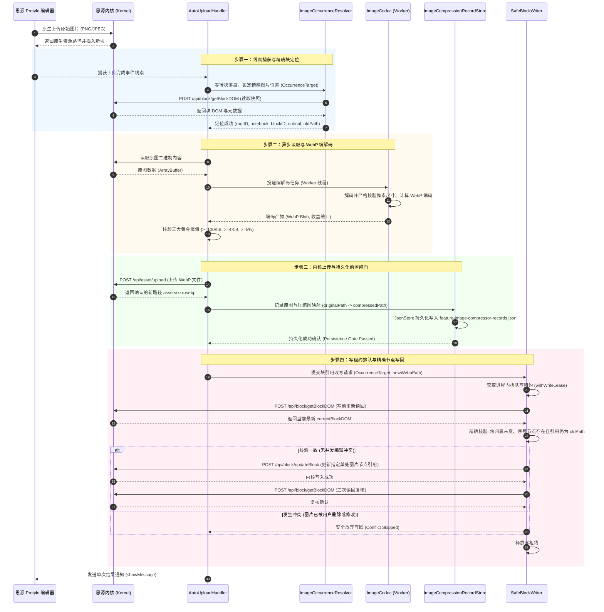
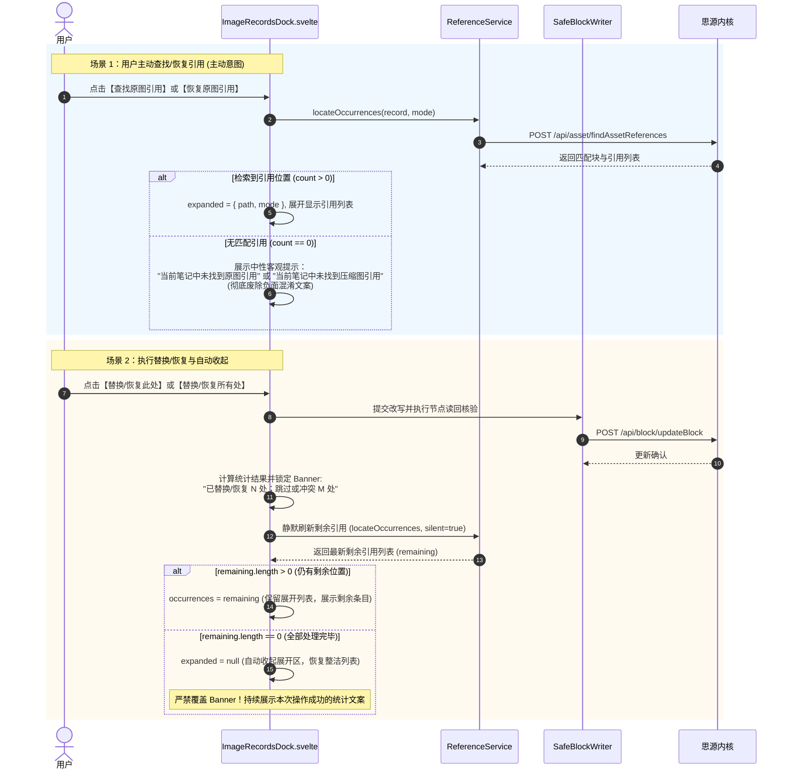

# OmniKit · 系统架构与技术实现设计文档 (ARCHITECTURE)

> **版本**：v1.0（正式发布稿）  
> **状态**：正式发布（Approved）  
> **设计基准**：严格遵循 [AGENTS.md](../AGENTS.md)、[CORE-PRD.md](CORE-PRD.md)、[image-compressor.md](features/image-compressor.md) 及 [titled-link.md](features/titled-link.md)  
> **源码基线**：`Forgo7ten/siyuan-plugin-omnikit` (`feat-image-compressor`)

---

## 1. 架构概览与技术栈

OmniKit 是基于现代前端与思源笔记插件生态构建的高效、高可靠多合一工具箱扩展平台。

### 1.1 技术栈选型
- **编程语言**：TypeScript 5.x（启用 `strict: true`、严格类型检查与安全泛型约束）
- **构建工具**：Vite 5.x（多输出配置：主入口打包为 `index.js`、样式整合为 `index.css`、资源静态复制）
- **UI 组件框架**：Svelte 5（基于 Runes 响应式体系，通过 `mount` 与 `unmount` 精确控制生命周期）
- **样式体系**：SCSS（模块化样式组织，继承思源原生 CSS 变量自适应浅色/深色主题）
- **宿主环境**：思源笔记核心（Protyle 编辑器引擎、REST Kernel API、EventBus、Protyle Upload 流程）

### 1.2 核心设计哲学
1. **微内核与单向依赖**：Core 平台层不感知具体 Feature 的内部实现，所有功能通过元数据驱动注入；
2. **多实例与环境防护**：针对思源独立设置窗口（`body--settings`）进行无副作用纯渲染隔离；
3. **确定性存储体系**：单文件 Promise 排队、30秒超时拦截、损坏备份恢复与配置/数据物理隔离；
4. **防御性块级改写**：写前基于 `OccurrenceTarget` 精确节点读回核验（废除整块 HTML 字符串全等比对）、进程内写租约（Write Lease）与持久化前置闸门。

---

## 2. 系统分层架构

OmniKit 划分为清晰的“宿主适配层”、“Core 平台基础设施层”与“Feature 业务特性层”三层架构：

```mermaid
flowchart TD
    subgraph Host["宿主环境 (SiYuan Note)"]
        H_API["Kernel REST API (/api/...)"]
        H_Event["EventBus / Protyle Lifecycle"]
        H_UI["Host Dock / Context Menu / TopBar"]
    end

    subgraph Core["OmniKit Core 平台层 (src/core/ & src/ui/)"]
        PluginEntry["OmniKitPlugin (插件主入口)"]
        Catalog["FeatureCatalog (元数据仓库)"]
        Manager["FeatureManager (串行生命周期状态机)"]
        Scope["FeatureScope (AbortSignal & 资源作用域)"]
        
        subgraph CoreInfra["基础设施与驱动"]
            KernelClient["KernelClient (安全 API 调用门面)"]
            SettingsMgr["SettingsManager (多文件配置协调器)"]
            JsonStore["JsonStore (并发队列/超时/容灾)"]
            Logger["Logger (动态等级日志)"]
            Platform["Platform (环境与端类型探测)"]
        end
        
        subgraph CoreUI["统一宿主 UI 容器"]
            UnifiedDock["UnifiedDock (单槽位 Tab 容器)"]
            SettingsShell["SettingsRoot.svelte (iPad 双栏联动面板)"]
            MenuRouter["MenuRouter & MenuRegistry ([OmniKit] 前缀路由)"]
        end
    end

    subgraph Features["Feature 业务特性层 (src/features/)"]
        subgraph ImgCompressor["image-compressor (图片压缩特性)"]
            FeatImage["ImageCompressorFeature"]
            ImgController["ImageController (业务编排门面)"]
            AutoUpload["AutoUploadHandler (上传完成异步捕获)"]
            RemoteWatcher["RemoteImageWatcher (外链安全本地化)"]
            SafeWriter["SafeBlockWriter (写租约与 Occurrence 节点改写)"]
            WorkerCodec["ImageCodec (WebP WebWorker 编解码引擎)"]
            RecordStore["ImageCompressionRecordStore (Dock 业务数据持久化)"]
            DockView["ImageRecordsDock.svelte (Tab 视图组件)"]
            SettingsView["ImageSettingsPanel.svelte (设置卡片组件)"]
        end

        subgraph TitledLink["titled-link (自动标题链接特性)"]
            FeatTitledLink["TitledLinkFeature"]
            TitledLinkController["TitledLinkController (业务编排门面)"]
            DualNetwork["DualTrackNetwork (桌面 fetch / 移动 forwardProxy)"]
            StreamParser["StreamParser (32~64KB 流式截断 & 编码嗅探)"]
            SafeTransactionWriter["SafeTransactionWriter (写前核验与事务提交)"]
            TitledLinkCache["TitledLinkCache (短期内存 LRU 缓存)"]
            TitledLinkSettingsView["TitledLinkSettingsPanel.svelte (设置组件)"]
        end
        
        subgraph FutureFeatures["未来扩展特性..."]
            FeatX["Feature X (独立业务逻辑与数据)"]
        end
    end

    %% 依赖与交互调用链
    Host <--> PluginEntry
    PluginEntry --> Catalog
    PluginEntry --> Manager
    PluginEntry --> SettingsMgr
    PluginEntry --> UnifiedDock
    PluginEntry --> MenuRouter

    Manager --> Scope
    Manager --> FeatImage
    Manager --> FeatTitledLink
    Manager --> FeatX

    FeatImage --> ImgController
    ImgController --> AutoUpload
    ImgController --> RemoteWatcher
    ImgController --> SafeWriter
    ImgController --> WorkerCodec
    ImgController --> RecordStore

    FeatTitledLink --> TitledLinkController
    TitledLinkController --> DualNetwork
    TitledLinkController --> StreamParser
    TitledLinkController --> SafeTransactionWriter
    TitledLinkController --> TitledLinkCache
    DualNetwork --> KernelClient
    SafeTransactionWriter --> KernelClient
    
    SafeWriter --> KernelClient
    AutoUpload --> KernelClient
    RemoteWatcher --> KernelClient
    KernelClient --> H_API

    RecordStore --> JsonStore
    SettingsMgr --> JsonStore
    JsonStore --> H_API

    UnifiedDock -.-> DockView
    SettingsShell -.-> SettingsView
    SettingsShell -.-> TitledLinkSettingsView
    MenuRouter --> H_UI
```



---

## 3. Core 平台核心设计与类职责

### 3.1 `OmniKitPlugin` (宿主集成与多窗口守卫)
- **文件位置**：`src/core/OmniKitPlugin.ts`
- **主要职责**：
  - 继承思源官方 `Plugin`，作为思源加载的唯一物理入口；
  - **多窗口隔离识别**：通过 `document.body.classList.contains("body--settings")` 识别独立设置窗口。在设置窗口中仅挂载 Svelte 设置界面与 Store，不启动后台上传监听、MenuRouter 或 Dock；
  - 监听宿主 `onload`、`onunload`、`onLayoutReady` 以及跨窗口配置广播 `onDataChanged`；
  - **顶栏与下拉菜单装配**：统筹注册 Core Dock 单槽位、TopBar 图标与设置对话框；构建顶栏下拉菜单时严格按分层组织：顶部 Core 平台项（「OmniKit 设置」） + 调用思源原生 `menu.addSeparator({ id: "separator_settings" })` 物理分隔线 + 各 Feature 业务选项（Dock 栏已有常驻入口，顶栏不设立重复且无控的打开 Dock 选项）。

### 3.2 `FeatureCatalog` 与 `FeatureManager` (生命周期与状态机)
- **文件位置**：`src/core/FeatureCatalog.ts`、`src/core/FeatureManager.ts`
- **主要职责**：
  - `FeatureCatalog` 集中持有所有 Feature 的声明式元数据（`FeatureRegistration<T>`），对外暴露只读索引；
  - `FeatureManager` 维护每个 Feature 的严格串行化启停队列（Promise Queue）；
  - **四阶段状态机**：`disabled` $\to$ `enabling` $\to$ `enabled` $\to$ `disabling` $\to$ `disabled`（异常流转为 `error`）；
  - 当 Feature 启动失败时，置状态为 `error` 并记录异常，保持用户在 `omnikit-core.json` 中配置的期望偏好不变。

### 3.3 `BaseFeature` 与 `FeatureScope` (资源作用域与中止信号)
- **文件位置**：`src/core/BaseFeature.ts`、`src/core/FeatureScope.ts`
- **主要职责**：
  - 每个业务功能继承 `BaseFeature`，通过 `context` 获得受控的 Core 基础设施；
  - `FeatureScope` 原生封装 `AbortController`：
    - `scope.own(disposer)`：注册所有运行期副作用（Protyle 事件监听器、DOM 钩子、定时器）；统一由 `FeatureScope` 集中托管与注销，清理死代码；
    - `scope.signal`：向下传递的只读 `AbortSignal`；
    - `scope.guard(fn)`：包装异步回调，若 Scope 已销毁则直接短路，防止失效的幽灵回调执行；
  - **任务正常中止与静默退出设计 (Normal Abort & Quiet Exit)**：
    - 当用户按 Esc、切换编辑器标签页、功能停用或触发 `signal.abort` 时，异步处理链路与控制器判定为**正常中止并静默退出**，严禁向用户误报“无法定位引用”、“无效文档”或并发冲突；
    - 底层改写执行者（`SafeBlockWriter`）在检测到任务取消或 Abort 信号时必须显式抛出 `AbortError` 或返回取消标识，严禁混淆为 `conflict`；
  - 当 Feature 停用或插件卸载时，`scope.dispose()` **首先广播 `abort` 信号**通知所有在途任务安全终止，再按后进先出（LIFO）顺序释放所有监听器。

### 3.4 `SettingsManager` 与 `JsonStore` (确定性存储体系)
- **文件位置**：`src/core/SettingsManager.ts`、`src/core/JsonStore.ts`
- **核心机制**：
  - **每文件独占 Promise 队列**：每个 JSON 文件的保存操作串行化执行，防止写竞争；
  - **内容指纹防抖**：内存维护序列化指纹（`fingerprint`），相同数据重复保存自动跳过实际 I/O；
  - **30 秒写保护超时**：调用思源 `saveData` 时启动 30 秒超时保护。若超时未收到成功确认，标记 `writeUncertain = true` 并阻断后续写入，避免在状态未明确时破坏数据；
  - **异常损坏隔离**：解析 JSON 失败时不使用默认值覆盖。将损坏文件备份为 `.backup` 并提示用户显式确认修复。

### 3.5 `KernelClient` (安全内核 API 封装)
- **文件位置**：`src/core/KernelClient.ts`
- **主要职责**：
  - 封装对思源内核 `/api/...` 的网络交互；
  - 支持调用方传入 `AbortSignal` 与自定义超时；
  - 自动归一化处理思源错误码（`code !== 0`），统一包装为结构化 `KernelError`；
  - 避免对可能改变工作区状态的非幂等修改请求进行静默重试。

### 3.6 统一 UI 扩展系统
- **统一 Dock 容器** (`src/ui/dock/`)：
  - 仅占用思源侧边栏 **1 个图标位置**；
  - 内部实现 Svelte 5 驱动的 Tab 路由管理器：当多个 Feature 启用 Dock 视图时展示 Tab 头；仅单个 Feature 启用时独占主视图；全停用时呈现空状态指引；
  - **Dock 顶部视觉与防遮挡规范 (Brand Hero Card)**：
    - 在 Dock 视图顶部常驻渲染约 52px~56px 高度的品牌展示区，包含 OmniKit 图标、粗体大标题（如「OmniKit / 图片记录」）与轻量模式徽章，背景采用思源原生主题微渐变浅背景（`var(--b3-theme-primary)` 8% 透明度）；
    - **几何防遮挡下移 (50px+)**：使下方操作栏（刷新记录、搜索筛选等按钮）整体平滑下移 50px 以上，彻底避开思源桌面端（Windows）及网页端右上角 32px 浮动 Snackbar 消息层（`#message` / `.b3-snackbars`）与 Tooltip 浮层的绝对遮挡，保障交互区域无遮挡点击；
    - **静默刷新防覆盖铁律 (Anti-Overwriting Guard)**：Dock 在改写操作后执行的后续静默刷新（`post_action`）若遇异常或返回空结果，绝对禁止冲刷或覆盖原有操作产生的成功统计文案；当待处理项降为 0 时必须干净收起抽屉并保留成功统计，杜绝悬挂假性“未找到引用”；
  - 依托 Svelte 5 `mount` / `unmount` 精准控制各 Feature 视图的装载与卸载。
- **统一菜单路由器 (`MenuRouter` / `MenuRegistry`)** (`src/core/MenuRouter.ts` / `MenuRegistry.ts`)：
  - 集中拦截思源上下文菜单事件（`event-bus`）；
  - 严格校验菜单所属 Feature 的运行态（`phase === "enabled"`）；
  - **顶栏菜单与分隔线规范**：
    - OmniKit 顶栏下拉菜单顶部为 Core 平台项：包含「OmniKit 设置」（Dock 栏已有常驻图标，顶栏不设立重复的 Dock 菜单项）；
    - Core 平台项与下方各 Feature 贡献的选项之间，**必须使用视觉分隔线 (`separator`) 进行物理隔离**；
    - **思源原生 SDK 契约对齐**：必须在「OmniKit 设置」之后显式调用思源原生 SDK 契约 `menu.addSeparator({ id: "separator_settings" })`，生成思源原生标准的 `<button data-id="separator_settings" class="b3-menu__separator"></button>` 分隔线（与思源官方 `openTopBarMenu.ts` 实现完全对齐），物理隔离 Core 平台设置与下方各 Feature 业务选项；
  - **前缀分流权威收口规范 (Context-Aware Prefix via MenuRegistry)**：
    - 由 `MenuRegistry` 作为菜单项注册与派发的唯一权威分流收口，禁止 Feature 层硬编码前缀；
    - 顶栏自有菜单 (`location === "topbar"`)：彻底移除 `[OmniKit]` 前缀，保持清爽克制；
    - 外部宿主上下文菜单 (`location === "doc-tree" | "doc-title" | "image" | "link" | "blockicon"`)：由 `MenuRegistry` 自动保留并统一补齐 `[OmniKit] ` 前缀，确保明确的插件归属标识；
  - 若触发时对应功能处于停用状态，调用轻量通知 `showMessage` 提示功能未启用，不弹出模态对话框。

---

## 4. 存储架构与持久化规范

```
SiYuan 工作区目录：data/storage/petal/siyuan-plugin-omnikit/
├── omnikit-core.json                      <-- Core 平台配置
├── feature-image-compressor-settings.json <-- Feature A 用户设置 (受重置管控)
├── feature-image-compressor-records.json  <-- Feature A 业务数据 (不受设置重置影响)
└── feature-titled-link-settings.json      <-- Feature B 用户设置 (受重置管控)
```

### 4.1 文件划分与生命周期

| 存储分类 | 文件路径规则 | 包含内容 | 重置操作影响边界 |
|---|---|---|---|
| **Core 平台配置** | `omnikit-core.json` | `schemaVersion: 1`<br/>`general: { debugLog, userAgent }`<br/>`featureStates: { [id]: { enabled } }` | **全局重置时重置**（恢复 debugLog 为 false，userAgent 为空串） |
| **Feature 设置** | `feature-{id}-settings.json` | 用户在各 Feature 设置页手动调整的业务参数（质量、白名单、截断长度等偏好） | **单功能重置**及**全局重置**时恢复默认值 |
| **Feature 业务数据** | `feature-{id}-{dataname}.json` | Feature 核心业务数据（如原图/WebP映射） | **不受设置重置影响**，仅支持在“数据管理专区”由用户显式操作清空 |

### 4.2 设置重置与数据管理专区机制
1. **重置隔离规范**：`SettingsManager.resetFeature(id)` 与 `resetAll()` 仅针对 `omnikit-core.json` 与各 `feature-*-settings.json` 调用 `store.save(codec.defaults())`。底层存储注册表中数据文件（`feature-*-{dataname}.json`）使用独立的存储句柄，重置逻辑不持有数据文件的写入权限。
2. **数据管理专区**：在统一设置面板底部提供独立的“数据管理”视图，展示每个数据文件的物理大小与记录总数，提供经二次确认的“清空数据”操作。

---

## 5. 图片压缩功能技术实现设计

### 5.1 上传后异步全流程时序



### 5.2 子模块职责与设计契约

#### 1. 架构分工与去重规范 (Feature-Controller-Action Separation)

为了消除多层重复判断、避免职责混乱引发假性报错或多重提示，系统确立严格的单向职责划分与所有权模型：

```
┌────────────────────────────────────────────────────────────────────────┐
│ Feature 层 (ImageCompressorFeature.ts)                                  │
│ - 负责思源宿主事件与菜单监听注册 (Protyle 事件 / 文档右键 / 图片右键)    │
│ - 负责提取宿主上下文 (Protyle 实例、blockID、rootID 等) 并派发给 Controller │
│ - 所有副作用与监听句柄统一由 FeatureScope (scope.own) 集中托管与清理   │
└───────────────────────────────────┬────────────────────────────────────┘
                                    │ 派发事件上下文
                                    ▼
┌────────────────────────────────────────────────────────────────────────┐
│ Controller 门面层 (ImageController.ts)                                 │
│ - 唯一业务编排门面，负责前置准入判定 (全局自动开关 / 白名单校验)        │
│ - 负责生命周期与状态调度 (TaskPanel 进度模态框装配与销毁、Abort 信号传递)│
│ - 唯一对外用户交互与通知收口 (统一负责向思源 showMessage 派发结果提示)  │
│ - 严格识别正常中止 (Esc / 切页 / abort)，杜绝下游假性报错冒泡          │
└───────────────────────────────────┬────────────────────────────────────┘
                                    │ 调度纯领域执行
                                    ▼
┌────────────────────────────────────────────────────────────────────────┐
│ Action 纯领域层 (SingleImageAction / DocumentBatchAction / ...)         │
│ - 纯领域逻辑执行者，专注扫描、节点定位、编解码与块改写                  │
│ - 严禁在 Action 内部直接调用 showMessage 发送全局通知气泡 (防重复弹窗)   │
│ - 遇异常或冲突规范化返回/抛出结构化结果，由 Controller 统一汇报       │
└────────────────────────────────────────────────────────────────────────┘
```

#### 2. 子模块技术职责表

| 子模块文件 | 核心类 / 单元 | 职责与技术边界 |
|---|---|---|
| `ImageCompressorFeature.ts` | `ImageCompressorFeature` | Feature 入口；注册菜单、事件监听；提取 Protyle 与 blockID 上下文后直接委托 `ImageController`；所有监听句柄由 `FeatureScope` 集中托管与清理，清理多余重复判断与死代码 |
| `ImageController.ts` | `ImageController` | 业务编排唯一门面；负责全局开关与白名单准入校验；调度 Action 与 `ImageTaskPanel` 进度模态框；负责统一结果通知与正常中止识别 |
| `AutoUploadHandler.ts` | `AutoUploadHandler` | 监听 Protyle 编辑器上传完成事件；**未授权静默与轻量化规范**：若当前文档未开启自动压缩，立即无感静默退出（直接 `return`），严禁派发 notice 或弹出任何提示气泡；且在确认未授权时尽早退出，严禁挂载无意义的 MutationObserver |
| `RemoteImageWatcher.ts` | `RemoteImageWatcher` | 监听新插入 HTTP/HTTPS 外链图片；**未授权低开销设防**：在入口及 `sweep()` 扫描入口设防，未授权文档中严禁向内核发起 `blockDOM` 网络请求与全量 DOM 解析；授权文档中直接按 URL 下载并通过内核 API 本地化，不解析或分类目标 IP |
| `ImageOccurrenceResolver.ts` | `ImageOccurrenceResolver` | 在 DOM 树中建立 `OccurrenceTarget` 精确定位（`rootID` + `notebook` + `blockID` + `imageOrdinal` + `oldPath`） |
| `image.ts` / `ImageCodec.ts` | `ImageCodec` / Worker | 封装基于 WebWorker 的图片转码引擎；严格执行保尺寸校验、EXIF 探测与三大黄金收益阈值核验 |
| `ImageProcessingServices.ts` | `ImageProcessingServices` | 聚合读取、本地化、编码、上传与写回步骤的编排服务层 |
| `ImageCompressionRecordStore.ts` | `ImageCompressionRecordStore` | 专职管理 `feature-image-compressor-records.json` 磁盘持久化，实现持久化前置闸门 |
| `SafeBlockWriter.ts` | `SafeBlockWriter` | 进程内单写租约控制器（`withBlockWriteLease`），写前读回节点核验，调用 `/api/block/updateBlock`；中止时显式抛出 `AbortError` 或返回专用取消结果（如 `"aborted"`），严禁混淆为 `conflict` |
| `ImageRecordsDock.svelte` | Svelte 5 组件 | 嵌入 Core 统一 Dock 的 Tab 视图，提供顶部 Hero 品牌卡片区（52px~56px，避开右上角 32px 浮动 Snackbar）、记录浏览、初始 present 状态与挂载自动异步核验、状态 Badge 纯主题 CSS 变量渲染（严禁硬编码 Hex，保证深浅模式对比度）、对称双向引用管理（查找原图引用/恢复原图引用，直接执行无需二次弹窗；严格区分主动查找与操作静默刷新；防覆盖铁律；全部处理完毕后自动收起展开区并保留成功统计）、失效记录清理（提示包含精确条数）与记录移除 |
| `SingleImageAction.ts` | `SingleImageAction` | 纯领域单图处理，涵盖图片右键“压缩此图片”（直接执行）与“压缩…”（预览对话框）业务动作，作用域严格限定为仅替换当前选中的单处引用（最小副作用原则）；不越权弹出全局通知，由 Controller 统一收口 |
| `DocumentBatchAction.ts` | `DocumentBatchAction` | 纯领域文档批量处理；扫描当前文档合格图片，同源图片合并编码，逐位置独立执行节点核验与改写；无待处理项或执行完成向 Controller 返回结构化结果；Controller 联动关闭 `ImageTaskPanel` 模态框并统一派发结果通知 |
| `ImageSettingsPanel.svelte` | Svelte 5 组件 | 设置卡片组件，调用思源内核原生 `/api/filetree/getFullHPathByID` 解析并展示包含笔记本全名的白名单完整层级路径 |

### 5.3 核心技术安全机制

#### 1. 进程内单写租约 (`withBlockWriteLease`) 与正常中止状态判定
思源内核块更新 API 不提供原子乐观锁或事务版本号（Revision/CAS）机制。为避免并发任务同时改写同一块导致数据冲突，系统在内存中维护按块隔离的全局写租约队列：
```typescript
const blockTails = new Map<string, Promise<void>>();

/** 针对持久化块的单写租约控制器，避免并发写冲突且不残留空闲键 */
export function withBlockWriteLease<T>(key: string, operation: () => Promise<T>): Promise<T> {
  const previous = blockTails.get(key) ?? Promise.resolve();
  let release!: () => void;
  const hold = new Promise<void>(resolve => { release = resolve; });
  const tail = previous.catch(() => undefined).then(() => hold);
  blockTails.set(key, tail);
  return previous.catch(() => undefined).then(operation).finally(() => {
    release();
    if (blockTails.get(key) === tail) blockTails.delete(key);
  });
}
```
- **中止状态边界原则与契约 (SafeBlockWriter Abort & Cancellation Contract)**：
  - 在 `SafeBlockWriter` 获取租约排队期间或执行写入过程中，若检测到任务取消、超时或 `signal?.aborted`，或者思源内核请求因取消抛出 `AbortError`；
  - **必须显式抛出标准 `AbortError` 或返回专用的取消状态（如 `"aborted"`）**；
  - **绝对严禁将其归类、隐式吞咽或混淆为内容修改引发的并发编辑冲突（`"conflict"`）**；
  - 混淆为 `"conflict"` 会导致上层调用者向用户误报“目标图片已被修改或移动，已放弃替换当前引用”并错误计入冲突数。上层调用者捕获中止信号后静默退出，不计入冲突统计，不派发误报提示。

#### 2. Occurrence 精确匹配与放弃原则
在获得写租约后，改写流程遵循以下严谨步骤：
1. 调用 `/api/block/getBlockDOM` 获取内核当前落盘的真实 DOM；
2. 解析 DOM，定位索引为 `target.imageOrdinal` 的图片节点；
3. **基于 OccurrenceTarget 的精确节点核验（废除整块 HTML 字符串全等比对）**：
   - 废除整块 HTML 字符串全等比对，消除 Protyle 运行时自动刷新 `updated` 时间戳或光标属性对改写比对的假性干扰；
   - 严格核验节点三要素：
     1. 块归属未变（`blockID` 归属于目标 `rootID`）；
     2. 块内第 `imageOrdinal` 个图片节点依然存在；
     3. 该图片节点的当前资源引用路径仍精确等于 `target.oldPath`；
4. 若核验通过，仅改写该目标图片节点的引用属性并提交 `/api/block/updateBlock`；
5. 若后台处理期间目标图片被删除、替换或序号改变，任一要素核验失败时系统安全放弃本次单处写回操作；提示文案客观反馈：`[OmniKit] 目标图片已被修改或移动，已放弃替换当前引用，WebP 已保存至记录`。

#### 3. 单图右键压缩最小副作用原则
- 编辑器图片右键触发的单图压缩动作（快捷压缩或弹窗微调），作用域严格限定为“仅替换当前选中的单处引用”；
- 即使同一文档中存在多处相同原图的引用，单图操作亦不触碰其他引用位置，确保操作行为完全可预期。

#### 4. 持久化前置闸门 (Persistence Gate)
在 `ImageProcessingServices` 中，上传与写回之间设置坚固前置闸门：
```typescript
// 1. 内核上传确认 WebP 成功
const uploadedPath = await this.uploadWebp(blob, filename);

// 2. 闸门：先持久化 Dock 记录至磁盘
const recordSaved = await this.recordStore.upsertRecord({
  originalPath,
  compressedPath: uploadedPath,
  updatedAt: Date.now(),
  lastOperation: mode === "replace" ? "replaced" : "saved-only"
});

if (!recordSaved) {
  // 闸门阻断：持久化失败，阻断笔记引用修改
  this.logger.error("Dock 记录持久化失败，阻断引用自动改写");
  return { status: "saved-unlinked", uploadedPath };
}

// 3. 闸门放行：仅在持久化写入确认后，才允许提交引用替换
await this.safeWriter.replaceOccurrence(target, uploadedPath);
```

#### 5. 白名单完整路径展示技术方案 (Full Hierarchical Path Resolution)
- **内核接口调用**：白名单展示明确调用思源内核原生 `/api/filetree/getFullHPathByID` 接口；
- **展示层级**：解析并展示包含笔记本全名的完整层级路径（格式：`笔记本名/父文档/文档名`），作为列表条目的加粗主标题；
- **副标题排查**：副标题展示文档精确 `rootID`，满足高级排查与一致性验证；
- **容灾回退**：若内核返回为空或文档被删除，主标题回退展示 `rootID`。

#### 6. Dock 双向引用管理与状态机制 (Bidirectional Reference Management & Lifecycle)
- **初始状态策略与挂载核验**：
  - 新建或刚压缩生成的记录，初始状态直接标记为 `present`（存在）；
  - 当外部数据加载挂载（插件启动、切换激活 Dock Tab 面板或用户点击“手动刷新”）时，系统自动执行后台异步核验，通过思源内核 `/api/asset/statAsset` 探测原图与压缩图的物理存在性，无需用户初次手动触发刷新；
- **状态 Badge 原生主题变量呈现与深浅模式自适应 (Theme-Aware Badges)**：
  - 原图与压缩图状态 Badge（`present`、`missing`、`checking`、`unknown`）样式必须严格采用思源原生主题 CSS 变量（`var(--b3-theme-primary)` / `var(--b3-theme-error)` / `var(--b3-theme-secondary)` / `var(--b3-theme-on-surface)`）与半透明派生背景（使用 `color-mix(in srgb, var(...) 15%, transparent)` 或标准透明度）；
  - **绝对严禁硬编码 Hex 颜色**（如 `#388e3c`、`#d32f2f`、`#1976d2` 等）或非自适应 RGBA 颜色，确保在深色模式（Dark Mode）与浅色模式（Light Mode）下均具备优秀的对比度与文字可读性；
- **失效记录清理与精确计数**：
  - 当内核明确返回资源不存在（返回 `code !== 0`）时，自动从 `feature-image-compressor-records.json` 中移除失效记录并刷新视图；
  - 清理操作完成后，通过 `showMessage` 提示精确清理条数（例如：`[OmniKit] 已清理 ${count} 条失效记录`）；
- **对称的双向引用管理交互**：
  - **【查找原图引用】**：展开展示引用原图（`originalPath`）的位置列表。区域标题为“当前原图引用”，辅助描述为“点击可跳转对应位置，替换后使用压缩 WebP”。支持点击文本调用 `openTab` 跳转定位并高亮对应块。单项提供“替换此处”按钮，列表底部提供“替换所有处”按钮。直接执行，无需弹窗二次确认；
  - **【恢复原图引用】**：仅在原图状态为 `present` 时可用。展开展示引用压缩图（`compressedPath`）的位置列表。区域标题为“当前压缩图引用”，辅助描述为“点击可跳转对应位置，恢复后将改回原图”。支持点击文本调用 `openTab` 跳转定位并高亮对应块。单项提供“恢复此处”按钮，列表底部提供“恢复所有处”按钮。直接执行，无需弹窗二次确认；恢复操作不删除压缩图附件；
- **路径直接复制交互**：点击原图或压缩图路径文本直接复制至剪贴板，弹出轻量 Toast 提示“已复制路径”。
- **场景区分与反馈状态机 (Decoupled Lookup & Feedback State Machine)**：
  系统严格隔离“主动查找意图”与“执行写回后的静默刷新”：
  1. **用户主动展开查询（用户意图：查找引用）**：
     - 用户点击“查找原图引用”或“恢复原图引用”，触发定位；
     - 若结果集为空（`occurrences.length === 0`），Dock 顶部 Banner 按模式渲染中性提示：查找原图为空提示“当前笔记中未找到原图引用”；恢复原图为空提示“当前笔记中未找到压缩图引用”；
     - 彻底废除历史陈旧且负面混淆的“没有可安全确认的图片位置，无法恢复。”文案；
  2. **执行替换/恢复后的静默刷新与防覆盖机制 (Post-Operation Silent Refresh & Anti-Overwriting Guard)**：
     - 用户点击“替换此处”、“恢复此处”、“替换所有处”或“恢复所有处”执行改写；
     - 写回完成后，首先生成操作统计文案（如 `已替换 ${replaced} 处为压缩图；跳过或冲突 ${conflicts} 处` 或 `已恢复 ${restored} 处为原图；跳过或冲突 ${conflicts} 处`），并写入顶部 Banner 与全局轻量提示（`showMessage`）；
     - 随后调用的重新定位属于后续静默刷新，**严禁使用静默刷新的空结果冲刷或覆盖已展示的成功统计文案**；
  3. **全部处理完成后的自动收起机制 (Auto-Collapse on Completion)**：
     - 若静默刷新返回剩余列表长度为 0（即全部引用均已处理完毕），系统自动重置展开状态（`expanded = null`，`occurrences = []`），抽屉自动折叠收起，界面恢复整洁的记录卡片列表；
     - 收起的同时，顶部 Banner 与轻量通知持续驻留展示本次操作的成功统计结果，形成明确无歧义的闭环反馈。



#### 7. 零工作区临时文件 (Zero Workspace Temporary Files)
- 任务执行状态、队列排队与临时缓存全部保存在宿主进程内存中；
- 不向思源工作区 `data/` 或 `assets/` 写入形如 `.log`、`.journal`、`.tmp`、`.queue` 等临时文件；
- 容灾依托思源内核原生文档历史版本（Doc History）和工作区备份机制，避免污染工作区与云端同步目录。

#### 8. 空状态与边界场景防护 (Empty States & Edge Guarding)
- **批量压缩 0 张可处理图片联动销毁**：
  - 当扫描当前文档发现合规可压缩图片数为 0 时，Controller 若向用户弹出提示气泡（如“当前文档未发现可压缩图片”），**必须同时联动自动关闭/销毁居中的 `ImageTaskPanel` 进度模态框**，杜绝模态框悬挂堆叠在屏幕中央打扰用户；
- **Dock 静默刷新防覆盖铁律 (Post-Operation Anti-Overwriting Guard)**：
  - 用户在 Dock 执行单项或全部替换/恢复操作后，触发的后续引用重新定位属于辅助静默刷新；
  - 遇到网络异常或返回剩余 0 处引用时，**绝对不得冲刷覆盖原有操作产生的成功统计文案**；
  - 剩余引用数为 0 时干净收起抽屉列表，持续保留操作成功统计，杜绝向用户悬挂假性“未找到引用”或负面报错。

---

## 6. 新 Feature 扩展开发指南

当团队或 Agent 需要向 OmniKit 增加新的业务特性时，必须严格执行以下开发步骤与契约清单：

### 6.1 开发步骤指南
1. **需求规范先行**：在 `docs/features/<feature-name>.md` 编写完整的业务需求与约束规范，获得评审冻结；
2. **建立特性目录**：在 `src/features/<feature-name>/` 下创建特性包，包括：
   - `settings.ts`：定义配置 TypeScript 类型与默认值；
   - `registration.ts`：定义 `FeatureRegistration<T>` 元数据，指定配置文件为 `feature-{id}-settings.json`；
   - `<FeatureName>Feature.ts`：派生自 `BaseFeature`，重写 `onEnable()` 与 `onDisable()`；
   - `<FeatureName>SettingsPanel.svelte`：Svelte 5 实现的专属设置组件；
   - 可选：若有 Dock 需求，提供 Svelte 5 Dock 视图组件。
3. **Core 元数据挂载**：在 `src/core/OmniKitPlugin.ts` 的 `registrations` 数组中添加该 Feature 的注册项；
4. **国际化补充**：在 `src/i18n/zh-CN.json` 和 `src/i18n/en.json` 添加对应的特性标题、描述及业务文案；
5. **保持 Core Schema 独立**：新特性的专属配置项保存在特性独立配置文件中，不写入 `omnikit-core.json`。

### 6.2 技术契约自查清单 (Contract Checklist)
- [ ] Feature 是否纯粹面向 `BaseFeature` 和 `FeatureContext` 编程？
- [ ] 是否不存在任何跨 Feature 的直接代码引用（`import`）？
- [ ] 设置文件命名是否严格为 `feature-${id}-settings.json`？
- [ ] 业务数据文件命名是否严格为 `feature-${id}-{dataname}.json`？
- [ ] 长时间异步任务是否传递并感知了 `context.scope.signal`？
- [ ] 菜单动作是否由 `MenuRegistry` 权威收口分流（顶栏自有菜单无前缀，外部宿主上下文菜单自动补齐 `[OmniKit] ` 前缀，禁止 Feature 层硬编码）？
- [ ] 顶栏下拉菜单中 Core 平台项（「OmniKit 设置」）与下方 Feature 选项之间是否使用了 `menu.addSeparator({ id: "separator_settings" })` 原生分隔线？
- [ ] 设置面板左侧导航分组标题是否规范使用国际化键 `nav.features`，杜绝任何硬编码或三元表达式？
- [ ] Dock 顶部是否具备 52px~56px 品牌 Hero 卡片区，操作区下移 50px 以上避开思源右上角 32px 浮动 Snackbar？
- [ ] Dock 状态 Badge 是否严格采用思源原生主题 CSS 变量（无硬编码 Hex 颜色），保证深浅模式对比度？
- [ ] 新图插入在未授权文档中是否彻底静默退出（不弹气泡、不挂载无意义 MutationObserver、不向内核发起 blockDOM 请求）？
- [ ] 用户按 Esc、切换标签页或 `signal.abort` 是否判定为正常中止并静默退出，未误报为无法定位或并发冲突？
- [ ] `SafeBlockWriter` 中止是否显式抛出 `AbortError` 或专用取消状态，严禁混淆为 `conflict`？
- [ ] 批量处理 0 张图片时是否联动销毁了 `ImageTaskPanel` 模态框？
- [ ] Dock 静默刷新是否遵循防覆盖铁律，未冲刷覆盖操作成功统计？
- [ ] 是否遵循 Feature（上下文分发）、Controller（参数校验与统一用户提示）、Action（纯领域执行）的单向职责划分？
- [ ] 是否避免向思源工作区写入任何临时调试或排队文件？
- [ ] 是否未调用任何主动删除原图或压缩图资产的 API？
- [ ] 块改写是否基于 `OccurrenceTarget` 精确节点核验而非整块字符串比对？
- [ ] 单图操作作用域是否严格限定为选中的单处引用？
