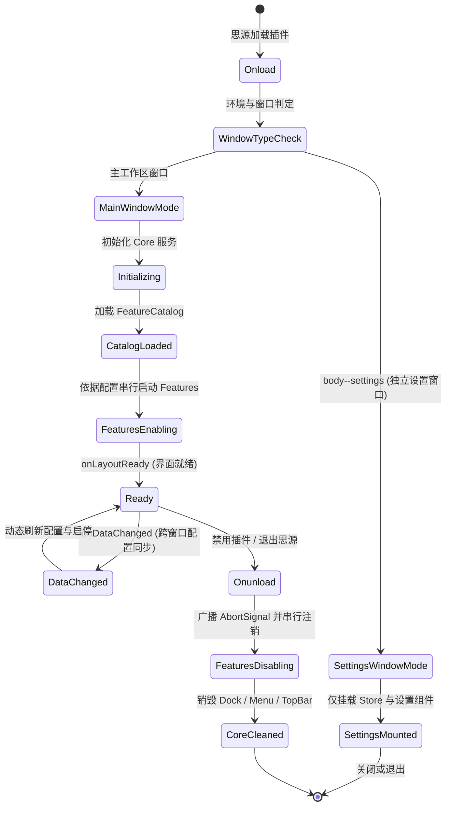
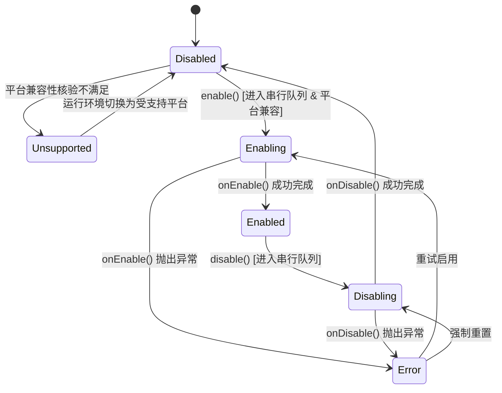

# OmniKit Plugin Core · 平台产品需求与架构规范 (CORE-PRD)

> **版本**：v1.0（正式发布稿）  
> **状态**：已冻结（Approved & Frozen）  
> **适用范围**：OmniKit 微内核平台层（`src/core/` 及 `src/ui/` 通用基础设施）  
> **上游契约**：遵循 [AGENTS.md](../AGENTS.md) 最高开发准则与思源笔记官方插件模型

---

## 1. 平台定位与设计哲学

OmniKit 是专为思源笔记（SiYuan Note）打造的多合一工具箱扩展平台。OmniKit Core 提供统一的基础设施与容器服务，确立以下核心架构设计原则：

1. **模块化微内核 (Modular Microkernel)**：Core 仅提供基础容器服务（生命周期、配置存储、UI 宿主容器、内核网络代理、日志与安全边界），不承载任何具体业务逻辑。所有业务能力均以独立 Feature 插件化接入。
2. **宿主集成克制 (Host Restraint)**：
   - **单槽位宿主占用**：OmniKit 在思源侧边栏（Dock）中仅占用 1 个统一入口图标，内部通过 Tab 标签路由各功能视图。
   - **统一入口聚合**：全局提供单页滚动的 iPad 风格统一设置面板与 TopBar 快速入口，实现界面入口的集中管理与统一呈现。
   - **统一动作标识与分流前缀**：注入思源外部上下文菜单的动作由 `MenuRegistry` 统一自动补齐 `[OmniKit] ` 前缀以标识功能归属；顶栏自有下拉菜单不添加前缀，保持界面简洁。Feature 层禁止硬编码前缀。
3. **安全优先 (Safety First)**：
   - 遵循零工作区临时文件、零主动文件删除、块级精准改写与持久化前置校验等安全规范。
   - 内核块更新执行写前读回比对与并发队列管理，避免并发编辑导致的数据冲突。
4. **系统解耦 (Decoupling Architecture)**：
   - Feature 之间保持相互隔离；各 Feature 仅面向 Core 提供的抽象基类与上下文契约进行开发，禁止跨 Feature 直接产生代码依赖。

---

## 2. 插件宿主集成与生命周期

OmniKit 继承自思源官方 `Plugin` 类，遵循思源官方生命周期规范，并针对多窗口（独立设置窗口）实施运行环境隔离。

### 2.1 宿主生命周期契约



- **`onload(): Promise<void>`**：
  - 判定当前窗口运行环境（主工作区窗口或独立设置窗口 `body--settings`）；
  - 初始化平台环境适配器 `Platform` 与日志管理器 `Logger`；
  - 初始化核心配置存储 `SettingsManager` 并加载 `omnikit-core.json` 及各 Feature 配置；
  - 预构建全局设置窗口实例（`onload()` 阶段仅预热实例与存储，不自动弹出设置对话框；设置对话框统一由 `openSetting()` 响应显式入口打开）；
  - 在主工作区窗口中：注册 Feature 元数据到 `FeatureCatalog`，依据配置声明与平台兼容性契约串行启动 Feature（受支持且配置开启的 Feature 进入激活流程；不受当前平台支持的 Feature 保持休眠并标记状态为 `unsupported`），并注册 Unified Dock、MenuRouter 与 TopBar 入口。
- **`onLayoutReady(): void`**：
  - 思源主界面 DOM 与编辑器完全渲染就绪；
  - Core 平台统筹挂载单例底栏状态栏 `PluginStatusBar`（注入 `FeatureContext.statusBar`）；
  - 触发已启用 Feature 的 `onLayoutReady` 钩子，执行依赖编辑器 DOM 的初始化检测。
- **`onDataChanged(): Promise<void>`**：
  - 当外部环境或独立设置窗口修改并持久化了配置文件或业务数据文件时触发；先等待插件初始化 `ready` 完成；
  - **主工作区窗口同步时序**：
    1. 首先遍历所有已注册 Feature 调用可选的 `reloadData(this)` 钩子，由 Feature 按需重载内存业务记录缓存（如 `imageCompressor` 仅对已初始化的 `ImageCompressionRecordStore` 重载 `feature-image-compressor-records.json`）；
    2. 随后调用 `SettingsManager.reloadAfterExternalChange()` 从磁盘重载相关 JSON 配置，按变更范围执行 `reconcileFromLoadedSettings()` 与受影响 Feature 的 `notifySettingsChanged(id)`（受支持环境下的热启用/热停用/参数热更新；不受支持平台持续保持 `unsupported` 阻断）；
    3. 最后刷新 Unified Dock 视图；
  - **独立设置窗口同步**：调用 `SettingsManager.reloadAfterExternalChange()` 同步外部配置变更，驱动并发修改提示；
  - 重新读取的数据不触发二次写盘操作。
- **`onunload(): void`**：
  - 触发全系统注销流程；
  - 标记 `unloading = true`，停止接收并拒绝调度新任务；
  - 销毁底栏状态栏 `PluginStatusBar` 实例；
  - 依相反顺序停用所有运行中的 Feature；
  - 销毁 Unified Dock、MenuRouter 路由监听与全局事件总线。

### 2.2 独立设置窗口多实例隔离规范

思源支持独立的设置窗口（DOM 根节点带有 `body--settings` 类名）。
- **运行规范**：在 `body--settings` 窗口实例中，OmniKit 作为独立的配置表单渲染器运行：
  - 仅加载 `SettingsManager`、Svelte 5 设置面板组件及其依赖的 `JsonStore`；
  - 独立设置窗口不实例化 `FeatureManager`（`manager === undefined`），以保持无状态轻量表单渲染；在设置面板中，受当前平台支持且配置为开启偏好的 Feature 其 `runtimePhase` 派生为 `"configured"`（对应国际化键 `runtime.configured`：“已配置启用（运行状态请看主窗口）”），客观反映多实例架构下的配置语义，且不渲染功能停用提示条；
  - 不初始化 Unified Dock；
  - 不注册思源右键菜单路由（MenuRouter）；
  - 不启动后台业务监听器（如编辑器事件监听、上传捕获、自动观察器等）；
  - 设置保存并写入文件后，思源内核会自动向主窗口广播 `onDataChanged` 事件，由常驻的主窗口实例负责将最新配置应用到运行时；独立设置窗口自身收到 `onDataChanged` 时同步刷新配置缓存。

---

## 3. Feature 容器与生命周期管理

### 3.1 Feature 元数据定义 (`FeatureRegistration<T>`)

每个 Feature 在 `src/features/<feature-name>/registration.ts` 中声明标准元数据，Core 不硬编码具体 Feature 的配置字段。

```typescript
/**
 * 思源笔记支持的前端平台运行环境契约（5+1 取值集合）
 * - "desktop": 桌面客户端主窗口 (Electron)
 * - "desktop-window": 桌面端独立拆分窗口
 * - "mobile": 移动端原生 App (Android / iOS)
 * - "browser-desktop": 桌面端浏览器访问
 * - "browser-mobile": 移动端浏览器访问
 * - "all": 全端通用支持（通配符）
 */
export type SiyuanFrontend =
  | "desktop"
  | "desktop-window"
  | "mobile"
  | "browser-desktop"
  | "browser-mobile"
  | "all";

export interface FeatureRegistration<T> {
  /** 唯一功能标识符（小驼峰或 kebab-case，如 "imageCompressor"、"titled-link"） */
  readonly id: string;

  /** 国际化标题对应的 key（如 "feature.imageCompressor.title"） */
  readonly titleKey: string;

  /** 国际化简要描述对应的 key */
  readonly descriptionKey: string;

  /** 功能首次安装或无持久化配置时的默认开关状态（由 Feature 自行声明） */
  readonly defaultEnabled: boolean;

  /**
   * 功能支持的前端平台环境白名单列表（可选）
   * 采用 5+1 取值集合：desktop, desktop-window, mobile, browser-desktop, browser-mobile, all
   * 省略或为空数组时默认为全端通用支持 (即 ["all"])
   */
  readonly frontends?: readonly SiyuanFrontend[];

  /**
   * Feature 用户配置文件名，严格遵循命名约束：
   * 格式固定为 `feature-${slug}-settings.json`（由 featureConfigFile(id) 派生）
   */
  readonly file: `feature-${string}-settings.json`;

  /** 配置编解码与校验器，定义 defaults() 和 parse(raw) */
  readonly codec: StoreCodec<T>;

  /**
   * 可选：跨端/外部数据同步钩子
   * 当收到思源内核 onDataChanged 广播时，Core 负责在配置协调前调用该钩子，由 Feature 自行重载业务数据
   */
  readonly reloadData?: (plugin: Plugin) => Promise<void>;

  /** Feature 运行时实例工厂函数 */
  create(plugin: Plugin, settings: SettingsManager): BaseFeature;

  /** Feature 归属的 Svelte 5 设置面板组件，在统一设置页中动态挂载 */
  readonly settingsView: Component<{
    store: JsonStore<T>;
    runtimePhase: FeaturePhase | "configured";
    t: (key: string, values?: Record<string, string | number>) => string;
  }>;

  /** 可选：若该 Feature 提供 Dock 视图，则提供 Svelte 5 Dock 组件 */
  readonly dockView?: Component<{
    context: FeatureContext;
    t: (key: string, values?: Record<string, string | number>) => string;
  }>;
}

/**
 * Core 平台向 Feature 运行时注入的受控上下文契约
 */
export interface FeatureContext {
  /** 思源插件宿主实例 */
  readonly plugin: Plugin;
  /** 平台多文件配置管理器 */
  readonly settings: SettingsManager;
  /** 平台菜单注册表 */
  readonly menus: MenuRegistry;
  /** 动态日志记录器 */
  readonly logger: Logger;
  /** Core 统筹的用户交互与通知反馈门面（Feature 启用时绑定对应 FeatureScope） */
  readonly feedback?: UiFeedback;
  /** 可选：Core 统筹的底栏状态栏单例（桌面端提供，移动端或设置窗口为 undefined） */
  readonly statusBar?: PluginStatusBar;
  /** 当前 Feature 的生命周期作用域与 AbortSignal 广播器 */
  readonly scope?: FeatureScope;
}
```

### 3.2 串行启停状态机与并发防护

每个 Feature 具备明确的运行期状态，状态流转通过队列进行串行化调度，防止快速切换开关引发的并发竞争与重复监听。



- **状态定义 (`FeaturePhase`)**：
  - `disabled`：功能已停用，不占用任何常驻定时器、DOM 节点或事件总线。
  - `unsupported`：功能在当前宿主前端平台不受支持。功能保持静态休眠，不创建 `FeatureScope`，不挂载任何事件监听、DOM 节点或定时器，不注册 Dock 视图与菜单动作。
  - `enabling`：初始化与启用中，正在创建 Scope、加载数据与挂载监听。
  - `enabled`：正常运行状态。
  - `disabling`：正在安全停止业务、触发 AbortSignal、注销菜单与释放资源。
  - `error`：启停过程中遭遇未捕获异常。错误信息记录至日志并在设置面板展示告警，系统保留用户在 `omnikit-core.json` 中配置的期望启用状态不变；执行 `deactivate()` 时清除错误态并继续执行 `onDisable()` 完成资源清理。

### 3.3 平台兼容性生命周期设防与云同步偏好保护 (Platform Compatibility Guard)

OmniKit 运行于思源笔记丰富的跨端环境（桌面客户端、移动端 App、浏览器 Web 端等）。针对不同平台能力差异（如桌面专属算力或原生系统调用限制），系统确立平台兼容性前置设防机制：

1. **环境前置设防准入**：
   - 在系统启动（`initialize`）与外部配置变更（`reconcileFromLoadedSettings`）时，`FeatureManager` 调用 `Platform.isFrontendSupported(feature.frontends)` 检查当前环境是否匹配；
   - 若当前前端环境不受支持，系统直接跳过生命周期激活，不调用 `feature.activate()` 与 `onEnable()`，不分配 `FeatureScope`，将运行时状态标记为 `"unsupported"`；
2. **`setEnabled` 安全拦截与云同步防污染铁律**：
   - 当外部或 API 尝试显式调用 `setEnabled(id, true)` 或 `enable(id)` 时，若当前平台不支持该 Feature，Core 必须执行安全拦截，直接拒绝激活并返回失败；
   - **绝对不调用 `settings.setFeatureEnabled`**：系统严格禁止修改 `omnikit-core.json` 中的 `featureStates[id].enabled` 偏好状态；
   - **跨端偏好保全机制**：该机制保障思源多端云同步环境下的偏好纯洁性。当用户在桌面端启用了某特性，配置通过云同步流转至移动端后，移动端因平台能力受限将该特性标记为 `unsupported` 并阻断运行，但绝不反向冲刷或覆盖用户在桌面端的开启意图；当用户重新在桌面端打开思源时，该特性依然自动正常启用。

### 3.4 `FeatureScope` 与任务安全中止机制

每个处于 `enabled` 状态的 Feature 拥有一个独立的 `FeatureScope` 实例：
1. **统一副作用所有权 (`scope.own`)**：所有事件监听（Protyle 监听、总线事件）、DOM 事件、定时器、Svelte 挂载句柄必须通过 `scope.own(disposer)` 托管。
2. **原生集成 `AbortSignal`**：
   - `FeatureScope` 内置 `AbortController`；
   - Feature 启动的任何长时间异步任务（下载、图片编码、批量更新）必须在调用链中向下传递 `scope.signal`；
3. **销毁时序与非回滚保障**：
   - 当 Feature 被停用或插件卸载时，`scope.dispose()` 被调用；
   - **第一步**：立即触发 `controller.abort("Feature disabled")`，通知所有运行中的异步任务感知取消；
   - **第二步**：倒序执行所有注册的 `disposers`，注销菜单与监听器；
   - **状态保留原则**：异步任务感知到 `signal.aborted` 时，立即中止未开始的后续步骤并退出。系统保留已完成上传或已持久化的文件与块内容，不执行事务性逆向回滚。
4. **任务正常中止与状态判定规范 (Normal Abort & Quiet Exit)**：
   - **静默退出原则**：在单图操作、批量压缩与任务控制器中，用户按 Esc、切换编辑器标签页、功能停用或触发 `signal.abort` 均判定为**正常中止**，系统必须静默退出，严禁向用户误报为“无法定位引用”、“无效文档”或“并发冲突”；
   - **精准错误类型边界**：底层写回组件（如 `SafeBlockWriter`）在检测到任务取消或 Abort 信号时，必须显式抛出标准的 `AbortError` 或返回专用的取消状态枚举，严禁将中止与由于内容修改引发的并发编辑冲突（`conflict`）混为一谈。

---

## 4. 持久化存储体系

### 4.1 存储命名与分层规范

OmniKit 采用“平台配置、用户设置、业务数据”三层物理分离的文件存储架构：

```
SiYuan/data/storage/petal/siyuan-plugin-omnikit/
├── omnikit-core.json                      [平台级全局配置]
├── feature-image-compressor-settings.json [Feature A 用户设置]
├── feature-image-compressor-records.json  [Feature A 核心业务数据]
├── feature-titled-link-settings.json      [Feature B 用户设置]
└── feature-{id}-settings.json             [Feature N 用户设置]
```

| 文件类别 | 命名规范 | 读写权限与时机 | 重置敏感度 |
|---|---|---|---|
| **Core 平台配置** | `omnikit-core.json` | 仅由 `SettingsManager` 维护，包含 `general.debugLog`、`general.userAgent` 及 Feature 启用偏好表 | 受“全局重置”管控 |
| **Feature 设置** | `feature-{id}-settings.json` | 用户在各 Feature 设置页手动调整的业务参数（质量、白名单、截断长度等偏好） | 受“单功能重置”和“全局重置”管控 |
| **Feature 业务数据** | `feature-{id}-{dataname}.json` | Feature 在运行过程中沉淀的核心业务资产映射（如 `records`） | **不受设置重置操作影响** |

#### Core 平台配置模型 (`omnikit-core.json`)

```json
{
  "schemaVersion": 1,
  "general": {
    "debugLog": false,
    "userAgent": ""
  },
  "featureStates": {
    "imageCompressor": { "enabled": false },
    "titled-link": { "enabled": true }
  }
}
```

- **`general.debugLog`**：全局调试日志开关，默认 `false`；
- **`general.userAgent`**：全局网络请求 User-Agent 伪装配置（默认空字符串 `""`）：
  - 当为空时，Core 与下游特性默认回退使用内置的现代 Chrome 浏览器 User-Agent（例如 `Mozilla/5.0 (Windows NT 10.0; Win64; x64) AppleWebKit/537.36 (KHTML, like Gecko) Chrome/130.0.0.0 Safari/537.36`）；
  - **跨特性复用机制**：由 Core 平台统一集中维护并提供访问能力，供下游需要外网访问的特性（如 `titled-link` 标题抓取、`imageCompressor` 远程外链图片下载等）共同复用，避免在各个 Feature 设置中重复配置与碎片化管理；
- **`featureStates`**：各 Feature 在平台中的期望启用偏好状态，由 Core 统一管理与持久化。

### 4.2 底层存储引擎 `JsonStore<T>` 与并发协调

所有 JSON 文件统一通过 `JsonStore<T>` 进行读写，提供以下可靠性与容灾机制：
1. **精简存储模型与单文件独占串行队列**：基于单文件 Promise 串行队列（Promise Queue）调度所有读写操作，配合思源原生 `Plugin.loadData` / `saveData` 实现持久化，杜绝写竞争；
2. **内容指纹防抖**：内存维护序列化内容指纹（Fingerprint），相同数据重复保存自动跳过实际磁盘 I/O；
3. **读写双路径 30 秒超时保护与不重试契约**：
   - **读路径超时保护**：主读取通道 `/api/file/getFile` 与 `Plugin.loadData` 降级路径均实施 30 秒超时保护；
   - **写路径超时保护与不重试**：`saveConfirmed` 调用 `plugin.saveData` 实施 30 秒超时保护；写入超时后直接抛出错误且不执行重试，防止宿主异步 API 永久挂起而冻结单文件串行队列；
4. **安全确定性读取与容灾契约 (`readPluginJSON`)**：
   - 读取操作规范使用思源内核 `/api/file/getFile` REST API（并在特定宿主条件下降级至 `Plugin.loadData`），精确区分文件缺失与系统故障；
   - **缺失与正常初始化**：当内核响应 HTTP 202 且思源返回体 `code === 404` 时，确认为新安装或文件不存在，安全返回 `codec.defaults()` 并允许后续正常初始化写入；
   - **错误设防与只读状态暴露**：当读取遭遇网络错误、请求超时（30 秒超时时限）或思源返回其他业务错误码（如 HTTP 202 且 `code` 为 500、503、403 等）时，系统判定为读取失败，立即将当前 Store 锁定为安全只读状态；Store 仅暴露 `needsRecovery` 只读状态标记与 `readOnlyReason`，保留上一次内存有效数据，严格禁止使用默认值或空对象静默覆盖用户的现有持久化文件；
   - **损坏保护与非空备份隔离**：当文件内容存在 JSON 语法损坏且确认已成功读取到非空物理字节时，系统不使用默认值静默覆盖，而是将损坏文件重命名备份为 `.backup` 容灾文件，并在设置界面展示明确的故障提示以供用户确认修复；未读取到有效物理字节的系统错误严禁创建假备份或触发覆盖；
   - **状态变动驱动重载**：`reload()` 方法在内容指纹变动或只读保护状态变动时均返回 `true`，确保外部状态协调准确响应；
5. **多 Store 并发容错重载 (`SettingsManager.reloadAfterExternalChange`)**：
   - `SettingsManager.reloadAfterExternalChange()` 采用 `Promise.allSettled` 并发重载核心配置与各 Feature 设置 Store，确保单个 Store 读取异常不阻塞其余 Store 的配置刷新与宿主 `onDataChanged` 事件响应，并按固定顺序汇总变更列表。

### 4.3 重置边界与业务数据隔离

1. **设置重置作用域边界**：
   - 单功能重置（Reset Feature Settings）：仅将对应的 `feature-{id}-settings.json` 重置为默认值。
   - 全局设置重置（Reset All Settings）：仅重置 `omnikit-core.json` 与所有已注册的 `feature-*-settings.json`。
   - 设置重置操作的作用域严格限定于设置文件，底层存储引擎在重置过程中不读取、修改或删除任何 `feature-*-{dataname}.json` 业务数据文件。
2. **业务数据清理与隔离边界**：
   - 统一设置面板中各 Feature 卡片当前仅开放设置重置（`settings.resetDraft`），不附带抹除业务数据的隐藏动作；
   - 业务数据记录（如 `feature-image-compressor-records.json` 的映射条目）当前通过各自 Feature 提供的专用交互入口（如 Unified Dock 记录面板中的单条“移除记录”）显式手动移除；在设置窗口集中展示并清空插件业务数据的专用能力见第 9 节后续规划。

---

## 5. 统一 UI 扩展模型

为了保持思源工作区界面的整洁纯粹，OmniKit 严格规范 UI 扩展入口。

### 5.1 统一 Dock 容器 (Tab 容器化)

整个 OmniKit 插件在思源侧边栏（Dock）仅注册一个统一的图标与面板容器。

```
┌────────────────────────────────────────────────────────┐
│ [OmniKit] 统一侧边栏容器                                │
├────────────────────────────────────────────────────────┤
│ [ Tab: 图片压缩记录 ] [ Tab: 功能B... ] [ Tab: 功能C... ]│
├────────────────────────────────────────────────────────┤
│                                                        │
│  当前激活 Tab 对应的 Svelte 5 Feature Dock 主视图       │
│                                                        │
│                                                        │
├────────────────────────────────────────────────────────┤
│ [ ⚙ 打开 OmniKit 设置 ]                                 │
└────────────────────────────────────────────────────────┘
```

- **容器交互规则**：
  1. **多视图切换**：当有 2 个及以上已启用的 Feature 注册了 `dockView` 时，容器顶部渲染轻量 Tab 切换栏；
  2. **单视图独占**：当仅有 1 个启用的 Feature 注册了 `dockView` 时，自动隐藏 Tab 栏，该 Feature 独占整个 Dock 主视图；
  3. **空状态引导**：当所有 Feature 被禁用或没有启用的 Feature 提供 `dockView` 时，Dock 渲染“空状态”引导页，展示各 Feature 概览并提供“进入设置开启功能”的跳转按钮；
  4. **平台兼容性联动**：不支持当前平台的 Feature（`runtime.status === "unsupported"`）自动跳过 Dock Tab 注册。即使该 Feature 注册了 `dockView` 且在 `omnikit-core.json` 中配置为期望开启，因其未实际激活运行，Unified Dock 容器绝不为其渲染 Tab 标签或独占视图。
- **Dock 顶部视觉与防遮挡规范 (Brand Hero Card)**：
  - **Hero 品牌卡片区**：在 Dock 视图顶部常驻渲染约 52px~56px 高度的品牌展示区，包含 OmniKit 图标、粗体大标题（如「OmniKit / 图片记录」）与轻量模式徽章，背景采用思源原生主题微渐变浅背景（`var(--b3-theme-primary)` 8% 透明度）；
  - **几何空间防遮挡下移 (50px+)**：通过 Hero 卡片使下方操作栏（刷新记录、搜索筛选等按钮）整体平滑下移 50px 以上，彻底避开思源桌面端（Windows）及网页端右上角 32px 浮动 Snackbar 消息层（`#message` / `.b3-snackbars`）与 Tooltip 浮层的绝对遮挡，保障交互区域无遮挡点击；
  - **静默刷新防覆盖铁律 (Anti-Overwriting Invariant)**：Dock 在改写操作后执行的后续静默刷新（`post_action`）若遇异常或返回空结果，绝对禁止冲刷或覆盖本次操作产生的成功统计文案；当待处理项降为 0 时必须干净收起抽屉并保留成功统计，杜绝悬挂假性“未找到引用”。
- **生命周期挂载**：Dock 内部组件基于 Svelte 5 的 `mount` / `unmount` 管理，在 Tab 切换或宿主 Dock 折叠时安全清理。

### 5.2 统一设置面板 (Unified Settings Panel)

- **iPad 风格双栏联动**：
  - **左侧导航栏**：列出“全局设置（General）”及所有已注册的 Feature 项；
  - **左侧导航分组与国际化规范**：左侧导航按“全局设置（`general.title`）”、“功能模块（`nav.features`）”规范化分区编排；所有界面文案统一通过 `t(...)` 从语言包解析，不在模板或逻辑中硬编码自然语言字符串；
  - **右侧单页滚动区**：所有选项以卡片分区形式在右侧连续排布；点击左侧导航平滑滚动到指定卡片，右侧滚动时根据视口可见性实时高亮左侧导航对应项；
  - 采用本地缓冲编辑与显式保存机制，支持实时输入校验；检测到外部 `onDataChanged` 时提示用户重新载入。
- **特性重置文案规范**：
  - 各 Feature 设置卡片头部的重置操作按钮文案统一为**“重置为默认设置”**；
  - 点击后仅将该 Feature 的当前配置重置为声明的初始默认值，不影响任何业务数据文件。
- **平台兼容性设防呈现与交互规范 (方案 A：卡片保持展示，总开关置灰禁用，专属设置可预先调整)**：
  针对在当前宿主平台中不受支持的 Feature（`runtime.status === "unsupported"`），设置中心遵循以下交互契约：
  1. **卡片保持展示与导航可达**：左侧导航栏与右侧滚动区域均完整展示该 Feature 对应的卡片分区，用户可通过点击左侧导航平滑滚动定位，保持全平台设置界面的完整性与视觉一致性；
  2. **总开关置灰禁用（Disabled Guard）**：卡片头部的总开关控件设置 `disabled` 属性置灰禁用，不允许用户点击或切换，防止向底层派发非法的生命周期流转；
  3. **明确的平台兼容性提示（Platform Badge & Hint）**：
     - 卡片顶部状态 Badge 渲染**「当前平台暂不支持」**（国际化键 `runtime.unsupported`），视觉呈现采用原生主题警告/中性状态色；
     - Badge 附带或卡片头部清晰展示该功能实际支持的前端平台说明（例如：“仅支持：桌面端、桌面窗口”）；
  4. **专属设置项允许预先调整（Ahead-of-Time Configuration）**：
     - 卡片主体区域的 Feature 专属设置组件（`settingsView`）保持挂载并允许用户交互浏览与修改参数；
     - 专属设置的保存严格写入对应的 `feature-{id}-settings.json` 文件，满足用户在轻量端（如移动端、Web 端）提前配置复杂参数并依托思源多端云同步无缝流转至主力端（如桌面端）的合理诉求，且改动绝不破坏 `omnikit-core.json` 的总开关状态；
  5. **多窗口状态语义对齐 (Independent Settings Window Phase)**：
     - 在思源独立设置窗口（`body--settings`）中，因其不运行 `FeatureManager`，对于配置处于开启状态的特性，状态 Badge 规范化渲染为 `runtime.configured`（「已配置启用（运行状态请看主窗口）」），客观表达运行状态由主窗口承载的系统架构事实。
- **白名单层级路径异步解析防重规范**：
  - 设置面板解析白名单文档路径时，采用非响应式登记集合（`pathLookupsStarted: Set<string>`）在发起网络请求前同步锁定目标文档 ID，确保同一文档 ID 在单次设置面板挂载周期内至多发起一轮路径查询，杜绝响应式更新级联触发重复网络请求。

### 5.3 统一菜单系统 (Unified Menu System)

- **通用上下文转换与业务解耦架构 (MenuRouter & Matcher Contract)**：
  - `MenuRouter` 作为通用宿主事件到上下文转换层，统一监听思源 EventBus 菜单事件（如 `click-blockicon`、`open-menu-doctree`、`open-menu-link` 等）；
  - **通用上下文提取**：`MenuRouter` 仅负责从原生 detail 中提取标准通用上下文（例如 `selectedDocumentIDs: string[]`、`selectedDocumentCount: number`、`protyle?: IProtyle`、`targetElement?: HTMLElement` 等）；在 `open-menu-doctree` 中，严格过滤笔记本节点（包括 `detail.type === "notebook" || detail.type === "notebooks"`、`item.path === "/"` 与 `nodeType === "navigation-closed"`），仅保留文档节点（含 `boxDocEnabled` 模式下 `path === "/<id>.sy"` 的笔记本文档）；平台核心代码中不含任何特定业务条件分支；
  - **Feature 自主注册 Matcher**：具体的业务匹配规则与菜单项由各 Feature 在自身模块内自主注册的 Matcher 函数判定。Matcher 接收标准通用上下文，自主决定是否激活菜单项、动态计算菜单标题与绑定点击动作；
- **前缀分流权威收口规范 (Context-Aware Prefix via MenuRegistry)**：
  - 由 `MenuRegistry` 作为菜单项注册与派发的唯一权威分流收口，Feature 层不得在菜单标题中硬编码 `[OmniKit]` 前缀；
  - **顶栏自有菜单 (`location === "topbar"`)**：不包含 `[OmniKit]` 前缀（例如呈现为 `压缩当前文档全部图片`、`开启当前文档图片自动压缩`），与顶栏环境融合；
  - **外部宿主上下文菜单 (`location === "doc-tree" | "doc-title" | "image" | "link" | "blockicon"`)**：由 `MenuRegistry` **自动统一补齐 `[OmniKit] ` 前缀**（例如 `[OmniKit] 压缩此图片`、`[OmniKit] 提取链接标题`、`[OmniKit] 批量提取链接标题 (共 N 个)`），帮助用户清晰区分思源原生菜单与其他第三方插件菜单。
- **轻量状态感知与路由防护**：
  - 通过 `MenuRouter` 与 `MenuRegistry` 集中管理菜单派发；
  - 菜单触发时，`MenuRouter` 首先核验对应 Feature 的运行状态（`phase === "enabled"`）；
  - 若在右键菜单打开期间 Feature 处于禁用状态，系统调用思源原生 `showMessage` 提示功能已停用，不展示模态错误弹窗，且不执行失效回调。
- **平台兼容性菜单联动**：
  - 不支持当前平台的 Feature 处于 `unsupported` 状态，未被激活且不分配 `FeatureScope`；
  - `MenuRegistry` 在渲染宿主上下文菜单与顶栏快捷菜单时，严格校验 `isFeatureRunning(entry.owner)`；不支持当前平台的 Feature 自动排除在外部宿主上下文菜单与顶栏快捷菜单之外，宿主菜单保持纯粹清爽，不响应也不渲染任何无效菜单项。

### 5.4 统一 TopBar 快捷入口与顶栏下拉菜单

- 在思源顶栏注册统一的 OmniKit 图标入口；
- 单击默认唤出 OmniKit 统一设置窗口；
- **顶栏下拉菜单结构与视觉分隔线规范**：
  - **顶部 Core 平台项**：顶部第一组固定为平台级核心命令**「OmniKit 设置」**（打开统一设置面板）。思源侧边栏（Dock 栏）已有专用的常驻 OmniKit 入口按钮，顶栏下拉菜单不设立重复且无法可靠控制 Dock 的菜单项；
  - **物理分隔线 (`separator`) 隔离**：在 Core 平台「OmniKit 设置」与下方各启用 Feature 贡献的业务选项之间，**必须使用视觉分隔线进行物理隔离**；
  - **思源原生 SDK 契约对齐**：必须显式调用思源原生 SDK 契约 `menu.addSeparator({ id: "separator_settings" })`，生成思源原生标准的 `<button data-id="separator_settings" class="b3-menu__separator"></button>` 分隔线，与思源官方 `openTopBarMenu.ts` 实现完全对齐，物理隔离 Core 平台设置与下方各 Feature 业务选项；
  - **下方 Feature 快捷指令**：分隔线下方动态渲染各已启用 Feature 注册的顶栏快捷操作（如当前文档图片压缩等），统一无 `[OmniKit]` 前缀。

### 5.5 通用通知与用户反馈服务 (`UiFeedback`)

Core 平台提供轻量级 `UiFeedback` 服务（注入 `FeatureContext.feedback`），统筹平台级用户交互通知、前缀治理、防抖与生命周期安全。

- **前缀治理与规范化**：
  - 对外发送通知气泡时由 `UiFeedback` 自动统一补齐 `[OmniKit] ` 前缀（例如 `[OmniKit] 已替换当前引用为 WebP`）；
  - Feature 业务层调用时仅传递领域文案，严禁 Feature 业务代码硬编码通知前缀。
- **生命周期绑定与静默设防**：
  - `BaseFeature.activate()` 在激活时创建当前激活专属的 `FeatureScope`，并通过 `feedback.forScope(scope)` 将 `UiFeedback` 与该 `scope` 深度绑定；
  - 当 Feature 处于未激活（`disabled` / `unsupported`）或插件正在卸载（`unloading`）时，自动静默丢弃未决的通知调用（包括 `copyable` 异步写入剪贴板完成后对 `scope.active` 的二次核验），防止失活回调向界面弹出残存气泡。
- **`AbortError` 与取消信号自动拦截吞咽**：
  - 异步任务在遭遇用户按 Esc、切换编辑器标签页、关闭面板或触发 `signal.abort` 中止时，底层抛出的标准 `AbortError` 或传入的中止信号由 `UiFeedback` 自动拦截并静默吞咽；
  - 严禁向用户弹出错误气泡，保障正常中止时界面完全静默退出。
- **高频消息防抖抑制 (Notice Debouncing)**：
  - 内置基于消息内容的防抖与去重窗口（默认 300ms）；
  - 短时间内同一事件源触发的完全相同文本自动抑制二次弹出，防止高频事件或批量处理时在屏幕右上角堆叠大量重复 Snackbar 气泡。
- **通用交互能力封装**：
  - `notify(message: string, type?: "info" | "error", options?: { timeout?: number })`: 规范化气泡通知调度；
  - `copyable(text: string, notice?: string)`: 统一封装文本复制至系统剪贴板功能（由 `forScope(scope)` 绑定上下文作用域，不提供额外参数嗅探重载，并在剪贴板异步返回后再次校验 `scope.active`），复制成功后触发轻量提示（如 `[OmniKit] 已复制路径`），下游业务特性直接复用；
- **局域网 HTTP 环境与无 WebCrypto 兼容规范**：
  - 在非 HTTPS/局域网 HTTP 部署环境下，宿主浏览器不暴露 `crypto.randomUUID()` 与 `crypto.subtle` 安全上下文 API；
  - 平台任务 ID 生成采用进程内时间戳与自增序列号，确保全网络环境可用；
  - 当 `navigator.clipboard` 在非安全 HTTP 环境不可用或写入被拒绝时，交互层（如 `ImageTaskUI` / `ImageRecordsDock`）安全回退为选中可复制文本路径或弹窗引导手动 `Ctrl+C` 复制，保证复制操作的确定性闭环。

### 5.6 通用底栏状态栏管理 (`PluginStatusBar`)

Core 平台在思源主工作区状态栏区域提供通用的轻量任务进度呈现入口，注入至 `FeatureContext.statusBar`。

- **单例入口与宿主生命周期挂载**：
  - 全平台仅在思源主工作区窗口（非独立设置窗口）的 `onLayoutReady()` 生命周期中，由 Core 统一调用思源原生 SDK 契约 `plugin.addStatusBar({ element, position: "left" })` 挂载单例 DOM 容器；
  - 插件注销（`onunload()`）时调用 `statusBar.dispose()` 统一清理；
  - 严禁任何 Feature 在自身的 `onEnable()` 中重复注册或向宿主重复插入状态栏节点。
- **通用样式与命名规范**：
  - 状态栏容器 DOM 的 CSS 样式类名固定为通用的 `.omnikit-status-bar`，**严禁硬编码具体 feature 名称**；
  - 样式设计遵循克制轻量的单行规范（`max-width: 260px; overflow: hidden; white-space: nowrap; text-overflow: ellipsis; font-size: 12px;`），与思源原生底栏视觉风格深度融合。
- **多任务文本汇聚与清除机制**：
  - 内部维护 `tasks: Map<string, string>` 字典；
  - 支持 `update(taskID: string, text: string)` 注册或刷新当前任务文本（展示最新活跃任务文本并同步更新 `title` 悬浮提示）；
  - 支持 `clear(taskID: string)` 移除指定任务；
  - 当活跃任务集合为空时，自动向容器追加思源原生隐藏类 `.fn__none` 完全隐藏节点，杜绝空白节点常驻。
- **跨端分流与移动端安全短路**：
  - 桌面客户端（Electron）正常挂载并提供轻量单行进度提示；
  - 移动端 App（Android / iOS）因思源原生不支持底栏状态栏 API（`addStatusBar` 返回 `undefined`），以及桌面端独立设置窗口（`body--settings`），`PluginStatusBar.mount()` 检测到环境受限后自动短路并标记 `mounted = false`；
  - 后续 `update()` 与 `clear()` 调用直接无感短路退出，不尝试操作不存在的 DOM 节点，也不向界面做任何侵入性回退，移动端保持纯粹使用任务面板查看进度。

---

## 6. 思源内核适配与基础设施

### 6.1 `KernelClient` 安全调用门面

对思源原生 REST API（`fetchPost` / `fetchSyncPost`）进行封装与防御性处理：
- **请求超时与真实连接中止 (Timeout & Abort Propagation)**：默认设置 30 秒超时，支持透传 `AbortSignal`；内部集成专属 `AbortController`，当超时定时器触发或外部取消时，不仅终止 Promise 等待并拒绝返回 `KernelRequestError`，同时显式调用底层内部控制器的 `abort()`，将中止信号传播到底层 `fetchSyncPost` 与物理网络连接，释放连接套接字；
- **响应错误归一化**：自动检查 HTTP 状态码与思源返回体中的 `code !== 0`，提取并包装为标准 `KernelRequestError`；
- **网络异常容灾**：网络断开或内核异常时不针对非幂等修改请求执行自动重试，避免向内核制造重复提交。

### 6.2 `Platform` 运行环境判断与平台兼容性判定算法

统一导出跨平台环境识别工具与平台兼容性判定算法：
- **宿主前端类型探测**：
  - 调用思源官方 `getFrontend()` 接口获取当前宿主前端类型（`SiyuanFrontend`）：`"desktop"`、`"desktop-window"`、`"mobile"`、`"browser-desktop"`、`"browser-mobile"`；
  - 辅助识别操作系统平台（Windows / macOS / Linux / Android / iOS）；
- **对齐思源内核 `IsTargetSupported` 算法**：
  - 核心判定算法 `isFrontendSupported(frontends?: readonly SiyuanFrontend[], current?: SiyuanFrontend): boolean` 在逻辑上与思源内核 Go 实现（`kernel/bazaar/plugin.go` 中 `IsTargetSupported`）保持严格对齐：
    1. **缺省与空列表全端兼容**：当 `frontends` 字段缺失、未定义或为空数组 `[]` 时，跳过平台检查，直接判定为全端支持（返回 `true`，等价于 `["all"]`）；
    2. **目标匹配与通配符支持**：若列表包含通配符 `"all"` 或包含当前宿主前端类型 `current`，判定为受支持（返回 `true`）；
    3. **不匹配拦截**：若以上条件均不满足，判定为不受支持（返回 `false`）；
- **前端平台友好标签格式化**：
  - 统一设置面板（`SettingsRoot`）通过 `platform.*` 语言包键名将前端标识符（如 `desktop`、`desktop-window`、`mobile`、`browser-desktop`、`browser-mobile`、`all`）格式化为人类可读的多语言标签，并通过插值参数 `t(key, { platforms })` 呈现兼容性提示。

### 6.3 `Logger` 动态日志体系

- 统一日志输出格式：`[OmniKit][{level}][{tag}] {message}`；
- 与 `omnikit-core.json` 中的 `general.debugLog` 开关深度绑定；
- 调试日志（Debug/Trace）在开关关闭时保持静默，生产环境下默认仅输出 Warn 与 Error 级别日志。

### 6.4 `ProtyleAdapter` 宿主通用数据提取器

为抹平思源不同事件与触发源的数据结构差异，Core 提供标准化的 `ProtyleAdapter`：
- **标准属性提取**：从思源标准事件对象及编辑器实例提取核心上下文（如 `detail.protyle.block.rootID`、`detail.protyle.element` 与 `getInstance()`）；
- **确定性数据流**：以思源原生数据结构为准，直接解构所需字段并执行类型守卫，保持宿主适配层精简、确定；
- **只读辅助**：适配器仅执行结构化属性解构与信号组合（`combineSignals`），不产生任何副作用。

---

## 7. 已纳管 Feature 索引

| Feature ID | 中文名称 | 支持端 (Frontends) | 业务规范文档 | 默认状态 | 说明 |
|---|---|---|---|---|---|
| `imageCompressor` | 图片压缩 | 全端通用 (`all`) | [PRD](features/image-compressor/PRD.md) · [DESIGN](features/image-compressor/DESIGN.md) | 关闭 (`false`) | 针对思源新插入图片与文档已有图片的无损/高质 WebP 压缩，含统一 Dock 记录与引用回溯 |
| `titled-link` | 自动标题链接 | 全端通用 (`all`) | [PRD](features/titled-link/PRD.md) · [DESIGN](features/titled-link/DESIGN.md) | 开启 (`true`) | 针对思源行内超链接异步获取并填充网页标题，支持非网页文件免抓取、单链右键菜单与块级批量提取，具备双轨网络、流式截断、万国码嗅探与并发冲突保护 |

*(后续新增 Feature 需在完成需求规范编写与冻结后，补充更新至本索引表)*

---

## 8. 工程化发版与版本规范 (Engineering Release & Versioning Specification)

### 8.1 插件版本权威源与双清单一致性
- **单一版本权威源**：思源笔记插件生态将 `plugin.json` 中的 `version` 作为识别插件元数据与集市版本的唯一官方权威源；
- **最低思源版本基准**：插件最低运行环境要求统一规范为思源笔记 `3.8.4`（`plugin.json` 中声明 `minAppVersion: "3.8.4"`，由思源宿主统一保障版本下限），以对齐内核 API 契约（包括 `/api/asset/findAssetReferences` 引用反查与 `before-upload-assets` 事件管道等能力）；
- **开发清单同步**：`package.json` 中的 `version` 保持原子同步一致，确保 Node.js/pnpm 工具链与思源宿主元数据强一致；
- **语义化版本规范**：版本号严格采用标准三段式 `X.Y.Z` 语义化版本（SemVer），无多余前缀或预发布后缀。

### 8.2 双入口自动化发版契约
- **多入口触发模型**：发版工作流支持本地推送 `v*` Tag 自动触发与 GitHub Actions 页面 `workflow_dispatch` 手动一键发版；
- **免参数手动发版**：手动发版页面免输入版本号，流水线自动从 `plugin.json` 提取版本并生成对应发布标签；
- **发版质量门禁**：发版必须经过版本强一致性核验、`pnpm check`（TypeScript 严格模式与 Svelte 5 检查）、`pnpm test`（全量自动化测试）、`pnpm build:app`、`pnpm package:verify`（产物包静态结构校验）及压缩完整性核验；
- **防递归死循环设计**：手动发版使用内置 `GITHUB_TOKEN` 调用 API 创建 Tag 与 Release，依托平台安全机制天然阻断 `push.tags` 递归触发。

### 8.3 依赖安全与监控自动化
- 通过 `.github/dependabot.yml` 实施 `npm` 与 `github-actions` 双生态月度监控；
- `npm` 依赖升级遵循 `lockfile-only` 策略，仅更新锁文件，保全项目声明依赖范围；
- Actions 核心大版本防御，自动化生成分组 PR 提升审查效率。

---

## 9. 后续演进与规划功能 (Future Enhancements)

1. **设置窗口「数据管理 (Data Management)」专区**：
   - 在统一设置面板（`SettingsRoot`）左侧导航与右侧视图中新增独立的「数据管理」专区；
   - 列出全部 `feature-*-{dataname}.json` 业务数据文件名、记录条数及占用体积；
   - 提供经二次确认的显式「清空数据」操作，允许用户集中清空插件全部或指定 Feature 的持久化业务数据（仍严守不主动删除思源物理附件的底线）。
