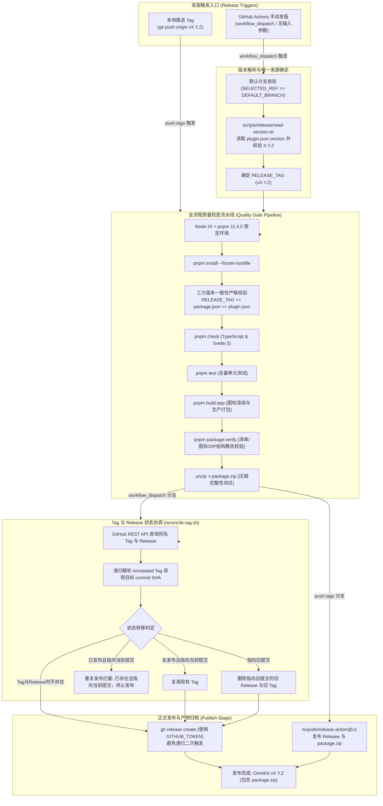

# OmniKit · 工程脚本、构建工具链与自动化发版规范 (ENGINEERING)

> **版本**：v1.0  
> **状态**：正式发布（Approved）  
> **定位**：定义 OmniKit 的 Vite 构建打包契约、`scripts/` 工程脚本体系、CI/CD 多入口自动化发版流水线、Dependabot 依赖监控策略与发版核验清单  
> **关联文档**：[AGENTS.md](../AGENTS.md) · [CORE-PRD.md](CORE-PRD.md) · [ARCHITECTURE.md](ARCHITECTURE.md)

---

## 1. Vite 构建与打包契约 (`vite.config.ts`)

1. **构建输出与环境分流**：
   - 开发模式（`NODE_ENV=development`）：输出至 `dev/` 目录，启用 `sourcemap: "inline"`，禁用代码压缩（`minify: false`），不打包 `package.zip`；
   - 生产模式（`NODE_ENV=production`）：输出至 `dist/` 目录，禁用 sourcemap，启用压缩，并通过 `vite-plugin-zip-pack` 将 `dist/` 归档为仓库根目录下的 `package.zip`；
2. **库入口与外部依赖隔离**：
   - 入口文件为 `src/index.ts`，以 CommonJS（`formats: ["cjs"]`）输出 `index.js`，样式汇聚为 `index.css`；
   - `rollupOptions.external` 声明 `["siyuan"]`，由思源宿主在运行时注入 SDK，禁止将 `siyuan` 打包进产物；
   - 内联 Web Worker 通过 Vite `?worker&inline` 打包为自包含 Blob Worker，不生成独立外部 worker 脚本，也不构建 `kernel.js`；
3. **静态资源拷贝 (`vite-plugin-static-copy`)**：
   - 将 `plugin.json`、`README*.md`、`.generated/icon.png`、`.generated/preview.png` 拷贝至输出根目录；
   - 将 `src/i18n/*.json` 拷贝至输出目录 `i18n/`，将 `assets/omnikit-*.svg` 拷贝至输出目录 `assets/`。

---

## 2. 工程化脚本体系 (`scripts/`)

工程脚本集中在 `scripts/` 目录中，仓库根目录不存放其他辅助脚本：

```text
scripts/
├── build/
│   └── render-icons.mjs       # 集市图标与预览图渲染
├── dev/
│   └── install-workspace.mjs  # 开发态向思源工作区安全安装与原子备份回滚
├── release/
│   ├── read-version.sh        # CI 手动发版从 plugin.json 提取版本并校验 X.Y.Z
│   ├── reconcile-tag.sh       # 处理已有同名 Tag 与 GitHub Release 的状态协调
│   ├── update-version.mjs     # plugin.json 与 package.json 双清单原子版本同步
│   ├── verify-package.mjs     # 产物包清单、PNG 标头、版本一致与 ZIP 结构静态校验
│   └── release.mjs            # 本地发版准备与全链路校验入口
└── clean.mjs                  # 构建产物清理工具
```

### 2.1 脚本职责与 NPM 指令映射

| 脚本路径 | 对应 NPM 指令 | 触发时机 | 核心技术职责 |
|---|---|---|---|
| `scripts/build/render-icons.mjs` | `pnpm render:icons` | `dev`、`build:app` 构建前 | 基于 `@resvg/resvg-js` 从 `assets/omnikit-plugin.svg` 渲染 `.generated/icon.png`（$160 \times 160$，$\le 64\text{ KiB}$）与 `.generated/preview.png`（$512 \times 512$，$\le 256\text{ KiB}$） |
| `scripts/dev/install-workspace.mjs` | `pnpm install:workspace` | 本地开发调试（传入工作区路径） | 先执行 `pnpm build`，再向指定思源工作区 `data/plugins/siyuan-plugin-omnikit` 安全安装产物，实施软链接拒绝、路径越界检查、清单归属校验、暂存部署与原子备份回滚 |
| `scripts/release/read-version.sh` | CI 内部调用 | GitHub Actions `workflow_dispatch` | 校验触发分支等于默认分支（`main`），使用 `jq` 读取 `plugin.json.version`，校验 `X.Y.Z` 格式并输出 `release_tag=v${version}` 至 `$GITHUB_OUTPUT` |
| `scripts/release/reconcile-tag.sh` | CI 内部调用 | 手动发版构建与校验通过后 | 通过 GitHub REST API 查询目标 Tag 与 Release 状态，递归解析 Annotated Tag 至 commit SHA，按状态矩阵执行 Tag 复用、重复发布拦截或旧提交覆盖清理 |
| `scripts/release/update-version.mjs` | `pnpm version:bump [patch\|minor\|major\|X.Y.Z]` | 本地版本升级 | 校验初始双清单版本一致后计算新版本号（未传参且在 TTY 下提供交互式选择），同步写回 `package.json` 与 `plugin.json` |
| `scripts/release/verify-package.mjs` | `pnpm package:verify` | 本地测试与 CI 构建后 | 校验 `dist/` 物理清单、根目录无散落图标、PNG 魔数与 IHDR 尺寸、README 资源引用、双清单版本一致、`minAppVersion === "3.8.4"`、JSON 语言包语法及 `package.zip` Central Directory 条目与排除项 |
| `scripts/release/release.mjs` | `pnpm release` | 本地发版准备 | 串行执行版本一致性校验、`pnpm check`、`pnpm test`、`pnpm build:app`、`verify-package.mjs` 与 `unzip -t package.zip`，通过后输出发版指引 |
| `scripts/clean.mjs` | `pnpm clean` | 本地维护与重置 | 跨平台递归清理 `dist/`、`.generated/` 与 `package.zip` |

其余 `package.json` 常用组合指令：
- `pnpm dev`：`pnpm render:icons && cross-env NODE_ENV=development vite build --watch`
- `pnpm check`：`tsc --noEmit -p tsconfig.omnikit.json && svelte-check --tsconfig ./tsconfig.omnikit.json`（分别对应 `pnpm check:types` 与 `pnpm check:svelte`）
- `pnpm test`：`node --experimental-transform-types --test 'tests/**/*.test.mjs'`
- `pnpm build`：`pnpm check && pnpm test && pnpm build:app`
- `pnpm build:app`（别名 `pnpm build:fast`）：`pnpm render:icons && cross-env NODE_ENV=production vite build`

### 2.2 核心脚本实现规范

1. **高精图标与预览图渲染 (`scripts/build/render-icons.mjs`)**：
   - 使用 `@resvg/resvg-js` 读取 `assets/omnikit-plugin.svg`，配置 `font: { loadSystemFonts: false }` 禁用系统字体探测以保证跨平台输出一致；
   - 输出至 `.generated/icon.png`（`160×160`，断言宽高精确匹配且 $\le 64\text{ KiB}$）与 `.generated/preview.png`（`512×512`，断言宽高精确匹配且 $\le 256\text{ KiB}$）；仓库根目录不留存或追踪静态 `icon.png` / `preview.png`。
2. **开发态工作区安全安装 (`scripts/dev/install-workspace.mjs`)**：
   - **路径与结构核验**：调用 `lstat` 与 `realpath` 验证工作区根目录及 `conf/`、`data/`、`data/.siyuan/`、`data/plugins/` 均为真实物理目录（遇到软链接或解析出工作区外部路径立即拒绝）；
   - **目标目录归属保护**：若 `data/plugins/siyuan-plugin-omnikit` 已存在，必须非软链接且其 `plugin.json` 的 `name === "siyuan-plugin-omnikit"`（仅 `ENOENT` 允许继续，JSON 损坏或归属不匹配立即终止）；
   - **产物前置校验与两阶段原子替换**：校验 `dist/` 下 7 个核心文件与 4 个 `assets/`、`i18n/` 资源齐全且 `dist/plugin.json` 名称匹配后，先拷贝至同目录暂存区 `.siyuan-plugin-omnikit.install-${Date.now()}-${uuid}`；随后将旧目录重命名为 `siyuan-plugin-omnikit.backup-${Date.now()}-${uuid}`，再将暂存区原子重命名为正式目录；若中途失败则清理暂存区并将备份恢复为正式目录。
3. **产物包结构静态核验 (`scripts/release/verify-package.mjs`)**：
   - **物理文件与非空断言**：核验 `dist/index.js`、`dist/index.css`、`dist/plugin.json`、`dist/README.md`、`dist/README.zh-CN.md`、`dist/i18n/en.json`、`dist/i18n/zh-CN.json`、`dist/icon.png`、`dist/preview.png`、`dist/assets/omnikit-menu.svg`、`dist/assets/omnikit-plugin.svg` 及 `package.zip` 均存在且大小 $> 0$；断言仓库根目录下不存在 `icon.png` 与 `preview.png`；
   - **PNG 标头与元数据核验**：校验 `dist/icon.png` 与 `dist/preview.png` 前 8 字节 PNG 魔数 `[137, 80, 78, 71, 13, 10, 26, 10]` 及 IHDR 块第 16~23 字节宽高与体积上限；校验 `README.md` 与 `README.zh-CN.md` 引用 `assets/omnikit-plugin.svg`；校验 `package.json.version === dist/plugin.json.version`、`manifest.name === "siyuan-plugin-omnikit"`、`manifest.minAppVersion === "3.8.4"`、`manifest.icon === "icon.png"`、`manifest.preview === "preview.png"` 及双语 JSON 可正常解析；
   - **零依赖 ZIP Central Directory 审查**：从 `package.zip` 尾部定位 EOCD 签名 `0x06054b50`，遍历 Central Directory Header `0x02014b50` 提取全部条目名，断言包含 9 项必需分发文件，且**不包含 `kernel.js`**、**不包含任何 `node_modules/` 前缀条目**。

---

## 3. CI/CD 与多入口自动化发版架构 (`.github/workflows/`)

日常提交与 PR 由 `.github/workflows/ci.yml` 执行只读权限（`contents: read`）全流程检查；正式发布由 `.github/workflows/release.yml` 驱动，支持“本地推送 `v*` Tag”与“GitHub Actions 手动触发（`workflow_dispatch`）”双入口。

### 3.1 双触发发布流水线拓扑



### 3.2 版本唯一来源、8 道质量门禁与状态协调矩阵

1. **版本唯一来源与默认分支保护**：
   - `workflow_dispatch` 不设外部输入参数，统一由 `scripts/release/read-version.sh` 校验 `SELECTED_REF === DEFAULT_BRANCH` 后从 `plugin.json.version` 提取 `X.Y.Z` 版本号并生成 `v${version}`；
2. **8 道前置质量门禁**：
   - 任何入口触发后，必须在修改远端 Tag/Release 前依次通过：① Node 24 + pnpm 11.4.0 环境固定；② `pnpm install --frozen-lockfile`；③ `${RELEASE_TAG#v}` 与 `package.json.version`、`plugin.json.version` 三方一致校验；④ `pnpm check`；⑤ `pnpm test`；⑥ `pnpm build:app`；⑦ `pnpm package:verify`；⑧ `unzip -t package.zip`；
3. **Tag 与 Release 状态协调矩阵 (`scripts/release/reconcile-tag.sh`)**：

| Git Tag 状态 | GitHub Release 状态 | 处理动作与策略 | 设计意图 |
|---|---|---|---|
| 不存在 | 不存在 | 放行后续流程，创建新 Tag 与 Release | 首次发布新版本 |
| 指向当前提交 (`GITHUB_SHA`) | 不存在 | 复用现有 Tag，放行创建 Release | 本地已打 Tag 但尚未创建 Release |
| 指向当前提交 (`GITHUB_SHA`) | 已存在 | 报错终止发布 | 幂等防重：避免重复触发覆盖已发布产物 |
| 指向历史旧提交 | 已存在 | 执行 `gh release delete "${RELEASE_TAG}" --cleanup-tag --yes` 删除旧 Release 与旧 Tag | 修正发布提交，使产物与 Tag 绑定当前构建 commit |
| 指向历史旧提交 | 不存在 | 调用 GitHub API `DELETE repos/${GH_REPO}/git/refs/tags/${RELEASE_TAG}` 删除旧 Tag | 清理指向旧提交的孤立 Tag |
| 不存在 | 已存在 | 报错终止发布 | 拦截无对应 Tag 的异常 Release 状态 |

4. **防递归触发与并发互斥控制**：
   - 手动发版使用内置 `GH_TOKEN: ${{ github.token }}` 调用 `gh release create`，GitHub Actions 对内置 `GITHUB_TOKEN` 创建的 Tag 不会二次触发 `push.tags` 工作流，从而天然阻断递归发版循环；
   - `release.yml` 声明 `concurrency: { group: "release", cancel-in-progress: false }`，保证同一时间仅运行一个发版任务且排队不强杀进行中的发布。

---

## 4. 自动化依赖监控规范 (`.github/dependabot.yml`)

1. **双生态月度监控**：同时覆盖 `npm`（根目录 `/`）与 `github-actions`（根目录 `/`），更新周期均设为 `monthly`，自动附加 `dependencies` 与 `automated-pr` 标签；
2. **`npm` `lockfile-only` 保护策略**：`npm` 生态设置 `versioning-strategy: lockfile-only` 并归入 `dev-dependencies` 分组，仅更新 `pnpm-lock.yaml` 解析版本，不自动改写 `package.json` 中的版本范围；
3. **GitHub Actions 核心大版本锁定**：将 Actions 更新归入 `actions` 单一分组 PR，并对 `actions/*`、`pnpm/*`、`ncipollo/*` 忽略 `version-update:semver-major` 跨大版本自动升级。

---

## 5. 工程与发版核验清单

- [ ] 所有工程脚本是否集中于 `scripts/` 目录体系，根目录下无散落的 `icon.png`、`preview.png` 或临时脚本？
- [ ] `scripts/build/render-icons.mjs` 是否生成 $160 \times 160$（$\le 64\text{ KiB}$）的 `.generated/icon.png` 与 $512 \times 512$（$\le 256\text{ KiB}$）的 `.generated/preview.png`？
- [ ] `scripts/dev/install-workspace.mjs` 是否实施了软链接拒绝、路径越界检查、目标 `plugin.json.name` 校验与暂存/备份原子回滚？
- [ ] `scripts/release/verify-package.mjs` 是否核验了 12 项必需产物、PNG 魔数与尺寸、README 图标引用、双清单版本一致、`minAppVersion === "3.8.4"` 以及 `package.zip` Central Directory（无 `kernel.js` 与 `node_modules/`）？
- [ ] `.github/workflows/release.yml` 是否保持 `push.tags: ["v*"]` 与免参数 `workflow_dispatch` 双入口、8 道前置质量门禁、`reconcile-tag.sh` 状态协调、`GITHUB_TOKEN` 防递归及 `concurrency` 互斥控制？
- [ ] `.github/dependabot.yml` 是否维持 `npm`（`lockfile-only`）与 `github-actions`（忽略核心大版本跨越）双生态月度分组监控？
