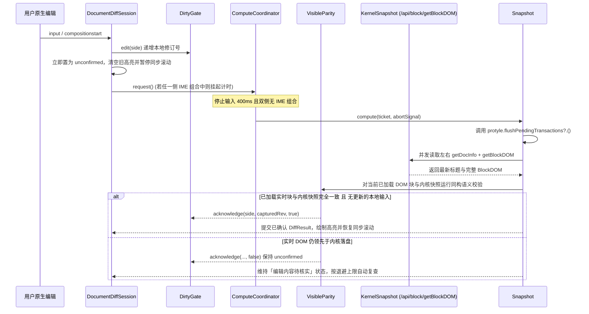

# 差异文档比较 技术设计文档 (DESIGN)

> **文档性质**：定义 `document-diff` 特性的模块拆分、接口契约、双层差异对齐算法、非侵入式渲染机制、分屏操控与并发状态流转。  
> **对应产品需求**：[PRD.md](PRD.md)  
> **所属系统架构**：[ARCHITECTURE.md](../../ARCHITECTURE.md)  
> **适用平台**：桌面布局端（`desktop` / `desktop-window` / `browser-desktop`，思源 >= v3.8.4）

---

## 1. 分层架构与目录结构

`document-diff` 严格遵循 OmniKit 微内核与单向依赖边界（[`AGENTS.md`](../../../AGENTS.md)），不与其他 Feature 产生交叉导入，也不在 Core 中引入针对特定 Feature ID 的业务分支。同时，为使全部核心算法、分屏协调与会话控制器可在 Node 单元测试环境中直接导入运行，所有来自 `"siyuan"` 运行时的值导入统一收敛至单一桥接模块 `host/SiyuanBridge.ts`。

```mermaid
flowchart TD
    subgraph Host["思源宿主环境 (SiYuan Host)"]
        KernelAPI["只读 Kernel API (/api/block/getBlockDOM, getDocInfo, listDocsByPath, searchDocs)"]
        LayoutWnd["Layout / Wnd / Tab / Protyle 实例"]
        BrowserHL["CSS Custom Highlight API & Resize/MutationObserver"]
    end

    subgraph Core["OmniKit Core 平台层"]
        MenuRouter["MenuRouter & MenuRegistry (doc-title / doc-tree / topbar)"]
        KernelClient["KernelClient (AbortSignal & 30s 超时)"]
        SettingsMgr["SettingsManager & JsonStore (feature-document-diff-settings.json)"]
        FeatScope["FeatureScope (统一生命周期与取消信号)"]
    end

    subgraph Feature["Document Diff 特性层 (src/features/document-diff/)"]
        Reg["registration.ts & DocumentDiffFeature.ts"]
        Bridge["host/SiyuanBridge.ts (隔离 siyuan 运行时值调用)"]
        
        subgraph Runtime["runtime/ (运行期会话与交互)"]
            Pair["VisiblePair.ts (可见双栏几何校验 / 无损分屏展开 / Wnd 原地左右对调)"]
            Snapshot["KernelSnapshot.ts (事务刷新 + getBlockDOM 快照读取)"]
            Parity["VisibleParity.ts (实时已加载块与内核快照同构一致性核验)"]
            Gate["DirtyGate.ts & ComputeCoordinator.ts (修订代次 / 分侧 IME / 400ms 防抖)"]
            Painter["DiffPainter.ts (CSS.highlights 行内着色 + 外置绝对定位块级浮层)"]
            Scroll["ScrollSync.ts (单调锚点链分段线性插值 + 手势代次防回弹)"]
            Picker["ManualPicker.ts (手动搜索指定文档弹窗)"]
            Session["DocumentDiffSession.ts (状态机 / 跨视口跳转 / 筛选 / 资源释放)"]
        end

        subgraph Model["model/ (纯函数模型与对齐引擎)"]
            Types["types.ts & settings.ts (数据结构 / 筛选器 / 配置 Codec)"]
            Conflict["conflict.ts (冲突后缀解析 / 公历时间校验 / 同父目录精确配对)"]
            Extractor["BlockDomExtractor.ts (离屏 BlockDOM 语义抽取 & 内部引用指纹归一化)"]
            Align["DiffEngine.ts & InlineDiff.ts (块组单调配对 + 块内加权行对齐 & 行内二级 LCS)"]
            Anchors["anchors.ts (滚动单调锚点链与有界外推计算)"]
        end

        subgraph UI["ui/ (Svelte 5 视图组件)"]
            Toolbar["DiffToolbar.svelte (可拖拽会话工具栏 / 身份提示 / 分类筛选胶囊)"]
            SettingsUI["DocumentDiffSettingsPanel.svelte (DraftParticipant 草稿设置面板)"]
        end
    end

    MenuRouter --> Reg
    SettingsMgr --> Reg
    FeatScope --> Reg
    Reg --> Bridge
    Reg --> Pair
    Reg --> Picker
    Reg --> Session
    Reg --> SettingsUI
    Session --> Snapshot
    Session --> Parity
    Session --> Gate
    Session --> Painter
    Session --> Scroll
    Session --> Toolbar
    Snapshot --> KernelClient
    Snapshot --> Extractor
    Parity --> Extractor
    Session --> Align
    Scroll --> Anchors
    Painter --> InlineDiff["InlineDiff.ts"]
    KernelClient --> KernelAPI
    Bridge --> LayoutWnd
    Painter --> BrowserHL
```



### 1.1 目录文件清单
```text
src/features/document-diff/
├── registration.ts                  # defineFeature 注册声明（frontends / defaultEnabled / codec）
├── DocumentDiffFeature.ts           # BaseFeature 子类：三入口菜单贡献、冲突自动匹配与会话单例调度
├── host/
│   └── SiyuanBridge.ts              # 唯一导入 siyuan 运行时值（getAllModels / openTab / Dialog）的薄适配器
├── model/
│   ├── settings.ts                  # DocumentDiffConfig 类型与 StoreCodec 校验器
│   ├── types.ts                     # SemanticUnit、DiffHunk、DiffUnitPair、DiffFilter、SessionStatus 等领域模型
│   ├── conflict.ts                  # 冲突后缀正则/UTC 日历校验、父路径计算、同父目录唯一原文档解析
│   ├── BlockDomExtractor.ts         # 离屏 BlockDOM 解析、语义签名构建、内部块引用唯一指纹归一化
│   ├── DiffEngine.ts                # 块组单调配对 + 块内防缩进错位加权行对齐与游标保持
│   ├── InlineDiff.ts                # 配对修改块内的二级行内 Token LCS 区间计算与 UTF-16 偏移验证
│   └── anchors.ts                   # 匹配块几何投影、严格单调锚点链筛选与分段线性插值
├── runtime/
│   ├── KernelSnapshot.ts            # 刷新编辑器待提交事务后并发读取 getDocInfo / getHPathByID / getBlockDOM
│   ├── VisiblePair.ts               # 可见双栏几何判定、单栏/已有双栏无损展开、基于 Wnd 的原地交换左右
│   ├── VisibleParity.ts             # 基于同构语义签名的实时可见叶子块与内核快照一致性核验
│   ├── DirtyGate.ts                 # 分侧编辑修订号与已核实水位门控
│   ├── ComputeCoordinator.ts        # 分侧 IME 组合挂起、400ms 防抖、代次票据与 AbortController 协调
│   ├── ScrollSync.ts                # 双向内容锚点滚动跟随、期望位置容差过滤与用户手势抢占
│   ├── DiffPainter.ts               # 独立键 CSS.highlights 渲染 + 外置浮层绘制（对齐思源 _history.scss）
│   ├── ManualPicker.ts              # 基于 /api/filetree/searchDocs 的跨目录手动比较对象选择弹窗
│   └── DocumentDiffSession.ts       # 会话主状态机、分类筛选、跨视口导航、工具栏挂载与全量资源回收
└── ui/
    ├── DiffToolbar.svelte               # Svelte 5 可拖拽浮动工具栏（身份展示、分类胶囊、导航与控制动作）
    ├── ToolbarStateBridge.svelte        # Svelte 5 工具栏响应式状态桥接组件
    ├── mountDiffToolbar.ts              # 工具栏容器挂载、状态更新与卸载工厂
    └── DocumentDiffSettingsPanel.svelte # Svelte 5 设置卡片（实现 DraftParticipant 协议）
```

---

## 2. 菜单接入与三入口门禁设计

复用现有 `src/core/feedback/MenuRouter.ts` 与 `MenuRegistry.ts` 的通用上下文（无需在 Core 新增硬编码位置）：

1. **入口 A（冲突文档菜单，`doc-title` 与 `doc-tree` 单选）**：
   - **标题菜单 (`doc-title`)**：从 `context.detail?.data?.name`（思源 `click-editortitleicon` 提供的 `IGetDocInfo.name`）读取文档标题，校验 `parseConflictTitle(title)` 非空且 `context.rootID` 存在；
   - **文档树单选菜单 (`doc-tree`)**：要求 `context.detail?.type === "doc"`、`context.selectedDocumentCount === 1` 且 `context.rootID` 非空；从 `context.targetElement`（需满足 `data-type === "navigation-file"` 且无 `aria-disabled="true"` / `data-spec-too-new="true"`）读取 `.b3-list-item__text` 文本校验冲突后缀；
   - 命中时返回两项动作：`compare-conflict`（「与原文档比较」）与 `choose-conflict-target`（「手动指定比较对象」）；点击执行时通过内核 `/api/block/getDocInfo` 二次复核标题与路径，避免菜单打开期间文档已改名或移动导致误配。
2. **入口 B（当前可见左右分屏，`topbar`）**：
   - 在顶栏菜单贡献 `compare-visible`（「比较当前左右窗口文档」），点击后调用 `findVisiblePair()` 实时检验可见主工作区几何布局。
3. **入口 C（文档树恰好双选，`doc-tree`）**：
   - 在 `doc-tree` 贡献 `compare-two-docs`（「差异文档比较」），门禁同时校验：
     - `context.detail?.type === "docs"`（思源 `navigation.ts` 仅在全部选中项均为文档时设为 `"docs"`，若混选笔记本与文档则为 `"items"`）；
     - `Array.isArray(context.detail?.items) && context.detail.items.length === 2`；
     - `context.selectedDocumentIDs?.length === 2 && context.selectedDocumentIDs[0] !== context.selectedDocumentIDs[1]`；
   - 渲染菜单时捕获常量元组 `const pair: readonly [string, string] = [idA, idB]`，杜绝菜单弹出后选区变动替换目标。

---

## 3. 可见双栏识别、无损分屏展开与原地交换左右 (`runtime/VisiblePair.ts`)

### 3.1 主工作区可见编辑器几何识别 (`visibleMainEditors` / `findVisiblePair`)
遍历 `host.getAllModels().editor`，仅保留同时满足以下条件的实例：
- 持有非空 `rootID`（`model.editor.protyle.block.rootID`）、已连接的 `.protyle` 与 `.protyle-wysiwyg` 元素；
- 位于主工作区窗格 `[data-type="wnd"]` 内（且位于 `#layouts .layout__center` 主编辑区，排除侧边栏 Dock、弹窗、悬浮窗 `block__popover`、搜索与反链内嵌编辑器）；
- 所属页签头 `model.headElement` 具有 `item--focus` 类（排除后台隐藏标签页），面板与窗格计算样式均可见且非零矩形；
- `!protyle.options?.history`（排除历史对比只读实例）。

当且仅当可见主编辑器数量等于 `2`、分属两个不同 `Wnd`、两侧 `rootID` 不同、纵向重叠高度 `> 0` 且水平方向呈左右并排（`left.rect.left < right.rect.left` 且 `left.rect.right <= right.rect.left + 24`）时，按 `rect.left` 升序返回 `[leftDoc, rightDoc]`。

### 3.2 单栏与已有双栏下的无损展开 (`openAndVerifyPair`)
给定目标 `(leftID, rightID)`：
1. 先向内核并发调用 `/api/block/getDocInfo` 校验两篇文档均存在且可读；
2. 检查当前 `visibleMainEditors()`：
   - **已有匹配的左右分屏**：若当前恰好是 `[leftID, rightID]`，直接复用返回；若当前恰好是反向的 `[rightID, leftID]`，直接执行 3.3 节的原地交换使其变为 `[leftID, rightID]`；
   - **单窗格布局（`editors.length <= 1`）**：先在当前窗格调用 `openTab({ doc: { id: leftID }, removeCurrentTab: false })` 打开或激活左文档，再调用 `openTab({ doc: { id: rightID }, position: "right", removeCurrentTab: false })` 创建右侧分屏；
   - **已有左右双窗格布局（`editors.length === 2` 且满足左右并排 `leftWnd` / `rightWnd`）**：保留两侧窗格中全部既有标签页不关闭：
     - 若 `leftID` 已在 `rightWnd` 中且 `rightWnd` 仅有这 1 个标签页，或双侧互换，优先通过 `Wnd` 迁移与切换页签避免右窗格因空标签自动合并；
     - 常规情况：先将焦点切换至 `leftWnd`（激活其当前活动页签使 `leftWnd` 成为 `.layout__wnd--active`），若 `leftID` 已在 `leftWnd` 则直接 `leftWnd.switchTab`，否则在 `leftWnd` 打开新页签；随后将焦点切换至 `rightWnd`，若 `rightID` 已在 `rightWnd` 则 `rightWnd.switchTab`，否则在 `rightWnd` 打开新页签（若 `openTab` 因跨栏同名页签复用了 `leftWnd` 中的实例，将该 `Tab` 通过 `rightWnd.moveTab(tab)` 移入右窗格）；
   - **3 个及以上多窗格或上下分屏等复杂布局**：不自动拆改布局，抛出可读提示中止启动；
3. 轮询等待（上限 `2.5s`，感知 `AbortSignal`）直至 `findVisiblePair()` 确认物理左侧为 `leftID`、物理右侧为 `rightID` 且 `protyle.wysiwyg.element` 就绪。

### 3.3 原地物理交换左右 (`swapVisiblePair`)
针对当前比较会话的 `[leftDoc, rightDoc]`（对应 `leftTab = leftDoc.tab`、`rightTab = rightDoc.tab`、`leftWnd = leftDoc.wndInstance`、`rightWnd = rightDoc.wndInstance`）：
1. 前置安全校验：必须满足 `findVisiblePair()` 仍为当前两篇文档，且 `leftTab`、`rightTab`、`leftWnd.moveTab`、`leftWnd.split` 均可用，两窗格同属水平方向（`direction === "lr"`）父 `Layout`；
2. 页签头与面板同步迁移（`transferTabToWnd`）：思源 `Wnd.prototype.moveTab` 仅移动 `tab.panelElement` 而不移动 `tab.headElement`，因此每次迁移统一先将 `tab.headElement` 追加至目标 `targetWnd.headersElement` 并移除 `targetWnd.headersElement.parentElement` 上的 `fn__none`，再调用 `targetWnd.moveTab(tab)`；
3. 会话重入保护与分支执行：在 `DocumentDiffSession.swapLeftRight()` 执行期间置位 `swapping = true`，屏蔽 `Wnd.switchTab` 同步派发的 `"switch-protyle"` 事件引发误销毁；双侧窗格均含 `>= 2` 个标签页时直接互迁并激活，单标签窗格在 `leftWnd.moveTab(rightTab)` 触发空窗格合并后调用 `leftWnd.split("lr", true)` 重建右分屏并迁入 `leftTab`；
4. 后置复核：读取交换后的 `findVisiblePair()`，确认物理左侧文档 ID 为原 `rightDoc.id`、物理右侧文档 ID 为原 `leftDoc.id`，随后更新会话引用并触发重绘。

---

## 4. 基于 BlockDOM 的双层差异模型 (`model/`)

### 4.1 为什么采用内核 `/api/block/getBlockDOM` 而非正则切分 Kramdown
1. 思源 `/api/block/getBlockDOM`（传入文档 `rootID` 与 `notebook`）由 Go 内核直接遍历完整 `.sy` 语法树（含折叠标题下的隐藏子块）渲染出标准 BlockDOM HTML；
2. 浏览器原生 `DOMParser` 解析 BlockDOM 的耗时远低于在前端主线程逐块调用 Lute JS 转换 Markdown，且产出的 DOM 节点结构与实时编辑器 `protyle.wysiwyg.element` 同构，可直接用于**语义比对**、**实时未落盘一致性核验 (`VisibleParity`)** 与**行内高亮偏移定位**。

### 4.2 离屏语义抽取与块引用归一化 (`BlockDomExtractor.ts`)
给定文档 `rootID` 与 BlockDOM 字符串（若原始 HTML 长度超过 `1,000,000` 字符，直接产出单条 `OversizedDocument` 待核对单元防止阻塞主线程）：
1. **块树遍历与容器上下文提取**：
   - 使用离屏 `DOMParser`（Node 测试环境支持注入轻量 DOM 解析器或同构树）提取所有带 `[data-node-id]` 的块元素；
   - 区分容器块（`NodeList`、`NodeListItem`、`NodeBlockquote`、`NodeCallout`、`NodeSuperBlock`、`NodeTabs`、`NodeTabItem`、`NodeMindmap`、`NodeMindmapItem`）与原子比较块（段落 `NodeParagraph`、标题 `NodeHeading`、代码块 `NodeCodeBlock`、数学公式块 `NodeMathBlock`、表格 `NodeTable`、分割线 `NodeThematicBreak`、HTML 块 `NodeHTMLBlock`、音视频 `NodeVideo` / `NodeAudio`、IFrame `NodeIFrame`、挂件 `NodeWidget`、查询嵌入 `NodeBlockQueryEmbed`、属性视图 `NodeAttributeView`，以及无子块的空容器）；
   - 为每个块记录祖先容器结构路径（含列表类型、列表与脑图任务勾选态 `protyle-task--done`、超级块布局、Callout 图标与标题、Tab 页签标题）、块级格式元数据（`data-type`、`data-subtype`、代码语言 `.protyle-action__language`、表格列对齐，以及剔除易失属性与数据库绑定缓存属性后的自定义属性排序串）；
2. **两遍扫描归一化文档内部块引用**：
   - **第一遍**：先将所有内部引用占位掩码后生成文档内每个块（含容器块）的无 ID 静态内容指纹 `selfFingerprint`，统计各指纹在本文档内的出现频次 `fingerprintCount`；
   - **第二遍**：解析块内的 `span[data-type~="block-ref"][data-id]`、`span[data-type~="a"][data-href^="siyuan://blocks/"]` 以及查询嵌入脚本中的块 ID：
     - 目标 ID 等于本篇 `rootID` -> 归一化为 `internal:document-root`；
     - 目标 ID 存在于本文档块集合中 -> 若目标块的 `fingerprintCount === 1`，归一化为 `internal:${targetFingerprint}`；若 `fingerprintCount > 1`，标记当前单元 `reliable = false`（内部引用指向文档内多个相同内容块，存在配对歧义）；
     - 目标 ID 不在本文档块集合中 -> 保留为 `external:${targetID}`，真实反映跨文档引用目标差异；
3. **逻辑行与全类型块展开 (`SemanticUnit[]`)**：
   - **普通代码块与图表渲染代码块 (`NodeCodeBlock`)**：普通代码块提取 `.hljs` 可编辑代码区（排除行号列 `.protyle-linenumber__rows` 并统一剥离思源高亮器附加的末尾换行与运行时 `line-height` 样式）；Mermaid、ECharts、PlantUML、Graphviz、Flowchart、ABC、Mindmap 等 `render-node` 图表块读取 `data-content` 源码，统一按 `\n` 逐行生成 `SemanticUnit`（`reliable = true`）；
   - **表格块 (`NodeTable`)**：按非虚拟化占位行 `<tr>` 逐行生成 `SemanticUnit`，记录单元格文本、行内格式（含单元格内图片与引用）及行列跨度，使单行增删改精确定位到对应表格行；
   - **普通富文本叶子块（段落、标题、引述文本等）**：遍历可编辑区（仅跳过 `.protyle-attr`、`.protyle-action`、`.protyle-icons`、`.callout-info`、`.tab-item-info` 等装饰控件，保留 `contenteditable="false"` 的行内图片 `span[data-type~="img"]` 与行内公式 `span[data-type~="inline-math"]`，剥离零宽边界符并解包虚拟引用 `virtual-block-ref`）：图片提取资源路径（`data-src` / `src`）、`alt`、标题（`data-title` / `title`）与容器宽度样式，行内公式提取 `data-content`，并将行内零长原子对象（图片、行内公式）在其所属逻辑行内的 UTF-16 字符偏移一并编码进 `lineMarks`，按显式 `\n`（含 `<br>`）拆分为逻辑行 `SemanticUnit`；
   - **多媒体、HTML、嵌入与数据库块**：
     - `NodeHTMLBlock`（提取 `protyle-html` 或块上的 `data-content`）、`NodeVideo` / `NodeAudio` / `NodeIFrame` / `NodeWidget`（提取媒体 `data-src` / `src`、`poster`、尺寸样式与子类型）、`NodeMathBlock`、`NodeThematicBreak` 均产出确定性签名（`reliable = true`）；
     - `NodeBlockQueryEmbed` 提取 `data-content` 查询脚本并归一化其中的本文档内部块 ID（无多同名块歧义时 `reliable = true`，有歧义时 `reliable = false`）；
     - `NodeAttributeView` 由 `KernelSnapshot` 并发调用只读 `/api/av/getAttributeView` 提取有效属性视图对象（须含 `keyValues` 或 `views` 数组）的名称、列定义、视图配置与行单元格语义值构建签名（读取成功时 `reliable = true`，接口返回空 `av` 或读取失败时 `reliable = false` 归入 `unresolved` 待核对）；
   - **顶层根子块序号映射 (`rootBlockIndexByBlockID`)**：在遍历完整 BlockDOM 时，按思源内核 `GetBlockIndex` 的顶层直接子块计数口径（`1 .. rootBlockCount`），为每个块（含容器内嵌套子块）记录其所属顶层根子块的 1 基序号，供长文档虚拟滚动分片判断与跨分片同步滚动定位使用。

### 4.3 双层块组单调配对、块内加权行对齐与行内二级 Diff (`DiffEngine.ts` & `InlineDiff.ts`)
1. **一级同侧块组单调配对与块内加权逻辑行对齐 (`alignUnits`)**：
   - 沿用思源 `history_diff.go` 预算参数：单段动态规划上限 `maxCells = 2_000_000`，整篇总预算 `totalCells = 8_000_000`，单侧最大逻辑行数 `10,000`；
   - 比较键 `semanticKey(unit)` 由 `[kind, context, text, format, target]` 序列化构成，不含 `blockID`；仅当双侧 `unit.reliable === true` 且 `semanticKey` 相同时才判为严格相等（`=`）；
   - **同侧块组聚合（保持块 ID 中立）**：按本侧连续非空且相同的 `blockID` 将 `SemanticUnit[]` 还原为 `BlockGroup`（`blockID` 仅作同侧块边界定位与分组键，跨侧块组签名仅由块类型、容器上下文及组内单元 `semanticKey` 序列构成）；
   - **块组级带预算单调配对**：对块组区间先剥离严格相等的公共前后缀；若剩余矩阵体积超出预算，则提取双侧仅出现 1 次的唯一可靠精确块组，按右侧下标最长递增子序列（LIS）作为有序锚点递归切分子区间，无唯一锚点且超预算的子区间产出 `kind: "unresolved"` 差异组；在预算内的未匹配块组子区间求最大权单调配对：
     - 严格等价的可靠块组直接产出逐行匹配（`=`），禁止跨不同块组边界产生逻辑行匹配锚点；
     - 块类型一致、容器结构层级兼容且内容特征对应的同位置变更块组建立一对一修改配对（普通代码块要求非纯括号且非空的高信息量代码行具备实质重合度，标题块要求标题文本相似或同槽位唯一对应，避免无关函数跨块错配或跨章节搬移块误判为同位置修改）；
     - 无对应关系的单侧整块保持未配对状态，按连续区间独立产出 `"left-only"`（左侧独有/删除）或 `"right-only"`（右侧新增）差异组，不并入相邻 `"modified"` 差异组；连续含不可靠单元的区间合并产出 `"unresolved"` 差异组；
   - **已配对块组内的加权逻辑行对齐**：在确认对应的修改块组内部共享剩余预算执行加权动态规划（超预算时回退块内唯一行 LIS 切分）：严格相等行优先产出 `=`，且高信息量代码/文本行的精确匹配与空白归一化相似行配对权重高于独立闭合括号行与空行，避免整体缩进级差下局部括号跨嵌套层级错位抢配；确认对应的变更行在所属 `"modified"` 差异组中记录显式行对索引 `pairedUnits: Array<{ leftIndex: number; rightIndex: number }>`，相邻已配对修改块之间未被 `=` 分隔的变更单元合并为单个 `"modified"` 差异组；
2. **二级块内行内精细 Diff (`computeInlineDiffRanges`)**：
   - 对 `kind === "modified"` 差异组中由 `pairedUnits` 确认对应的逻辑行对，当存在可见文本变化时，仿照思源 `history_diff.go:799-838` 按字符码点执行带预算二级 LCS（单对上限 `200,000` 单元）；
   - 产出左右两侧在各自逻辑行内的变更 UTF-16 区间列表 `Array<{ start: number; end: number }>`：
     - 若仅部分文字或前导缩进修改，仅高亮变更的字符区间（如把段落中的 `"2025"` 改为 `"2026"`，仅 `"2025"` 标红、`"2026"` 标绿；代码缩进由 8 空格缩减为 4 空格时，仅左侧多出的 4 个空格标红，其余未变代码保持清晰可读）；
     - 若文字完全相同而仅标题级别、任务勾选、代码语言或行内加粗等格式变化，不产生误导的局部文字底色，交由块级弱底色与修改指示条呈现。

---

## 5. 非侵入式双通道渲染 (`runtime/DiffPainter.ts`)

为保证编辑器 `outerHTML -> /api/transactions` 保存流程不受污染，禁止向 `.protyle-wysiwyg [data-node-id]` 节点写入任何属性、类名、内联样式或包裹标签。绘制分为两个与正文树隔离的只读通道，视觉规则对齐思源 `app/src/assets/scss/business/_history.scss:603-703`：

1. **通道一：CSS Custom Highlight API（文本级精确着色）**：
   - 每个比较侧注册由 `createRuntimeId(\`omnikit-diff-${side}\`)` 生成的会话私有唯一键（与思源自带的 `search-mark-*` 隔离）；
   - 在 `.protyle` 根节点下挂载会话私有 `<style>`：
     - 左侧：`color-mix(in srgb, var(--b3-theme-error) 18%, transparent)`；
     - 右侧：`color-mix(in srgb, var(--b3-theme-success) 18%, transparent)`；
   - 构造 `Range` 时遍历目标 `[data-node-id]` 内的可编辑文本与软换行 `<br>`（跳过 `.protyle-attr`、`.protyle-action`、`[contenteditable="false"]`、`[data-type~="inline-math"]` 及嵌套子块），剥离零宽边界符并建立净字符偏移到原始 `Text` 节点偏移的精确映射表，核验块内可见文本（兼容 `.hljs` 末尾单换行）与抽取快照的逻辑行拼接一致后生成 `Range` 加入 `Highlight` 集合；若偏移无法唯一证明，不猜测文本位置，安全回退至通道二整块着色。
2. **通道二：`.protyle` 外置绝对定位只读浮层（块级背景、左侧指示条、图片高亮框与聚焦框）**：
   - 在 `.protyle` 根节点下（`.protyle-content` 同级，位于编辑区 DOM 树之外）挂载 `div.omnikit-document-diff-overlay`（`position: absolute; inset: 0; pointer-events: none; overflow: hidden; z-index: 2`）；
   - 按可视视口裁剪（`[viewport.top, viewport.bottom]`）绘制各可见差异块及块内变更图片（`span[data-type~="img"]`）的几何投影框：
     - **`left-only` / `right-only` 整块**：左侧 `3px solid` 错误红/成功绿边框 + `15%` 混合底色；
     - **`modified` 块**：左侧 `3px solid var(--b3-theme-primary)` 指示条（对齐思源 `[data-history-diff~="modified"]`）；绘制时按 `DiffHunk.pairedUnits` 解析显式配对单元（无 `pairedUnits` 的合成差异组仅在两侧长度相等且同下标单元 `kind` 相同时回退配对）：当成对逻辑行完成精确二级 LCS 比对且实时文本经核验一致时，仅对存在新增或删除字符的一侧绘制行内 `CSS.highlights`（单侧纯插入或纯删除时，未发生字符删改的对侧仅展示左侧 `3px` 主色指示条，不涂满整行或整块底色）；同一 `"modified"` 差异组内的单侧未配对非空行在文本核验通过时按该行范围绘制 `CSS.highlights` 并展示左侧 `3px` 主色指示条，单侧未配对空行（含代码块末尾空行或内部空行）在实时文本核验通过且支持 `CSS.highlights` 时同样仅展示左侧 `3px` 主色指示条而不升级整块底色；仅当文本完全相同而纯格式/属性变更、块属无可见文本节点的独立图片/图表渲染 `render-node`/音视频/HTML/数据库块、运行环境无 `CSS.highlights` 或实时文本偏移无法唯一证明时，补充 `12%` 左红/右绿弱底色，并对包含行内图片变化的段落中发生变更的 `.img[data-type~="img"]` 元素叠加对应侧边框与弱底色框；
     - **`title` 差异**：在 `protyle.title.element` 投影位置绘制 `3px solid var(--b3-theme-primary)` 与对应侧红/绿弱底色；
     - **`unresolved` 待核对块**：左侧 `3px dashed var(--b3-theme-warning)` + `10%` 警示弱底色；
     - **当前聚焦差异组 (`focusedHunkKey`)**：附加 `2px solid var(--b3-theme-primary)` 聚焦脉冲边框（复刻思源 `history-diff-focus` 关键帧动画）；
3. **分类筛选联动与虚拟滚动自适应**：
   - 传入当前激活的 `DiffFilter`（`"all" | "removed" | "added" | "modified" | "unresolved"`），非命中分类的差异组跳过绘制（与思源 `docDiff.ts:218-246` 筛选隐藏行为一致）；
   - 监听 `wysiwyg.element` 的 `MutationObserver`、编辑器容器的 `ResizeObserver` 与 `contentElement` 的 `scroll` 事件（经 `requestAnimationFrame` 合并节流）：当虚拟滚动动态插入新块时重新绑定 `Range` 与块投影，普通像素滚动仅更新浮层几何坐标。

---

## 6. 输入一致性核验与并发控制 (`DirtyGate` + `VisibleParity` + `ComputeCoordinator`)



### 6.1 按需本地编辑核验 (`VisibleParity.ts`)
仅当 `DirtyGate.isSidePending(side)` 为真（即该侧发生过本地输入且尚未确认落盘）时才运行 `verifyVisibleParity`；初始打开会话或未发生本地编辑的一侧在 `flushPendingTransactions` 后直接采信内核权威快照，避免思源运行时装饰（如大表格虚拟化行、未命名标题占位、图片延迟尺寸等）导致无编辑文档误入 `unconfirmed`。对存在待核实输入的侧，比对已加载非嵌入原子块的同构归一化签名（统一剥离行号、零宽边界字符、虚拟引用包装与运行时 `line-height` 样式，兼容空标题标记 `custom-sy-title-empty` 与图片 `data-title`）；连续重试达上限且期间无新输入时采信最新内核快照解除挂起。

---

## 7. 双向内容锚点同步滚动与跨视口跳转 (`ScrollSync.ts` & `DocumentDiffSession.ts`)

### 7.1 单遍挂载映射、锚点链插值与长文档跨分片同步 (`ScrollSync.ts` & `anchors.ts` & `DocumentDiffSession.ts`)
1. **单遍挂载块扫描与严格单调锚点链**：
   - 每次滚动同步计算时，对左右两侧 `protyle.wysiwyg.element` 各执行一次非嵌入 `[data-node-id]` 挂载块扫描，构建 `Map<string, HTMLElement>` 及当前已挂载的顶层根子块序号区间 `[minRootIndex, maxRootIndex]`，每侧仅读取一次 `contentElement.getBoundingClientRect()`；
   - 从已确认的 `DiffResult.matches` 与成对 `modified` / `unresolved` 差异组首块中提取双侧同时挂载在 DOM 中的块对，计算各自相对于 `protyle.contentElement` 内容顶部的纵向偏移，经 `monotoneAnchors`（LIS）生成 `leftY` 与 `rightY` 同时严格递增的单调锚点链；
2. **同分片插值与边界块精确回退**：
   - 当主动滚动侧的视口阅读锚线（`scrollTop + min(48, clientHeight * 0.15)`）落在已挂载单调锚点链范围内时，按二分查找与分段线性插值计算对侧目标 `scrollTop`；
   - 若双侧当前已挂载分片无共同 `=` 锚点或阅读锚线超出锚点链外推距离，则取主动侧阅读锚线处的当前可见块，通过全量文档对齐结果（依次按精确匹配块、同差异组对应块、最近匹配锚点块、顶层块比例）映射为对侧目标块 `(targetBlockID, targetRootIndex)`；若 `targetRootIndex` 位于对侧已挂载区间 `[minRootIndex, maxRootIndex]` 内，直接按对侧该块（或折叠标题祖先块）与阅读锚线的相对进度换算对侧 `scrollTop`；
3. **长文档跨分片动态加载协同（兼容 `.protyle-scroll` 加载块滚动条）**：
   - 同步写入对侧 `other.scrollTop = target` 前，联动更新 `otherProtyle.scroll.lastScrollTop`，避免触发思源 `scrollEvent` 的快速拖拽回退矫正（`scrollTop > lastScrollTop * 2`），并在向上逼近未加载顶边界时保持 `scrollTop >= 1` 以正常触发思源向上动态加载；
   - 当对侧目标 `targetRootIndex` 超出对侧当前已挂载分片 `[minRootIndex, maxRootIndex]` 时：
     - **相邻分片（距离在单次 `dynamicLoadBlocks` 窗口内）**：先将对侧滚动至视口边界，并调用 `otherProtyle.scroll.loadDynamic(otherProtyle, mode, { suppressFocus: true })` 预取相邻分片；
     - **不相交远端分片（如双侧初始加载区间不同、用户拖动 `.protyle-scroll` 的 `b3-slider` 滑块或点击跳至首尾/翻页按钮）**：通过防抖调度更新对侧 `protyle.scroll` 滑块索引（预留前导上下文块并限制末尾起始索引上限以保证单次加载填满视口），以 `suppressFocus: true` 触发对侧加载目标分片（不夺取当前焦点、不切换活动窗格），待 `loaded-protyle-static` / `loaded-protyle-dynamic` 到达后立即将对侧 `targetBlockID` 对齐至阅读锚线并补绘差异高亮；
   - 非编辑态下的 `loaded-protyle-static` 事件（由虚拟滚动分片切换或导航触发，且文档根 ID 未变）直接复用内存 `DiffResult` 重绘高亮并执行待定滚动对齐，不重复发起 `/api/block/getBlockDOM` 全量重算；
4. **防循环、手势抢占与调试诊断日志**：
   - 在 `protyle.element` 捕获期监听用户物理手势（`wheel` / `touchstart` / `pointerdown` / `keydown` / `.b3-slider` 的 `input` 与 `change`），记录当前主动滚动侧；程序写入对侧 `scrollTop` 或触发对侧分片加载期间抑制反向回声，用户在对侧产生物理手势时立即取消挂起对齐并接管控制权；
   - 接入 `Logger` 调试通道（受插件通用设置「调试日志」开关控制），输出快照顶层块范围、双方已挂载分片区间、锚点链命中/回退模式、跨分片 `loadDynamic` / `setIndex` 触发及分片到达后的对齐详情。

### 7.2 跨视口差异导航（兼容虚拟滚动）
用户点击「上一处 / 下一处」时：
1. 在当前筛选后的可见差异组列表 `filteredHunks` 中更新游标 `cursor`；
2. 对左右两侧分别确定目标定位块 ID：
   - 若该侧在当前 `DiffHunk` 中含有自身单元，取其首个 `blockID`；
   - 若该侧无自身单元（例如右侧独有新增块，左侧在该处为空），在 `DiffResult.matches` 中查找紧邻该差异组逻辑下标 `leftIndex` 的前一个或后一个匹配锚点块 ID，使对侧同步跳转到同一上下文位置；
3. **已加载块 vs 虚拟滚动未加载块**：
   - 若目标块存在于 `protyle.wysiwyg.element` 中，直接调整 `contentElement.scrollTop` 使其居中，并设置 `focusedHunkKey` 触发 `DiffPainter` 绘制聚焦框动画；
   - 若目标块因长文档虚拟滚动不在当前 DOM 中，先暂停本次滚动同步回声并聚焦目标侧窗格，调用宿主桥接传入 `action: ["cb-get-hl", "cb-get-context"]`（使思源走 `mode: 3` 上下文分片加载而非单块缩放聚焦），待 `MutationObserver` 观测到目标块挂载后自动补绘高亮与聚焦框。

---

## 8. 会话资源清理与设置契约

### 8.1 配置编码器 (`model/settings.ts`)
```ts
export interface DocumentDiffConfig {
  defaultSyncScroll: boolean;
}
```
默认值 `{ defaultSyncScroll: true }`。`parseDocumentDiffConfig` 校验顶层为非数组纯对象，且 `defaultSyncScroll` 为布尔值（缺失时填默认值，类型非法时抛错触发 `JsonStore` 只读损坏保护）。

### 8.2 会话销毁闭包 (`DocumentDiffSession.dispose`)
任一退出条件（手动关闭、`destroy-protyle`、`switch-protyle` 检测到左右任一窗格活动文档根 ID 改变、比较目标失效、`FeatureScope` 中止、插件卸载）触发幂等 `dispose()`：
1. 中止 `ComputeCoordinator`（清除防抖定时器、触发在途请求 `AbortController.abort()`）与核验重试定时器；
2. 断开双侧 `MutationObserver`、`ResizeObserver` 与 `ScrollSync` 监听；
3. 按逆序卸载全部浏览器捕获期事件（`input` / `compositionstart` / `compositionend` / `scroll`）与思源 `eventBus` 监听（`ws-main` / `loaded-protyle-dynamic` / `loaded-protyle-static` / `switch-protyle` / `destroy-protyle` / `sync-end`）；
4. 调用双侧 `DiffPainter.dispose()`：清空 `Highlight` Range、从 `CSS.highlights` 删除私有键、移除注入的 `<style>` 与 `.omnikit-document-diff-overlay` 节点；
5. 调用 Svelte 5 `unmount` 卸载并移除 `DiffToolbar.svelte` 挂载容器，保留宿主原有的双分屏编辑器与文档标签页不变。
