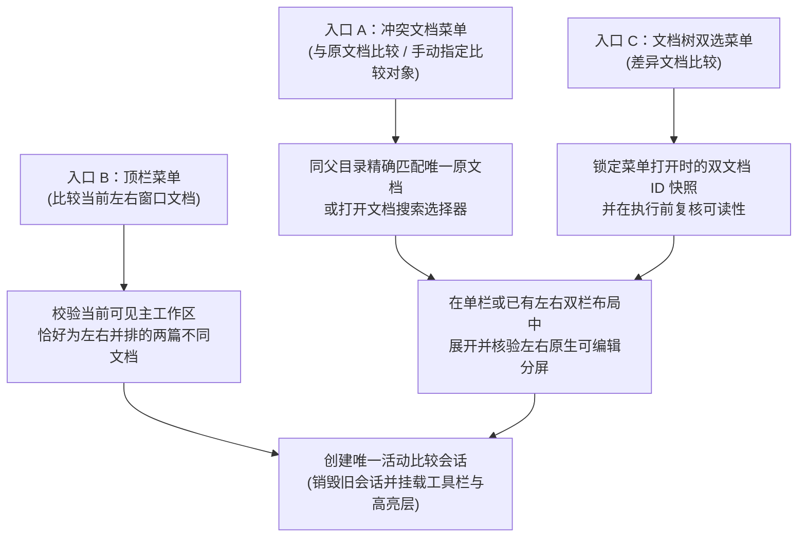

# OmniKit · 差异文档比较功能需求规范 (Document Diff PRD)

> **版本**：v1.0（正式发布稿）  
> **状态**：已定稿（Approved）  
> **适用模块**：`src/features/document-diff/`  
> **对应技术设计**：[DESIGN.md](DESIGN.md)  
> **所属平台规范**：[CORE-PRD.md](../../CORE-PRD.md)  
> **最高设计准则**：[AGENTS.md](../../../AGENTS.md)  
> **最低思源版本约束**：v3.8.4

---

## 1. 功能定位与产品边界

### 1.1 核心目标
OmniKit 差异文档比较（Document Diff）功能在思源笔记原生左右分屏编辑器中，为任意两篇不同文档提供非侵入式、支持边编辑边动态刷新的内容与语义差异可视化辅助能力：
1. **同步冲突副本排查**：思源笔记在离线同步或并发写入时会生成带时间戳后缀的冲突副本（形如 `标题 (Conflicted YYYY-MM-DD HH:mm:ss)`）。本功能支持同父目录原文档自动匹配、显式手动指定比较对象及差异高亮展示；
2. **原生左右分屏协同编辑**：直接复用思源原生左右分屏编辑窗口，比较期间两侧文档保持原生编辑能力（输入法、快捷键、右键菜单、拖拽、撤销/重做与自动保存），用户在任一侧编辑后自动防抖重算差异；
3. **只读差异辅助定位**：本功能仅提供差异可视化、分类筛选、跳转导航与同步滚动辅助，不提供「接受左侧」「接受右侧」「一键覆盖」「自动合并」等写操作指令，内容取舍由用户在原生编辑器中自行编辑完成；
4. **内容语义优先与块 ID 中立**：思源冲突副本会重新生成文档根 ID 与全部块 ID，并重映射文档内部块引用。比对以实际文本、结构层级、排版格式与引用目标语义为依据，不以块 ID 异同判定内容差异；
5. **结果可信度分级与保守降级**：区分已确认无差异、已确认有差异、本地编辑待核验、部分区域待核对与比较失败状态；未完成读取、未与内核确认一致、超出计算预算或存在歧义的区域均显式标注，不将未验证区域显示为「无差异」；
6. **非侵入式渲染与数据安全**：差异高亮通过浏览器 `CSS.highlights` 注册表与正文区域外的独立只读浮层绘制，不修改文档内容、块属性、持久化文件、修改时间或撤销/重做历史。

### 1.2 领域术语表
| 术语 | 定义 |
|---|---|
| **左文档 / 右文档** | 当前比较会话中物理左侧与物理右侧两个独立原生编辑窗格所打开的文档 |
| **冲突副本** | 标题末尾精确匹配 ` (Conflicted YYYY-MM-DD HH:mm:ss)` 且日期时间合法的文档 |
| **原文档** | 与冲突副本处于同一笔记本、同一物理父目录且标题与剥离最后一个冲突后缀后的基准标题完全相同的文档（不预设哪一侧内容更新或更准确） |
| **逻辑行** | 文档块源内容中的显式换行单元，不包含因编辑器宽度产生的视觉自动折行 |
| **差异组 (Diff Hunk)** | 一段连续的新增、删除、修改、标题差异或待核对区间，在差异计数与导航中计为一处 |
| **未确认 (`unconfirmed`)** | 用户刚发生本地编辑、尚未与思源内核持久化快照完成一致性核验的暂态，期间隐藏旧的差异着色 |
| **待核对 (`unresolved`)** | 因外部状态依赖块、内部引用多目标歧义或超出安全计算预算而无法证明精确等价的区域，以警示虚线样式标记并单独统计 |
| **比较会话** | 一对活动分屏编辑器、当前差异结果、筛选状态、同步滚动关联与视觉高亮资源的运行期实例 |

### 1.3 功能边界 (Scope)
| 维度 | 纳入范围 (In-Scope) | 排除范围 (Out-of-Scope) |
|---|---|---|
| **比较对象** | 任意两篇根块 ID 不同的思源笔记文档 | 同一篇文档的两个标签页自比对、单文档历史版本与快照对比（由思源内置数据历史功能承担） |
| **触发入口** | 1. 冲突副本菜单「与原文档比较」与「手动指定比较对象」（覆盖文档标题菜单与文档树单选菜单）； 2. 顶栏菜单「比较当前左右窗口文档」； 3. 文档树恰好双选两个不同文档的右键菜单「差异文档比较」 | 普通非冲突单文档菜单直接发起比较、全库冲突后台自动扫描、反链面板或悬浮窗预览比对 |
| **比对粒度** | 逻辑行级语义对齐 + 同位置修改块内的行内差异精细高亮（对齐思源内置历史对比视觉层级） | 跨多主窗口或独立弹窗编辑器的比对 |
| **比对要素** | 文档标题（冲突配对会话适用后缀豁免特例）、正文文本、逻辑换行、段落与块顺序、标题级别、列表类型/层级与任务勾选状态、列表脑图、普通代码块（文本/语言/缩进）、图表渲染代码块（Mermaid / ECharts / 脑图 / PlantUML / Graphviz / Flowchart / ABC 源码）、表格行列单元格与合并对齐、块级与行内公式、图片（路径/描述/标题/尺寸）、音视频/IFrame/挂件资源属性、HTML 块源码、超级块布局、提示块（Callout 类型与标题）、标签页容器（Tabs 标题与内容）、查询嵌入块脚本、数据库属性视图（结构与行列数据）、超链接目标、文档内部与跨文档块引用语义、行内加粗/斜体/删除线/下划线/高亮/行内代码/上下标/键盘/标签/备注等格式 | 块 ID、创建/更新时间、折叠展开状态、行号装饰、滚动条位置等非内容元数据 |
| **辅助交互** | 分类计数与筛选胶囊（全部 / 左侧独有 / 右侧新增 / 修改 / 待核对）、上一处/下一处跨视口导航、双向内容锚点同步滚动、原地交换左右分屏、编辑防抖刷新、手动刷新、可拖拽会话工具栏 | 自动合并、接受单侧修改、覆盖对侧文档、自动删除冲突副本或附件 |
| **平台覆盖** | 桌面布局端：`desktop`、`desktop-window`、`browser-desktop` | 移动端：`mobile`、`browser-mobile` |

### 1.4 全局约束规则
1. **REQ-001｜原始数据安全**：开启、查看、筛选、滚动、导航、交换左右、刷新与关闭比较的过程，不修改任一文档的正文内容、块属性、`.sy` 文件、修改时间、同步状态或撤销/重做栈；仅用户在原生编辑器中的主动编辑产生正常保存。
2. **REQ-002｜块 ID 中立**：块 ID 不同不构成差异判定依据，块 ID 相同也不跳过内容与格式核验。
3. **REQ-003｜不自动合并**：不提供任何代用户改写或覆盖对侧文档内容的自动化指令。
4. **REQ-004｜结果可信**：未完成读取、本地输入未与内核快照核验一致、超出预算或结构存在歧义时，展示对应状态说明，不显示无限定词的「无差异」。
5. **REQ-005｜身份明确**：会话工具栏持续展示左右两篇文档的完整标题及所属笔记本与可读路径提示，任何入口不在未提示情况下静默替换比较目标。

---

## 2. 功能入口与分屏展开规则

### 2.1 入口 A：冲突副本识别、同目录配对与手动指定
1. **候选识别规则**：
   - 仅当文档标题末尾精确匹配 ` (Conflicted YYYY-MM-DD HH:mm:ss)` 且日期与时间数值合法（按公历闰年与时分秒范围校验）时，识别为冲突副本；
   - 打开冲突文档时不自动分屏、不自动发起比较、不弹出提示打断阅读。
2. **菜单挂载门禁**：
   - 在冲突副本的**文档标题菜单**与**文档树单选右键菜单**（仅限可正常打开的文档节点，排除笔记本节点、未打开笔记本占位项与高版本不可读项）中，同时挂载两项动作：
     - **「与原文档比较」**：先执行同父目录精确自动匹配，未命中唯一原文档时转入手动选择器；
     - **「手动指定比较对象」**：无论同目录是否存在同名原文档，直接打开文档搜索选择器由用户显式挑选比较目标（支持跨目录与跨笔记本人工选择）；
   - 普通非冲突文档不展示上述两个菜单项。
3. **同父目录精确自动匹配（「与原文档比较」）**：
   - 剥离冲突副本标题末尾**最后一个**合法冲突后缀得到基准标题；若剥离后剩余标题末尾仍带有合法冲突后缀，视为多重嵌套冲突副本，直接提示原因并转入手动指定；
   - 自动查找范围严格限定在**同一笔记本、同一物理父路径（`.sy` 直接父目录）下的直接兄弟文档**，不执行模糊匹配、大小写折叠、跨目录查找、跨笔记本查找或按修改时间猜测；
   - 候选文档必须满足：ID 与冲突副本不同、经内核复核的完整标题与基准标题完全一致、物理父路径一致且可正常读取；且匹配前后冲突副本自身的位置与标题未发生并发变更；
   - 查到**恰好 1 个**有效候选时，按「左：原文档，右：冲突副本」展开原生左右分屏启动比较；
   - 查到 0 个、多个同名候选、目录列表达到上限可能截断、存在不可靠标题或读取失败时，发出明确原因通知并打开手动搜索选择器（手动选择器仅展示搜索结果列表，不默认选中第一项）。
4. **冲突配对会话的标题豁免规则**：
   - 从入口 A 启动（含自动匹配成功与手动指定比较对象）的会话记录冲突副本的文档根 ID；
   - 仅在判断「两篇文档标题是否相同」时，忽略该冲突副本文档自身末尾的最后一个系统冲突后缀（交换左右位置后仍按该冲突副本文档 ID 豁免，而非按屏幕方向豁免）；界面标题栏与工具栏始终显示完整原始标题；
   - 从入口 B 与入口 C 启动的普通比较会话不豁免任何标题后缀。

### 2.2 入口 B：顶栏菜单比较当前左右窗口文档
1. **触发方式**：点击思源顶栏 OmniKit 图标菜单中的「比较当前左右窗口文档」。
2. **可见窗口几何与可编辑性校验**：
   - 仅提取当前主工作区 `centerLayout` 内实际可见、处于激活页签（`item--focus`）且非历史只读视图的主文档编辑器；
   - 排除后台非活动页签、搜索面板编辑器、反链面板编辑器、悬浮预览窗与对话框内编辑器；
   - 按编辑器在屏幕中的实际水平几何矩形（`left < right` 且纵向重叠、横向相邻）确定物理左右顺序，不按实例数组顺序猜测；
   - 若可见主文档编辑器数量不为 2、属于上下分屏或复杂多栏网格、处于不可比较状态，或左右两侧打开的是同一篇文档，提示具体原因并拒绝启动，不改动现有标签页。

### 2.3 入口 C：文档树双选比较
1. **触发方式**：在思源文档树中同时选中**恰好两个不同文档**（`type === "docs"` 且选中项数为 2）时，右键上下文菜单展示「差异文档比较」。
2. **门禁与快照锁定**：
   - 选中数量不为 2、同一文档重复出现、包含笔记本节点或混合节点（`type === "items"` / `"notebooks"`）时，不展示该菜单项，同时其他单文档写操作菜单在多选下保持隐藏；
   - 菜单弹出时锁定当时选中的两个文档 ID 顺序快照（第 1 项为初始左文档，第 2 项为初始右文档），点击执行前向内核复核两篇文档均存在且可读。

### 2.4 原生左右分屏展开与「交换左右」行为
1. **单栏与已有双栏无损展开（入口 A / C）**：
   - 若当前主工作区为**单窗格布局**：在当前窗格打开或切换至左文档（`removeCurrentTab: false`，保留用户原有页签不关闭），再向右分屏打开右文档；
   - 若当前主工作区已是**左右双窗格布局**：保留两侧窗格中已有的其他后台页签不关闭，分别在左窗格打开或切换激活左文档、在右窗格打开或切换激活右文档（若目标文档已打开在对侧窗格，安全迁移或切换至目标侧窗格）；
   - 若当前主工作区存在 **3 个及以上可见编辑窗格或上下分屏等复杂布局**：不擅自拆改用户布局，提示原因并中止启动；
   - 展开完成后再次执行可见几何与文档根 ID 核验，未形成预期的左右双文档视图时不挂载高亮。
2. **原地交换左右分屏**：
   - 会话工具栏提供「交换左右」按钮（复用思源 `#iconScrollHoriz` 图标）；
   - 点击后基于思源宿主窗格（`Wnd`）的页签迁移与分屏接口将左右两个活动文档页签原地物理对调，保持原 `Protyle` 编辑器实例、未保存状态与撤销栈不断裂，完成后复核物理左右几何顺序与文档 ID，并同步反转左红右绿着色方向与工具栏文档身份显示；
   - 若当前窗口布局因外部变动无法安全执行自动对调，按钮置灰或提示用户通过原生标签页拖拽调整，不仅修改界面文字伪装对调成功。

---

## 3. 差异比对规则、视觉层级与可信度状态

### 3.1 语义提取与块 ID 中立规则
1. **块 ID 仅作本侧定位键**：跨文档比对签名不包含文档根 ID、块 ID、`updated` 时间戳、`fold` / `heading-fold` 折叠标记与 `scroll` 滚动属性；
2. **结构与格式全覆盖**：比对签名纳入块类型（段落、各级标题、无序/有序/任务列表及勾选态、引述、引述块/提示块 Callout 类型与标题、代码块及语言、数学公式块、表格及对齐方式、分割线、HTML/微件/嵌入/数据库块等）、父容器结构路径、保留的非易失自定义属性以及块内文本与行内格式（加粗、斜体、删除线、下划线、高亮标记、行内代码、行内公式、上下标、键盘、标签、行内备注、图片资源路径与描述、超链接地址与标题）；
3. **空白与代码保真**：代码块内的空格、缩进、大小写与空行原样逐行比对；普通文本块的显式逻辑换行与有效空格保留比对，视觉自动折行不计入差异；
4. **块引用归一化规则**：
   - 指向所属文档根块的内部引用（`((rootID ...))` 或 `siyuan://blocks/rootID`）统一归一化为「本文档根引用」，两侧均引用各自根块且锚文本语义一致时判为相同；
   - 指向所属文档内部子块的引用，按目标块在本文档内的语义内容指纹归一化：当目标块指纹在本文档内唯一时按该语义指纹配对（冲突副本重置内部块 ID 不产生假差异）；当本文档内存在多个内容完全相同的候选目标块导致引用对应关系无法唯一证明时，将该引用所在单元标记为 `待核对 (unresolved)`；
   - 指向文档外部其他块的跨文档引用保留真实目标块 ID，指向不同外部块时判定为内容修改；
5. **多媒体、图表、嵌入与数据库块全覆盖规则**：
   - 图片（含独立图片段落与图文混排中的图片）、音视频（`NodeVideo` / `NodeAudio`）、IFrame（`NodeIFrame`）、挂件（`NodeWidget`）、HTML 块（`NodeHTMLBlock`）、图表渲染代码块（Mermaid / ECharts / PlantUML / Graphviz / Flowchart / ABC / Mindmap 的 `data-content` 源码）均提取其完整资源路径、尺寸样式或源码文本执行确定性差异比对；
   - 查询嵌入块（`NodeBlockQueryEmbed`）提取其查询脚本，并对脚本中出现的本文档内部块 ID 执行与普通块引用一致的唯一块指纹归一化；
   - 数据库属性视图（`NodeAttributeView`）通过思源只读属性视图接口读取数据库列结构、视图配置与行单元格值生成无瞬态块绑定 ID 的内容签名进行比对；仅当属性视图接口读取失败或查询嵌入引用存在多同名块歧义时，将该块标记为 `待核对 (unresolved)`。

### 3.2 差异类型与视觉呈现（复用思源历史对比视觉规范）
连续的增删改单元按文档逻辑顺序合并为差异组（Diff Hunk），空间上被相同内容隔开的变化不合并。配色与视觉层级对齐思源内置历史对比样式（继承思源明暗主题 CSS 变量）：

| 差异类别 | 左侧编辑器呈现 | 右侧编辑器呈现 | 计数归类与说明 |
|---|---|---|---|
| **完全相同** | 原生正常显示 | 原生正常显示 | 计 0 处，不附加背景或边框 |
| **左侧独有 (`left-only`)** | 外置浮层浅红底色 + 左侧 `3px` 实线红边（`--b3-theme-error`） | 无对应内容（不插入真实占位空行） | 归入「删除 / 左侧独有」，连续区间计 1 处 |
| **右侧独有 (`right-only`)** | 无对应内容（不插入真实占位空行） | 外置浮层浅绿底色 + 左侧 `3px` 实线绿边（`--b3-theme-success`） | 归入「新增 / 右侧独有」，连续区间计 1 处 |
| **同位置修改 (`modified`)** | 外置浮层左侧 `3px` 主题主色边（`--b3-theme-primary`）+ 变更行/行内片段 `CSS.highlights` 浅红高亮（无文本节点块回退浅红浮层底色） | 外置浮层左侧 `3px` 主题主色边（`--b3-theme-primary`）+ 变更行/行内片段 `CSS.highlights` 浅绿高亮（无文本节点块回退浅绿浮层底色） | 成对合并归入「修改」，计 1 处 |
| **标题差异 (`title`)** | 标题区浅红/主色边框浮层提示 | 标题区浅绿/主色边框浮层提示 | 独立计 1 处并归入「修改」筛选，排在导航首位 |
| **待核对 (`unresolved`)** | 外置浮层左侧 `3px` 虚线警示边 + 弱警示底色（`--b3-theme-warning`） | 同左（若双侧对应） | 独立归入「待核对」统计，不混同为无差异 |

当前跳转聚焦的差异组在双侧对应块浮层上展示 `2px solid var(--b3-theme-primary)` 聚焦框脉冲动画（对齐思源 `history-diff-focus` 动效）。

### 3.3 可信度状态机与界面反馈
状态同时通过文字说明与分类徽章表达，不仅依赖颜色区分：

| 会话状态 | 工具栏状态文字示例 | 高亮与交互行为 |
|---|---|---|
| **比较中 (`comparing`)** | 正在比较… | 请求进行中，不将旧结果标为已确认最新；允许随时关闭比较 |
| **编辑待核实 (`unconfirmed`)** | 编辑内容待核实… | 本地发生输入而内核快照尚未确认一致时，清除可能过时的差异着色并暂停同步滚动；支持防抖自动核实或点击「刷新比对」 |
| **已确认无差异 (`equal`)** | 已确认内容无差异 | 仅当双侧全文完成读取、可见块与内核快照一致且待核对数为 0 时展示；导航按钮禁用 |
| **已确认有差异 (`diff`)** | 差异 i / N 处 | 渲染左红右绿高亮与分类胶囊，支持分类筛选与上下处循环跳转 |
| **含待核对项 (`unresolved`)** | 已确认 N 处，待核对 M 处 | 已确认差异正常标红绿，待核对区标警示虚线并可独立筛选定位；不显示无限定词的「无差异」 |
| **比较失败 (`failed`)** | 比较失败：{原因} | 清除差异着色，保持原生编辑器正常可编辑，支持点击「刷新比对」重试 |

### 3.4 重复内容对齐与大文档性能预算
1. **重复内容上下文对齐**：连续重复段落、重复列表项或相同代码行结合前后唯一内容锚点与相对顺序对齐；例如三段相同内容删除一段时，仅报告 1 处单侧独有，其余两段保持匹配不误报；
2. **分级计算预算**：
   - 先剥离双侧公共前后缀，若中间区间超出单段动态规划预算（`2,000,000` 矩阵单元，总预算 `8,000,000` 单元），提取双侧唯一语义单元的最长递增子序列（LIS）作为锚点划分子区间递归比对；
   - 单文档逻辑单元超过 `10,000` 行、文档 DOM 超过 `1 MB` 或无唯一锚点仍超预算的子区间，保守标记为 `待核对 (unresolved)`，不阻塞编辑器主线程；
3. **虚拟滚动动态渲染**：比对数据覆盖整篇文档，视觉绘制仅针对当前已加载进 `Protyle` 视口 DOM 的块创建 `Range` 与浮层框；滚动触发动态加载或卸载块时自动补绘与回收。

---

## 4. 协同编辑、同步滚动与会话工具栏

### 4.1 边编辑边比较与输入法保护
1. 用户在左右任一侧编辑正文或修改文档标题时，立即将该侧标为 `unconfirmed` 并隐藏旧高亮，停止输入 **400 ms** 防抖后先刷新待提交编辑事务再读取内核最新快照重新比对；
2. 左右两侧独立跟踪中文等输入法组合态（`compositionstart` / `compositionend`，含超时兜底），任一侧处于拼字组合期间挂起后台重算，待两侧均完成落字后再触发比对；
3. 每次本地输入、切换或刷新均递增代次票据并中止在途旧请求，较早发出的慢响应返回后自动丢弃；后台重算不夺取焦点、不改动光标选区、不主动滚动视口。

### 4.2 双向内容锚点同步滚动
1. 新建会话时按插件设置决定是否默认开启同步滚动（默认开启），工具栏可随时一键开闭；
2. 手动滚动任一侧时，提取两侧已加载 DOM 中匹配块对的纵向坐标构建严格单调锚点链，按分段线性插值驱动对侧 `protyle.contentElement` 平滑跟随；缺少可靠锚点或超出锚点外推安全距离时不强行跳动；
3. 程序性设置的跟随滚动通过目标位置容差与用户手势代次（`wheel` / `touchstart` / `pointerdown` / `keydown`）防回弹，避免双侧循环触发，且用户在新一侧主动滚动时立即接管控制权。

### 4.3 浮动会话工具栏与跨视口差异导航
比较会话激活期间挂载可拖拽浮动工具栏（默认位于工作区顶部中央避开右上角通知区，支持鼠标拖拽标题握把调整位置）：
1. **文档身份区**：并排展示左文档（红点标识）与右文档（绿点标识）的完整标题，悬浮提示所属笔记本名称与可读路径；
2. **分类筛选胶囊**（对齐思源历史对比筛选栏）：展示「全部」「左侧独有」「右侧新增」「修改」「待核对」胶囊及各自数量；点击某一分类可仅针对该类差异进行高亮显示与上下跳转（再次点击恢复「全部」）；
3. **差异导航（「上一处 / 下一处」）**：
   - 按文档逻辑顺序循环遍历当前筛选下的差异组，显示 `i / N`；
   - 若目标块已挂载在当前 DOM 中，平滑滚动至视口中部并播放聚焦脉冲框；
   - 若目标块因长文档虚拟滚动尚未加载进 DOM，按块 ID 触发思源编辑器加载目标分片并滚动到位；若单侧独有差异在对侧无直接差异块，则同步将对侧定位到最近的已匹配上下文锚点块；
   - 编辑重算后若原差异组仍存在则保留在其位置，若已被修复消除则自动停留在紧邻的下一处差异，不每次跳回第 1 处；
4. **动作按钮组**：「同步滚动」开关、「交换左右」、「刷新比对」、「关闭比较」。

---

## 5. 设置项、会话生命周期与持久化边界

### 5.1 功能设置规范 (`feature-document-diff-settings.json`)
本功能默认状态为**开启**（`defaultEnabled: true`），设置卡片接入 OmniKit 统一设置面板与全局浮动草稿保存栏（卡片内部不单设保存/重置按钮），包含以下配置项：
- **新建比较会话默认开启同步滚动 (`defaultSyncScroll`)**：布尔开关，默认开启（`true`）。控制每次启动比较会话时同步滚动功能的初始开关状态；会话运行期间点击工具栏「同步滚动」仅改变当次会话内存状态，不回写设置文件。

### 5.2 会话单例与退出清理
1. 当前窗口同时至多存在 1 个活动比较会话；发起新比较会话时自动销毁前序会话；
2. 发生以下任一情况时立即终止会话，同步移除全部 `CSS.highlights` 条目、注入样式、外置浮层、浮动工具栏、观察器、事件监听、定时器与未完成请求：
   - 点击工具栏「关闭比较」（保留左右两侧已打开的文档与用户编辑内容）；
   - 关闭左右任一比较标签页或窗格（保留另一侧文档）；
   - 将左右任一比较窗格的活动标签页切换为其他文档（清理原高亮，不将旧高亮带入新文档）；
   - 比较文档被删除或不可读取（提示原因并停止会话）；
   - 停用本功能或卸载 OmniKit 插件。
3. **最小持久化**：除 `omnikit-core.json` 中的功能启用状态与 `feature-document-diff-settings.json` 中的用户偏好外，比较会话、快照与差异数据仅驻留内存，不写入任何工作区文件或插件业务数据文件。

---

## 6. 验收基准与交付门槛

| 用例 | 场景 | 必须通过的结果 |
|---|---|---|
| **A01** | 同父目录存在唯一原文档与冲突副本 | 冲突文档标题菜单与文档树单选菜单出现「与原文档比较」和「手动指定比较对象」；点击前者按左原右冲展开分屏，正文一致时差异为 0，系统冲突后缀不计标题差异 |
| **A02** | 原文档仅在其他目录，或用户在已有同目录原文档时点「手动指定比较对象」 | 不跨目录自动匹配；弹出手动搜索选择器，按用户显式选中的目标文档启动比较 |
| **A03** | 同父目录存在多个同名候选或嵌套冲突后缀 | 不自动择一，提示具体原因并转入手动指定 |
| **A04** | 打开冲突文档但未点击比较菜单 | 保持静默，不自动分屏，不修改文档 |
| **A05** | 冲突副本全块 ID 重置且包含文档内部块引用 | 正文与唯一目标内部引用均相同则判为 0 差异；多同名目标歧义引用标为「待核对」 |
| **A06** | 单侧增删块与同位置块内单行/局部文字修改 | 单侧增删整块红绿着色；同位置修改块显示左侧主色指示条及块内变更片段红绿 `CSS.highlights`，合并计为 1 处修改，分类胶囊计数准确 |
| **A07** | 文字相同但标题级别、列表类型/层级、任务勾选或代码语言不同 | 准确检出结构或格式修改差异并可视化提示 |
| **A08** | 连续三段相同内容删除其中一段 | 仅报告 1 处删除，其余重复段正常对齐不误报 |
| **A09** | 单栏或已有左右双栏下触发入口 A / C，以及入口 B 校验 | 单栏自动右分屏、已有双栏分别激活目标文档且不关后台旧标签；入口 B 排除搜索/反链预览，非有效双栏时提示原因拒绝启动 |
| **A10** | 点击工具栏「交换左右」 | 物理左右窗格文档原地对调，编辑器实例与撤销栈保留，红绿方向与冲突后缀豁免身份同步跟随 |
| **A11** | 文档树选中 1 个非冲突文档、3 个文档或混合选中笔记本+文档 | 不展示「差异文档比较」，且双选时不暴露其他单文档写操作菜单 |
| **A12** | 比较期间双侧编辑、撤销/重做与中文 IME 拼字 | IME 组合期间挂起计算不吞字；输入立即进入待核实态隐藏旧高亮，停止输入约 400 ms 后与内核核验一致再刷新新差异；慢请求不覆盖新状态 |
| **A13** | 长文档虚拟滚动下的高亮恢复与跨视口「上一处 / 下一处」 | 滚动动态加载块自动补绘高亮；点击上下处可加载并跳转至视口外差异块，超预算区域标为「待核对」 |
| **A14** | 开启比较、筛选、同步滚动、交换左右后关闭比较或停用功能 | 未编辑时两篇文档内容、块属性与撤销栈保持不变；退出后无残留高亮、浮层、工具栏或监听器 |
