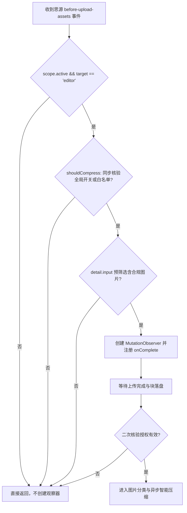
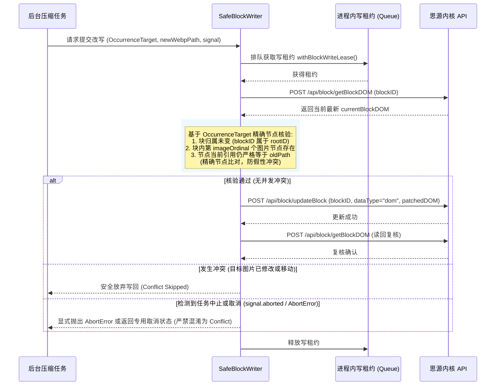

# OmniKit · 图片压缩功能需求规范 (Image Compressor PRD)

> **版本**：v1.0（正式发布稿）  
> **状态**：已冻结（Approved & Frozen）  
> **适用模块**：`src/features/image-compressor/`  
> **所属平台规范**：[CORE-PRD.md](../CORE-PRD.md)  
> **最高设计准则**：[AGENTS.md](../../AGENTS.md)  
> **最低思源版本约束**：v3.8.4

---

## 1. 功能定位与产品边界

### 1.1 核心目标
OmniKit 图片压缩功能为思源笔记提供安全、透明、可追溯的图片 WebP 压缩与存储管理能力：
1. **非阻塞异步处理**：原生图片上传与编辑器插入立即完成，压缩任务在后台异步执行，不阻塞用户编辑；
2. **新增图片处理范围**：自动模式仅处理授权后新插入的图片，不扫描或修改文档存量图片；
3. **改写范围精确**：单图操作严格仅替换当前选中的单处引用（最小副作用原则），文档批量仅修改当前文档，不产生跨文档副作用；
4. **Dock 记录追溯**：生成的 WebP 统一由 Dock 进行持久化映射登记，支持路径复制与对称的双向引用管理（查找原图引用与恢复原图引用）；
5. **数据安全原则**：插件不主动删除任何原图或压缩图；写前基于 `OccurrenceTarget` 精确节点读回比对，遇并发修改自动放弃写回；持久化确认严格先于笔记引用更新。

### 1.2 功能边界 (Scope)

| 维度 | 纳入范围 (In-Scope) | 排除范围 (Out-of-Scope) |
|---|---|---|
| **图片检测** | 编辑器新插入（拖入/粘贴）图片的异步捕获；授权文档中的新增 HTTP/HTTPS 图片；`ImageCandidateClassifier` 统一路径与扩展名前置排除（常见视频、矢量、专有绘图） | 存量图片全库全量扫描；子文档递归继承授权 |
| **图片格式** | 静态 PNG、JPEG、WebP（支持二次优化）；标准 5 尺度 MS-SSIM 质量自适应评估 | 动态图片（GIF、APNG、动画 WebP）、矢量图（SVG）、常见视频、Excalidraw 绘图 |
| **触发方式** | 自动上传捕获、右键单图操作（快捷压缩/弹窗微调，作用域仅限当前选中的单处引用）、当前文档批量压缩（桌面端 2 / 移动端 1 有界并发准备与确定性顺序写回） | 笔记本全量扫描压缩、定时常驻扫描任务 |
| **文件管理** | 压缩 WebP 上传至思源 `assets`；原图始终保留 | 插件主动删除原图或 WebP 附件；自定义图片归档属性 |
| **引用改写** | 精确块级单图片位置改写（Occurrence-level，基于节点核验而非整块字符串比对）；当前文档范围内按位置改写 | 跨文档全局重链接 (`relinkAsset`)；直接操作 `.sy` 文件或数据库 |
| **任务控制** | 系统生命周期中断保护（保留已完成产物、不回滚）；未授权完全静默与零开销（Silent by Default & Low Overhead）；用户按 Esc、切标签页或触发 signal abort 判定为正常中止并静默退出，严禁误报为“无法定位引用”、“无效文档”或并发冲突；Core `UiFeedback` 统一通知分层与防抖；Core `PluginStatusBar` 进度与当前文件展示 | 用户主动取消按钮；任务排队队列；失败自动重试机制；未授权文档中挂载无意义 MutationObserver 或发起冗余 blockDOM 查询 |

---

## 2. 自动新图压缩策略

### 2.1 异步处理时序
- **原生上传先行**：图片通过思源原生上传通道（拖拽、粘贴、上传按钮）直接上传至 `assets` 并插入编辑器。插件仅监听上传完成事件获取资源线索，不拦截原生上传，不阻塞编辑器输入。
- **延迟定位与异步处理**：监听到上传完成事件后，等待思源内核完成块落盘，通过 `ImageOccurrenceResolver` 锁定持久化块中的精确图片位置，随后调度后台异步压缩。
- **编辑冲突保护**：异步处理期间用户可正常编辑。写前校验基于 `OccurrenceTarget` 精确核验目标图片节点（块归属未变、序号节点存在且引用仍等于 `oldPath`）。若内容发生变化，系统安全放弃替换当前引用，保留用户最新编辑内容。

### 2.2 自动压缩准入规则与未授权静默原则
自动压缩在满足以下条件时生效：



- **未授权静默与轻量化规范 (Silent by Default & Low Overhead)**：
  - **彻底无感静默**：当新插入图片所在文档未开启自动压缩（全局自动压缩未开启且文档 `rootID` 不在白名单中）时，系统**完全静默处理，直接返回 (`return`)，严禁派发 notice 或弹出“未开启自动压缩，已跳过”及任何形式的 Toast 气泡打扰用户编辑**；全量跳过时也保持无感静默；
  - **上传前纯同步授权与候选预筛选（零观察器开销）**：
    1. 授权判断函数 `shouldCompress(rootID): boolean` 规范为纯同步判定，仅在内存中读取当前配置、Feature 运行状态与白名单，无任何异步 I/O；
    2. 收到思源 `before-upload-assets` 事件时，首先核验 `scope.active`、`detail.target === "editor"` 与当前目标文档授权；
    3. 同步基于 `detail.input` 进行候选图片预筛选（`files` 取 `File.name`，`local-files` 取 `path`），调用分类器 `classifyImageCandidate` 判断是否包含可处理图片；
    4. **未授权或不包含可处理候选图片时，直接同步退出，不创建 `MutationObserver` 观察器，不注册 `onComplete` 回调**，实现零 DOM 监听开销；
    5. 仅当文档授权通过且存在候选图片时，创建轻量 DOM 观察器并同步挂载 `onComplete` 监听；
    6. 上传完成回调触发时，保留一次同步授权复核，防止用户在上传在途期间撤销授权；
  - 维持沉浸式写作环境，仅在真正进入压缩流程并产生实质性结果时才提供轻量通知。
- **白名单规则**：
  - 白名单存储文档的唯一 `rootID`，不受文档改名或移动影响；界面展示时调用内核原生 `/api/filetree/getFullHPathByID` 展示包含笔记本全名的完整层级路径；
  - **白名单不继承**：仅对加入白名单的具体文档生效，子文档不继承父文档的白名单授权。

### 2.3 统一图片准入分类器 (`ImageCandidateClassifier`)

为了消除各入口重复实现与口径不一致隐患，系统确立统一的低开销路径与扩展名前置分类器：

- **调用点权威收拢**：
  1. `scanDocumentImages`：扫描当前文档 DOM 阶段进行前置过滤；
  2. `AutoUploadHandler`：上传前从 `detail.input` 预筛选候选，上传完成后再次按确定路径过滤；
  3. `RemoteImageWatcher`：外链下载前进行前置过滤；
  4. `SingleImageAction`：远程本地化前进行前置过滤；
  5. `ImageProcessingServices.prepareImage`：读取原图二进制前的最终入口再次核验；
- **常见视频扩展名统一前置排除**：
  - 常见视频扩展名集合：`mp4, m4v, mov, avi, wmv, flv, mkv, webm, 3gp, ogv, mpeg, mpg, mts, m2ts, ts, vob, asf, rm, rmvb, f4v`；
  - 路径解析算法：若为完整 URL，先提取 `URL.pathname`；规范化反斜杠并截取末尾扩展名（小写匹配）。严格杜绝直接用整段 URL 进行子串匹配，防止因 Query 参数（如 `video.MP4?token=abc`）或伪装文件名（如 `photo.mp4.png`）导致误判；
- **Excalidraw 与专有绘图资产保护**：
  - 路径或文件名包含 `excalidraw`、或位于 `drawings/` / `drawing/` 专用目录的资源，统一识别为保护排除；
  - 普通包含 `drawing` 字样的普通文件名（如 `drawing-of-cat.png`、`my-drawing.png`）不因单一子串被误伤；
- **动图与矢量格式前置排除**：
  - 动态格式（`gif`, `apng`）直接识别为 `animated-format` 跳过；
  - 矢量格式（`svg`）直接识别为 `vector-format` 跳过；
- **操作模式与 WebP 二次优化联动**：
  - 静态 WebP 图片在自动上传（`auto`）、快捷单图（`manual-quick`）与文档批量（`document`）模式下默认识别为排除扩展名并跳过；
  - 仅在手动弹窗微调模式（`manual-dialog`）下允许对 WebP 进行二次优化调整；
- **分工明确**：分类器专职处理路径与扩展名低成本过滤；读取后的图片签名、MIME、多帧动图与像素尺寸验证继续由 `inspectImage()` 负责，分类器不重复解析二进制签名。

---

## 3. 远程外链图片处理规范

### 3.1 本地化前置与未授权设防原则 (Localization First & Entry Guard)
当自动授权满足或用户对远程图片手动触发压缩时：
1. **未授权低开销设防**：外链图片监控（`RemoteImageWatcher`）**必须在触发入口及 `sweep()` 扫描入口处强设防**。若检测到当前文档未获授权（未开启全局自动压缩且不在白名单中），严禁向思源内核发起任何 `/api/block/getBlockDOM` 网络请求与全量 DOM 树解析，直接短路退出，杜绝无意义的网络 I/O 与性能开销；
2. **外链资源本地化**：通过思源 `/api/asset/upload` 将远程图片下载并上传为思源本地原图资产；
3. **引用更新模式分流**：
   - 自动上传压缩模式：无论后续压缩是否执行或达标，该远程图片在笔记中的引用首先更新为思源本地原图路径，确保外链完成本地化；
   - 单图手动微调模式（`manual-dialog`）：遵循用户操作意图，若未勾选“是否使用压缩图替换当前图片”（`replace: false`），则严格不改写文档块内容（调用 `updateBlock` 次数严格为 0），仅将原图与 WebP 上传至 assets 并写入业务记录供用户复制路径；若勾选替换，则在 WebP 生成并持久化记录后直接将引用改写为 WebP 路径；
4. **加密笔记本资产支持**：支持携带 `?box=` 参数的加密笔记本资产 URL 规范解析与上传，资产映射及引用写回均完整保留 `?box=` 参数；
5. **记录生成条件**：仅在生成了有效压缩 WebP 时才写入 Dock 记录；仅完成本地化而未生成压缩图的情况不写入 Dock 记录。

### 3.2 远程下载网络规范
- **协议支持**：仅支持 `http://` 与 `https://` 协议；
- **分平台网络下载与代理分流**：
  - 桌面端环境在存在 DesktopBridge 时按系统网络栈直接发起请求，遵循宿主系统的代理与网络栈设置（兼容 Fake-IP 等常见代理模式）；
  - 在无 DesktopBridge（或移动端/Web端）环境下，统一通过调用思源内核 REST API `/api/network/forwardProxy`（携带 `"responseEncoding": "base64"`）代理转发，彻底规避跨域限制并获得内核网络代理支持；
- **下载 User-Agent 规范**：桌面端远程外链图片下载统一使用 Core 平台全局配置 `omnikit-core.json` 中的 `general.userAgent` 进行请求头伪装（留空则默认使用现代 Chrome 浏览器 User-Agent 兜底），以兼容具备防盗链或 UA 校验的图床服务；图片压缩特性统一继承平台级 UA，不设立特性专属 UA 配置项；
- **请求边界**：单次下载超时为 30 秒，最大响应体体积限制为 32 MiB；自动跟随重定向（最多 3 次）；请求不附带思源身份凭证或 Cookie。

---

## 4. 格式、质量、尺寸与收益阈值

### 4.1 格式支持矩阵
| 图片格式 | 静态处理策略 | 动画/动态处理策略 | 说明 |
|---|---|---|---|
| **PNG** | 支持编码为 WebP | 不支持（检测到 APNG 时跳过） | 完整保留透明通道（Alpha） |
| **JPEG / JPG** | 支持编码为 WebP | 无 | 纠正 EXIF 旋转方向 |
| **WebP** | 支持二次重编码优化（满足阈值时） | 不支持（多帧动图 WebP 跳过） | 保护多帧动画 WebP 不被转换为单帧静态图 |
| **GIF** | 跳过 | 跳过 | 不转码，保留动图播放 |
| **SVG** | 跳过 | 跳过 | 矢量图不转码，保持矢量缩放 |
| **Excalidraw 绘图** | 跳过 | 跳过 | 专有绘图资产受固定保护 |

### 4.2 收益阈值 (Compression Thresholds)
编码后的 WebP 需同时满足以下条件才进行替换：
1. **体积下限**：输入原图 $\ge 100\text{ KiB}$ ($102,400\text{ 字节}$)，小于 100 KiB 跳过；
2. **绝对节省**：压缩产物比原图节省 $\ge 4\text{ KiB}$ ($4,096\text{ 字节}$)；
3. **相对节省**：体积节省比例 $\ge 5\%$ ($0.05$)。

> 未达到上述任一阈值时跳过替换，保持原图引用。

### 4.3 尺寸保护规范
- **自动模式保持原尺寸**：在自动上传压缩与文档批量压缩中，**输出 WebP 保持与输入原图相同的像素宽高**（`keepResolution: true`）。编码后进行尺寸校验，若尺寸改变则判定任务未达标并跳过；
- **真实有效尺寸提取与整数对齐契约**：
  - 在计算缩放与尺寸比对前，系统首先通过图片解码获取应用真实 EXIF 旋转方向后的有效宽高（有效纠正 orientation 6/8 等横纵互换导致的高宽颠倒问题）；
  - 缩放计算严格采用与底层 Canvas 渲染网格一致的整数取整契约（`width > height ? { width: maxEdge, height: Math.floor((height / width) * maxEdge) } : { width: Math.floor((width / height) * maxEdge), height: maxEdge }`），消除 1 像素舍入差异对尺寸校验的假性误判；
- **手动模式等比缩放**：仅在手动操作中，若配置了“手动最大边长”（默认 4096 px），图片长边超过该阈值时按上述整数对齐契约等比缩小，保持宽高比，不进行非等比拉伸或裁切。

### 4.4 EXIF 元数据选项规范
- 设置中提供“保留 EXIF 元数据”开关（默认关闭）；
- 若当前 WebP 编码库未支持 EXIF 保留，该控件在 UI 上保持展示但处于禁用状态，并附带功能暂不支持说明。

### 4.5 智能压缩质量计算规格 (Adaptive MS-SSIM Quality Search)

智能压缩通过多尺度结构相似度（MS-SSIM）客观图像质量指标自适应寻找最优 WebP 编码质量，规格确立如下：

- **子模块独立解耦**：
  - 算法域收拢在 `src/features/image-compressor/similarity/` 独立子模块；
  - 包含算法纯函数（`ms-ssim.ts`）、自适应搜索逻辑（`adaptive-quality-search.ts`）、Worker 会话驱动（`SimilarityWorkerSession.ts`）与内联 Worker 脚本（`similarity.worker.ts`）；
  - 该模块不依赖思源内核 REST API、Protyle 编辑器 DOM 或文件存储体系，具备完全独立的纯函数单元测试能力。
- **全平台标准 5 尺度 MS-SSIM 评估体系**：
  - 全平台统一保留标准的 **5 尺度 MS-SSIM** 评估体系，不降低尺度数量以保证质量指标的客观一致性与跨端准确性；
  - 5 尺度标准权重：`[0.0448, 0.2856, 0.3001, 0.2363, 0.1333]`；
  - 局部平滑窗口：$11 \times 11$ 高斯平滑核，标准差 $\sigma = 1.5$；
  - 通道加权与合成：RGB 三通道分别计算局部亮度（Luminance）、对比度（Contrast）与结构项（Structure），按标准亮度系数加权合并；
  - **Alpha 通道与全值预乘优化 (Alpha-Premultiply)**：对含透明通道图片执行 Alpha 预乘，每个 RGB 分量严格按 Alpha 系数进行缩放（`data[i] = Math.round(data[i] * (data[i + 3] / 255))`），全透明像素（$\alpha = 0$）RGB 归零，半透明像素正确预乘，消除透明背景与边缘杂色数据对结构相似度的干扰；同时当存在半透明像素时将 Alpha 相似度独立加权合并；
  - 小尺寸图片自动安全截断尺度数，并对剩余权重重新归一化，杜绝除零或 NaN。
- **智能压缩前置检查与轻量绕过契约**：
  - 智能压缩流水线首先使用初始质量执行底层轻量编码与预检；
  - 若原图体积未达到门槛（原图 $< 100\text{ KiB}$）或格式受保护，底层直接返回结构化的 `{ kind: "skipped", reason: "..." }` 正常跳过结果，不创建 Worker 线程，亦不抛出业务异常或标记为失败；
  - 仅在初始编码通过预检后才启动相似度 Worker 线程执行搜索，且搜索过程直接复用首轮候选编码产物，消除冗余计算开销。
- **平台算力分流与搜索预算**：
  - 调用思源官方 `getFrontend()` 区分平台预算：
    - **桌面端（`desktop` / `desktop-window` / `browser-desktop`）**：单张图片最多允许 7 轮质量搜索；
    - **移动端（`mobile` / `browser-mobile`）**：单张图片最多允许 5 轮质量搜索；
  - **像素基准边长归一化**：原图与候选图基准比较边长统一限制在不超过 512px（长边等比缩放至 512px，宽高比偏差 $\le 0.005$），确保高频特征比对精度与计算耗时的最佳平衡。
- **自包含内联 Worker 与两阶段通信协议**：
  - **Vite 内联打包机制**：Worker 脚本通过 Vite 原生 `import SimilarityWorker from "./similarity.worker.ts?worker&inline"` 打包为内联自包含 Blob Worker，彻底消除 CommonJS 打包产物与 `window.eval` 运行环境下的跨端路径解析与权限异常；
  - **两阶段通信协议（节省 50% 以上计算量）**：
    1. **阶段一：原图预计算 (`initOriginal`)**：单张图片质量搜索开始时，主线程向 Worker 传递原图 Blob。Worker 仅执行一次原图解码、Alpha 预乘、5 尺度降采样高斯金字塔构建，并常驻缓存原图各层的均值与方差统计量；
    2. **阶段二：候选图轻量评估 (`evaluate`)**：后续质量探索轮次中，主线程仅向 Worker 传递当前轮次的候选 WebP Blob。Worker 仅对候选图进行单向解码与金字塔生成，直接与缓存的原图金字塔与统计量执行 MS-SSIM 卷积计算；
  - 单次搜索复用同一 Worker 实例，任务完成、异常或取消（AbortSignal）时立即终止（`worker.terminate()`）并释放资源。
- **带区间保护的割线法 + 二分法混合搜索**：
  - 基于初始质量点探测（默认 0.80）；
  - 未达标时以最大质量建立合格端点，已达标时以最小质量建立不合格端点，形成确定性收敛区间；
  - 当割线预测点位于安全边界内部（距端点留有 10% 裕度）时采用割线法加速收敛；当预测越界、斜率分母过小或检测到非单调扰动时，安全回退二分法；
  - 搜索质量严格位于 $[0.10, 1.00]$，质量区间容差为 0.01；
  - 从所有达标候选（$\text{similarity} \ge \text{target}$）中挑选文件体积最小的一个。
- **早停收敛与双收益门槛铁律**：
  - **达标早停条件**：仅在“已达到目标相似度（默认 $\ge 0.99$）且候选 WebP 体积满足黄金收益门槛（原图 $\ge 100\text{ KiB}$，比原图节省 $\ge 4\text{ KiB}$ 且节省比例 $\ge 5\%$）”时，允许提前安全终止搜索；
  - **不可达判定红线**：若最高质量（1.00）仍无法达到目标相似度，算法坚决判定为 `unreachable` 并返回未达标状态。系统绝对禁止将未达标的图片当作合格产物进行自动替换，保持原图引用不变；
  - **收益不足跳过**：相似度达标但体积收益不足（未达到 4 KiB 或 5%）时，判定为 `insufficient-savings` 并跳过自动替换。

---

## 5. 菜单动作与用户交互

### 5.0 菜单前缀与顶栏隔离规范 (Menu Prefixes & Separation)
所有菜单项严格遵循**场景化前缀分流与权威收口原则**：
- **权威收口治理**：由 Core 层的 `MenuRegistry` 作为菜单前缀与派发的唯一权威收口，**严禁 Feature 层在菜单标题中硬编码 `[OmniKit]` 前缀**；
- **顶栏自有菜单 (`location === "topbar"`)**：**彻底移除 `[OmniKit]` 前缀**（例如渲染为 `压缩当前文档图片`、`开启当前文档图片自动压缩`），与顶栏环境深度融合，保持清爽克制；
- **顶栏物理分隔线**：在顶栏下拉菜单中，Core 平台项（「OmniKit 设置」）与下方 Feature 贡献的业务选项之间，必须调用思源原生 SDK 契约 `menu.addSeparator({ id: "separator_settings" })`，生成思源原生标准的 `<button data-id="separator_settings" class="b3-menu__separator"></button>` 分隔线进行物理隔离（Dock 栏已有常驻入口，顶栏不设立重复且无控的打开 Dock 选项）；
- **外部上下文右键菜单 (`location === "doc-tree" | "doc-title" | "image"`)**：由 `MenuRegistry` **自动统一补齐 `[OmniKit] ` 前缀**（例如 `[OmniKit] 压缩此图片`、`[OmniKit] 压缩…`、`[OmniKit] 压缩当前文档图片`），明确向用户标识插件归属。

### 5.1 单图操作：`[OmniKit] 压缩此图片`
- **入口**：编辑器图片右键菜单；
- **行为**：使用默认压缩质量与阈值在后台执行压缩与上传；
- **作用域**：**严格限定为仅替换当前选中的单处引用（最小副作用原则）**；同块内其他图片、同文档其他位置或跨文档相同引用保持不变；
- **正常中止静默退出**：处理期间用户按 Esc、切换标签页或触发任务 abort 属于正常中止，系统必须静默退出，严禁向用户误报为“无法定位引用”或并发冲突；
- **反馈**：无弹窗阻断，完成后由 Controller 统一发送轻量精准提示（成功：`[OmniKit] 已替换当前引用为 WebP`；冲突：`[OmniKit] 目标图片已被修改或移动，已放弃替换当前引用，WebP 已保存至记录`）。

### 5.2 单图操作：`[OmniKit] 压缩…` (弹窗微调)
- **入口**：编辑器图片右键菜单；
- **UI 视觉与规范**：
  - 弹窗采用与思源原生弹窗和设置窗口一致的设计语言（规范化标题栏、关闭按钮、标准边距与底部操作栏）；
  - 采用原图与 WebP 压缩图并列对比卡片布局，直观展示两端图片缩略图、像素尺寸、格式及体积；
  - 提供体积节省药丸徽章（Badge），显示节省字节与节省百分比；
  - 滑块带实时百分比数值气泡，调节 WebP 压缩质量（1%~100%）与手动最大边长；
  - **单图预览原图 Blob 缓存 (In-Memory Blob Cache)**：在弹窗生命周期内，原图读取后在当前弹窗会话内存中持有其 Blob 对象，在用户切换不同质量/参数重新预览时复用该 Blob，仅重新执行编码，不重复发起内核或远端原图下载；
  - **智能质量搜索过程与指标展示**：
    - 展示目标相似度指标（例如 99% MS-SSIM，明确说明为多尺度结构相似度指标，非“99% 像素完全相同”）；
    - 展示最终评估相似度与最终推荐质量参数；
    - 展开展示搜索过程表格：列出轮次（Round）、尝试质量（Quality）、评估相似度（MS-SSIM）、产物体积（Bytes）与采用的搜索方法（初始/端点/割线/二分，`initial` / `endpoint` / `secant` / `bisection`）；
    - 展示当前正在计算的轮次与方法进度，未达标或收益不足时给出明确提示；
  - **国际化多语言一致性**：弹窗内表单项标题、辅助说明、加载文案及节省状态严格通过国际化函数 `t()` 解析，杜绝硬编码语言文本；
  - 底部操作栏提供标准 `b3-button` 取消与确认按钮，提供“是否使用压缩图替换当前图片”复选框，**默认未勾选（仅保存不替换）**；
- **作用域与结果**：
  - 用户确认保存后，上传 WebP 并记录至 Dock；
  - **仅保存模式严格零改写 (Zero Document Write in Save-Only Mode)**：未勾选替换时，WebP（及外链原图）作为附件保存并写入 Dock 记录，严格不改写文档块内容（调用思源内核 `updateBlock` 次数严格为 0），由 Controller 统筹提示 `[OmniKit] 图片压缩完成，WebP 已保存至记录`；
  - 勾选替换时，作用域同样**严格限定为仅替换当前选中的单处引用**，并执行持久化前置闸门与写前节点读回比对；
  - 重新调节质量或尺寸时清空旧搜索轮次并重新触发计算；
  - 关闭或取消弹窗不执行上传；用户按 Esc 或点击取消属于正常中止，立即终止当前预览 Worker 并静默退出。

### 5.3 文档批量：`[OmniKit] 压缩当前文档图片`
- **入口**：文档树节点右键菜单、编辑器标题区域右键菜单；
- **规则与生命周期联动**：
  - **文档树直接触发支持**：支持从文档树节点直接调度当前文档批量压缩，以目标文档 `rootID` 与所属 `notebook` 为基准调度处理，不强依赖当前已打开或激活的 Protyle 编辑器实例；
  - **文档批处理并发去重**：Controller 通过内部登记集合（`activeDocuments: Set<string>`）维护正在处理中的文档 `rootID`，防止针对同一文档重复并发拉起批处理任务；同一文档正在处理时再次触发提示已有任务运行并跳过，任务结束或中止时在 `finally` 中安全移除登记；
  - 扫描当前文档中所有合规图片块（含折叠块）；
  - 跳过静态 WebP 图片；
  - **原生批量查询契约**：在扫描计划与准备阶段，系统采用思源原生批量查询接口 `/api/block/getBlockDOMs`（每批最多 64 个块 ID 分批请求），避免为每个块单独发起网络往返，显著降低内核渲染与网络往返开销；
  - **加密笔记本资产支持**：支持携带 `?box=` 参数的加密笔记本资产 URL，准备与提交阶段不排除 `source.box`，映射记录与引用写回完整保留 `?box=`；
  - 同源图片复用编码与上传结果，避免重复生成附件；
  - **已知字节数复用 (Zero Redundant I/O)**：准备阶段完成后，`OccurrenceCompressionResult` 返回已知大小（`originalBytes`、`compressedBytes`），批处理汇总统计直接复用，不重复读取磁盘文件；
  - **有界并发调度**：按平台前端预算控制准备阶段并发度（桌面端最大 2 并发，移动端最大 1 并发）；写回阶段严格保持按确定顺序逐项提交给 `SafeBlockWriter` 串行写租约与写前节点比对更新；
  - **阶段流转明确与进度呈现**：
    - 任务明确划分“准备资源（`preparing`）”与“应用替换（`applying`）”两个阶段；
    - `DocumentBatchAction` 在准备阶段实时汇报 `uploaded` 已准备上传数，在应用阶段汇报 `completed / total` 引用替换数与当前处理的文件名 `currentFile`；
    - `ImageController` 将进度数据传递给 `ImageTaskPanel` 进度模态框，直观展示当前阶段与进度；
    - 同时，Controller 联动调用 Core `PluginStatusBar`，在支持的桌面客户端主窗口呈现单行轻量文本（如 `图片压缩 5/18 · photo.png`）；
    - 移动端自动短路不操作状态栏，仅通过居中任务面板展示；
  - **空状态与扫描失败明确反馈**：
    - 扫描当前文档若可处理图片数为 0，Controller 自动关闭/销毁居中的 `ImageTaskPanel` 进度模态框，并向用户提示中性说明“当前文档未发现可压缩图片”；
    - 扫描阶段若因网络或内核异常失败，立即关闭模态框并向用户明确提示读取失败，绝不静默吞掉；
  - **正常中止静默规范**：批量任务执行期间用户关闭模态框、按 Esc 或切标签页，判定为正常中止，立即安全停止未执行的后续任务，彻底清除状态栏任务并静默退出，严禁误报为“无效文档”或业务错误；
  - 正常完成时由 Controller 统一发送单条汇总通知（包含成功数、节省体积、跳过数及冲突数）。

### 5.4 白名单快捷菜单与动态状态
- 文档右键菜单（及文档树菜单）根据当前文档是否在白名单中动态计算文案与状态：
  - **当前文档不在白名单中**：渲染为 `[OmniKit] 开启当前文档图片自动压缩`，点击后将当前文档 `rootID` 写入白名单；
  - **当前文档已在白名单中**：渲染为 `[OmniKit] 关闭当前文档图片自动压缩`，点击后将当前文档从白名单中移除；
- 菜单项遵循动作开关语义，文案保持简洁统一。

---

## 6. 原图记录 Dock 面板规范

接入 OmniKit Core 统一 Dock 容器，作为专属 Tab 面板呈现（标题：“图片压缩记录”）。

### 6.1 记录数据模型 (`feature-image-compressor-records.json`)

```typescript
export interface CompressionRecord {
  /** 思源内核原资源路径，如 "assets/image-20261113100000-xxxx.png" */
  readonly originalPath: string;
  /** 经思源上传确认成功的最新 WebP 路径 */
  readonly compressedPath: string;
  /** 记录创建或更新时间戳 (毫秒) */
  readonly updatedAt: number;
  /** 最近一次操作模式 */
  readonly lastOperation: "saved-only" | "replaced" | "incomplete";
}
```

### 6.2 记录维护契约与持久化前置闸门 (Persistence-First Gate)
1. **生成时机与落盘确认标准 (Upload Confirmation & N21)**：
   - 资产上传与落盘确认以思源内核 `/api/asset/upload` 返回的响应契约为唯一权威凭证；
   - 成功确认判定标准：`response.code === 0`，`succFiles` 数组首项 `index === 0`，`failedFiles` 长度为 0，且返回的资产路径符合 `assets/` 相对路径规范；
   - 确认上传成功后，在记录中新增或更新映射关系；
2. **区分大小写的资产路径标识 (Case-Sensitive Identity & N31)**：
   - 业务记录的资产唯一标识（`assetIdentity`）在底层严格保持大小写敏感；
   - 规范仅对 `%20` 等等价百分号编码进行安全解码规整，不执行大小写折叠转换，确保在 Linux 等区分大小写文件系统下物理不同的资产（如 `assets/Photo.png` 与 `assets/photo.png`）各自拥有独立映射，互不覆盖；
3. **多次压缩处理与最新操作排序 (Recent Operation Ordering & N38)**：
   - 同一原图仅记录最近一次压缩产物（如 A 压为 B 后再次将 A 压为 D，记录更新为 A→D）；
   - 重新压缩生成的记录自动移动至数组头部，确保 Dock 列表按操作时间倒序直观呈现最新结果；
   - 若基于已压缩的 B 继续压缩为 C，记录为独立的 B→C，不进行多代链式追溯合并；
4. **持久化前置闸门 (Persistence Gate)**：
   - **执行自动引用替换前，必须先将 Dock 记录成功写入 `feature-image-compressor-records.json` 并收到确认**；
   - 若写入超时或失败，自动替换流程终止，不改写笔记引用，界面展示已上传的 WebP 路径以供手动复制。

### 6.3 交互与状态管理规范
- **Dock 顶部视觉与防遮挡规范 (Brand Hero Card)**：
  - **顶部 Hero 品牌卡片区**：在 Dock 视图顶部常驻渲染约 52px~56px 高度的品牌展示区，包含 OmniKit 图标、粗体大标题「OmniKit / 图片记录」与轻量模式徽章，背景采用思源原生主题微渐变浅背景（`var(--b3-theme-primary)` 8% 透明度）；
  - **几何防遮挡下移 (50px+)**：使下方操作栏（“图片压缩记录”标题与“刷新记录”操作按钮、搜索等）整体平滑下移 50px 以上，在几何空间上彻底避开思源桌面端（Windows）及网页端右上角 32px 浮动 Snackbar 消息层（`#message` / `.b3-snackbars`）以及原生 Tooltip 浮层的绝对覆盖区域；
  - **防遮挡效能**：确保用户在随时点击“刷新记录”或查看记录总数时，视线与交互区域不被任何思源原生瞬态浮层遮挡。
- **路径直接复制与局域网 HTTP 兼容交互**：
  - 列表中原图路径（`originalPath`）与压缩图路径（`compressedPath`）均支持鼠标悬浮高亮与**点击直接复制到系统剪贴板**，点击后弹出轻量 Toast 提示“已复制路径”；
  - 统一通过点击路径文本触发复制，列表项中不设置独立的复制操作按钮；
  - 在缺少 Clipboard API 的局域网 HTTP 环境下，交互自动聚焦并选中文本输入框，向用户明确提示手动复制（`image.copySelectedPrompt`，如“已选中路径，请按 Ctrl+C 复制”）。
- **组件生命周期 Abort 机制 (Component-Level AbortController & R06)**：
  - `ImageRecordsDock` 组件内部持有专属的 `AbortController`（`viewController`）；
  - 当组件卸载（`onDestroy`）、Dock 折叠或 Tab 切换销毁时，立即广播中断信号，取消在途的轻量异步查询（如 `findAssetReferences`、`statAsset`）与批量替换/恢复循环；
  - 每个网络请求与异步循环迭代均检查并透传 `viewController.signal`，收到中止信号时静默退出。
- **双资源独立状态感知与状态标签呈现规范 (State Badges & Theme-Aware Styling)**：
  - 每条记录分别展示【原图状态】与【压缩图状态】两个独立的状态标签（Badge）；
  - **状态枚举**：`存在`（present）、`未核验/未知`（unknown）、`核验中`（checking，带加载动画）；
  - **初始状态策略**：新建或刚压缩生成的记录，其初始状态直接标记为“存在（present）”；
  - **挂载与增量核验**：当插件启动数据挂载、切换激活 Dock Tab 面板或记录发生映射变动时，系统自动触发后台异步核验，通过思源内核 `/api/asset/statAsset` 探测原图与压缩图的物理存在性；
  - **原生主题 CSS 变量与无 Hex 铁律**：
    - 原图/压缩图状态 Badge 样式必须严格使用思源原生主题 CSS 变量（如 `var(--b3-theme-primary)` / `var(--b3-theme-error)` / `var(--b3-theme-secondary)` / `var(--b3-theme-on-surface)` 等）及其半透明派生背景（使用 `color-mix(in srgb, var(--b3-theme-*) 15%, transparent)` 或标准 alpha 背景）；
    - **严禁硬编码 Hex 颜色**（如 `#388e3c`、`#d32f2f`、`#1976d2` 等）或非自适应 RGBA 颜色；
    - `present`（存在）：前景色采用 `var(--b3-theme-primary)`，背景采用基于该主题变量的 15% 透明度派生背景；
    - `checking`（核验中）：前景色采用 `var(--b3-theme-secondary)` 或 `var(--b3-theme-primary)`，背景采用 15% 透明度派生背景，并嵌入同色旋转 Spinner 指示器；
    - `unknown`（未核验/未知）：前景色采用 `var(--b3-theme-on-surface)`（带 0.7 透明度），背景采用 `var(--b3-theme-surface-lighter)`；
    - 确保在深色模式（Dark Mode）与浅色模式（Light Mode）下均具备优秀的对比度与文字可读性，杜绝深色模式下暗色字迹看不清的问题。
- **记录持久化纯手动管理与零自动淘汰 (Pure Manual Record Management & R03)**：
  - 业务记录的生命周期完全由用户显式触发管理（在总设置数据管理专区或 Dock 面板手动删除）；
  - 思源内核 `/api/asset/statAsset` 返回非零错误码（包括 `code === 1`）仅表示物理探测未成功或路径无法解析，不代表资源物理不存在；
  - 探测失败时，仅在 UI 层面将其标记为 `unknown` 状态并提示状态未知，**严格禁止自动调用 `removeRecord` 淘汰或清理用户的业务映射记录**。
- **对称的双向引用管理 (Bidirectional Reference Management)**：
  Dock 面板为每条记录提供对称的双向引用查找与按需改写交互：
  1. **【查找原图引用】**：
     - **展开与呈现**：点击“查找原图引用”按钮，临时查询库中当前引用原图（`originalPath`）的所有位置并展开列表；
     - **标识规范**：区域主标题为“当前原图引用”，辅助描述为“点击可跳转对应位置，替换后使用压缩 WebP”；
     - **位置跳转**：列表项展示文档路径与块摘要，点击文本直接调用内核 `openTab` 打开对应文档并高亮聚焦目标块；
     - **单项与批量替换**：
       - 单项操作：每项右侧提供“替换此处”按钮，直接将该单处引用改写为对应压缩图 WebP；
       - 批量操作：列表底部提供“替换所有处”按钮，直接批量改写当前列表中全部引用位置为 WebP；
     - **交互原则**：点击操作直接执行写前核验与改写，无需弹窗二次确认。
  2. **【恢复原图引用】**：
     - **前置约束**：仅当原图状态为“存在”时可用；原图状态未确认时给出提示；
     - **展开与呈现**：点击“恢复原图引用”按钮，临时查询库中当前引用压缩图（`compressedPath`）的所有位置并展开列表；
     - **标识规范**：区域主标题为“当前压缩图引用”，辅助描述为“点击可跳转对应位置，恢复后将改回原图”；
     - **位置跳转**：列表项展示文档路径与块摘要，点击文本直接调用内核 `openTab` 打开对应文档并高亮聚焦目标块；
     - **单项与批量恢复**：
       - 单项操作：每项右侧提供“恢复此处”按钮，直接将该单处引用改写恢复为对应原图路径；
       - 批量操作：列表底部提供“恢复所有处”按钮，直接批量改写当前列表中全部引用位置为原图；
     - **交互原则**：点击操作直接执行写前核验与改写，无需弹窗二次确认；恢复操作不删除任何压缩图附件文件。
  3. **触发场景区分与空列表状态反馈规范 (Empty Query & Post-Operation Feedback Distinction)**：
     系统严格区分“用户主动查询”与“写回后的静默刷新”两种不同场景，杜绝空状态误报错误：
     - **场景一：用户主动点击展开查询（用户意图：查找引用）**：
       - 用户点击“查找原图引用”或“恢复原图引用”按钮展开抽屉，系统触发主动引用定位；
       - 若思源内核 `/api/asset/findAssetReferences` 返回 `skippedNotebooks` 等提示覆盖不完整，展示轻量提示（如“部分笔记本或数据库未参与查询；当前列表不代表全部引用”）；
       - 若库中检索到的引用列表为空（`count === 0`），Dock 顶部提示条（Banner）按当前模式展示中性、客观且符合语境的提示文案，明确当前无匹配引用，严禁定性为操作异常或错误：
         - 查找原图引用为空（`mode === "original"`）：提示“当前笔记中未找到原图引用”；
         - 恢复原图引用为空（`mode === "compressed"`）：提示“当前笔记中未找到压缩图引用”；
         - 提示文案使用符合语境的中性空状态说明，不使用易产生困惑的否定性报错文案；
     - **场景二：执行替换/恢复后的静默刷新与防覆盖铁律（系统动作：操作反馈）**：
       - 当用户点击“替换此处”、“恢复此处”、“替换所有处”或“恢复所有处”完成写回操作后，系统自动触发重新定位（静默刷新）以同步剩余引用列表；
       - **防覆盖铁律（Anti-Overwriting Invariant）**：静默刷新属于后续辅助动作，静默刷新无论遭遇网络异常或返回空结果（如剩余 0 处），**严禁冲刷或覆盖操作本身已产生的成功统计反馈**！Dock 顶部提示条（Banner）及思源轻量通知（`showMessage`）必须持续完整展示本次操作的统计结果（例如：`已替换 ${replaced} 处为压缩图；跳过或冲突 ${conflicts} 处` 或 `已恢复 ${restored} 处为原图；跳过或冲突 ${conflicts} 处`）；
  4. **全部处理完成后的交互表现规范（自动收起展开区）**：
     - 当用户在展开列表中点击【替换所有处】/【恢复所有处】，或逐个点击【替换此处】/【恢复此处】使得最后一处引用也被成功处理完毕后，剩余待处理引用列表数量降为 0；
     - **自动干净收起展开区**：系统判定剩余引用数为 0，自动将该卡片的展开状态复位收起（`expanded = null`，`occurrences = []`），抽屉干净折叠，界面恢复整洁的记录卡片列表；
     - **保留成功反馈**：收起展开区的同时，顶部 Banner 及系统轻量通知（Toast）持续保留本次操作成功的统计文案，杜绝悬挂假性“未找到引用”或任何报错提示。
- **移除记录 (Remove Record)**：
  - 用户可显式点击“移除记录”，仅删除插件 JSON 中的映射配对，不删除任何附件文件，不修改笔记引用。

---

## 7. 块级改写与并发冲突防护

### 7.1 精确目标定义 (`OccurrenceTarget`)
```typescript
export interface OccurrenceTarget {
  readonly rootID: string;            // 文档根 ID
  readonly notebook: string;          // 笔记本 ID
  readonly blockID: string;           // 所在块 ID
  readonly imageOrdinal: number;      // 图片在块内图片节点中的次序 (0-indexed)
  readonly oldPath: string;           // 原引用路径
}
```

### 7.2 写前读回校验与进程内写租约 (Write Lease)



- **精确节点核验规范**：
  - 改写核验采用块内节点精确比对，而非整块 HTML 字符串比对（避免受 Protyle 运行时自动刷新 `updated` 时间戳、光标属性或用户在等待压缩期间编辑块内非目标文字带来的假性冲突）；
  - 采用基于 `OccurrenceTarget` 的精确节点核验三要素：
    1. 块归属未变（`blockID` 属于预期 `rootID`）；
    2. 块内第 `imageOrdinal` 个图片节点依然存在；
    3. 该节点的当前引用路径仍严格等于 `oldPath`。
  - 核验通过时，仅更新该单处节点的引用路径并提交写入；
  - 核验失败时（例如目标图片被删除或引用已由用户手动修改），安全放弃替换当前引用，不强行覆盖或执行模糊匹配；反馈客观提示 `[OmniKit] 目标图片已被修改或移动，已放弃替换当前引用，WebP 已保存至记录`；
  - **中止状态边界原则与契约 (SafeBlockWriter Abort & Cancellation Contract)**：
    - 在 `SafeBlockWriter` 获取租约（`withBlockWriteLease`）排队期间或执行写入过程中，若检测到任务取消或 Abort 信号（`signal?.aborted === true`），或者思源内核请求因取消抛出 `AbortError`；
    - **必须显式抛出标准 `AbortError` 或返回专用的取消状态枚举（如 `"aborted"`）**；
    - **绝对严禁将其归类、隐式吞咽或混淆为内容并发修改导致的冲突（`"conflict"`）**；
    - 混淆为 `"conflict"` 会导致上层调用者向用户误报“目标图片已被修改或移动，已放弃替换当前引用”并错误计入冲突数，严重破坏交互确定性。

---

## 8. 任务生命周期与通知规范

### 8.1 任务中断、正常中止与边界控制
- **无用户主动取消控制**：任务后台异步执行过程中不提供专门的取消按钮，避免操作半途带来的状态不一致；
- **任务生命周期与编辑区切换联动中断 (Lifecycle & Switch-Protyle Abort & R10)**：
  - 在单图微调、文档批量压缩与控制器编排中，用户按 Esc 键、关闭进度模态框、或切换当前文档标签页（监听 `switch-protyle` 且 `nextRoot !== rootID`），以及所属 Feature 停用时，**均判定为正常中止**；
  - 任务控制器立即触发内部 `AbortController` 信号中止后续未执行的准备与写回操作；
  - 遵循系统安全底线，已提交的块修改与已落盘资产安全保留，不执行逆向回滚，应用重启后不恢复在途任务；
  - 联动彻底销毁模态框并清除状态栏轻量文本，系统静默退出，绝对严禁向上抛出业务异常或向用户误报为“无法定位引用”、“无效文档”或“并发冲突”；
- **`SafeBlockWriter` 中止与取消严禁混同为 `"conflict"`**：
  - 底层写回组件 `SafeBlockWriter` 在检测到 `signal.aborted` 时，必须显式抛出标准 `AbortError` 或返回专用取消状态（如 `"aborted"`）；
  - 上层调用者（如 `ImageProcessingServices`、`SingleImageAction`、`DocumentBatchAction`、`ImageController`）感知中止后立即安全退出，严禁将中止误判为内容编辑冲突（`"conflict"`），严禁向用户提示冲突气泡，严禁将取消数量计入汇总冲突统计；
- **空状态与扫描失败模态框联动销毁 (Empty State & Failure Guard & R12)**：
  - 批量压缩扫描发现 0 张可处理图片或扫描阶段发生异常时，Controller 立即联动自动关闭/销毁居中的 `ImageTaskPanel` 进度模态框，并向用户提供明确的客观提示，杜绝模态框悬挂堆叠。

### 8.2 结果通知规范与分层收口 (Controller & Core UiFeedback Integration)

通知反馈体系严格遵循“Action 纯数据返回 -> Controller 领域解释 -> Core UiFeedback 统一呈现”的三层分工：

```
┌────────────────────────────────────────────────────────┐
│ Action 纯领域层 (SingleImageAction / DocumentBatchAction)│
│ - 仅返回纯数据结构 (ImageActionOutcome / Summary)     │
│ - 严禁在 Action 内部直接调用 showMessage 发送通知     │
└───────────────────────────┬────────────────────────────┘
                            │ 返回纯数据结果
                            ▼
┌────────────────────────────────────────────────────────┐
│ Controller 门面层 (ImageController.ts)                 │
│ - 唯一通知决策层，负责将领域纯数据解释为语义文案与参数 │
│ - 调度 ImageTaskPanel 进度模态框与 Core PluginStatusBar│
└───────────────────────────┬────────────────────────────┘
                            │ 派发纯语义文案
                            ▼
┌────────────────────────────────────────────────────────┐
│ Core UiFeedback 平台服务 (FeatureContext.feedback)     │
│ - 自动补齐 [OmniKit] 前缀                             │
│ - 检查 scope.active，失活时静默丢弃未决通知           │
│ - 自动拦截并吞咽 AbortError 与取消信号 (杜绝误报)       │
│ - 300ms 消息防抖抑制高频重复弹出                      │
└────────────────────────────────────────────────────────┘
```

- **自动压缩未授权静默原则 (Silent by Default)**：
  - 当在未授权文档（未开启全局自动压缩且文档未加入白名单）中插入图片时，系统**完全静默处理，严禁弹出“未开启自动压缩，已跳过”或任何 Toast 提示打扰用户编辑**；
  - 仅在真正进入压缩流程并产生明确结果时，才提示对应的轻量气泡，杜绝打扰用户正常写作。
- 各类触发路径在真正执行并结束时，统一由 Controller 调用 Core `UiFeedback` 发送明确客观的结果通知：
  - **单文件场景 (`ImageActionOutcome`)**：
    - 替换成功 (`success`)：`[OmniKit] 已替换当前引用为 WebP（节省体积 ${saved}）` 或 `[OmniKit] 已替换当前引用为 WebP`；
    - 并发冲突放弃 (`conflict`)：`[OmniKit] 目标图片已被修改或移动，已放弃替换当前引用，WebP 已保存至记录`；
    - 仅保存模式 (`saved-only`，微调弹窗未勾选替换)：`[OmniKit] 图片压缩完成，WebP 已保存至记录`；
    - 收益不足跳过 (`skipped`)：`[OmniKit] 图片压缩收益不足，已跳过`；
    - 目标相似度不可达 (`skipped`)：`[OmniKit] 无法达到目标相似度，已保留原图`；
    - 压缩处理失败 (`failed`)：`[OmniKit] 图片压缩处理失败，已保留原图`；
    - 正常取消 (`cancelled`)：完全静默退出，无通知。
  - **多文件 / 批量场景 (`CompressionBatchSummary`)**：
    - 统一发送至多一条汇总通知，按分类清晰报告各项张数（例如：`[OmniKit] 图片处理完成：${success} 张已替换为 WebP（节省 ${saved}），${skipped} 张未达收益跳过，${conflict} 张因冲突放弃替换（WebP 已保存至记录）`）；
  - **Dock 双向引用管理场景**：
    - **主动查询无结果提示（中性语境，区分模式）**：
      - 查找原图引用为空（`mode === "original"`）：`当前笔记中未找到原图引用`；
      - 恢复原图引用为空（`mode === "compressed"`）：`当前笔记中未找到压缩图引用`；
      - （提示文案保持中性客观，不使用歧义或混淆文案）；
    - **替换操作反馈**：`已替换 ${replaced} 处为压缩图；跳过或冲突 ${conflicts} 处`；全部处理完毕后自动收起展开列表，持续保留此统计文案；
    - **恢复操作反馈**：`已恢复 ${restored} 处为原图；跳过或冲突 ${conflicts} 处`；全部处理完毕后自动收起展开列表，持续保留此统计文案；
  - **提示文案规范**：原生图片上传由思源主程序承载；插件在后续压缩判定或跳过时，提示文案客观反映压缩与改写状态，提供精准反馈。

---

## 9. 设置项结构与界面规范 (`feature-image-compressor-settings.json`)

### 9.1 数据结构 (Schema Version 2)

```json
{
  "schemaVersion": 2,
  "auto": {
    "globalEnabled": false,
    "pageAllowlist": {}
  },
  "compression": {
    "smartEnabled": false,
    "targetSimilarity": 0.99,
    "initialQuality": 0.8,
    "manualMaxEdge": 4096,
    "excludedExtensions": ["gif", "svg", "webp"]
  },
  "metadata": {
    "preserveExif": false
  }
}
```

| 配置字段 | 类型 | 默认值 | 约束与说明 |
|---|---|---|---|
| `schemaVersion` | number | `2` | 配置结构版本，当前现行规格固定为 `2` |
| `auto.globalEnabled` | boolean | `false` | 全局自动压缩开关（默认关闭） |
| `auto.pageAllowlist` | object | `{}` | 精确文档 `rootID` 白名单映射表 |
| `compression.smartEnabled` | boolean | `false` | 智能压缩质量搜索开关（默认关闭，保持轻量默认行为） |
| `compression.targetSimilarity` | number | `0.99` | 智能压缩目标多尺度结构相似度指标 (MS-SSIM)，范围 `0.01` ~ `1.0` |
| `compression.initialQuality` | number | `0.8` | 默认 WebP 压缩质量，范围 `0.01` ~ `1.0` |
| `compression.manualMaxEdge` | number | `4096` | 手动压缩时的最大等比长边限制 (px)，范围 `256` ~ `8192` |
| `compression.excludedExtensions` | string[] | `["gif", "svg", "webp"]` | 保护排除的扩展名列表 |
| `metadata.preserveExif` | boolean | `false` | 保留 EXIF 元数据（未支持时在设置界面禁用置灰） |

### 9.2 设置面板展示与操作规范
1. **自动处理文档白名单展示与路径防重**：
   - 明确调用思源内核原生 `/api/filetree/getFullHPathByID`，解析展示包含笔记本全名的完整层级路径；
   - 采用非响应式登记集合（`pathLookupsStarted: Set<string>`）在发起网络请求前同步锁定目标文档 ID，确保单次面板挂载周期内每个 ID 至多发起一轮路径查询，杜绝响应式状态变动导致的级联重复请求；
   - 列表中每个条目展示两行信息：
     - **主标题（加粗）**：展示包含笔记本全名的完整层级路径（格式：`笔记本名/父文档/文档名`）；若内核返回为空或文档已删除，主标题回退展示 `rootID`；
     - **副标题 / 描述**：展示文档精确 ID（`rootID`），便于高级排查；
   - 每个条目右侧提供“移出白名单”快捷删除按钮；
   - **文档身份核验契约**：白名单文档身份核验调用思源内核原生 `/api/block/getBlockInfo` 接口结合 `notebook` 验证 `rootID === id` 与所属笔记本，天然支持普通笔记本与加密笔记本，不依赖全局普通 SQL。
2. **智能压缩设置控件**：
   - 提供“智能质量搜索”开关控件，开启后启用基于 MS-SSIM 相似度的自适应搜索；
   - 提供“目标相似度”数值滑块或输入框，范围 80%~99.9%（默认 99%），附带说明明确该指标为 MS-SSIM 结构相似度指标。
3. **User-Agent 配置说明**：
   - 特性设置面板不包含 User-Agent 配置项；外链图片下载直接遵循 Core 平台全局设置。
4. **特性重置按钮文案规范**：
   - 设置卡片右上角的重置操作按钮文案统一为**“重置为默认设置”**。

### 9.3 配置文件版本平滑迁移规格 (Schema Version Migration)
- 当从磁盘读取到 `schemaVersion: 1` 或缺少新增字段的旧配置时，系统执行确定性平滑迁移：
  1. 补齐 `compression.smartEnabled = false` 与 `compression.targetSimilarity = 0.99`；
  2. 完整保留用户已存在的全局开关、白名单列表、初始质量、最大边长及排除扩展名等配置值；
  3. 将 `schemaVersion` 标记更新为 `2` 并持久化写入；
  4. 迁移过程零数据丢失，对用户无感。

---

## 10. 架构职责划分与代码规范 (Architecture Responsibilities & Clean Code)

为了消除多层重复判断、避免职责混乱引发假性报错或多重提示，特性内部确立严格的单向职责划分与所有权模型：

### 10.1 单向职责与分工边界
1. **Feature 层 (`ImageCompressorFeature.ts`)**：
   - 专职负责思源宿主环境的事件监听（Protyle 监听、编辑器上传事件、文档与图片右键菜单注册、`destroy-protyle` 生命周期事件）；
   - **外链观察器热重载 (Hot Reconciliation & R07)**：通过订阅特性设置 Store，当用户修改白名单或自动开关时动态协调各个已知编辑器的观察器实例，启动时调用 `getActiveEditor()` 接入当前活动编辑器，监听 `destroy-protyle` 及时销毁失活观察器；
   - 提取宿主上下文信息（`Protyle` 实例、`blockID`、`rootID` 等），将业务直接委托给 `ImageController`；
   - 严禁在 Feature 层直接编写复杂的业务编排逻辑与 UI 弹窗，所有用户提示权威收拢至 Controller；
   - 所有副作用与事件监听句柄由 `FeatureScope`（`context.scope.own`）集中托管与自动释放。
2. **Controller 门面层 (`ImageController.ts`)**：
   - 唯一业务编排门面，严格把控前置参数校验与准入条件（全局自动压缩开关、白名单匹配判定、文档批处理并发去重 `activeDocuments`）；
   - 调度纯领域 Action、居中进度模态框 `ImageTaskPanel` 与 Core `PluginStatusBar` 底栏文本；
   - 唯一负责领域结果解释：接收 Action 返回的纯数据结构，解释为多语言语义并调用 Core `UiFeedback` 发送通知；
   - 负责识别正常中止（用户 Esc、切标签页、关闭面板、AbortSignal），静默退出，严禁假报错。
3. **Action 纯领域层 (`SingleImageAction.ts` / `DocumentBatchAction.ts` / `RemoteImageWatcher.ts` 等)**：
   - 纯领域逻辑执行者，专注执行扫描、节点匹配、WebP 编解码、文件上传与块级安全改写；
   - 严禁在 Action 内部直接调用 `showMessage` 弹出全局通知气泡，避免与 Controller 重复提示；
   - 遇到异常、冲突或取消时，统一返回纯数据结构化结果（`ImageActionOutcome` / `CompressionBatchSummary` / `AutoUploadNotice`），交由 Controller 统筹判定与汇报。
4. **独立算法子模块 (`src/features/image-compressor/similarity/`)**：
   - 专职承担 5 尺度 MS-SSIM 计算、割线+二分混合自适应搜索、内联 Worker 调度；
   - 纯计算无 DOM 或内核 API 依赖，通过标准 `SimilarityEvaluator` 接口与编码器及业务层解耦。

### 10.2 代码去重与准入前置规范
- **准入分类前置收敛**：所有图片候选过滤统一收拢于 `ImageCandidateClassifier`，禁止在各 Action 和辅助函数中散落重复的扩展名或专有绘图正则判断；
- **授权判断纯同步化**：原生上传入口前置纯同步授权判断与文件预筛选，杜绝未授权场景下创建多余的 MutationObserver，保持业务链路精炼透明。
