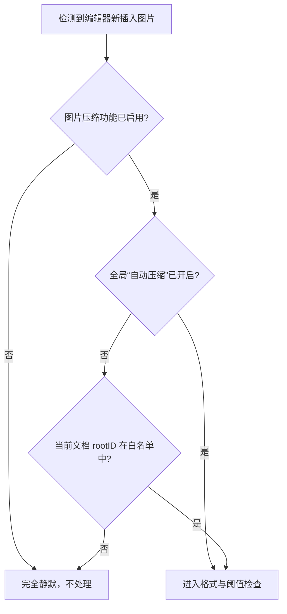
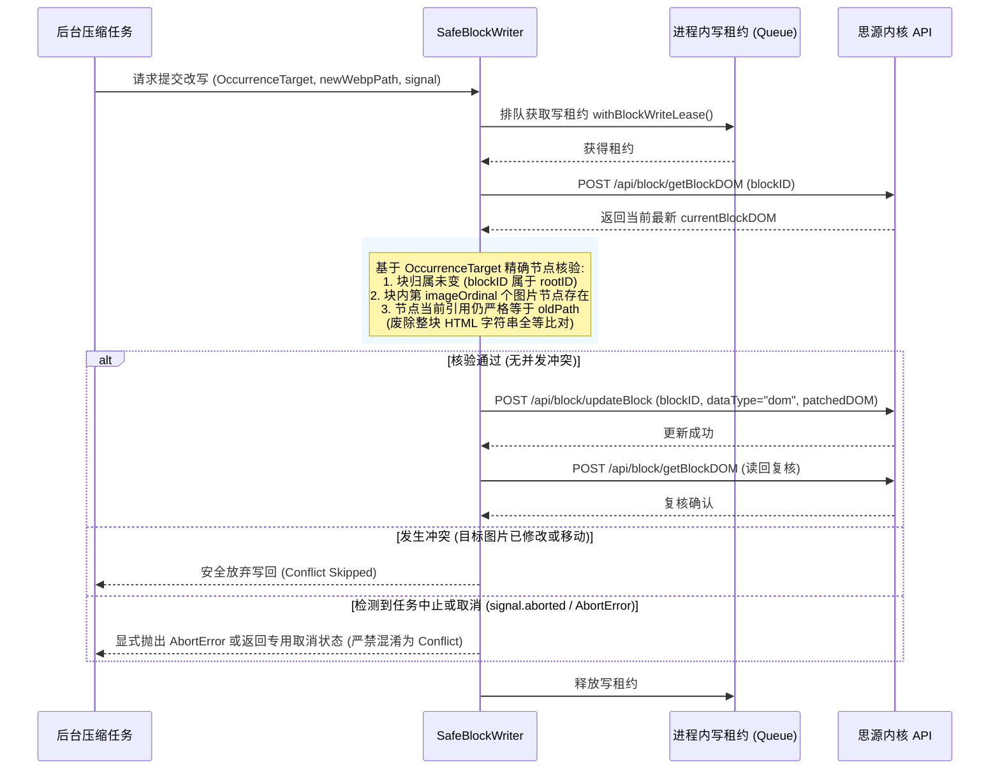

# OmniKit · 图片压缩功能需求规范 (Image Compressor PRD)

> **版本**：v1.0（正式发布稿）  
> **状态**：已冻结（Approved & Frozen）  
> **适用模块**：`src/features/image-compressor/`  
> **所属平台规范**：[CORE-PRD.md](../CORE-PRD.md)  
> **最高设计准则**：[AGENTS.md](../../AGENTS.md)

---

## 1. 功能定位与产品边界

### 1.1 核心目标
OmniKit 图片压缩功能为思源笔记提供安全、透明、可追溯的图片 WebP 压缩与存储管理能力：
1. **非阻塞异步处理**：原生图片上传与编辑器插入立即完成，压缩任务在后台异步执行，不阻塞用户编辑；
2. **新图处理范围**：自动模式仅处理授权后新插入的图片，不扫描或修改历史存量图片；
3. **改写范围精确**：单图操作严格仅替换当前选中的单处引用（最小副作用原则），文档批量仅修改当前文档，不产生跨文档副作用；
4. **Dock 记录追溯**：生成的 WebP 统一由 Dock 进行持久化映射登记，支持路径复制与对称的双向引用管理（查找原图引用与恢复原图引用）；
5. **数据安全原则**：插件不主动删除任何原图或压缩图；写前基于 `OccurrenceTarget` 精确节点读回比对，遇并发修改自动放弃写回；持久化确认严格先于笔记引用更新。

### 1.2 功能边界 (Scope)

| 维度 | 纳入范围 (In-Scope) | 排除范围 (Out-of-Scope) |
|---|---|---|
| **图片检测** | 编辑器新插入（拖入/粘贴）图片的异步捕获；授权文档中的新增 HTTP/HTTPS 图片 | 历史存量图片全量扫描；子文档递归继承授权 |
| **图片格式** | 静态 PNG、JPEG、WebP（支持二次优化） | 动态图片（GIF、APNG、动画 WebP）、矢量图（SVG）、Excalidraw 绘图 |
| **触发方式** | 自动上传捕获、右键单图操作（快捷压缩/弹窗微调，作用域仅限当前选中的单处引用）、当前文档批量压缩 | 笔记本全量扫描压缩、定时常驻扫描任务 |
| **文件管理** | 压缩 WebP 上传至思源 `assets`；原图始终保留 | 插件主动删除原图或 WebP 附件；自定义图片归档属性 |
| **引用改写** | 精确块级单图片位置改写（Occurrence-level，基于节点核验而非整块字符串比对）；当前文档范围内按位置改写 | 跨文档全局重链接 (`relinkAsset`)；直接操作 `.sy` 文件或数据库 |
| **任务控制** | 系统生命周期中断保护（保留已完成产物、不回滚）；未授权完全静默与零开销（Silent by Default & Low Overhead）；用户按 Esc、切标签页或触发 signal abort 判定为正常中止并静默退出，严禁误报为“无法定位引用”、“无效文档”或并发冲突；操作完成精准通知 | 用户主动取消按钮；任务排队队列；失败自动重试机制；未授权文档中挂载无意义 MutationObserver 或发起冗余 blockDOM 查询 |

---

## 2. 自动新图压缩策略

### 2.1 异步处理时序
- **原生上传先行**：图片通过思源原生上传通道（拖拽、粘贴、上传按钮）直接上传至 `assets` 并插入编辑器。插件仅监听上传完成事件获取资源线索，不拦截原生上传，不阻塞编辑器输入。
- **延迟定位与异步处理**：监听到上传完成事件后，等待思源内核完成块落盘，通过 `ImageOccurrenceResolver` 锁定持久化块中的精确图片位置，随后调度后台异步压缩。
- **编辑冲突保护**：异步处理期间用户可正常编辑。写前校验基于 `OccurrenceTarget` 精确核验目标图片节点（块归属未变、序号节点存在且引用仍等于 `oldPath`）。若内容发生变化，系统安全放弃替换当前引用，保留用户最新编辑内容。

### 2.2 自动压缩准入规则与未授权静默原则
自动压缩在满足以下条件时生效：



- **未授权静默与轻量化规范 (Silent by Default & Low Overhead)**：
  - **彻底无感静默**：当新插入图片所在文档未开启自动压缩（全局自动压缩未开启且文档 `rootID` 不在白名单中）时，系统**完全静默处理，直接返回 (`return`)，严禁派发 notice 或弹出“未开启自动压缩，已跳过”及任何形式的 Toast 气泡打扰用户编辑**；全量跳过时也保持无感静默；
  - **尽早退出与零监听开销**：原生上传监听逻辑（`AutoUploadHandler`）在确认当前文档未获得自动授权后立即尽早退出，**绝对禁止在未授权场景下挂载无意义的 MutationObserver 观察器**，彻底杜绝无谓的性能损耗；
  - 维持沉浸式写作环境，仅在真正进入压缩流程并产生实质性结果时才提供轻量通知。
- **白名单规则**：
  - 白名单存储文档的唯一 `rootID`，不受文档改名或移动影响；界面展示时调用内核原生 `/api/filetree/getFullHPathByID` 展示包含笔记本全名的完整层级路径；
  - **白名单不继承**：仅对加入白名单的具体文档生效，子文档不继承父文档的白名单授权。

---

## 3. 远程外链图片处理规范

### 3.1 本地化前置与未授权设防原则 (Localization First & Entry Guard)
当自动授权满足或用户对远程图片手动触发压缩时：
1. **未授权低开销设防**：外链图片监控（`RemoteImageWatcher`）**必须在触发入口及 `sweep()` 扫描入口处强设防**。若检测到当前文档未获授权（未开启全局自动压缩且不在白名单中），严禁向思源内核发起任何 `/api/block/getBlockDOM` 网络请求与全量 DOM 树解析，直接短路退出，杜绝无意义的网络 I/O 与性能开销；
2. **外链资源本地化**：通过思源 `/api/asset/upload` 将远程图片下载并上传为思源本地原图资产；
3. **引用更新基准**：无论后续压缩是否执行或达标，该远程图片在笔记中的引用首先更新为思源本地原图路径，确保外链完成本地化；
4. **记录生成条件**：仅在生成了有效压缩 WebP 时才写入 Dock 记录；仅完成本地化而未生成压缩图的情况不写入 Dock 记录。

### 3.2 远程下载网络规范
- **协议支持**：仅支持 `http://` 与 `https://` 协议；
- **系统网络栈与代理支持**：桌面端直接按 URL 发起请求，遵循宿主系统的代理与网络栈设置（兼容 Fake-IP 等常见代理模式），插件层不进行额外的 DNS 过滤或 IP 阻断；
- **User-Agent 配置**：桌面端支持在设置中自定义下载使用的 `User-Agent`（默认空值，使用系统默认 UA），便于兼容部分有防盗链或 UA 校验的图床服务；非桌面端自动忽略该选项；
- **请求边界**：单次下载超时为 30 秒，最大响应体体积限制为 32 MiB；自动跟随重定向（最多 3 次）；请求不附带思源身份凭证或 Cookie。

---

## 4. 格式、质量、尺寸与收益阈值

### 4.1 格式支持矩阵
| 图片格式 | 静态处理策略 | 动画/动态处理策略 | 说明 |
|---|---|---|---|
| **PNG** | 支持编码为 WebP | 不支持（检测到 APNG 时跳过） | 完整保留透明通道（Alpha） |
| **JPEG / JPG** | 支持编码为 WebP | 无 | 纠正 EXIF 旋转方向 |
| **WebP** | 支持二次重编码优化（满足阈值时） | 不支持（多帧动图 WebP 跳过） | 保护多帧动画 WebP 不被转换为单帧静态图 |
| **GIF** | 跳过 | 跳过 | 不转码，保留动图播放 |
| **SVG** | 跳过 | 跳过 | 矢量图不转码，保持矢量缩放 |
| **Excalidraw 绘图** | 跳过 | 跳过 | 专有绘图资产受固定保护 |

### 4.2 收益阈值 (Compression Thresholds)
编码后的 WebP 需同时满足以下条件才进行替换：
1. **体积下限**：输入原图 $\ge 100\text{ KiB}$ ($102,400\text{ 字节}$)，小于 100 KiB 跳过；
2. **绝对节省**：压缩产物比原图节省 $\ge 4\text{ KiB}$ ($4,096\text{ 字节}$)；
3. **相对节省**：体积节省比例 $\ge 5\%$ ($0.05$)。

> 未达到上述任一阈值时跳过替换，保持原图引用。

### 4.3 尺寸保护规范
- **自动模式保持原尺寸**：在自动上传压缩与文档批量压缩中，**输出 WebP 保持与输入原图相同的像素宽高**。编码后进行尺寸校验，若尺寸改变则判定任务未达标并跳过；
- **手动模式等比缩放**：仅在手动操作中，若配置了“手动最大边长”（默认 4096 px），图片长边超过该阈值时按原比例等比缩小，保持宽高比，不进行非等比拉伸或裁切。

### 4.4 EXIF 元数据选项规范
- 设置中提供“保留 EXIF 元数据”开关（默认关闭）；
- 若当前 WebP 编码库未支持 EXIF 保留，该控件在 UI 上保持展示但处于禁用状态，并附带功能暂不支持说明。

---

## 5. 菜单动作与用户交互

### 5.0 菜单前缀与顶栏隔离规范 (Menu Prefixes & Separation)
所有菜单项严格遵循**场景化前缀分流与权威收口原则**：
- **权威收口治理**：由 Core 层的 `MenuRegistry` 作为菜单前缀与派发的唯一权威收口，**严禁 Feature 层在菜单标题中硬编码 `[OmniKit]` 前缀**；
- **顶栏自有菜单 (`location === "topbar"`)**：**彻底移除 `[OmniKit]` 前缀**（例如渲染为 `压缩当前文档图片`、`开启当前文档图片自动压缩`），与顶栏环境深度融合，保持清爽克制；
- **顶栏物理分隔线**：在顶栏下拉菜单中，Core 平台项（「OmniKit 设置」）与下方 Feature 贡献的业务选项之间，必须调用思源原生 SDK 契约 `menu.addSeparator({ id: "separator_settings" })`，生成思源原生标准的 `<button data-id="separator_settings" class="b3-menu__separator"></button>` 分隔线进行物理隔离（Dock 栏已有常驻入口，顶栏不设立重复且无控的打开 Dock 选项）；
- **外部上下文右键菜单 (`location === "doc-tree" | "doc-title" | "image"`)**：由 `MenuRegistry` **自动统一补齐 `[OmniKit] ` 前缀**（例如 `[OmniKit] 压缩此图片`、`[OmniKit] 压缩…`、`[OmniKit] 压缩当前文档图片`），明确向用户标识插件归属。

### 5.1 单图操作：`[OmniKit] 压缩此图片`
- **入口**：编辑器图片右键菜单；
- **行为**：使用默认压缩质量与阈值在后台执行压缩与上传；
- **作用域**：**严格限定为仅替换当前选中的单处引用（最小副作用原则）**；同块内其他图片、同文档其他位置或跨文档相同引用保持不变；
- **正常中止静默退出**：处理期间用户按 Esc、切换标签页或触发任务 abort 属于正常中止，系统必须静默退出，严禁向用户误报为“无法定位引用”或并发冲突；
- **反馈**：无弹窗阻断，完成后由 Controller 统一发送轻量精准提示（成功：`[OmniKit] 已替换当前引用为 WebP`；冲突：`[OmniKit] 目标图片已被修改或移动，已放弃替换当前引用，WebP 已保存至记录`）。

### 5.2 单图操作：`[OmniKit] 压缩…` (弹窗微调)
- **入口**：编辑器图片右键菜单；
- **UI 视觉与规范**：
  - 弹窗采用与思源原生弹窗和设置窗口一致的设计语言（规范化标题栏、关闭按钮、标准边距与底部操作栏）；
  - 采用原图与 WebP 压缩图并列对比卡片布局，直观展示两端图片缩略图、像素尺寸、格式及体积；
  - 提供体积节省药丸徽章（Badge），显示节省字节与节省百分比；
  - 滑块带实时百分比数值气泡，调节 WebP 压缩质量（1%~100%）与手动最大边长；
  - 底部操作栏提供标准 `b3-button` 取消与确认按钮，提供“是否使用压缩图替换当前图片”复选框，**默认未勾选（仅保存不替换）**；
- **作用域与结果**：
  - 用户确认保存后，上传 WebP 并记录至 Dock；
  - 未勾选替换时，WebP 作为独立附件保存并写入 Dock 记录，界面提示 `[OmniKit] 图片压缩完成，WebP 已保存至记录`；
  - 勾选替换时，作用域同样**严格限定为仅替换当前选中的单处引用**，并执行持久化前置闸门与写前节点读回比对；
  - 关闭或取消弹窗不执行上传；用户按 Esc 或点击取消属于正常中止，静默退出。

### 5.3 文档批量：`[OmniKit] 压缩当前文档图片`
- **入口**：文档树节点右键菜单、编辑器标题区域右键菜单；
- **规则与生命周期联动**：
  - 扫描当前文档中所有合规图片块（含折叠块）；
  - 跳过静态 WebP 图片；
  - 同源图片复用编码与上传结果，避免重复生成附件；
  - 逐位置独立执行基于 `OccurrenceTarget` 的写前节点比对更新，允许部分位置成功、冲突位置跳过；
  - **空状态模态框联动销毁**：扫描当前文档若可处理图片数为 0，Controller 向用户弹出提示气泡（如“当前文档未发现可压缩图片”），**必须同时联动自动关闭/销毁居中的 `ImageTaskPanel` 进度模态框**，严禁悬挂空模态框；
  - **正常中止静默规范**：批量任务执行期间用户关闭模态框、按 Esc 或切标签页，判定为正常中止，立即安全停止未执行的后续任务并静默退出，严禁误报为“无效文档”或业务错误；
  - 正常完成时由 Controller 统一发送单条汇总通知（包含成功数、节省体积、跳过数及冲突数）。

### 5.4 白名单快捷菜单与动态状态
- 文档右键菜单（及文档树菜单）根据当前文档是否在白名单中动态计算文案与状态：
  - **当前文档不在白名单中**：渲染为 `[OmniKit] 开启当前文档图片自动压缩`，点击后将当前文档 `rootID` 写入白名单；
  - **当前文档已在白名单中**：渲染为 `[OmniKit] 关闭当前文档图片自动压缩`，点击后将当前文档从白名单中移除；
- 菜单项遵循动作开关语义，文案保持简洁统一。

---

## 6. 原图记录 Dock 面板规范

接入 OmniKit Core 统一 Dock 容器，作为专属 Tab 面板呈现（标题：“图片压缩记录”）。

### 6.1 记录数据模型 (`feature-image-compressor-records.json`)

```typescript
export interface CompressionRecord {
  /** 思源内核原资源路径，如 "assets/image-20261113100000-xxxx.png" */
  readonly originalPath: string;
  /** 经思源上传确认成功的最新 WebP 路径 */
  readonly compressedPath: string;
  /** 记录创建或更新时间戳 (毫秒) */
  readonly updatedAt: number;
  /** 最近一次操作模式 */
  readonly lastOperation: "saved-only" | "replaced" | "incomplete";
}
```

### 6.2 记录维护契约与持久化前置闸门 (Persistence-First Gate)
1. **生成时机**：WebP 上传确认成功后，在记录中新增或更新映射关系；
2. **多次压缩处理**：
   - 同一原图仅记录最近一次压缩产物（如 A 压为 B 后再次将 A 压为 D，记录更新为 A→D）；
   - 若基于已压缩的 B 继续压缩为 C，记录为独立的 B→C，不进行历史链合并；
3. **持久化前置闸门**：
   - **执行自动引用替换前，必须先将 Dock 记录成功写入 `feature-image-compressor-records.json` 并收到确认**；
   - 若写入超时或失败，自动替换流程终止，不改写笔记引用，界面展示已上传的 WebP 路径以供手动复制。

### 6.3 交互与状态管理规范
- **Dock 顶部视觉与防遮挡规范 (Brand Hero Card)**：
  - **顶部 Hero 品牌卡片区**：在 Dock 视图顶部常驻渲染约 52px~56px 高度的品牌展示区，包含 OmniKit 图标、粗体大标题「OmniKit / 图片记录」与轻量模式徽章，背景采用思源原生主题微渐变浅背景（`var(--b3-theme-primary)` 8% 透明度）；
  - **几何防遮挡下移 (50px+)**：使下方操作栏（“图片压缩记录”标题与“刷新记录”操作按钮、搜索等）整体平滑下移 50px 以上，在几何空间上彻底避开思源桌面端（Windows）及网页端右上角 32px 浮动 Snackbar 消息层（`#message` / `.b3-snackbars`）以及原生 Tooltip 浮层的绝对覆盖区域；
  - **防遮挡效能**：确保用户在随时点击“刷新记录”或查看记录总数时，视线与交互区域不被任何思源原生瞬态浮层遮挡。
- **路径直接复制交互**：
  - 列表中原图路径（`originalPath`）与压缩图路径（`compressedPath`）均支持鼠标悬浮高亮与**点击直接复制到系统剪贴板**，点击后弹出轻量 Toast 提示“已复制路径”；
  - 统一通过点击路径文本触发复制，列表项中不设置独立的复制操作按钮。
- **双资源独立状态感知与状态标签呈现规范 (State Badges & Theme-Aware Styling)**：
  - 每条记录分别展示【原图状态】与【压缩图状态】两个独立的状态标签（Badge）；
  - **状态枚举**：`存在`（present）、`不存在`（missing）、`核验中`（checking，带加载动画）、`未核验`（unknown）；
  - **初始状态策略**：新建或刚压缩生成的记录，其初始状态直接标记为“存在（present）”；
  - **挂载与刷新核验**：当插件启动数据挂载、切换激活 Dock Tab 面板或用户点击“手动刷新”按钮时，系统自动触发后台异步核验，通过思源内核 `/api/asset/statAsset` 探测原图与压缩图的物理存在性，无需用户初次手动触发刷新；
  - **原生主题 CSS 变量与无 Hex 铁律**：
    - 原图/压缩图状态 Badge 样式必须严格使用思源原生主题 CSS 变量（如 `var(--b3-theme-primary)` / `var(--b3-theme-error)` / `var(--b3-theme-secondary)` / `var(--b3-theme-on-surface)` 等）及其半透明派生背景（使用 `color-mix(in srgb, var(--b3-theme-*) 15%, transparent)` 或标准 alpha 背景）；
    - **严禁硬编码 Hex 颜色**（如 `#388e3c`、`#d32f2f`、`#1976d2` 等）或非自适应 RGBA 颜色；
    - `present`（存在）：前景色采用 `var(--b3-theme-primary)`，背景采用基于该主题变量的 15% 透明度派生背景；
    - `missing`（不存在）：前景色采用 `var(--b3-theme-error)`，背景采用基于该错误主题变量的 15% 透明度派生背景；
    - `checking`（核验中）：前景色采用 `var(--b3-theme-secondary)` 或 `var(--b3-theme-primary)`，背景采用 15% 透明度派生背景，并嵌入同色旋转 Spinner 指示器；
    - `unknown`（未核验）：前景色采用 `var(--b3-theme-on-surface)`（带 0.7 透明度），背景采用 `var(--b3-theme-surface-lighter)`；
    - 确保在深色模式（Dark Mode）与浅色模式（Light Mode）下均具备优秀的对比度与文字可读性，杜绝深色模式下暗色字迹看不清的问题。
- **失效记录自动清理与提示规范**：
  - 通过内核 `/api/asset/statAsset` 核验两端资源物理存在性；
  - 若内核明确返回资源不存在（返回 `code !== 0`），自动从 `feature-image-compressor-records.json` 中移除该条失效映射记录并更新视图；
  - 清理操作完成后，通过 `showMessage` 提示精确清理条数（例如：`[OmniKit] 已清理 ${count} 条失效记录`）；
  - 若因网络异常或请求超时等无法判定，保持原状态并保留记录。
- **对称的双向引用管理 (Bidirectional Reference Management)**：
  Dock 面板为每条记录提供对称的双向引用查找与按需改写交互：
  1. **【查找原图引用】**：
     - **展开与呈现**：点击“查找原图引用”按钮，临时查询库中当前引用原图（`originalPath`）的所有位置并展开列表；
     - **标识规范**：区域主标题为“当前原图引用”，辅助描述为“点击可跳转对应位置，替换后使用压缩 WebP”；
     - **位置跳转**：列表项展示文档路径与块摘要，点击文本直接调用内核 `openTab` 打开对应文档并高亮聚焦目标块；
     - **单项与批量替换**：
       - 单项操作：每项右侧提供“替换此处”按钮，直接将该单处引用改写为对应压缩图 WebP；
       - 批量操作：列表底部提供“替换所有处”按钮，直接批量改写当前列表中全部引用位置为 WebP；
     - **交互原则**：点击操作直接执行写前核验与改写，无需弹窗二次确认。
  2. **【恢复原图引用】**：
     - **前置约束**：仅当原图状态为“存在”时可用；原图不存在时禁用置灰并提示原图已失效；
     - **展开与呈现**：点击“恢复原图引用”按钮，临时查询库中当前引用压缩图（`compressedPath`）的所有位置并展开列表；
     - **标识规范**：区域主标题为“当前压缩图引用”，辅助描述为“点击可跳转对应位置，恢复后将改回原图”；
     - **位置跳转**：列表项展示文档路径与块摘要，点击文本直接调用内核 `openTab` 打开对应文档并高亮聚焦目标块；
     - **单项与批量恢复**：
       - 单项操作：每项右侧提供“恢复此处”按钮，直接将该单处引用改写恢复为对应原图路径；
       - 批量操作：列表底部提供“恢复所有处”按钮，直接批量改写当前列表中全部引用位置为原图；
     - **交互原则**：点击操作直接执行写前核验与改写，无需弹窗二次确认；恢复操作不删除任何压缩图附件文件。
  3. **触发场景区分与空列表状态反馈规范 (Empty Query & Post-Operation Feedback Distinction)**：
     系统严格区分“用户主动查询”与“写回后的静默刷新”两种不同场景，杜绝空状态误报错误：
     - **场景一：用户主动点击展开查询（用户意图：查找引用）**：
       - 用户点击“查找原图引用”或“恢复原图引用”按钮展开抽屉，系统触发主动引用定位；
       - 若库中检索到的引用列表为空（`count === 0`），Dock 顶部提示条（Banner）按当前模式展示中性、客观且符合语境的提示文案，明确当前无匹配引用，严禁定性为操作异常或错误：
         - 查找原图引用为空（`mode === "original"`）：提示“当前笔记中未找到原图引用”；
         - 恢复原图引用为空（`mode === "compressed"`）：提示“当前笔记中未找到压缩图引用”；
         - **彻底废除历史陈旧且负面混淆的“没有可安全确认的图片位置，无法恢复。”文案**；
     - **场景二：执行替换/恢复后的静默刷新与防覆盖铁律（系统动作：操作反馈）**：
       - 当用户点击“替换此处”、“恢复此处”、“替换所有处”或“恢复所有处”完成写回操作后，系统自动触发重新定位（静默刷新）以同步剩余引用列表；
       - **防覆盖铁律（Anti-Overwriting Invariant）**：静默刷新属于后续辅助动作，静默刷新无论遭遇网络异常或返回空结果（如剩余 0 处），**严禁冲刷或覆盖操作本身已产生的成功统计反馈**！Dock 顶部提示条（Banner）及思源轻量通知（`showMessage`）必须持续完整展示本次操作的统计结果（例如：`已替换 ${replaced} 处为压缩图；跳过或冲突 ${conflicts} 处` 或 `已恢复 ${restored} 处为原图；跳过或冲突 ${conflicts} 处`）；
  4. **全部处理完成后的交互表现规范（自动收起展开区）**：
     - 当用户在展开列表中点击【替换所有处】/【恢复所有处】，或逐个点击【替换此处】/【恢复此处】使得最后一处引用也被成功处理完毕后，剩余待处理引用列表数量降为 0；
     - **自动干净收起展开区**：系统判定剩余引用数为 0，自动将该卡片的展开状态复位收起（`expanded = null`，`occurrences = []`），抽屉干净折叠，界面恢复整洁的记录卡片列表；
     - **保留成功反馈**：收起展开区的同时，顶部 Banner 及系统轻量通知（Toast）持续保留本次操作成功的统计文案，杜绝悬挂假性“未找到引用”或任何报错提示。
- **移除记录 (Remove Record)**：
  - 用户可显式点击“移除记录”，仅删除插件 JSON 中的映射配对，不删除任何附件文件，不修改笔记引用。

---

## 7. 块级改写与并发冲突防护

### 7.1 精确目标定义 (`OccurrenceTarget`)
```typescript
export interface OccurrenceTarget {
  readonly rootID: string;            // 文档根 ID
  readonly notebook: string;          // 笔记本 ID
  readonly blockID: string;           // 所在块 ID
  readonly imageOrdinal: number;      // 图片在块内图片节点中的次序 (0-indexed)
  readonly oldPath: string;           // 原引用路径
}
```

### 7.2 写前读回校验与进程内写租约 (Write Lease)



- **精确节点核验规范**：
  - 改写核验废除整块 HTML 字符串全等比对（避免受 Protyle 运行时自动刷新 `updated` 时间戳或光标属性带来的假性干扰）；
  - 采用基于 `OccurrenceTarget` 的精确节点核验三要素：
    1. 块归属未变（`blockID` 属于预期 `rootID`）；
    2. 块内第 `imageOrdinal` 个图片节点依然存在；
    3. 该节点的当前引用路径仍严格等于 `oldPath`。
  - 核验通过时，仅更新该单处节点的引用路径并提交写入；
  - 核验失败时，安全放弃替换当前引用，不强行覆盖或执行模糊匹配；反馈客观提示 `[OmniKit] 目标图片已被修改或移动，已放弃替换当前引用，WebP 已保存至记录`；
  - **中止状态边界原则与契约 (SafeBlockWriter Abort & Cancellation Contract)**：
    - 在 `SafeBlockWriter` 获取租约（`withBlockWriteLease`）排队期间或执行写入过程中，若检测到任务取消或 Abort 信号（`signal?.aborted === true`），或者思源内核请求因取消抛出 `AbortError`；
    - **必须显式抛出标准 `AbortError` 或返回专用的取消状态枚举（如 `"aborted"`）**；
    - **绝对严禁将其归类、隐式吞咽或混淆为内容并发修改导致的冲突（`"conflict"`）**；
    - 混淆为 `"conflict"` 会导致上层调用者向用户误报“目标图片已被修改或移动，已放弃替换当前引用”并错误计入冲突数，严重破坏交互确定性。

---

## 8. 任务生命周期与通知规范

### 8.1 任务中断、正常中止与边界控制
- **无用户主动取消控制**：任务后台异步执行过程中不提供专门的取消按钮，避免操作半途带来的状态不一致；
- **正常中止静默退出原则 (Normal Abort & Quiet Exit)**：
  - 在单图微调、文档批量压缩与控制器编排中，用户按 Esc 键、切换编辑器标签页（Tab）、关闭进度模态框、或外部触发 `signal.abort`，**均判定为正常中止**；
  - 系统必须静默退出，绝对严禁向上抛出业务异常或向用户误报为“无法定位引用”、“无效文档”或“并发冲突”；
- **`SafeBlockWriter` 中止与取消严禁混同为 `"conflict"`**：
  - 底层写回组件 `SafeBlockWriter` 在检测到 `signal.aborted` 时，必须显式抛出标准 `AbortError` 或返回专用取消状态（如 `"aborted"`）；
  - 上层调用者（如 `ImageProcessingServices`、`SingleImageAction`、`DocumentBatchAction`、`ImageController`）感知中止后立即安全退出，严禁将中止误判为内容编辑冲突（`"conflict"`），严禁向用户提示冲突气泡，严禁将取消数量计入汇总冲突统计；
- **系统生命周期安全中断**：
  - 功能禁用、插件卸载、应用退出时，Core 通过 `scope.signal` 广播中断信号；
  - 正在进行的网络下载或 Worker 编码立即终止；
  - 已上传的 WebP 资源与已持久化的 Dock 记录保留；
  - 不执行事务回滚；应用重启后不恢复在途任务；
- **空状态模态框联动销毁**：
  - 批量压缩 0 张可处理图片时，若弹出了轻量提示气泡，必须同时联动自动关闭/销毁居中的 `ImageTaskPanel` 进度模态框，杜绝模态框悬挂堆叠。

### 8.2 结果通知规范
- **自动压缩未授权静默原则 (Silent by Default)**：
  - 当在未授权文档（未开启全局自动压缩且文档未加入白名单）中插入图片时，系统**完全静默处理，严禁弹出“未开启自动压缩，已跳过”或任何 Toast 提示打扰用户编辑**；
  - 只有在真正进入压缩流程并产生明确结果时，才提示对应的轻量气泡，杜绝打扰用户正常写作。
- 各类触发路径（单图、文档批量、自动新图、Dock 引用管理）在真正执行并结束时，统一通过 `showMessage` 与 Dock 顶部提示条（Banner）发送明确客观的结果通知：
  - **单文件场景**：
    - 替换成功：`[OmniKit] 已替换当前引用为 WebP（节省体积 ${saved}）` 或 `[OmniKit] 已替换当前引用为 WebP`；
    - 并发冲突放弃：`[OmniKit] 目标图片已被修改或移动，已放弃替换当前引用，WebP 已保存至记录`；
    - 仅保存模式（微调弹窗未勾选替换）：`[OmniKit] 图片压缩完成，WebP 已保存至记录`；
    - 收益不足跳过：`[OmniKit] 图片压缩收益不足，已跳过`；
    - 压缩处理失败：`[OmniKit] 图片压缩处理失败，已保留原图`。
  - **多文件 / 批量场景**：
    - 统一发送至多一条汇总通知，按分类清晰报告各项张数（例如：`[OmniKit] 图片处理完成：${success} 张已替换为 WebP（节省 ${saved}），${skipped} 张未达收益跳过，${conflict} 张因冲突放弃替换（WebP 已保存至记录）`）；
  - **Dock 双向引用管理场景**：
    - **主动查询无结果提示（中性语境，区分模式）**：
      - 查找原图引用为空（`mode === "original"`）：`当前笔记中未找到原图引用`；
      - 恢复原图引用为空（`mode === "compressed"`）：`当前笔记中未找到压缩图引用`；
      - （彻底废除“没有可安全确认的图片位置，无法恢复。”等负面易混淆文案）；
    - **替换操作反馈**：`已替换 ${replaced} 处为压缩图；跳过或冲突 ${conflicts} 处`；全部处理完毕后自动收起展开列表，持续保留此统计文案；
    - **恢复操作反馈**：`已恢复 ${restored} 处为原图；跳过或冲突 ${conflicts} 处`；全部处理完毕后自动收起展开列表，持续保留此统计文案；
  - **提示文案规范**：原生图片上传由思源主程序承载；插件在后续压缩判定或跳过时，提示文案客观反映压缩与改写状态，彻底废除“新上传资源保留”等历史陈旧措辞，转为精准反馈。

---

## 9. 设置项结构与界面规范 (`feature-image-compressor-settings.json`)

### 9.1 数据结构

```json
{
  "schemaVersion": 1,
  "auto": {
    "globalEnabled": false,
    "pageAllowlist": {}
  },
  "compression": {
    "initialQuality": 0.8,
    "manualMaxEdge": 4096,
    "excludedExtensions": ["gif", "svg", "webp"]
  },
  "remote": {
    "downloadUserAgent": ""
  },
  "metadata": {
    "preserveExif": false
  }
}
```

| 配置字段 | 类型 | 默认值 | 约束与说明 |
|---|---|---|---|
| `schemaVersion` | number | `1` | 配置结构版本 |
| `auto.globalEnabled` | boolean | `false` | 全局自动压缩开关（默认关闭） |
| `auto.pageAllowlist` | object | `{}` | 精确文档 `rootID` 白名单映射表 |
| `compression.initialQuality` | number | `0.8` | 默认 WebP 压缩质量，范围 `0.01` ~ `1.0` |
| `compression.manualMaxEdge` | number | `4096` | 手动压缩时的最大等比长边限制 (px)，范围 `256` ~ `8192` |
| `compression.excludedExtensions` | string[] | `["gif", "svg", "webp"]` | 保护排除的扩展名列表 |
| `remote.downloadUserAgent` | string | `""` | 桌面端外链图片下载自定义 UA；为空时采用系统默认 UA |
| `metadata.preserveExif` | boolean | `false` | 保留 EXIF 元数据（未支持时在设置界面禁用置灰） |

### 9.2 设置面板展示与操作规范
1. **自动处理文档白名单展示**：
   - 明确调用思源内核原生 `/api/filetree/getFullHPathByID`，解析展示包含笔记本全名的完整层级路径；
   - 列表中每个条目展示两行信息：
     - **主标题（加粗）**：展示包含笔记本全名的完整层级路径（格式：`笔记本名/父文档/文档名`）；若内核返回为空或文档已删除，主标题回退展示 `rootID`；
     - **副标题 / 描述**：展示文档精确 ID（`rootID`），便于高级排查；
   - 每个条目右侧提供“移出白名单”快捷删除按钮。
2. **特性重置按钮文案规范**：
   - 设置卡片右上角的重置操作按钮文案统一为**“重置为默认设置”**。

---

## 10. 架构职责划分与代码去重规范 (Architecture Responsibilities & Clean Code)

为了消除多层重复判断、避免职责混乱引发假性报错或多重提示，特性内部确立严格的单向职责划分与所有权模型：

### 10.1 单向职责与分工边界
1. **Feature 层 (`ImageCompressorFeature.ts`)**：
   - 专职负责思源宿主环境的事件监听（Protyle 监听、编辑器上传事件、文档与图片右键菜单注册）；
   - 提取宿主上下文信息（`Protyle` 实例、`blockID`、`rootID` 等），将业务直接委托给 `ImageController`；
   - 严禁在 Feature 层直接编写复杂的业务编排逻辑与 UI 弹窗；
   - 所有副作用、事件监听句柄由 `FeatureScope`（`context.scope.own`）统一集中托管与清理，清理死代码。
2. **Controller 门面层 (`ImageController.ts`)**：
   - 唯一业务编排门面，严格把控前置参数校验与准入条件（全局自动压缩开关、白名单匹配判定）；
   - 调度纯领域 Action 与进度模态框 `ImageTaskPanel`；
   - **唯一负责对外用户反馈**：Controller 统一收口思源 `showMessage` 提示，杜绝多处或重复弹出提示气泡；
   - 负责识别正常中止（用户 Esc、切标签页、关闭面板、AbortSignal），静默退出，严禁假报错。
3. **Action 纯领域层 (`SingleImageAction.ts` / `DocumentBatchAction.ts` / `RemoteImageWatcher.ts` 等)**：
   - 纯领域逻辑执行者，专注执行扫描、节点匹配、WebP 编解码、文件上传与块级安全改写；
   - 严禁在 Action 内部直接调用 `showMessage` 弹出全局通知气泡，避免与 Controller 重复提示；
   - 遇到异常、冲突或取消时，统一返回或抛出结构化结果，交由 Controller 统筹判定与汇报。

### 10.2 代码去重与清理规范
- **杜绝多层重复判断**：白名单与自动授权的准入校验仅在 Controller / Watcher 设防入口判定一次，禁止在下游 Action 和辅助函数中层层重复判断；
- **清理死代码与废弃逻辑**：严格移除不再使用的旧前缀硬编码、历史遗留的负面报错文案与多余的 MutationObserver 挂载。
