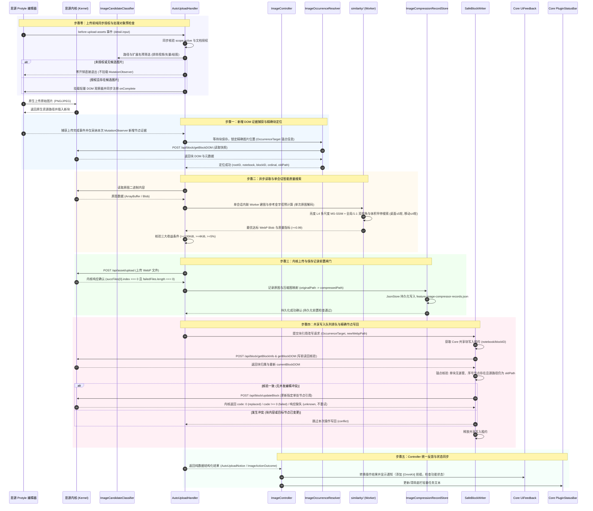

# OmniKit · 图片压缩技术设计文档 (Image Compressor DESIGN)

> **文档性质**：具体技术架构、模块职责、算法模型与存储规范（How）。代码重构或修复 BUG 时直接更新本文件，不影响业务需求 PRD。  
> **对应产品需求**：[PRD.md](PRD.md)  
> **适用平台**：OmniKit 全端通用（`desktop`、`desktop-window`、`browser-desktop`、`mobile`、`browser-mobile`）

---

## 1. 架构总览与模块划分

图片压缩功能位于 `src/features/image-compressor/`，遵循 `Feature（宿主事件与菜单分发） → Controller（准入判定、生命周期与统一反馈） → Action（纯领域执行，不直接调用全局通知） → 独立算法域（纯函数 MS-SSIM 与内联 Worker）` 的单向职责分层：

```
┌──────────────────────────────────────────────────────────────────────┐
│                      ImageCompressorFeature 主入口                    │
│   (注册 Protyle 事件与菜单贡献，提取宿主上下文，由 FeatureScope 托管)   │
└──────────────────────────────────┬───────────────────────────────────┘
                                   │ 派发事件上下文
┌──────────────────────────────────▼───────────────────────────────────┐
│        ImageController (准入判定、activeDocuments、进度弹窗与统一反馈) │
├──────────────────┬───────────────────────┬───────────────────────────┤
│ actions/         │ policy/               │ services/                 │
│ ├─ AutoUpload    │ ├─ AutoPolicy         │ ├─ allowlistPaths         │
│ ├─ SingleImage   │ ├─ Classifier         │ ├─ assets / download      │
│ ├─ DocBatch      │ ├─ CompressionResult  │ ├─ desktop                │
│ ├─ RemoteWatcher │ ├─ contracts          │ ├─ documentTitle          │
│ ├─ menuContrib   │ ├─ DocumentIdentity   │ ├─ image (CanvasWebpCodec)│
│ └─ scanDocImages │ ├─ dom / source       │ ├─ ImageOccurrenceResolver│
│                  │ ├─ formatStats        │ ├─ ImageProcessingServices│
│                  │ ├─ PageAllowlist      │ ├─ createImageServices    │
│                  │ ├─ parseImageConfig   │ ├─ SafeBlockWriter        │
│                  │ ├─ settings           │ ├─ references (写回包装)  │
│                  │ └─ TaskRegistry       │ └─ ImageReferences (定位) │
├──────────────────┼───────────────────────┼───────────────────────────┤
│ store/           │ ui/                   │ similarity/               │
│ └─ ImageRecord   │ ├─ ImageRecordsDock   │ ├─ AdaptiveImageCompressor│
│    Store         │ ├─ ImageSettingsPanel │ ├─ similarity-policy      │
│                  │ ├─ ImageSettingsBridge│ ├─ ms-ssim                │
│                  │ ├─ ImageCompressionDlg│ ├─ patch-selector         │
│                  │ ├─ ImageTaskPanel     │ ├─ adaptive-quality-search│
│                  │ └─ ImageTaskUI        │ ├─ SimilarityWorkerSession│
│                  │                       │ └─ similarity.worker      │
└──────────────────┴───────────────────────┴───────────────────────────┘
```

### 1.1 子模块职责速查表

| 子模块文件 | 核心类 / 单元 | 职责与技术边界 |
|---|---|---|
| `ImageCompressorFeature.ts` & `actions/menuContributions.ts` | `ImageCompressorFeature` & `imageMenuContributions` | Feature 入口（ID: `imageCompressor`）；通过 `/api/block/getBlockInfo` + `isDocumentRootIdentity` 校验文档身份；`doc-title` / `doc-tree` / `topbar` 白名单菜单项校验 `ctx.rootID` 后声明固定文案键 `menu.whitelistDocument` 与 `checked: deps.isAllowlisted(ctx)`（读取 `PageAllowlist.hasCached(rootID)`，独立于 `globalEnabled`），交由 `MenuRegistry` 渲染整行复选框视觉态；批量压缩前遍历 `getAllEditor()` 对同 `rootID` 且未销毁的活动编辑器执行 `flushPendingTransactions()` |
| `ImageController.ts` | `ImageController` | 唯一业务控制器；检查全局开关与白名单，维护 `activeDocuments: Set<string>` 并在 `compressDocument` 中将任务创建、进度弹窗与批处理调用纳入 `try/finally`；委托 `ImageTaskUI.ts` 管理 `ImageTaskPanel` 模态框，将 Action 返回的纯数据结构化结果转换为语义文案，通过 Core `UiFeedback` 显示通知、通过 `PluginStatusBar` 更新底栏任务文本 |
| `policy/ImageCandidateClassifier.ts` | `classifyImageCandidate` | 按路径与正则提取的末段扩展名判定准入（无扩展名或点号结尾返回 `""`）；跳过视频、GIF/APNG、SVG、Excalidraw 及 `/(?:^\|[\\/])drawings?[\\/]/i` 绘图目录（不跳过 `drawings_v2.png` 等普通文件名）；静态 WebP 在手动模式始终放行，在 `auto`/`document` 模式仅当 `smartEnabled === true` 时放行 |
| `actions/AutoUploadHandler.ts` | `AutoUploadHandler` | 监听 Protyle `before-upload-assets` 事件；同步检查授权与可处理图片，不满足时零开销退出（不建 `MutationObserver`）；仅采纳本次上传观察到的新节点，等待块落盘后定位并返回 `AutoUploadNotice` |
| `actions/RemoteImageWatcher.ts` | `RemoteImageWatcher` | 监听已授权文档中新插入的 HTTP/HTTPS 图片；跳过受保护容器；按每批最多 20 张顺序推进，桌面端默认并发 3（`concurrencyDesktop`）、移动端并发 1，同块内通过尾承诺串行排序写入任务 |
| `services/ImageOccurrenceResolver.ts` & `policy/source.ts` | `AssetAddress` / `ImageOccurrenceResolver` / `buildReplacementPath` / `sameSource` | 分离 `raw`、`kernelPath`、`key`（大小写敏感 + `box`）、`fetchURL` 与 `box` 并保护 `%25` 字面路径；`sameSource` 比对本地 `asset` 或规范化 `remote` URL；建立 `OccurrenceTarget` |
| `services/image.ts` & `similarity/` | `CanvasWebpEncoder` & `AdaptiveImageCompressor` | 宿主原生 `OffscreenCanvas` / `HTMLCanvasElement` WebP 编码引擎、智能压缩能力探测 `probeSmartCompressionSupport`、统一目标尺寸计算 `computeTargetDimensions`；`similarity/` 提供零宿主/DOM 依赖的 5 尺度亮度 $L_4$ MS-SSIM、双向梯度抗边框 1:1 选区、体积单调早停搜索与单会话内联 Worker |
| `services/assets.ts` & `services/ImageProcessingServices.ts` | `AssetStore` / `ImageProcessingServices` | `AssetStore.upload` 区分 `"not-sent"` / `"rejected"` 与 `UploadOutcomeUnknown`；`ImageProcessingServices` 提供 `localizeRemoteAsset`、`prepareImage`、`savePreview`、统一持久化前置闸门 `persistMappedAsset` 及结构化 `info` 日志输出 |
| `store/ImageCompressionRecordStore.ts` | `ImageCompressionRecordStore` | 基于 Core `JsonStore` 管理 `feature-image-compressor-records.json`；支持 `assets/...` 或无凭据 `http(s)://` 作为 `originalPath`；最多保存 100 条，超限按 `updatedAt` 淘汰最旧记录；`compareAndRemove` 在串行队列中二次核对配对后移除确认缺失项 |
| `services/SafeBlockWriter.ts` & `services/references.ts` | `SafeBlockWriter` & `ReferenceService` | 接入 Core `withBlockWriteLease`（`notebook/blockID`）；写前读回校验块归属、单块无嵌套、序号节点存在与 `oldPath` 原文一致；返回五态 `CommitResult` 与可选 `conflictReason` |
| `ui/ImageRecordsDock.svelte` & `services/ImageReferences.ts` | Dock 记录视图与引用核验服务 | 顶部设置约 52px~56px 品牌 Hero 卡片区（`image-records__hero`，使下方操作区下移 50px 以上以避开思源右上角 32px 浮动 Snackbar `#message` / `.b3-snackbars` 遮挡）；提供三态资产核验、双向引用定位与替换/恢复、只读 SQL 外链粗召回与 `?box=` 加密笔记本范围扫描 |
| `ui/ImageSettingsBridge.svelte`、`ui/ImageSettingsPanel.svelte` & `services/allowlistPaths.ts` | 设置桥接、面板与白名单路径服务 | 透传 `registerDraft` 草稿协议；`allowlistPaths.ts` 按固定小批（32）执行只读 SQL 批量路径解析并回退 `resolveDocumentTitle`；面板通过 `pathLookupsStarted: Set<string>` 与 `resolvedHPaths` 保障单次挂载周期内同一文档至多查询一轮 |

### 1.2 上传后异步全流程时序



---

## 2. 块级更新规则 (`services/SafeBlockWriter.ts`)

### 2.1 图片位置和路径信息 (`OccurrenceTarget`、`AssetAddress`)
1. **资源路径信息 (`policy/source.ts`)**：
   `AssetAddress` 分别记录 DOM 中的原始路径、内核路径、用于比较的路径标识和浏览器读取地址：
   ```typescript
   export interface AssetAddress {
     readonly raw: string;        // DOM 中的路径原文，用于写入前比较
     readonly kernelPath: string; // 内核使用的 assets/文件名.ext 路径，可带 ?box=...
     readonly key: string;        // 区分大小写的路径标识，包含所属 box
     readonly fetchURL: string;   // 按路径段独立编码的网络读取 URL，仅供浏览器端读取/预览
     readonly box?: string;       // 可选加密笔记本 ID
   }
   ```
   - `/api/asset/upload` 返回值和 DOM 中的 `assets/...` 按原文解析。只解码 URL 路径，不对普通路径无条件执行 `decodeURIComponent`，避免混淆 `assets/100%.png` 和 `assets/100%25.png`；
   - `key` 区分大小写，并包含 `box` 笔记本信息；`?width=`、`#fragment` 等显示参数与片段不参与路径比较。`buildReplacementPath` 生成替换属性时，对远程 URL 及非合法本地 `assets/` 路径仅保留新产物生成的 `?box=<notebookID>`（丢弃源路径的全部查询参数与片段）；对合法本地 `assets/` 路径替换仅保留新产物的 `?box=<notebookID>` 与原引用的 `#fragment`（丢弃 `width`、`height` 及其他全部查询参数）。
2. **目标位置记录 (`OccurrenceTarget`)**：
   按元素在块内的顺序、节点类型和原文定位目标，不搜索其他位置：
   ```typescript
   export interface OccurrenceTarget {
     readonly rootID: string;
     readonly notebook: string;
     readonly blockID: string;
     readonly kind?: "image" | "link";
     readonly attribute?: "data-src" | "src" | "data-href" | "href";
     /** 该元素在所属块内同类元素中的序号，从 0 开始 */
     readonly imageOrdinal: number;
     readonly oldPath: string;
   }
   ```

### 2.2 写入结果、同块排队和内核限制
1. **五态写回结果 (`CommitResult`)**：
   ```typescript
   export type CommitResult = "replaced" | "conflict" | "aborted" | "failed" | "unknown";
   // "aborted": 确认尚未向内核发出写请求（含前置中止或 KernelRequestError outcome === "not-sent"）
   // "failed": 内核明确拒绝写请求（KernelRequestError outcome === "rejected"，即返回非 0 code）
   // "unknown": 写请求已发出但确认结果缺失（空/无效响应、超时、断连或发后中止）
   ```
2. **Core 共享块写入租约 (`BlockWriteLease`)**：
   - `SafeBlockWriter` 使用 Core 按 `notebook/blockID` 管理的写入租约，并与 `titled-link` 等功能共用。多个任务按队列顺序等待该块的写入权；获得写入权后再次检查任务是否已中止；
   - 思源 `/api/block/updateBlock` 不支持原子 Compare-And-Swap（CAS）。从 `getBlockDOM` 读取到调用 `updateBlock` 之间，其他程序仍可能修改内容。共享队列只负责按顺序处理当前插件进程内各功能对同一块的写入。
3. **写前读回核验、锚点替换与异常分类边界**：
   - 获取租约后，依次调用 `/api/block/getBlockInfo`（核验 `data.rootID === target.rootID && data.box === target.notebook`）与 `/api/block/getBlockDOM`（读取目标块实时 HTML `current`）；
   - 读取时发生网络、超时或内核错误时，报告为读取失败，不归类为 `"conflict"`；
   - **入锁前校验目标路径**：`SafeBlockWriter` 与 `policy/source.ts` 的 `buildReplacementPath` 接受本地 `assets/` 与无凭据 `http(s)://` 目标路径（非法路径直接抛错）；写入 `assets/` 时遵循既有 `?box=` 与 `#fragment` 规则，恢复为 `http(s)://` 外链时原样写入规范化 URL；入锁后检查实时 `current` 为唯一目标单块且不含嵌套 `[data-node-id]`，按 `(kind, attribute, imageOrdinal)` 定位目标节点并核验其源属性仍精确等于 `target.oldPath`（忽略整块 `data-node-index`、`updated`、`parent-heading` 或同块其余非目标节点变化）；任一项不符时返回 `"conflict"` 并附带精确 `conflictReason`（`"identity-mismatch"` | `"missing-dom"` | `"nested-block"` | `"ordinal-mismatch"` | `"path-mismatch"`）供调度层输出调试日志；
   - 在发出 `/api/block/updateBlock` 前检测到 `signal?.aborted` 返回 `"aborted"`；
   - 基于实时 `current` DOM 仅修改目标节点引用属性（提交 `writeDOM` 仅剥离渲染期只读属性 `parent-heading`，完整保留实时块内的其余文本、其他节点以及 `updated` 等属性）；`/api/block/updateBlock`（`dataType: "dom"`）返回 `code === 0` 时返回 `"replaced"`。捕获 `KernelRequestError` 时按 `outcome` 分流：`outcome === "not-sent"` 返回 `"aborted"`，`outcome === "rejected"` 返回 `"failed"`，仅发后传输不确定（`outcome === "unknown"`）时返回 `"unknown"` 且不自动重试；上层将记录保留或标记为 `"incomplete"`；
   - 同块多图替换统一在 `withBlockWriteLease` 锁内由 `SafeBlockWriter` 完成实时读回与单块无嵌套、`(imageOrdinal, oldPath)` 锚点核验，使后续轮次基于最新块内容顺序替换；
   - `AssetStore.upload` 对 `/api/asset/upload` 遵循同一传输分类：遇到 `KernelRequestError` 的 `"not-sent"` 或 `"rejected"` 时直接向上传播确定失败，仅 `"unknown"` 传输异常或响应缺少唯一文件映射时抛出 `UploadOutcomeUnknown`。

---

## 3. 自动上传、单图动作与外链监听 (`actions/`)

### 3.1 上传前检查 (`AutoUploadHandler.ts`)
- 监听 Protyle 编辑器的 `before-upload-assets` 事件；
- `shouldCompress: (rootID: string) => boolean` 同步读取当前配置、功能状态和白名单；
- 根据文件扩展名和 MIME 类型检查上传内容。未开启自动压缩或没有可处理图片时直接退出，不创建 `MutationObserver`，也不注册回调；
- `before-upload-assets` 回调遇到异常时清理已创建的观察器、记录警告并退出，不向思源上传流程抛出异常。

### 3.2 等待块保存并定位新图片 (`AutoUploadHandler.ts`)
- 自动压缩已开启且上传内容包含支持的图片时，创建 DOM 观察器并注册 `onComplete` 回调；
- `onComplete` 只使用本次 `MutationObserver` 观察到的新图片节点，或根据上传前 DOM 快照和内核 `succFiles` 返回路径确认的新节点；不扫描编辑器中已有的图片；
- 区分新插入节点和已有 `` 属性变化。无法确认唯一新增图片时跳过处理，不调用 `updateBlock`；
- 找到新增图片后，等待思源保存对应块，再由 `ImageOccurrenceResolver` 定位图片并创建 `OccurrenceTarget`。处理结束后向 `ImageController` 返回 `AutoUploadNotice` 数据。

### 3.3 单图操作和远程图片处理 (`SingleImageAction.ts`、`RemoteImageWatcher.ts`、`desktop.ts`、`download.ts`)
- **图片节点过滤和格式检查**：`SingleImageAction` 与 `policy/dom.ts` 复用 Core 的 `PROTECTED_CONTAINER_SELECTOR`（`src/core/host/dom.ts`），跳过 `[data-type="NodeCodeBlock"]`、`[data-type="NodeBlockQueryEmbed"]`、`.protyle-wysiwyg__embed`、`pre`、`code` 中的图片。`ImageCandidateClassifier`、`CanvasWebpEncoder` 和 `AdaptiveImageCompressor` 在 `manual-dialog`、`manual-quick` 模式始终支持静态 WebP；在 `auto`、`document` 模式中，开启智能压缩（`smartEnabled === true` 且宿主支持智能压缩）时支持静态 WebP，关闭时跳过。三处均跳过路径位于 `drawing/` 或 `drawings/` 目录的绘图文件，但不跳过 `drawings_v2.png` 等普通文件名；均使用正则精确提取路径末段扩展名（去除查询参数与片段后取最后一段文件名匹配 `/\.([a-z0-9]{1,10})$/i` 并转小写，无扩展名或以点号结尾时返回 `""`）；编码器在 `inspectImage` 检查 APNG、多帧动画 WebP 并识别出 `image/webp` 后，执行 `isWebpAllowed("webp", mode, smartEnabled)` 二次校验；
- **无扩展名远程图片处理边界**：`ImageCandidateClassifier` 基于路径扩展名预过滤，保留无扩展名的远程 URL（`extension === ""`）。`RemoteImageWatcher`、`DocumentBatchAction` 与 `SingleImageAction.compressSelectedImageQuick` 会先将无扩展名远程图片下载并本地化到 `assets/`，再进入解码与压缩阶段（无扩展名的远程动图或矢量图在本地化后于格式检查或编码阶段跳过或失败）；`SingleImageAction.compressSelectedImageCustom` 则在预览阶段先行下载并解码，仅在用户确认保存后才上传本地化并更新文档引用；
- **单图最小副作用与远程图片本地化**：编辑器图片右键触发的单图动作作用域严格限定为当前选中的单处引用。`SingleImageAction` 返回 `ImageActionOutcome`，由 `ImageController.present()` 调用 `services.ui.notify(...)` 显示结果；微调弹窗在前端内存中持有原图 Blob 缓存，切换压缩参数时复用已下载原图，预览时不上传图片或修改文档。用户点击保存后：
  - 若源图片为已有本地 `assets/` 资源且 `replaceWebp === false`，仅上传 WebP 并写入持久化记录供复制路径，执行零文档写回（`updateBlock` 调用次数为 0）；
  - 若目标是远程 URL，`localizeRemoteOccurrence` 先下载并调用 `/api/asset/upload` 上传原图，再通过 `SafeBlockWriter` 更新该单处引用（不调用文档级 `/api/format/netImg2LocalAssets`）；本地原图引用更新成功后，通过思源块读取 API 获取最新块内容，并创建包含 `oldPath = localOriginal` 锚点定位信息的新 `OccurrenceTarget`（若结果为 `"unknown"` 或失败则停止后续处理）；随后上传预览 WebP 并先保存 Dock 配对记录，`replaceWebp === false` 时保留本地原图引用，`replaceWebp === true` 时再通过 `SafeBlockWriter` 将该处引用更新为 WebP；
- **远程图片监听的分批与并发控制**：`RemoteImageWatcher` 使用 `MutationObserver` 跳过嵌入块和代码块。非 `rebasing` 且观察到图片变化、首次 `sweep()` 未发现新图片时，通过一个定时器最多再检查一次。新插入的远程图片按每批最多 20 张顺序推进下一批；每批内部桌面端按 `concurrencyDesktop`（默认 3）并行下载上传与压缩（移动端并发 1），同时按 `blockID` 串行排序写入任务，保证同块多图依次改写时的顺序一致性。上传本地原图并替换引用后，调用 `blockDOM` 读取最新块 DOM 并通过 `policy/dom.ts` 的 `parseSingleLeafBlock` 验证单块无嵌套及对应序号图片路径已更新为本地原图路径，构造新的 `OccurrenceTarget` 后再传入经 `inspectImage` 与格式校准检查的 `providedFile`；
- **不同平台的远程图片下载方式**：`services/desktop.ts` 仅提供桌面端（`desktop` / `desktop-window`）远程 HTTP(S) 下载能力（使用 Node `http` / `https` 请求并携带 Core 设置的 `general.userAgent`）；浏览器和移动端由 `services/download.ts` 使用 `fetch`，不发送 Cookie 或 Referer，并按浏览器规则跟随重定向。全平台仅支持工作区 `assets/` 本地附件与 `http(s)` 远程图片源（不支持本机文件系统路径读取）；远程下载总超时为 30 秒，最多读取 32 MiB，并检查图片格式和 XSS 内容。不拦截内网、本机或链路本地地址，因此访问风险与思源原生网络图片下载相同。

### 3.4 配置结构、能力探测、EXIF 设置和质量模式 (`ImageSettingsPanel.svelte`、`ImageCompressionDialog.svelte`、`parseImageConfig.ts`、`CanvasWebpEncoder`、`AdaptiveImageCompressor.ts`)
- `parseImageConfig.ts` 校验单一现行 `schemaVersion: 2` 配置结构（包含 `auto: { globalEnabled, pageAllowlist }`、`compression: { initialQuality, manualMaxEdge, minInputBytes, minSavingBytes, minSavingRatio, maxInputBytes, maxPixels, maxEncodeMs, concurrencyDesktop, excludedExtensions, smartEnabled, targetSimilarity }` 与 `metadata: { preserveExif: false }`，其中 `manualMaxEdge` 取值范围为整数 `512–16383` 以匹配 WebP 帧头上限）；`services/ImageProcessingServices.ts` 的 `prepareImage` 直接接收 `mode: CompressionMode`；
- `ImageSettingsPanel.svelte` 和 `ImageCompressionDialog.svelte` 不显示 EXIF 设置。`parseImageConfig.ts` 校验配置中的 `metadata.preserveExif === false`（遇到其他值时抛出错误），`CanvasWebpEncoder` 通过原生 Canvas 重绘输出 WebP，天然剥离 EXIF 元数据并遵循图像视觉旋转方向；
- **宿主智能压缩能力探测 (`probeSmartCompressionSupport`)**：检查运行环境是否同时具备可用内联 `Blob` `Worker`（实测最小消息握手以识别远程内核或反向代理 `worker-src` CSP 拦截）、`OffscreenCanvas`、`createImageBitmap` 及 `OffscreenCanvas` 原生 `image/webp` 编码支持（通过 `1×1` 画布编码校验返回 MIME 为 `image/webp`，拦截 WebKit 静默回退 `image/png` 的情况）：
  - 支持智能压缩时，桌面端与移动端均允许开启 `smartEnabled`；移动端（`isMobileFrontend() === true`）在 `smartEnabled` 开启时渲染性能与电量消耗提示条；设置页在 `smartEnabled === true` 时渲染 `targetSimilarity` 滑块、隐藏固定质量滑块，在 `smartEnabled === false` 时渲染默认压缩质量滑块（绑定 `initialQuality`）；
  - 不支持智能压缩时，设置页将 `smartEnabled` 开关置为 `disabled` 并展示具体不支持原因，不改写存储中已同步的 `smartEnabled` 布尔值，运行时回退至 `CanvasWebpEncoder`（若主线程 `HTMLCanvasElement` 亦不支持 `image/webp` 编码，则直接返回 `skipped` 保留原图）；
- **手动微调弹窗模式 (`ImageCompressionDialog.svelte`、`SingleImageAction.ts`)**：支持智能压缩的宿主在弹窗内提供 `smartEnabled` 局部开关（初始继承全局配置）：关闭时展示固定质量滑块（`0.01–1.00`）单次编码；开启时展示目标相似度滑块（`0.90–0.999`）执行自适应质量搜索。`manual-dialog` 允许预览小图片、未达节省要求的结果以及未达目标相似度的最高质量候选（携带 `unreachable: true` 标记供界面渲染未达标告警，不抛错中断预览）；大于原图的结果是否允许保存由 PRD 复选框规则定义。

---

## 4. 读取文档并定位批量处理目标 (`DocumentBatchAction.ts`、`services/references.ts`、`services/ImageReferences.ts`)

### 4.1 单次 `getBlockDOM(rootID)` 与内存切片
为避免逐块请求，并避免依赖 SQLite 异步索引造成漏图，文档扫描一次读取实时 `.sy` 树，再在内存中按块处理：
1. **确认文档身份、等待同文档活动编辑器落盘并读取根块**：`DocumentBatchAction` 先调用 `/api/block/getBlockInfo` 检查 `rootID` 和所属笔记本（传入编辑器的 `notebookId`，以支持加密或尚未入库的文档）。随后通过 `getAllEditor()`（并兼容入口传入的编辑器实例）遍历所有 `rootID` 匹配 `targetRootID` 且未销毁（`!disabled && !destroyed`）的活动编辑器，逐一执行 `flushPendingTransactions()` 等待挂起编辑落盘后再调用一次 `/api/block/getBlockDOM({ id: rootID, notebook })`。仅当 `response.data?.id === rootID` 且 `dom` 非空时，才设置 `scanComplete = true`；
2. **扫描与跳过嵌套块**：`scanDocumentImages` 扫描文档图片时跳过受保护容器，通过 `image.closest("[data-node-id]")` 定位所属最内层块并将含嵌套 `[data-node-id]` 的块记入 `nestedBlockIds` 跳过；
3. **写前核验与同块顺序写回**：单图、文档批量、自动上传和远程监听均通过 `SafeBlockWriter`（或 `ReferenceService`）在 `withBlockWriteLease` 锁内实时读回块身份与块 DOM，核验单块无嵌套与目标 `(imageOrdinal, oldPath)` 锚点一致性，再基于实时块 DOM 仅修改目标节点后写回。同块多图依次入锁实时读回并顺序替换；若目标节点缺失、源路径变化或块归属在外部被修改，由 `SafeBlockWriter` 返回 `"conflict"` 跳过，内核明确拒绝写请求则返回 `"failed"` 计入失败。多个功能同时更新同一块时，通过 Core 的同块写入队列依次处理；

### 4.2 批量任务过程、进度窗口和结果统计 (`ImageController.ts`、`DocumentBatchAction.ts`、`ImageTaskUI.ts`、`CompressionResult.ts`)
1. **编辑器切换与关闭不断任务**：批处理控制器不监听 `switch-protyle` 或 `destroy-protyle` 触发中止；任务全程持有启动时捕获的 `rootID` 与 `notebook`，不依赖活动编辑器实例，写前通过内核 API 核验块实时状态；
2. **释放文档占用状态 (`ImageController.ts`)**：`ImageController.compressDocument` 维护 `activeDocuments: Set<string>`，并将 `activeDocuments.add(rootID)` 后的任务创建、`services.ui.progress(...)` 进度窗口显示与 `compressDocumentImages` 调用放入 `try/finally`，确保初始化失败时也会释放文档占用状态；
3. **进度 Dialog 用户关闭与程序关闭隔离 (`ImageTaskUI.ts`)**：`ImageController` 通过 `services.ui.progress(...)` 委托 `ImageTaskUI.ts`（`mountDialog`）管理 `ImageTaskPanel` 模态框（面板不提供独立“取消”按钮）；`ImageTaskUI.ts` 的 `mountDialog` 内部维护 `closingByController` 标记区分两种关闭来源：
   - 用户主动关闭进度弹窗（含点击关闭或按 Esc，即 `!closingByController`）：触发 `onClose()` 通知批处理中止尚未开始的后续步骤；
   - 控制器在扫描失败、零图片或任务结束时调用 `view.close()`（由 `ImageTaskUI.ts` 置 `closingByController = true`）：仅完成 Svelte 卸载与 DOM 释放，不触发 `onClose()` 取消回调，防止将完成或扫描失败态误报为 `cancelled`；
4. **显示两个处理阶段、状态栏联动和结果统计**：准备阶段（`phase: "preparing"`）完成后进入写入阶段时，`DocumentBatchAction` 通过 `options.onProgress` 汇报 `phase: "applying"` 及当前文件名 `currentFile`，由 `ImageController` 同步更新 `ImageTaskPanel` 模态框与桌面端 Core `PluginStatusBar`（移动端短路不操作状态栏）；任务完成、取消或中止时统一销毁模态框并清除状态栏任务。`CompressionProgress` / `CompressionBatchSummary` 直接复用 `prepareImage` 返回的已知字节数统计（不二次读盘 I/O），并分别记录 `succeeded`、`skipped`、`failed`、`conflicts`、`unknown` 和 `cancelled`（`aborted` 和 `unknown` 不计入 `failed`）。每批任务结束时只发送一条汇总通知，必显总数，其余非零分项动态拼接展示；结果未知时，Dock 保留记录或将记录标记为 `"incomplete"`；
5. **并发数与远程图片本地化**：准备阶段桌面端通过 `concurrencyDesktop` 并行准备图片，默认并发数为 3；移动端并发数为 1。对文档内的远程图片（`source.kind === "remote"`），准备阶段按 URL 去重后调用 `localizeRemoteAsset` 下载并上传为本地原图（同步落盘 `图片链接 → 本地原图` 记录）；应用阶段逐项将原远程引用先更新为本地原图并重取块快照，随后更新外链记录操作状态再统一执行 WebP 编码与替换。块写回逐项顺序执行。

---

## 5. 原生 WebP 编码与智能画质计算 (`services/image.ts`、`similarity/`)

### 5.1 内置零依赖 WebP 编码器 (`CanvasWebpEncoder`)
- **无第三方运行时编码库**：编码器基于宿主原生 `OffscreenCanvas`（优先）与 `HTMLCanvasElement`（当无 `OffscreenCanvas` 或 `OffscreenCanvas.convertToBlob` 未返回 `image/webp` 时回退）将位图编码为 `image/webp`，严格按请求 `quality` 执行单次编码，不对大于原图的产物执行隐式降质重试；若当前宿主两种画布均不支持 `image/webp` 编码（如静默回退 `image/png`），返回 `{ kind: "skipped", reason: "webp-encode-unsupported" }` 保留原图；
- **目标尺寸统一计算 (`computeTargetDimensions`) 与边长上限**：`auto` 与 `document` 模式保持原图经 EXIF 方向校正后的完整宽高 `(info.width, info.height)`；`manual-quick` 与 `manual-dialog` 模式在长边超过 `manualMaxEdge`（上限 `16383`）时按 `scale = Math.min(1, manualMaxEdge / Math.max(info.width, info.height))` 及 `Math.max(1, Math.floor(dim * scale))` 统一计算目标宽高；目标宽高任一边超过 `WEBP_MAX_DIMENSION = 16383` 时由 `validateEncodeInput` 返回 `{ kind: "skipped", reason: "dimension-limit-exceeded" }`；
- **输入与输出双重校验**：编码前通过 `validateEncodeInput` 执行扩展名、专有绘图目录、`minInputBytes`（`manual-dialog` 除外）、`maxInputBytes`、`inspectImage` 容器头与动图保护（APNG / 动画 WebP 返回 `animation-protected`；含 `APP2` `MPF\0` / Ultra HDR Gain Map 的实拍 JPEG 正常解析主帧）、静态 WebP 准入、`maxPixels: 32_000_000` 及 `WEBP_MAX_DIMENSION = 16383` 校验，并对整个编码过程设置 `maxEncodeMs: 45_000` 超时保护；编码后严格校验 `output.type === "image/webp"`、`inspectImage` RIFF/WEBP 头尺寸一致性与 `verifyBitmap`（`maxEdge = 64`）可解码性，显式调用 `ImageBitmap.close()` 并将临时画布宽高置 `0` 释放显存/内存。

### 5.2 亮度通道 5 尺度 MS-SSIM、$L_4$ 空间池化与细尺度提权 (`ms-ssim.ts`)
- **预乘浮点亮度与透明通道提取**：单遍遍历 RGBA 像素缓冲区（不原地修改输入 `PixelFrame.data`），按 $\alpha / 255$ 浮点缩放计算预乘 Rec.709 亮度平面 $Y = (0.2126 R + 0.7152 G + 0.0722 B) \times (\alpha / 255)$（$\alpha = 0$ 时归零），同时检测是否存在透明像素（$\alpha < 255$）。不透明图仅评估单通道 $Y$；含透明像素的图片评估 $Y$ 与 $A$ 双通道并按 `0.85 : 0.15` 合成，在消除 WebP YUV 4:2:0 彩色边缘假性不可达天花板的同时将卷积开销降低约 2/3；
- **局部平滑与缓冲复用**：采用 $11 \times 11$ 可分离高斯核（$\sigma = 1.5$），复用水平卷积与均值/协方差临时 `Float32Array` 缓冲区，减少多轮迭代中的类型化数组分配；
- **$L_4$ 局部误差池化与尺度权重**：每层对比度-结构项采用四次方误差范数池化 $\text{cs}_{\text{pool}} = 1 - \left(\frac{1}{N}\sum_{i=1}^{N}(1 - \text{cs}_i)^4\right)^{1/4}$（防止大面积留白背景稀释细小文字边缘失真），5 尺度权重设为 `[0.20, 0.30, 0.25, 0.15, 0.10]`，强化原生精细尺度的锐度敏感度。

### 5.3 全图 1:1 与大图双视角选区评估 (`patch-selector.ts`、`similarity-policy.ts`)
- **小图与中等图全图 1:1 路径**：当目标输出尺寸满足 `Math.max(targetW, targetH) <= 768` 时，直接对整幅输出尺寸图像执行 1:1 5 尺度 MS-SSIM 评估；
- **大图“全局概览 + 原生 1:1 细节块”双视角路径**：当 `Math.max(targetW, targetH) > 768` 时，组合两类视图评估：
  1. **全局视图**：等比缩放到长边不超过 `512px`，捕获整体亮度、对比度与大面积渐变色带表现；
  2. **原生 1:1 局部细节块（最多 2 块）**：每块尺寸为 `pw = Math.min(targetW, 384)`、`ph = Math.min(targetH, 384)`（完整支持 5 层金字塔并避开极小尺寸高斯核边界截断效应）；
  3. **双向梯度抗边框选区**：在短边受保护的低分代理图上同时计算预乘亮度与透明通道的双向梯度响应（$g_x = \max(|g_{Lx}|, |g_{Ax}|)$、$g_y = \max(|g_{Ly}|, |g_{Ay}|)$，$E = \sqrt{g_x g_y} + 0.15(g_x + g_y)$），利用积分图 $O(1)$ 滑窗求和选出信息密度最高的非重叠文字/线条区域（覆盖透明底深色图形文字并抑制纯水平或纯竖直 1px 分割线吸附）；当长宽比 $\ge 2.2$（如长截图）时沿长轴分为前后两半区分别选取有实际梯度能量（`meanEnergy > 1e-3`）的最高响应块，空半区名额回退至全局高响应非重叠候选；
  4. **双视角合成得分**：`score = 0.20 * globalScore + 0.80 * Math.min(...patchScores)`。

### 5.4 单会话内联 Worker 与体积预算单调早停 (`similarity.worker.ts`、`SimilarityWorkerSession.ts`、`adaptive-quality-search.ts`)
- **单图片单会话同源编解码与显存回收**：Vite 通过 `?worker&inline` 将 Worker 内联打包。每张图片搜索启动时，`initSession` 将原图解码一次并绘制到 `sourceCanvas(targetW, targetH)`（立即 `close()` 原始 `ImageBitmap`），保持 `sourceCanvas` 不调用全图 `getImageData`，而是通过绘制到小尺寸复用的全局/局部读取画布提取参考金字塔统计量；后续每轮 `encodeAndEvaluate` 直接对同一 `sourceCanvas` 调用 `convertToBlob({ type: "image/webp", quality })` 并在 Worker 内解码候选图完成双视角评分，使手动缩放与 EXIF 旋转下的参考图与候选图严格同源对齐；正常结束时 `SimilarityWorkerSession.close()` 发送 `{ type: "dispose", id }` 等待 Worker 确认已将画布宽高置 `0`（含 `50 ms` 超时兜底）后再调用 `worker.terminate()`，取消或超时中止时直接调用 `dispose()` 立即终止线程；
- **受保护割线 + 二分搜索与体积单调早停**：
  - 搜索质量区间为 `[0.50, 1.00]`，固定首轮探测点 `0.78`，收敛容差 `0.02`，桌面端最多评估 `5` 轮、移动端最多 `4` 轮；割线预测点位于区间内部且距两端至少 10% 时使用割线法，越界、斜率过小或出现非单调波动时切换为二分法；
  - 在启用节省校验的模式（`auto`、`document`、`manual-quick`）下传入字节上限 `maxAllowedBytes = originalBytes - Math.max(minSavingBytes, Math.ceil(originalBytes * minSavingRatio))`：若探测点字节数超过 `maxAllowedBytes` 且相似度未达目标（继续提质体积更大、降质相似度更低），或 `minQuality` 处字节数已超过 `maxAllowedBytes`，立即提前终止搜索并返回 `insufficient-savings`；仅在 `bytes <= maxAllowedBytes` 且 `similarity >= targetSimilarity` 的合格候选中按最小体积选优。

---

## 6. 数据存储与 Dock 状态规范

### 6.1 数据模型 (`feature-image-compressor-records.json`)
```typescript
export interface CompressionRecord {
  readonly originalPath: string;
  readonly compressedPath: string;
  readonly updatedAt: number;
  readonly lastOperation: "saved-only" | "replaced" | "incomplete";
}
```

### 6.2 保存记录、列表排序和无效记录清理 (`ImageCompressionRecordStore.ts`、`ImageProcessingServices.ts`)
- **持久化通道**：`ImageCompressionRecordStore` 基于 Core `JsonStore` 管理 `feature-image-compressor-records.json`（通过 `imageRecordsFor` 共享单文件串行读写队列，支持测试注入可选 `fetchFn`），严格通过 `/api/file/getFile` 读取记录文件并通过 `plugin.saveData` 持久化；
- **先保存记录再替换引用 (Persistence-First Gate)**：`services/ImageProcessingServices.ts` 通过统一持久化闸门 `persistMappedAsset` 完成资源上传（确认 `response.code === 0 && succFiles[0].index === 0 && failedFiles.length === 0`）与 `feature-image-compressor-records.json` 落盘，同时承接两条写入通道：
  - 外链本地化（`localizeRemoteAsset`）：由 `RemoteImageWatcher`、`DocumentBatchAction` 与 `SingleImageAction.localizeRemoteOccurrence` 统一调用，完成远程下载/校准（支持弹窗预览复用已校准 `File`）、上传本地原图并先落盘 `图片链接 → 本地原图` 记录，随后在各入口替换引用后调用 `records.markOperation` 更新状态；
  - 压缩保存（`prepareImage` 与 `savePreview`）：经 `normalizedAssetPath` 归一化原图路径后上传 WebP 并落盘 `本地原图 → 压缩图` 记录；
  - 两条通道在记录保存失败时均调用 `services.ui.copyablePath(uploadedPath)` 向用户提供可复制的资源路径并抛出 `RecordPersistenceError`，停止后续引用更新，保留已上传文件；
- **压缩结果日志与单/多图通知 (`policy/formatStats.ts`、`ImageProcessingServices.ts`、`DocumentBatchAction.ts`、`RemoteImageWatcher.ts`、`ImageController.ts`)**：
  - `policy/formatStats.ts` 统一提供 `formatBytes`、`formatCompressionRatio`（带符号体积变化百分比：变小 `-xx.x%`、变大 `+xx.x%`、零变化 `0.0%`）与 `buildCompressionNoticeValues`，供通知文案、`ImageCompressionDialog.svelte` 与诊断日志复用；
  - 每项图片压缩任务均通过 `ImageProcessingServices.ts` 统一提供的 `logCompressedImage`、`logSkippedImage`、`logFailedImage` 与 `logReferenceStatus` 向控制台输出 `info` 级结构化日志：成功保存记录 `status: "saved"`、操作模式 `mode`、源路径、压缩图路径、前后体积与带符号变化百分比及引用状态；跳过（含 `AutoUploadHandler` / `SingleImageAction` 前置跳过、编码阈值/收益不足或智能压缩未达目标相似度）记录 `status: "skipped"`、源路径、跳过原因及已有体积/智能压缩搜索摘要；非中止异常记录 `status: "failed"`、源路径与错误描述；文档批量应用阶段对每处引用更新调用 `logReferenceStatus` 记录真实引用状态（`replaced`/`conflict`/`failed`/`unknown`）；开启智能压缩（MS-SSIM）时统一在 `smart` 对象中附带 `quality`、`similarity`、`targetSimilarity` 与 `searchRounds`（不与顶层 `quality` 重复）；
  - 单张图片压缩并成功替换引用时（本地自动上传单张、`RemoteImageWatcher` 自动处理单张外链图、`compressSelectedImageQuick`、`compressSelectedImageCustom` 勾选替换、`ImageController.compressDocument` 在 `total === 1 && succeeded === 1` 时），统一展示 `原体积 → 现体积（-xx.x% / +xx.x%）` 提示；多张图片处理（自动上传多张、自动外链多张、文档批量其他情况）展示简要非零分项汇总；`RemoteImageWatcher` 复用 `AutoUploadNotice` 与 `ImageController.reportAutoUploadNotice` 统一派发通知；
- **列表排序、记录校验、记录上限与自动淘汰**：`ImageCompressionRecordStore` 保持 `schemaVersion: 1` 的 4 字段结构，通过 `isRemoteRecordSource` 与 `recordSourceIdentity` 允许 `originalPath` 为 `assets/...` 或无凭据 `http(s)://` URL，`compressedPath` 始终限定为 `assets/...`。`upsert` 和 `markOperation` 保存记录后按 `updatedAt` 置顶排序。`MAX_RECORDS = 100`；新增记录超过 100 条上限时，按 `updatedAt` 自动淘汰最旧的临时记录（仅移出列表、不删除任何物理图片、不阻断后续压缩，`codec.parse` 不拒绝超长记录文件）；
- **清理无效配对记录 (`compareAndRemove`)**：
  - 每次打开或切换回 Dock 标签、用户点击手动刷新以及压缩/本地化保存记录时，`reconcileRecordPair` 实时检查每条记录的本地资源，不做状态缓存（也不设后台定时巡检）；
  - 普通 `原图 → 压缩图` 记录同时核验 `originalPath` 与 `compressedPath`，任一返回 `"missing-confirmed"` 时调用 `store.compareAndRemove` 移除；外链 `图片链接 → 本地原图` 记录跳过 `originalPath` 核验、仅核验 `compressedPath`（本地原图），仅当本地原图返回 `"missing-confirmed"` 时调用 `store.compareAndRemove` 移除；
  - `compareAndRemove` 在 `JsonStore.update` 队列中重新比较待清理路径和当前记录，避免检查期间 `A → B` 更新成 `A → C` 后误删新记录；只删除对应 JSON 记录，不调用删除图片文件的 API，也不根据配对关系删除其他记录；
- **外链记录双向引用查找与 Dock 复用 (`ImageReferences.ts`、`ImageRecordsDock.svelte`)**：
  - `locateAssetOccurrences` 同时支持 `assets/...` 与 `http(s)://` 搜索路径：本地路径沿用 `/api/asset/findAssetReferences`（加密笔记本 `?box=` 走 `locateBoxScopedOccurrences`）；远程 URL 在关联本地原图带 `?box=` 时扫描该加密笔记本，其余在已入库明文笔记本范围内通过只读 `/api/query/sql`（排除容器块 `type NOT IN ('d', 'b', 'l', 'i', 's', 'callout', 'tabs', 'tab', 'mindmap', 'mindmap_item')`，对主机名与编码/解码路径片段做 `LOWER(markdown) LIKE ... ESCAPE '\'` 粗召回，`LIMIT 200`）检索候选叶子块，再统一经 `loadBatchBlockDOMs` 与 `extractBlockOccurrences` 做内核实时 DOM 精确匹配（`sameSource` 同时兼容 `asset` 与规范化 `remote` URL）；
  - `ImageRecordsDock.svelte` 直接复用统一卡片模板与 3 个动作按钮：对 `isRemoteRecordSource(record.originalPath)` 隐藏外链侧本地存在性徽标、恢复按钮不受 `origStatus === "present"` 约束、写回目标为 `http(s)://` 时跳过 `checkAssetAvailability` 且节点比对使用 `sameSource`。

### 6.3 文件状态检查、引用查找、白名单路径与菜单 (`ImageRecordsDock.svelte`、`services/ImageReferences.ts`、`services/references.ts`、`services/allowlistPaths.ts`、`ImageSettingsPanel.svelte`、`actions/menuContributions.ts`)
- **Dock 视图顶部避让区与组件生命周期 (`ImageRecordsDock.svelte`)**：
  - 顶部包含约 52px~56px 高度的品牌 Hero 卡片（`image-records__hero`，含图标、标题与副标题），使下方「刷新记录」等操作区下移 50px 以上，避开思源桌面端与网页端右上角 32px 浮动 Snackbar（`#message` / `.b3-snackbars`）与 Tooltip 浮层遮挡；
  - 组件实例化专属 `AbortController`，在组件卸载、Dock 折叠或 Tab 切换销毁时立即中止进行中的后台引用检索与状态核验；点击原图或压缩图路径文本通过 `UiFeedback.copyable` 复制路径（非安全 HTTP 上下文不可用时展示带全选只读文本框的复制弹窗）；
- **文件状态 (`AssetAvailability` 与 Dock 四态映射 `DisplayStatus`)**：
  ```typescript
  export type AssetAvailability = "present" | "missing-confirmed" | "unknown";
  type DisplayStatus = AssetAvailability | "checking";
  ```
  - `"present"`：`/api/asset/statAsset`（保留 `?box=`）返回 `code === 0`（内核已登记但尚未下载的同步文件 `downloaded === false` 也视为存在）；或普通资源（无 `?box=`）在 `statAsset` 返回 `code === 1` 后继续调用 `/api/file/getFile`（路径 `data/${kernelPath}`）返回 HTTP `200`；
  - `"missing-confirmed"`：仅对普通资源（无 `?box=`）在 `statAsset` 返回 `code === 1` 后调用 `/api/file/getFile`（路径 `data/${kernelPath}`）返回 HTTP `202` 且 JSON 响应体 `code === 404`；
  - `"unknown"`：网络错误、超时、权限拒绝、加密笔记本未解锁、带 `?box=` 资源在 `/api/asset/statAsset` 返回 `code === 1`，或普通资源在 `/api/file/getFile` 二次确认中返回除 HTTP `200` 与 `202/404` 之外的响应。`kernel/api/asset.go:27-77` 中 `statAsset` 返回 `code === 1` 本身无法区分缺失与 stat 异常；只有 `"missing-confirmed"` 可以触发 `compareAndRemove`，`"unknown"` 时保留记录；
  - **Dock UI 四态渲染与原生主题变量映射**：`ImageRecordsDock.svelte` 对新增或待核验记录在内核核验完成前统一初始化为 `"checking"`，状态徽标严格采用思源原生主题 CSS 变量（`var(--b3-theme-primary)` / `var(--b3-theme-error)` / `var(--b3-theme-secondary)` / `var(--b3-theme-on-surface)` 与 `color-mix` 半透明背景，禁止硬编码 Hex 颜色），文案键映射如下：
    - `"checking"` → `image.records.assetStatus.checking`
    - `"present"` → `image.records.assetStatus.present`
    - `"missing-confirmed"` → `image.records.assetStatus.missing`
    - `"unknown"` → `image.records.assetStatus.unknown`
- **普通资源链接和分组更新**：
  - 引用定位结果按 `image`、`resource-link`、`unsupported` 三类分组展示；除 `img[data-src|src]` 外，同时定位同一受保护容器过滤规则下的普通资源链接（`span[data-type~=a][data-href]` 与 `a[href]`）；
  - 将候选 `blockID` 经 `/api/block/getBlockDOMs`（按笔记本分批每批 50，整批失败时降级逐块 `/api/block/getBlockDOM`）重取实时块 DOM，按 `(notebook, rootID, blockID, kind, ordinal, attribute, raw)` 定位目标节点并附带快照；
  - 用户选中一处或执行批量操作时，通过 `SafeBlockWriter` 的图片或资源链接更新函数只修改目标属性，不调用全局 `/api/asset/relinkAsset`；属性视图、数据库等无法对应到具体块的引用只显示、不自动更新；
- **加密笔记本中的 `?box=` 路径、后台刷新防覆盖与自动收起**：
  - 思源 `/api/asset/findAssetReferences`（`kernel/model/asset_relink.go`）不接受带 query/hash 的路径，也会跳过加密笔记本。因此不去掉 `?box=` 后调用全局查找；
  - 对 `?box=<notebookID>` 资源，在笔记本已解锁且用户有权限时，通过思源文档和块读取 API 扫描可访问文档中的图片及资源链接。不依赖 SQL 索引，每次写入前都通过实时块读取 API 检查目标。笔记本未解锁或无权限时返回 `unavailable` / `unknown`；
  - 替换或恢复后，根据剩余引用数和扫描是否完成，调用 `store.markOperation` 保存 `"replaced"`、`"saved-only"` 或 `"incomplete"`。后台的 `post_action` 检查失败或无结果时只写日志，不覆盖刚显示的操作成功统计（仅当 `source === "user_click"` 时显示查找失败或空结果提示）；若 `post_action` 刷新发现剩余待处理引用数为 0，自动收起展开抽屉并保留统计结果；
- **白名单持久化、只读 SQL 批量路径解析与三端菜单**：
  - **精简结构**：`parseImageConfig.ts` 与 `PageAllowlist.ts` 中 `auto.pageAllowlist` 仅读取并持久化 `{ grantedAt }`；`ImageCompressorFeature` 的 `resolveDocument` 与 `validateDocument` 使用 `/api/block/getBlockInfo` + `isDocumentRootIdentity` 区分无效 ID、API 读取失败与合法文档（`validateDocument` 仅返回 `{ id }`）；
  - **批量 SQL 路径解析 (`services/allowlistPaths.ts`)**：设置页展示白名单时，对通过 `NODE_ID` 正则的 ID 按固定小批（`32`）构造只读 SQL `SELECT id, box, hpath FROM blocks WHERE type = 'd' AND id IN (...) LIMIT ...` 请求 `/api/query/sql`（显式传入 `{ stmt, mode: "readonly" }`），读取 `KernelResponse` 顶层可选 `limit` 与 `truncated` 字段（若 `truncated` 且 `limit` 更小则下调后续批大小），对 `rows` 与 `/api/notebook/lsNotebooks` 返回的 `notebooks` 判空并校验字符串字段，将有效行写入 `rowsByID`；笔记本根文档（`row.id === row.box`）仅显示笔记本名称，普通文档在 `row.hpath` 非空时拼接 `${notebookName}${row.hpath}`；所有未进入 `rowsByID` 的剩余 ID（含被截断、加密未解锁、未入库或异常项）统一交由有限并发的 `resolveDocumentTitle` 回退解析，仍失败时展示 `rootID`；`ImageSettingsPanel.svelte` 通过非响应式登记集合 `pathLookupsStarted: Set<string>` 与 `resolvedHPaths` 仅缓存成功结果（确保单次挂载周期内同一文档至多发起一轮路径查询），查询失败或从白名单移除条目时同步清理 `pathLookupsStarted` 与缓存以便重试，组件卸载时通过 `AbortController` 中止未完成查询，全程不触发配置文件写入；
  - **三端白名单菜单 (`actions/menuContributions.ts`)**：`doc-title`、`doc-tree` 与 `topbar` 在 `ctx.rootID` 存在时统一渲染固定文案键 `menu.whitelistDocument` 菜单项（缺少 `ctx.rootID` 时不渲染），通过 `checked: deps.isAllowlisted(ctx)` 读取 `PageAllowlist.hasCached(rootID)` 实时状态（独立于 `globalEnabled`），由 Core `MenuRegistry` 适配宿主 `bind` 渲染 `role="menuitemcheckbox"`、`aria-checked`、类 `omnikit-checkbox-menu-item` 与视觉 `span.omnikit-menu-checkbox`。
