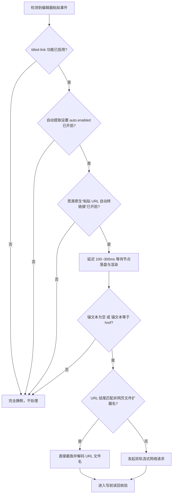
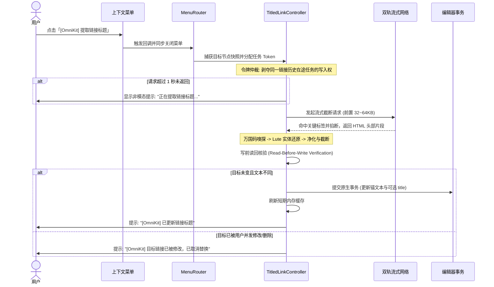

# OmniKit · 自动标题链接功能需求规范 (Titled Link PRD)

> **版本**：v1.0（正式发布稿）  
> **状态**：已冻结（Approved & Frozen）  
> **适用模块**：`src/features/titled-link/`  
> **所属平台规范**：[CORE-PRD.md](../CORE-PRD.md)  
> **最高设计准则**：[AGENTS.md](../../AGENTS.md)

---

## 1. 功能定位与产品边界

### 1.1 核心目标
OmniKit 自动标题链接（Titled Link）功能为思源笔记提供安全、极速、无侵扰的行内超链接标题异步获取与文本替换能力：
1. **以锚文本改写为核心**：思源笔记中的超链接以 `<span data-type="a" data-href="http://..." data-title="...">锚文本</span>` 结构持久化存储。本功能**默认严格仅替换该元素内部的「锚文本」（显示文字）**；同时提供可选设置项允许同步更新 Markdown Title 属性（`data-title`，悬浮 Tooltip 呈现），链接地址（`data-href`）严禁被篡改；
2. **非阻塞异步处理**：用户粘贴 URL 时保持思源原生插入流程零延迟完成，网页请求与标题解析在后台异步进行，绝不阻塞用户连续输入或打乱编辑光标；
3. **改写范围精确锁定**：每次操作严格锁定被点击或本次独立粘贴创建的**唯一目标行内超链接实例**（最小副作用原则），基于所属块内节点快照核验改写，绝不调用全局字符串搜索替换，绝不产生跨文档或同块其他相同 URL 的副作用；
4. **原生受控事务与撤销支持**：通过受控的思源编辑器事务队列（`Protyle.updateTransactionElement`），原生支持 `Ctrl+Z` / `Ctrl+Y` 撤销与重做，保持块级历史版本一致性；
5. **双轨网络分流与平台适配流式解析**：桌面端直连网络请求并以流式 Chunk 截断，匹配关键闭合标签（`</head>` 或 `</title>`）即主动掐断底层网络流；Web/移动端通过思源内核 `/api/network/forwardProxy`（携带 `"responseEncoding": "base64"`）代理完整响应，前端截取前 64KB 二进制流执行万国码嗅探与解析；支持实体还原、非网页文件免抓取与失败降级 Hostname；
6. **零工作区污染与数据安全**：纯内存短期驻留缓存，不向工作区写入任何临时调试或排队文件；写前严格执行节点级读回比对，遇到并发编辑冲突安全放弃改写，绝不冲刷丢失用户打字。

### 1.2 功能边界 (Scope)

| 维度 | 纳入范围 (In-Scope) | 排除范围 (Out-of-Scope) |
|---|---|---|
| **改写对象** | 思源正文块内原生可编辑的行内超链接锚文本（显示文字）；开启 `replaceTitle` 时同步改写 `data-title` 属性 | 链接地址（`data-href`）、未开启 `replaceTitle` 时的 `data-title` 属性、链接卡片、数据库/属性视图对象、只读块、代码块、数学公式 |
| **网络协议** | 仅校验 `http://` 与 `https://` 格式；与图片压缩网络模型一致，默认笔记内 URL 可信 | `mailto:`、`file:`、`ftp:`、`siyuan://`、`javascript:`、相对路径、无协议前缀地址 |
| **文件免抓取** | 常见非网页文件扩展名（归档、安装包、文档/媒体、图片等）直接提取文件名并解码，零网络请求 | 试图对大体积二进制安装包或压缩文件发起 HTTP 请求并解析 HTML |
| **触发方式** | 1. 独立粘贴 URL 异步自动触发（满足锚文本门槛与 100~300ms 延迟）；<br>2. 单链接上下文菜单（`open-menu-link`）；<br>3. 块级批量提取上下文菜单（`click-blockicon`，限制并发度 = 3） | 历史笔记存量全库扫描、定时后台轮询抓取、跨文档批量重命名 |
| **内容解析** | 纯静态 HTML 流式解析（读取 32KB~64KB，`<title>` -> `og:title` -> `twitter:title`）；万国码自动嗅探；Lute 实体还原；长标题截断；拉取失败降级 Hostname | 动态 JavaScript 执行、SPA 页面路由渲染、正文内容抓取、AI 总结生成标题 |
| **反爬页过滤** | 完整匹配 `Just a moment...` 及其大小写/省略号变体过滤挑战页 | 复杂网站反爬黑名单系统、登录页破解、验证码绕过、付费墙穿透 |
| **并发与通知** | 自动模式彻底无感静默；单链手动即时反馈；块级批量受控并发（并发度 3）并在全部完成时聚合汇报单条通知 | 自动提取弹窗打扰；块级提取为每个链接逐个弹窗轰炸 |
| **平台覆盖** | `desktop`（Win/Mac/Linux）、`browser-desktop`、`mobile`（App）、`browser-mobile`（手机浏览器） | - |

---

## 2. 自动提取时序与准入策略

### 2.1 异步处理时序与门槛校验
- **原生粘贴先行**：用户在编辑器中粘贴内容时，插件优先放行思源原生粘贴逻辑，不拦截事件、不延迟插入，毫秒级生成初始行内链接；
- **剪贴板纯文本修整与单 URL 判定**：
  - 用户从外部（如微信、Slack、QQ 或终端）复制链接时，剪贴板末尾常附带换行（`\n`）或空白字符；系统在粘贴检测时对纯文本进行首尾空白修整（`trimmed = textPlain.trim()`），只要修整后为单一合法的 `http://` 或 `https://` 链接且不包含内部换行，即允许进入候选提取；
- **延迟检查门槛（100~300ms 防抖）**：原生粘贴完成后，插件延迟 100~300ms 检查生成的链接节点：
  - **自动触发门槛**：**仅当链接节点的锚文本为空（`""`）或等于原 URL（`anchorText === href`）时**，才自动触发后台抓取；
  - **自定义保护**：若用户已在外部复制了带标题的 Markdown 链接（例如 `[思源笔记](https://b3log.org/siyuan)`）、粘贴前存在文本选区、或在延迟期间已输入自定义锚文本，系统**直接跳过，绝不覆盖用户自定义内容**；
  - **同块相同 URL 防歧义短路**：当当前块内已存在相同 URL 的超链接且发生重新渲染导致节点模糊时，系统主动跳过自动提取，防止歧义替换；
- **思源原生设置依赖**：若思源原生“粘贴 URL 自动转链接”设置处于关闭状态，插件始终跳过自动提取，不强制改变用户排版；
- **写前比对防护**：网络返回后，执行写前二次读回比对（Read-Before-Write Verification）。核验通过后局部修改锚文本并提交受控事务；若发生内容篡改或焦点冲突，系统安全放弃回填。

### 2.2 非网页文件扩展名免抓取机制 (Static Filename Extraction)
对于指向非网页文件的直接下载链接或媒体链接，无需发起耗时且无意义的 HTTP 网络请求，系统直接截取 URL 路径末尾的文件名作为锚文本：
1. **覆盖的文件类型矩阵**：
   - **归档与安装包**：`.zip`, `.rar`, `.7z`, `.tar`, `.gz`, `.exe`, `.dmg`, `.pkg`, `.apk`, `.deb`, `.rpm`, `.iso`；
   - **办公文档与电子书**：`.pdf`, `.docx`, `.xlsx`, `.pptx`, `.doc`, `.xls`, `.ppt`, `.epub`, `.mobi`；
   - **音视频媒体**：`.mp4`, `.mkv`, `.avi`, `.mov`, `.wmv`, `.flv`, `.mp3`, `.wav`, `.flac`, `.aac`, `.m4a`；
   - **图片资产**：`.png`, `.jpg`, `.jpeg`, `.webp`, `.svg`, `.gif`, `.bmp`, `.ico`；
2. **提取算法契约**：
   - 提取 URL 路径（Pathname）的最后一段（剥离 Query 参数与 Hash 锚点）；
   - 执行标准 URL 解码（`decodeURIComponent`），将形如 `%E6%96%87%E6%A1%A3.pdf` 还原为人类可读文件名；
   - 若提取出的文件名有效且非空，直接将其作为目标标题回填，跳过网络请求与流式解析流程，达到零延迟、零网络开销。

### 2.3 自动准入与状态流转



### 2.4 彻底无感静默与低开销规范 (Silent by Default & Low Overhead)
- **彻底无感静默**：
  - 自动提取执行过程中与结束后，无论是成功替换、文件免抓取回填、抓取超时、网络错误、反爬拦截还是准入跳过，**系统完全静默处理，严禁弹出任何 Toast 气泡或通知打扰用户正常写作**；
  - 仅在手动模式（单链右键提取或块级批量提取）下向用户提供明确的交互反馈；
- **输入环境零侵扰**：
  - 标题回填全程在后台完成，**严禁抢夺当前编辑器焦点、严禁改变光标位置、严禁重置用户正在编辑的选区**；
- **尽早短路与零额外开销**：
  - 若剪贴板内容不符合单 URL 判定，或原生设置未启用，监听器立即同步退出（`return`），绝不在未命中场景下发起任何网络请求或 DOM 轮询。

---

## 3. 网络请求、流式传输与解析规范

### 3.1 双轨网络模型与平台适配
为了彻底解决跨端网络限制（浏览器跨域 CORS、移动端混合环境及系统代理兼容性），系统实施双轨分流：
1. **桌面端环境 (`desktop`)**：
   - 优先直接使用 `window.fetch` 发起网络请求；
   - 完整遵循宿主系统的系统代理与网络栈配置（兼容 Fake-IP 等透明代理模式）；
   - 支持内网地址与 `localhost` 访问，不强加额外 SSRF 阻断；
2. **Web 与移动端环境 (`browser-desktop` / `mobile` / `browser-mobile`)**：
   - 通过调用思源内核 REST API `/api/network/forwardProxy` 进行转发请求，彻底绕过前端浏览器跨域（CORS）与移动端沙盒限制；
   - **二进制原始字节保护契约**：向内核显式传递 `"responseEncoding": "base64"`，指示 Go 内核执行 `client.DisableAutoDecode()`，直接返回原始字节的 Base64 编码，避免 Go 端 UTF-8 自动强转造成的非 UTF-8 字符损坏；
3. **Core 平台 User-Agent 统一复用**：
   - 网络请求读取 Core 平台全局配置 `omnikit-core.json` 中的 `general.userAgent`；
   - 若用户配置了自定义 UA 则优先使用；若为空则默认使用现代 Chrome 浏览器 User-Agent 进行请求头伪装（例如：`Mozilla/5.0 (Windows NT 10.0; Win64; x64) AppleWebKit/537.36 (KHTML, like Gecko) Chrome/130.0.0.0 Safari/537.36`）；
4. **安全凭据边界**：
   - 请求头携带 `credentials: 'omit'` 与 `referrerPolicy: 'no-referrer'`，绝不附带思源内部 Token 或本地 Cookie。单次网络超时上限为 **8 秒**。

### 3.2 流式截断与分平台读取规范 (Streaming Fetch & Platform Tailoring)
网页 HTML 的标题元数据集中于 `<head>` 区域，正文通常包含大量无关内容。系统按端实施差异化低开销处理：
1. **桌面端环境（真实流式截断）**：
   - 前置以流式（Chunk Stream）方式只读前置 **32KB ~ 64KB** 二进制流；
   - 在 Chunk 接收与解码过程中，一旦正则匹配到 `</head>` 或 `</title>` 闭合标签，立即调用 `ReadableStreamDefaultReader.cancel()` 掐断底层 TCP 连接，停止接收后续网络流，实现物理级底层节流；
   - 若流读取累计达到 64KB 仍未发现 `<head>` 闭合或有效标题，立即掐断连接并基于已有截获片段进行最终解析；
2. **Web 与移动端环境（内核代理 + 前端截取）**：
   - 受思源内核 `/api/network/forwardProxy` 契约限制，内核会在完整拉取网页后（插件显式配置 8 秒超时，若未指定则回退内核默认 7 秒超时与 10MB 最大响应体保护）返回 Base64 编码的响应体；
   - 前端接收到 Base64 字符串后，解码为原始 `Uint8Array` 二进制流，**前端严格仅截取前 64KB 字节片段**送入万国码嗅探器与解析引擎，丢弃后续数据，有效规避不必要的全量文本解码与 DOM 构造开销。

### 3.3 万国码自动嗅探与动态转码 (Multi-Charset Sniffing)
部分国内老旧站点或特定区域站点采用 GBK、GB2312、Big5 等非 UTF-8 编码。系统前置进行万国码自动嗅探：
1. **编码探测通道**：
   - 优先探测 HTTP 响应头的 `Content-Type: text/html; charset=...` 声明；
   - 若响应头未声明或声明为非特定编码，在前置读取的首个 Chunk（纯 ASCII 兼容区）中正则嗅探 `<meta charset="...">` 或 `<meta http-equiv="Content-Type" content="...; charset=...">`；
2. **原生解码器转码**：
   - 获取到编码标识（如 `gbk`、`gb2312`、`big5`、`shift-jis`、`utf-8`）后，调用浏览器原生 `TextDecoder(encoding)` 规范化转码；
   - 原生不支持或异常编码安全回退至 `utf-8`，避免标题解析呈现乱码。

### 3.4 标题优先级、反爬挑战页过滤与降级策略
1. **标题选取优先级**：
   - **第一优先级**：`<head><title>` 标签内的文本内容；
   - **第二优先级**：`<meta property="og:title" content="...">` 属性值；
   - **第三优先级**：`<meta name="twitter:title" content="...">` 属性值；
2. **反爬挑战页整页过滤**：
   - 精准完整匹配 `Just a moment...` 及其省略号变体（`Just a moment…`、大小写忽略及首尾空白）；
   - 一旦命中整页拒绝，坚决不回退到 `og:title` 或 `twitter:title`；
3. **拉取失败降级 Hostname (`fallbackToHostname`)**：
   - 当网络请求失败、超时、命中反爬拦截、或 HTML 中未包含任何可用标题时：
     - 若设置项 `fallbackToHostname` 为 `true`（默认），提取原 URL 的域名主机名（Hostname，例如 `github.com`、`b3log.org`）作为降级标题回填；
     - 若 `fallbackToHostname` 为 `false`，则判定为提取失败，完全保留原 URL，不执行修改。

### 3.5 标题净化、实体还原与截断
提取出的候选标题必须按严格顺序进行纯文本归一化处理：
1. **HTML 实体解码**：
   - 统一调用思源官方内置的 `window.Lute.UnEscapeHTMLStr` 接口，完整还原标准实体（`&amp;`、`&quot;`、`&lt;`、`&gt;`）与 Unicode 数字实体（`&#...;`）；
2. **空白字符与换行压缩**：
   - 剔除首尾空白字符；
   - 将所有换行符（`\r`、`\n`）、制表符（`\t`）及多个连续半角空格统一压缩替换为单个半角空格；
3. **标题最大长度截断 (`maxTitleLength`)**：
   - 若 `maxTitleLength > 0`（默认 `80`）：采用 Unicode 字素簇安全分割（`Intl.Segmenter`），当标题字素总数超出阈值时，截取前 `maxTitleLength - 3` 个字符并在末尾追加 `...`，确保显示整洁；
   - 若 `maxTitleLength === 0`：不设上限，保留完整标题内容；
4. **无变化判定 (`same-title-no-op`)**：
   - 若净化后的最终标题与超链接当前的锚文本完全一致，判定为无需写回，不提交事务。

---

## 4. 菜单动作与用户交互

### 4.0 菜单前缀与权威收口规范 (MenuRegistry)
所有菜单项严格遵循 OmniKit 平台的**场景化前缀分流与权威收口原则**：
- **权威收口治理**：由 Core 层的 `MenuRegistry` 作为菜单前缀与派发的唯一权威收口，**严禁 Feature 层在菜单标题中硬编码 `[OmniKit]` 前缀**；
- **外部上下文右键菜单 (`location === "link" | "blockicon"`)**：由 `MenuRegistry` **自动统一补齐 `[OmniKit] ` 前缀**（例如 `[OmniKit] 提取链接标题`、`[OmniKit] 批量提取链接标题 (共 N 个)`），明确向用户标识插件归属；
- **顶栏自有菜单 (`location === "topbar"`)**：若暴露快捷项则彻底移除前缀，保持界面清爽克制。

### 4.1 单链接手动提取：`[OmniKit] 提取链接标题`
- **入口**：在正文块内对行内超链接点击右键（桌面端）或长按（移动端）弹出的链接上下文菜单（`open-menu-link`）；
- **行为与覆盖策略**：
  - 手动点击明确表达了用户的更新意图，**无论当前链接是否已有自定义锚文本，均可强制拉取最新网页标题并覆盖**；
  - 绕过短期内存缓存，发起强制联网更新；
  - 若配置了 `replaceTitle: true`，同步更新链接节点的 `data-title` 属性；
- **交互与即时反馈**：
  - 若请求耗时超过 1 秒，弹出非模态轻量提示 `正在提取链接标题...`；
  - 成功替换：提示 `[OmniKit] 已更新链接标题`；
  - 标题已是最新（`same-title-no-op`）：提示 `[OmniKit] 链接标题已是最新`；
  - 失败或超时：提示 `[OmniKit] 未能提取网页标题`（若开启了 `fallbackToHostname` 且降级成功，则提示 `[OmniKit] 未能获取网页标题，已降级为域名`）；
  - 遭遇并发冲突：提示 `[OmniKit] 目标链接已被修改，已取消替换`。

### 4.2 块级批量提取：`[OmniKit] 批量提取链接标题 (共 N 个)`
- **入口**：在块图标菜单（`click-blockicon`）中，若当前块（或包含的子块）中存在 1 个及以上行内超链接，挂载菜单项；
- **动态文案与数量感应**：菜单标题实时计算并渲染链接数量，例如 `[OmniKit] 批量提取链接标题 (共 3 个)`；若为 0 个链接则不挂载该菜单；
- **受控并发控制池 (Concurrency Pool = 3)**：
  - 块内存在多个链接时，网络抓取任务进入受控并发调度池，**限制最大并发网络请求数严格等于 3**，防止瞬间突发并发拉垮宿主网络或触发站点封锁；
- **同块事务合并回写 (Per-Block Consolidated Transaction)**：
  - 若批量选区中多个链接从属于同一个块（相同 `blockID`），网络层保持并发拉取，但在写回阶段进行**按块收口**：在该块所属链接全部拉取完毕（或超时）后，**仅执行一次写前读回核验，并在一次 `updateTransactionElement` 事务中将该块内所有已完成更新的链接一并提交**；
  - **核心价值**：消除同块并发写入的写租约锁冲突，同时使用户仅需按一次 `Ctrl+Z` 即可一次性撤销当前块的所有标题替换，大幅提升撤销体验与操作稳定性；
- **聚合汇报通知（杜绝弹窗轰炸）**：
  - 批量执行过程中保持静默，严禁为每个链接弹出单独的 Toast 气泡；
  - 全部链接处理完成（或被终止）后，Controller 统筹向思源发送**单条聚合结果通知**：
    - 示例：`[OmniKit] 链接标题提取完成：共 5 个，已更新 4 个，跳过或冲突 1 个`。

### 4.3 任务仲裁与并发防重



- **任务仲裁机制**：
  - 基于单调递增任务 Token 结合 `WeakMap` 与超链接 DOM 节点绑定；
  - 同一链接连续多次点击提取时，每次新任务立即剥夺此前所有在途任务的写入与提示权限；
  - 仅最后一次有效受理的请求拥有最终提交权和提示权，旧响应返回后静默丢弃。

---

## 5. 短期内存缓存规范

### 5.1 缓存数据结构与读写契约
- **结构模型**：内存驻留的短期 LRU 缓存，最大容量为 100 条，TTL 有效期为 5 分钟；
- **读写契约**：
  - 自动模式在发起网络前优先查询内存缓存；若命中有效记录，直接复用该标题并进入写前核验；
  - 多个粘贴任务指向同一 URL 时，自动模式可合并并发网络请求，避免重复消耗带宽；
  - **手动强制联网**：手动提取始终绕过缓存发起真实网络请求；手动成功更新或确认为 `same-title-no-op` 后，主动刷新该 URL 的内存缓存条目。

### 5.2 手动刷新与新旧代际保护
- 为每个缓存条目附加自增的代际版本号（Generation ID）；
- 当手动提取成功刷新了某 URL 的缓存后，该 URL 的代际版本号增加；
- 随后返回的较早批次的在途自动请求，因携带旧代际标记，被严格禁止写回缓存，杜绝旧响应污染最新有效标题。

### 5.3 零持久化原则
- 缓存仅存在于前端内存中；
- Feature 停用、插件重载或应用退出时，内存缓存立即销毁；
- **严禁将抓取的 URL、网页正文或标题历史写入工作区磁盘文件**。

---

## 6. 块级改写与并发冲突防护

### 6.1 精确目标定义 (`OccurrenceTarget` / `LinkTarget`)

```typescript
export interface LinkOccurrenceTarget {
  readonly protyle: any;                 // 编辑器上下文
  readonly notebook: string;             // 笔记本 ID
  readonly rootID: string;               // 所在文档根 ID
  readonly blockID: string;              // 所属块 ID
  readonly linkElement: HTMLElement;     // 目标行内 span 元素 DOM 身份
  readonly originalHref: string;         // 提取时的 data-href
  readonly originalText: string;         // 提取时的原始锚文本
  readonly originalTitle: string | null; // 提取时的原始 data-title
}
```

### 6.2 写前读回校验与冲突防护 (Read-Before-Write Verification)
在网络响应返回或文件名提取完毕准备提交写入时，必须原子化执行以下核验：
1. **Feature 存活状态**：所属 Feature 仍处于 `enabled` 状态，未被动态停用；
2. **节点归属一致性**：目标 `linkElement` 依然附着在 DOM 树中，且仍从属于预期 `blockID` 的块；
3. **URL 严格匹配**：`linkElement.getAttribute("data-href")` 与 `originalHref` 严格相等；
4. **锚文本未被并发编辑**：
   - 链接当前内部的文本内容与 `originalText` 严格一致；
   - 若用户在异步等待期间修改了文字、键入了新内容或删除了链接，系统**安全放弃替换，绝不冲刷丢失用户打字，并向用户发送客观提示**；
5. **受控事务写入与同块聚合**：核验通过后，修改 `linkElement.textContent`（若 `replaceTitle: true` 则同时更新 `data-title`），调用思源原生事务方法：
   ```typescript
   protyle.updateTransactionElement(target.blockElement, oldBlockOuterHTML);
   ```
   若在批量提取模式下，同一块内包含多个提取完成的链接，系统在核验后一次性对该块内所有已完成链接进行修改并提交单次事务，杜绝同块多次提交引发的历史碎片与租约冲突。

### 6.3 输入法 (IME) 与光标安全防护
- **输入法安全等待**：若请求返回时当前编辑器正处于 IME 中文输入法组合状态（`isComposing === true`），系统进入有界延后等待队列，最多等待 **3 秒**；
- **超时安全放弃**：若 3 秒后用户仍在组合输入，或当前编辑光标正停留在目标链接内部且无法安全恢复选区，系统立即安全放弃本次回填，绝不打断用户输入流。

---

## 7. 任务生命周期与通知规范

### 7.1 任务中断与正常中止
- **无用户主动取消按钮**：任务在后台异步进行，不提供半途取消控件，杜绝半持久化不一致状态；
- **系统生命周期安全中止**：
  - 功能禁用、插件卸载或应用退出时，Core 通过 `scope.signal` 广播中止信号；
  - 正在执行的网络流立即通过 `AbortController` 或 `reader.cancel()` 掐断；
  - 未提交的异步任务立即注销写入权限，迟到响应一律丢弃；
  - 系统不执行事务回滚，重启后不恢复在途任务，保持纯粹无状态。

### 7.2 结果通知规范
- **自动模式彻底静默**：成功、失败、跳过均不派发任何气泡或通知；
- **手动单链模式精确提示**：
  - 耗时 > 1 秒：弹出轻量提示 `正在提取链接标题...`；
  - 成功替换：提示 `[OmniKit] 已更新链接标题`；
  - 标题相同（`same-title-no-op`）：提示 `[OmniKit] 链接标题已是最新`；
  - 失败且降级为域名：提示 `[OmniKit] 未能获取网页标题，已降级为域名`；
  - 失败且未降级：提示 `[OmniKit] 未能提取网页标题`；
  - 目标被修改放弃：提示 `[OmniKit] 目标链接已被修改，已取消替换`；
  - 被后续任务取代：静默丢弃，不弹窗提示；
- **块级批量模式聚合提示**：
  - 全部处理完成后发送单条汇总通知：`[OmniKit] 链接标题提取完成：共 N 个，已更新 X 个，跳过或冲突 Y 个`。

---

## 8. 设置项结构与界面规范 (`feature-titled-link-settings.json`)

### 8.1 数据结构

```json
{
  "schemaVersion": 1,
  "auto": {
    "enabled": true
  },
  "replaceTitle": false,
  "maxTitleLength": 80,
  "fallbackToHostname": true
}
```

| 配置字段 | 类型 | 默认值 | 约束与说明 |
|---|---|---|---|
| `schemaVersion` | number | `1` | 配置结构版本号 |
| `auto.enabled` | boolean | `true` | 粘贴单 URL 时自动提取链接标题开关（**默认开启**） |
| `replaceTitle` | boolean | `false` | 是否同时替换 Markdown 标题属性（`data-title`），为 false 仅替换显示文字，为 true 同步替换 |
| `maxTitleLength` | number | `80` | 提取标题最大字素长度限制（默认 80 字素，超出追加 `...`；设为 `0` 表示不限制长度） |
| `fallbackToHostname` | boolean | `true` | 当网络失败、反爬拦截或标题缺失时，是否自动降级为网站域名（Hostname）作为显示文字 |

### 8.2 设置面板与操作规范
1. **界面布局**：
   - 嵌入 OmniKit 统一设置面板的卡片分区展示；
   - 提供「自动提取设置」分组：
     - 开关控件：**粘贴时自动提取链接标题**（附带说明：“粘贴单个网页链接时，后台获取网页标题并替换链接文字；需同时开启思源「粘贴 URL 自动转链接」”）；
     - 开关控件：**同时替换悬浮标题属性 (`title`)**（附带说明：“开启后，将同时更新链接的 title 提示文字”）；
     - 开关控件：**拉取失败时降级为网站域名**（附带说明：“网页无法访问或无标题时，以域名（如 github.com）作为显示文字”）；
     - 数字输入/滑块控件：**标题最大长度**（默认 80，范围 0~200，说明：“0 表示不限制；超过限制将自动截断并追加省略号”）；
2. **多窗口同步**：
   - 在独立设置窗口（`body--settings`）中修改后由 `JsonStore` 保存至磁盘，主窗口通过 `onDataChanged` 实时响应；
3. **特性重置为默认设置**：
   - 点击设置卡片右上角「重置为默认设置」按钮，仅将 `feature-titled-link-settings.json` 重置为上述初始默认值，不影响任何其他文件。

---

## 9. 架构职责划分与代码去重规范 (Architecture Responsibilities & Clean Code)

为了消除多层重复判断、避免职责混乱引发假性报错或多重提示，特性内部确立严格的单向职责划分与所有权模型：

### 9.1 单向职责与分工边界
1. **Feature 层 (`TitledLinkFeature.ts`)**：
   - 专职负责思源宿主环境的事件监听（Protyle 菜单监听、`open-menu-link`、`click-blockicon` 与编辑器 `paste` 事件挂载）；
   - 提取宿主上下文信息（`Protyle` 实例、`linkElement`、`blockElement` 等），将业务直接委托给 `TitledLinkController`；
   - 严禁在 Feature 层直接编写复杂的网络抓取逻辑与 UI 弹窗；
   - 所有副作用、事件监听句柄由 `FeatureScope`（`context.scope.own`）统一集中托管与清理，清理死代码；
2. **Controller 门面层 (`TitledLinkController.ts`)**：
   - 唯一业务编排门面，严格把控准入检查（`auto.enabled`、思源原生开关、粘贴门槛校验、非网页文件扩展名免抓取判定）；
   - 管理并发控制池（限制并发度 = 3）与任务 Token 仲裁（WeakMap）；
   - 调度网络请求、流式解析、规范化、缓存读取与刷新；
   - **唯一负责对外用户反馈**：Controller 统一收口思源 `showMessage` 提示，杜绝多处或重复弹出提示气泡，负责块级聚合通知；
   - 负责识别正常中止与输入法安全等待，静默退出，严禁假报错；
3. **Action / Service 领域层 (`network.ts` / `parser.ts` / `target.ts` / `cache.ts`)**：
   - 纯领域执行单元：双轨网络请求（桌面直连 / Web移动端代理）、32KB~64KB 流式截断读取、万国码嗅探解码、Lute 实体还原、字素截断与写前读回核验；
   - 严禁在领域服务内部直接调用 `showMessage` 弹出全局通知气泡，避免与 Controller 重复提示；
   - 遇到异常、冲突或取消时，统一返回结构化执行结果，交由 Controller 统筹判定与汇报。

### 9.2 代码去重与清理规范
- **准入判定单点收口**：URL 格式、粘贴门槛与文件扩展名免抓取仅在 Controller 设防入口判定一次，下游各模块不层层重复校验；
- **清理死代码与废弃逻辑**：彻底移除任何关于 SSRF 复杂阻断的死代码与多余检查，保持网络调用精简纯粹。
