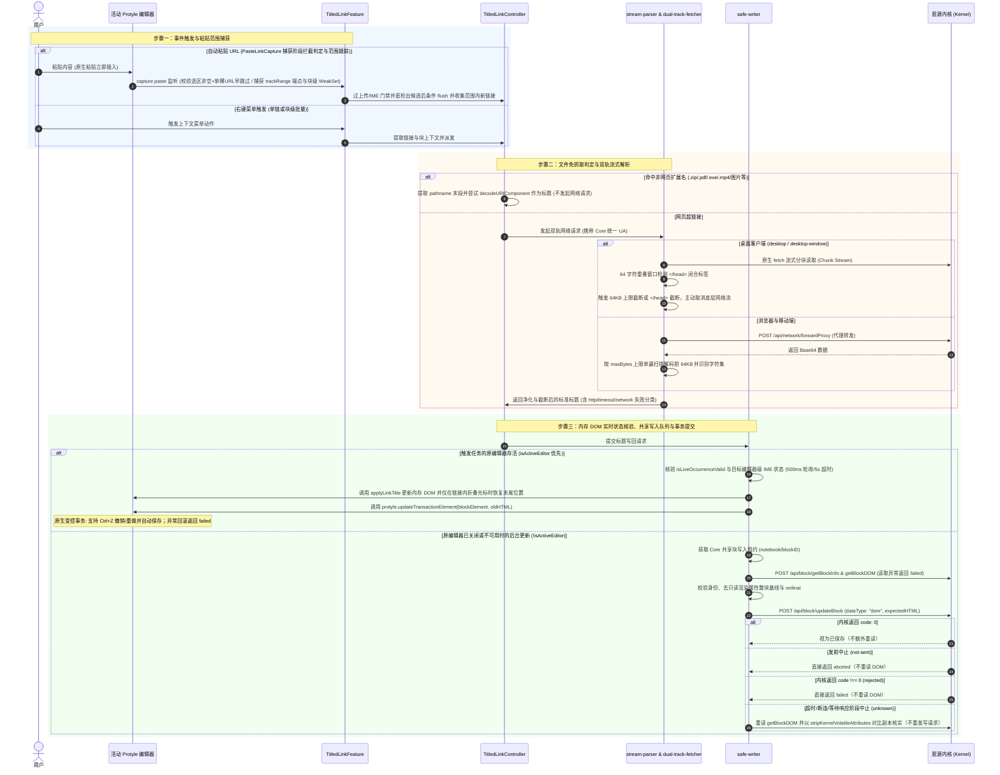

# OmniKit · 自动标题链接技术设计文档 (Titled Link DESIGN)

> **文档性质**：具体技术架构、模块职责、网络模型与事务写回规范（How）。代码重构或修复 BUG 时直接更新本文件，不影响业务需求 PRD。  
> **对应产品需求**：[PRD.md](PRD.md)  
> **适用平台**：OmniKit 全端通用（`desktop`、`desktop-window`、`browser-desktop`、`mobile`、`browser-mobile`）

---

## 1. 架构总览与模块划分

自动标题链接功能（`src/features/titled-link/`）由宿主事件入口、粘贴捕获服务、任务控制器、策略纯函数模块、网络读取与解析服务、编辑器事务写回服务、短期内存缓存和设置界面组成。

```
┌──────────────────────────────────────────────────────────────────────┐
│                          TitledLinkFeature                           │
│ (注册编辑器生命周期、capture 粘贴捕获、菜单贡献与输入法跟踪，受 Scope 管理) │
└──────────────────┬───────────────────────────────┬───────────────────┘
                   │ 粘贴范围捕获                  │ 菜单/自动任务调度
┌──────────────────▼───────────────┐ ┌─────────────▼───────────────────┐
│   services/PasteLinkCapture.ts   │ │       TitledLinkController      │
│ (trackRange + MutationObserver   │ │ (版本检查 / 并发池 / 汇总通知)  │
│  + flushProtyleTransactions)     │ └──┬──────────────┬─────────────┬─┘
└──────────────────┬───────────────┘    │              │             │
                   │                    │              │             │
┌──────────────────▼────────────────────▼──┐ ┌─────────▼─────────┐ ┌─▼───────────────────┐
│                 policy/                  │ │     services/     │ │         ui/         │
│ types.ts        (配置/目标/结果类型)      │ │ title-resolver    │ │ TitledLinkSettings- │
│ settings.ts     (配置解析与默认值)        │ │ dual-track-fetcher│ │   Panel.svelte      │
│ paste-range.ts  (区间重建/边界对齐/筛选)  │ │ stream-parser     │ │ autoPasteHelp.ts    │
│ batchSummary.ts (终态统计守恒与静默判定)  │ │ static-file       │ │ (运行期词典副标题)  │
└──────────────────────────────────────────┘ │ title-normalizer  │ └─────────────────────┘
                                             │ safe-writer & 子器│
                                             │ title-cache       │
                                             └───────────────────┘
```

### 1.1 模块职责速查表

| 模块文件 | 核心职责 | 技术规范与边界 |
|---|---|---|
| `TitledLinkFeature.ts` | Feature 入口 | 集中注册上下文菜单（`open-menu-link` 过滤 `isHttpUrl` 与只读状态 / `click-blockicon` 过滤 `isProtyleReadOnly` 块级批量）、`PasteLinkCapture`、`destroy-protyle`（按 `wysiwyg?.element` 清理）并在 `onEnable` 遍历 `getAllEditor()` 补登已打开编辑器；在目标编辑器上以捕获阶段管理输入法状态（`attachCompositionTracking`）；所有监听句柄由 `FeatureScope` 集中托管与注销 |
| `services/PasteLinkCapture.ts` & `policy/paste-range.ts` | 粘贴链接范围捕获 | 挂载原生捕获阶段 `paste` 监听（`{ capture: true }`），入口拦截只读编辑器/块（`isProtyleReadOnly`）；非空选区且 `text/plain` 为单个裸 URL 时跳过且不创建捕获资源；通过 `alignCollapsedPasteBoundary` 在克隆 `Range` 上镜像对齐思源 `beforePaste` 对行内 `SPAN` 首尾边界的外移行为后创建 `trackRange` 首尾句柄，并对原始选区所属 `[data-node-id]` 块记录既有链接 `WeakSet<HTMLElement>`；`isAutomaticLinkCandidate` 兼容 Lute 对含百分号编码 URL 的可见文本解码（`decodeURI` / `decodeURIComponent`）；仅检出候选时调用一次 Core `flushProtyleTransactions` 确认落盘后复检交付，收敛至幂等 `finishCapture(reason)` |
| `TitledLinkController.ts`、`services/title-resolver.ts`、`policy/types.ts` & `policy/batchSummary.ts` | 业务控制器、标题解析器与批量守恒统计 | `title-resolver.ts` 集中封装静态文件短路（经 `finalizeTitle` 净化与 80 字素截断）、`TitleCache` 读写、`pending` 同 URL 并发请求合并与双轨抓取解析；`batchSummary.ts` 按 7 桶守恒统计 `updated`、`unchanged`、`conflict`、`failed`、`imeTimeout`、`unknown` 与 `skipped = superseded + aborted`（相加等于 `total`）；同块任务去重、最大并发 3 请求、按块合并提交 |
| `services/static-file.ts` | 非网页文件识别 | 提取 URL `pathname` 末段并先尝试 `decodeURIComponent`（失败时回退原始字符串），匹配归档、文档、媒体与图片扩展名，命中后直接返回文件名且不发起网页请求 |
| `services/dual-track-fetcher.ts` | 双轨网络驱动 | 桌面客户端原生 `fetch` 直连分块读取；浏览器与移动端通过 `/api/network/forwardProxy` 代理转发，并在 `decodeBase64` 中绑定 `maxBytes` 上限执行单遍 $O(\text{maxChars})$ 扫描与校验；复用 Core `general.userAgent`；输出 `http` / `timeout` / `network` / `aborted` 失败分类 |
| `services/stream-parser.ts` & `services/title-normalizer.ts` | 流式解析与标题净化 | 单实例 `LATIN1_DECODER` 增量分块解码、尾部 64 字符重叠窗口检测 `</head\s*>` 闭合标签与 64KB 上限截断（不提前在 `</title>` 截断）；GBK/Big5/Shift-JIS/UTF-8 字符集识别与解码；引号感知 `<meta>` 正则提取；`window.Lute.UnEscapeHTMLStr` 实体还原；空白与控制字符净化并按固定常量 `80` 字素截断 |
| `services/safe-writer.ts`、`block-dom-snapshot.ts`、`active-editor-writer.ts` & `inactive-block-writer.ts` | 原生受控事务与后台安全写回 | `block-dom-snapshot.ts` 负责目标链接捕获、块 DOM 解析与等价性比对克隆归一化（`normalizeBlockForComparison`）；`active-editor-writer.ts` 负责活跃编辑器只读拦截（只读时直接返回 `"failed"` 不落入后台路径）、`isLiveOccurrenceValid` 核验、折叠光标恢复与 `updateTransactionElement` 提交；`inactive-block-writer.ts` 在原编辑器不可用时校验块归属、归一化整块基线与 `ordinal` 后调用 `updateBlock`，仅在传输结果 `"unknown"` 时重读核实；`safe-writer.ts` 负责 `withBlockWriteLease` 串行写锁、IME 轮询门禁与路径分发 |
| `services/title-cache.ts` | 短期内存缓存 | 100 条 / 5 分钟 TTL 内存 LRU 结构；`epoch * EPOCH_SHIFT + urlGeneration` 代际保护；不缓存静态文件与 `fallback: true` 降级域名；不写入磁盘 |
| `ui/TitledLinkSettingsPanel.svelte` & `ui/autoPasteHelp.ts` | 设置界面与运行期词典适配 | 接入平台 `DraftParticipant` 全局保存栏；通过纯函数 `resolveAutoPasteHelp(t, languages?)` 动态读取思源运行期语言词典（`configGroupBehavior` 与 `pasteURLAutoConvert`），缺失时回退 `feature.titledLink.settings.autoHelp` |

### 1.2 异步处理与原生受控事务写回全流程时序



---

## 2. 大网页保护与双轨网络模型 (`services/dual-track-fetcher.ts` & `stream-parser.ts` & `static-file.ts`)

为限制超大网页的内存与网络消耗并正确解析多语言字符集，系统实施流式截断、64KB 字节上限截取与字符集识别解码机制：

### 2.1 桌面端和浏览器端的网络请求与失败分类
1. **桌面客户端直连流式截断 (`desktop` / `desktop-window`)**：
   - 直接使用 `window.fetch` 发起流式网络请求，默认超时 8 秒；
   - `stream-parser.ts` 使用 `LATIN1_DECODER`，每次只解码新收到的数据块，并保留末尾 **64 个字符**，以识别分块边界上的 `</head>`。遇到 `</title>` 时继续读取，以便获取 `<title>` 之后的 `og:title` 或 `twitter:title`。全部数据读取完成后合并一次；
   - 读到 `</head>` 或达到 **64KB (`DEFAULT_MAX_BYTES`)** 上限时，调用 `ReadableStreamDefaultReader.cancel()` 停止读取；
2. **浏览器和移动端使用思源内核转发 (`mobile` / `browser-desktop` / `browser-mobile`)**：
   - 统一通过思源内核 `/api/network/forwardProxy`（携带 `"responseEncoding": "base64"`、`Range: bytes=0-65535` 与 `Accept-Encoding: identity`）代理转发；收到 `416` 时移除 `Range` 重试一次，若目标服务器忽略 `Range` 返回全量内容则仍由本地截取解码上限；
   - `decodeBase64` 根据 `maxBytes` 限制待解码字符数（默认 65,536 字节对应 87,384 个字符，以保留 `truncated: true` 检测所需的一个额外字节）。扫描一次内容，跳过 ASCII 空格，检查 `[A-Za-z0-9+/=]` 字符和末尾 `=` 后，再调用 `globalThis.atob(cleaned)` 解码并交给后续解析；
3. **不请求非网页文件 (`static-file.ts`)**：
   - 提取 `parsed.pathname` 末段后，先尝试调用 `decodeURIComponent` 解码（解码抛出异常时回退使用原始末段字符串），再检测末段扩展名是否命中静态文件扩展名集合（归档/安装包、办公文档/电子书、音视频媒体、图片资产）；
   - 命中支持列表且修剪空白后的文件名非空时，直接返回该文件名作为显示文字，不发起网页请求；
4. **使用 Core 的 User-Agent 设置**：
   - 通过 Core 平台读取 `general.userAgent`（平台初始化、读取阶段判空自动补全并落盘、重置及留空保存时均使用现代 Chrome 浏览器 `DEFAULT_USER_AGENT`，并在读取时保留空值回退双重保障；不设 Feature 独立 UA 字段）。
5. **失败原因 (`TitleFetchFailureReason`)**：
   - HTTP 非 2xx 响应记录为 `"http"` 并保留状态码；请求超时记录为 `"timeout"`；DNS 或网络错误记录为 `"network"`；主动中止记录为 `"aborted"`；挑战页记录为 `"challenge"`；没有可用标题记录为 `"missing-title"`。是否使用网站域名作为标题由 `fallbackToHostname` 设置决定。

### 2.2 多字符集识别、引号感知标签匹配与实体还原 (`stream-parser.ts` & `title-normalizer.ts`)
1. 先读取 HTTP 响应头中的 `Content-Type: charset=...`；如果没有声明，则在前 8KB 内容中查找 `<meta charset="...">` 或 `<meta http-equiv="Content-Type" content="...; charset=...">`；
2. 获取编码标识（GBK、GB2312、Big5、Shift-JIS、EUC-JP、UTF-8 等，其中 `gb2312` 归一化为 `gbk`）后，调用浏览器原生 `TextDecoder(encoding)` 规范化转码；
3. `extractMetaContent` 使用引号感知正则 `/<meta\b(?:[^>"']|"[^"]*"|'[^']*')*>/gi` 扫描 `<meta>` 标签，避免单引号或双引号属性值中的 `>` 字符提前截断标签匹配；
4. 统一调用思源官方内置 `window.Lute.UnEscapeHTMLStr`（缺省时回退基础 HTML 实体表）还原标准实体与 Unicode 实体；`sanitizeWhitespaceAndControls` 先将所有连续 Unicode 空白字符（`\s+/gu`，含换行、制表符、全角空格、不间断空格等）压缩为单个半角空格并 `trim()`，再移除 C0/C1 控制字符、双向控制字符及零宽空格 `\u200B`（保留 `\u200C`、`\u200D`）并再次压缩空白，最后按字素数截断至代码中固定的默认常量 `80`（仅通过修改代码调整，不提供 `maxTitleLength` 用户设置项或配置字段）；文本长度不超过上限时不截断，超过上限时截断（上限不超过 3 时直接截取对应长度且不追加 `...`，上限超过 3 时保留 `上限 - 3` 个字素并追加 `...`）。

---

## 3. 原生内存受控事务写回与事件入口 (`services/safe-writer.ts`、`block-dom-snapshot.ts`、`active-editor-writer.ts`、`inactive-block-writer.ts`、`services/PasteLinkCapture.ts` & `TitledLinkFeature.ts`)

### 3.1 检查编辑器、只读门禁与目标链接 (`isActiveEditor`、`isProtyleReadOnly`、`isLiveOccurrenceValid`)
- **`isActiveEditor(target)`**：兼容真实 `Protyle` 包装层级（`const host = (protyle as any).protyle ?? protyle`）与单测 Mock，校验 `updateTransactionElement` 方法存在、`destroyed !== true`、若存在 `host.element` 则其处于在树连接状态且包含 `.protyle` 类、若存在 `host.wysiwyg?.element` 则处于在树连接状态，且 `host.block?.rootID === target.rootID`（可读时）；
- **只读与受保护容器门禁 (`isProtyleReadOnly` & `PROTECTED_CONTAINER_SELECTOR`)**：
  - 复用 Core `PROTECTED_CONTAINER_SELECTOR` 统一跳过代码块、查询嵌入块、数据库属性视图（`NodeAttributeView` / `.av`）、公式块、HTML 块、渲染节点（`.render-node`）与内嵌预览中的超链接；
  - 复用 Core `isProtyleReadOnly(context, blockElement)` 检查编辑器 `disabled === true`、`wysiwyg` 的 `data-readonly="true"` / `contenteditable="false"` 及目标块 `contenteditable="false"`：`onLinkMenu`、`onBlockMenu` 与 `PasteLinkCapture` 入口遇到只读状态直接跳过；在活跃编辑器提交阶段若编辑器或块处于只读状态则直接返回 `"failed"`（绝不转入后台 `updateBlock` 路径绕过只读锁）；
- **`isLiveOccurrenceValid(target)`**：核验 `blockElement.isConnected !== false`、`linkElement.isConnected !== false`、`linkElement.closest("[data-node-id]") === blockElement`、`blockElement.getAttribute("data-node-id") === target.blockID`，以及 `data-href`、`textContent`、`data-title` 未被外部编辑篡改；
- **原编辑器分流与冲突检查**：只要触发任务的原编辑器仍存活且可用（`isActiveEditor(target)` 为真），就走受控事务路径或返回对应状态，避免误走后台路径覆盖活动编辑状态（若链接已被用户删除或修改导致 `!isLiveOccurrenceValid(target)`，返回 `"conflict"`，不调用 `/api/block/updateBlock`）；只有确认触发任务的原编辑器已关闭或不可用（`!isActiveEditor(target)`）时，才使用后台写入路径。

### 3.2 更新链接文字、恢复光标与事务失败归类 (`applyLinkTitle`)
- `applyLinkTitle(link, title, replaceTitle)` 修改 `link.textContent` 前，检查折叠光标是否位于该链接中（`range.collapsed && link.contains(range.startContainer) && link.contains(range.endContainer)`）。如果是，更新后将光标放在新文字末尾；否则不移动光标；
- 调用 `protyle.updateTransactionElement(target.blockElement, oldBlockOuterHTML)` 通过思源编辑器事务提交修改，使用户可以使用 `Ctrl+Z` / `Ctrl+Y` 撤销和重做，并记录在文档历史中；
- **事务异常回滚与终态归类**：若 `updateTransactionElement` 抛出异常，回滚 `linkElement` 的 `textContent` 与 `data-title` 并按原偏移重建折叠光标选区；返回值按当前状态判定：`options.signal?.aborted` 返回 `"aborted"`，已被新请求取代（`!isUpdateCurrent(u, options)`）返回 `"superseded"`，其余非中止非取代异常统一归类为 `"failed"`（不归类为 `"conflict"`）。

### 3.3 触发任务的原编辑器不可用时的后台写入：读写异常分离、归一化整块基线校验与 `unknown` 重读核实
当触发任务的原编辑器已关闭或不可用（`!isActiveEditor(target)`）时（例如原页签已关闭或编辑器已销毁）：
- **写前读取校验与失败归类**：在 Core 的同块写入队列中（以 `notebook/blockID` 为键，与 `imageCompressor` 共用），先调用 `/api/block/getBlockInfo` 检查当前 `rootID` 和 `box` 是否仍与目标一致，再调用 `/api/block/getBlockDOM` 读取最新块 DOM：
  - 若任务已中止（`options.signal?.aborted` 或捕获 `AbortError`），返回 `"aborted"`；
  - 在发送 `/api/block/updateBlock` 之前的 `getBlockInfo` / `getBlockDOM` 读取阶段，若抛出非 `AbortError` 异常、内核返回非 0 `code` 或响应体缺少有效 `id`/`dom` 字段，统一返回 `"failed"`（不误判为 `"conflict"`）；
  - 仅在两次读取与块 DOM 解析均成功后，通过 `normalizeBlockForComparison` 生成用于等价性核验的克隆字符串（统一剥离 `parent-heading`、`updated`、`data-node-index`、`data-eof`、`data-editing`、`select-start`、`select-end`、`data-heading-number`、瞬态选区/高亮类名、`<wbr>`、`.protyle-heading-number` 及空 `class`/`style` 并对属性名排序），比对 `rootID`/`box`、归一化整块基线与 `links[target.ordinal]` 的 `data-href`/`textContent`/`data-title` 及受保护容器状态，出现不一致时判定 `"conflict"` 并跳过写入。单条和批量更新共用 `commitLinkTitles`；
- **调用 `/api/block/updateBlock` 与错误结果分流**：
  - 检查通过后，将剔除 `parent-heading` 只读属性（保留内核原有 `updated` 与持久化属性）的 `expectedHTML` 经 `/api/block/updateBlock`（`dataType: "dom", lockType: true`）提交，避免意外改变块类型。收到 `code === 0` 即视为内核已保存，不额外重读；思源接口不支持原子 CAS，Core 队列保证本插件内对同一块的写入依次进行；
  - `KernelClient` 将传输错误细分为 `"not-sent"`（发前中止）、`"rejected"`（收到明确非 0 `code` 响应）与 `"unknown"`（空/无效响应、网络异常、超时或发后中止）。`inactive-block-writer.ts` 收到 `"not-sent"` 直接返回 `"aborted"`，收到 `"rejected"` 返回 `"failed"`，均不重读 DOM；
- **`unknown` 重读核实（归一化副本对比与混合组逐项归类）**：
  - 仅当 `/api/block/updateBlock` 出现 `"unknown"`（传输结果未知或等待响应阶段被中止）时，禁止自动重发写请求，转而重读 `/api/block/getBlockDOM` 核实结果；
  - 若重读失败或块 DOM 无法解析，所有非 `"superseded"` 项返回 `"unknown"`；
  - 若重读解析成功，以 `normalizeBlockForComparison` 对重读块、预期块及原始基线块副本生成归一化表示（保留用户内容及链接属性），并按以下规则逐项归类：
    1. 重读核验副本整块等于预期块副本：返回原 `results`（保留各自 `"updated"`、`"unchanged"` 或 `"superseded"`）；
    2. 重读核验副本整块等于原始基线块副本：原 `"updated"` 项转为 `"unknown"`（禁止自动重试），原 `"unchanged"` 与 `"superseded"` 项维持原状态；
    3. 既不等于预期也不等于基线：所有非 `"superseded"` 项归类为 `"conflict"`（`"superseded"` 项维持原状态）。

### 3.4 自动粘贴范围捕获、批量终态统计、并发去重与输入法状态
- **编辑器登记与生命周期管理 (`TitledLinkFeature.ts`)**：
  - `onEnable` 通过 `getAllEditor()` 补登已打开的编辑器实例，同时监听 `loaded-protyle-static` 与 `switch-protyle` 登记后续加载或切换的编辑器，并在 `destroy-protyle` 时按 `wysiwyg?.element` 注销；
  - 在每个编辑器上挂载 `PasteLinkCapture`（捕获阶段监听 `wysiwyg.element` 原生 `paste` 事件）与 `attachCompositionTracking`（捕获阶段监听 `compositionstart` / `compositionend`）。`destroy-protyle` 与 `onDisable` 时统一卸载监听并释放状态；
- **原生捕获阶段粘贴检测与范围捕获 (`services/PasteLinkCapture.ts` & `policy/paste-range.ts`)**：
  - 入口不拦截思源原生 `paste` 流程，也不预判 `pasteURLAutoConvert` 开关；当 `scope.active && config().auto.enabled` 且编辑器与选区所在块非只读时，在原生 `paste` 捕获阶段读取当前选区与剪贴板数据（`text/plain`、`text/html`）；
  - **非空选区与前置过滤**：校验 `selection.rangeCount === 1` 且选区两端点位于当前 `editor` 内且不处于受保护容器；若存在非空选区且 `text/plain` 为单个裸 `http(s)://` URL（即使 `text/html` 包含 `<a>`），在创建 `trackRange` 句柄、`MutationObserver` 与定时器之前直接跳过；普通纯文本粘贴不取消正在进行中的 URL 粘贴捕获任务；
  - **行内 `SPAN` 边界对齐、同块旧链接排除与锚点跟踪**：读取粘贴前原始选区所属块（`[data-node-id]`）内既有链接节点记录到 `WeakSet<HTMLElement>`（`beforeElements`）；通过纯函数 `alignCollapsedPasteBoundary` 在克隆 `Range` 上对齐思源 `beforePaste` 对行内 `SPAN`（`a`、`text`、`inline-memo`、`block-ref`、`file-annotation-ref`）首尾折叠光标的外移位置（不改动宿主真实 `Selection`），同时调用 `capturePrePasteBlockAnchor` 快照源块 ID、对齐边界前后的直属链接签名序列（`prefixLinks` / `suffixLinks`）与编辑器既有块 ID 集合，再调用编辑器 `trackRange` 创建粘贴起止边界句柄（起始 `affinity: "before"`、结束 `affinity: "after"`，指定 `owner: plugin`），并挂接 `MutationObserver` 与静默定时复检；
  - **门禁直检与条件事务落盘**：每次静默评估按以下顺序执行：
    1. 先过上传态（`isProtyleUploading`）与目标编辑器 IME 组合态（`isComposing`）门禁，命中时延后 500ms 复检且不调用 `flushProtyleTransactions()`；
    2. 无副作用直检当前解析范围：优先通过 `resolveTrackedRange` 解析起止锚点并调用 `createRangeFromResolved(editor, start, end)` 遍历区间内候选链接；当连续粘贴链接导致 `SpinBlockDOM` 前后词元流首尾闭合标签重叠使折叠 `trackRange` 返回 `"invalid"` 时，回退至 `collectCandidateLinksFromBlockAnchor` 在源块及紧随其后的新插入块上严格核验前后缀链接签名序列一对一吻合后切片提取本次新增链接；两种路径均排除 `beforeElements` 中同块既有链接与受保护容器内链接，仅保留 `isAutomaticLinkCandidate(text, href)` 为真（锚文本为空、等于 `href`，或等于含百分号编码 `href` 的 `decodeURI` / `decodeURIComponent` 解码结果）的合格 `http(s)://` 链接；若范围或前后缀锚点失配（`invalid-range`）、为空（`empty-range`）或无候选链接（`no-candidate`），立即释放句柄且零次调用 `flushProtyleTransactions()`；
    3. 仅在非上传、非 IME 且检出候选链接时调用一次 Core `flushProtyleTransactions()` 确认事务落盘，随后再次复检有效范围与候选链接并交付调度；
  - **单一幂等收敛**：所有退出路径（候选交付、无效/空范围、无候选、超时终止、编辑器销毁或作用域停用）收敛至单一幂等 `finishCapture(reason)`，统一释放 `observer`、定时器以及 `startHandle`/`endHandle`（`releaseTrackedRange`）；
- **按块合并提交、批量终态统计守恒与静默规则 (`TitledLinkController.ts`、`services/title-resolver.ts` & `policy/batchSummary.ts`)**：
  - `LinkActionResult` 定义于 `policy/types.ts`（`"updated" | "unchanged" | "conflict" | "failed" | "unknown" | "aborted" | "superseded" | "ime-timeout"`）；
  - 自动粘贴与块级批量提取均按 `notebook/blockID` 将同块合格链接分组，经并发池（最多 3 个并发网络请求）调用 `TitleResolver.resolve` 取回标题后，在单次 `commitLinkTitles` 中按块合并提交；`BatchOutcome` 保留 `fallback` 字段；
  - `policy/batchSummary.ts` 汇总终态计数：`updated`、`unchanged`、`conflict`、`failed`、`imeTimeout`（对应 `"ime-timeout"`）、`unknown` 以及 `skipped`（`superseded + aborted`），严格满足 `updated + unchanged + conflict + failed + imeTimeout + unknown + skipped === total`；
  - 通知前复核 `scope.active && config().auto.enabled`（自动模式）或 `scope.active`（手动批量模式）：自动粘贴与手动批量在所有项均为 `skipped`（即 `updated + unchanged + conflict + failed + imeTimeout + unknown === 0`）时均静默返回，自动模式已停用时亦静默返回；有效自动粘贴仅发一条通知（单链接按结果使用单链文案含 `titledLink.fallbackUsed`，多链接与手动批量使用 `titledLink.batchSummary`）；面向用户的汇总通知必显总数，其余分项（成功及已更新/已是最新子项、内容冲突、处理失败、输入法等待超时、结果未知与已跳过）仅在数量大于 0 时动态拼接展示（复用 `titledLink.batchSummary` 与分项文案键）；
- **并发防重、版本取代与输入法等待**：
  - `TitledLinkController.runBatch` 按 `notebook/blockID` 对进行中的块任务去重，不并行启动同一块的重复批量任务；任务启动前通过 `captureLinkTarget` 保存块与链接快照，并通过 `tokens.set(link, token)` 登记请求版本；
  - `runManual` 与 `runBatch` 将 `isCurrent` 检查传给 `commitLinkTitles`，在进入 Core 写入队列、等待输入法结束与网络读取完成后、修改 DOM 或调用 `updateBlock` 前再次校验请求版本，版本落后时返回 `"superseded"`；
  - `attachCompositionTracking` 使用捕获阶段（`{ capture: true }`）记录输入法状态，10 秒未收到配对事件视为过期；仅在活跃编辑器（`isActiveEditor`）路径执行 `awaitCompositionEnd` 等待目标链接所属编辑器的输入法结束（超时 **5 秒** `imeTimeoutMs = 5_000`，轮询间隔 **500ms** `imePollMs = 500`；等待轮询中转为非活跃时立即退出并交由后台 `updateBlock` 路径；目标元素缺失时不回退扫描其他分屏编辑器），超时返回 `"ime-timeout"`（不归类为 `"conflict"`），单链手动模式弹出 `titledLink.imeTimeout` 提示。

---

## 4. 内存缓存和请求版本检查 (`services/title-cache.ts`)

1. **短期内存 LRU 结构**：
   - 内存驻留，最大容量 100 条，TTL 有效期 5 分钟；
   - 自动模式优先查询内存缓存，命中时直接复用；手动模式强制绕过缓存读取，发起真实联网更新；批量模式不读取也不写入 `TitleCache`（仅通过 `pending` Map 共享进行中的并发请求去重）；
   - 仅网页抓取结果写入 `TitleCache`；静态文件本地解析（含手动提取静态文件链接）不写入也不刷新 `TitleCache`；
   - 请求失败并改用网站域名作为标题时（`fallback: true`），自动和手动模式都不写入 `TitleCache`，确保之后仍会重新读取网页；
2. **防止旧请求覆盖新结果**：
   - 使用全局清除版本 `epoch` 和每个 URL 独立的刷新计数（编码为 `epoch * EPOCH_SHIFT + urlGeneration`）。手动刷新某 URL 时只增加该 URL 的计数；`clear()` 增加 `epoch`，使此前开始的请求失效；
3. **缓存只保存在内存中**：
   - 功能停用或重载时清除缓存，不写入文件。

---

## 5. 设置界面与运行期语言词典适配 (`ui/TitledLinkSettingsPanel.svelte` & `ui/autoPasteHelp.ts`)

1. **设置项与草稿协议**：
   - `TitledLinkSettingsPanel.svelte` 通过平台统一草稿协议接入 `SettingsRoot` 全局保存栏，编辑 `auto.enabled`（粘贴时自动提取链接标题）、`replaceTitle`（同时替换悬浮标题属性）与 `fallbackToHostname`（拉取失败时降级为网站域名）；
2. **动态副标题解析 (`ui/autoPasteHelp.ts`)**：
   - 纯函数 `resolveAutoPasteHelp(t, languages?)` 优先读取运行期 `window.siyuan.languages.configGroupBehavior` 与 `window.siyuan.languages.pasteURLAutoConvert` 拼接思源内置设置引导说明；
   - 当上述词典字段缺失、为空白或运行在非宿主环境中时，回退使用 `t("feature.titledLink.settings.autoHelp")`。
